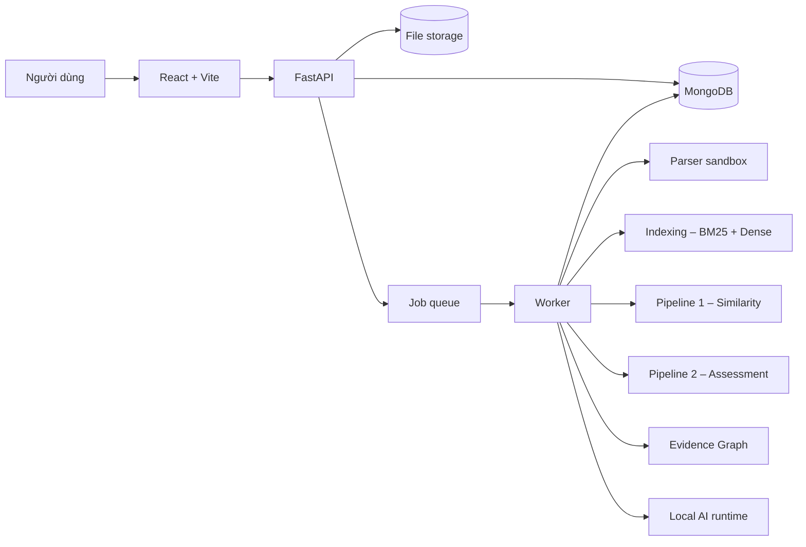

# Xây dựng hệ thống hỗ trợ kiểm tra đạo văn và đánh giá báo cáo sinh viên dựa trên bằng chứng

**Development of an Evidence-Grounded System for Plagiarism Checking and Student
Report Assessment**

Hệ thống hỗ trợ giảng viên kiểm tra tính tương đồng và đánh giá báo cáo sinh
viên theo hướng **local-first**, **evidence-first** và **human-in-the-loop**.

## Chức năng chính

1. **Xử lý và quản lý báo cáo** – Upload PDF/DOCX, nhận diện cấu trúc chương/
   mục/đoạn văn, chuẩn hóa và lập chỉ mục phục vụ truy xuất.
2. **Kiểm tra nội dung tương đồng** – Hybrid Retrieval (BM25 + Dense), RRF,
   re-ranking, phân loại dạng tương đồng (verbatim / paraphrase / summary) và
   Similarity Report.
3. **Đánh giá báo cáo dựa trên bằng chứng** – Rubric → Checklist → Evidence
   Retrieval (Local + Graph) → Verification → Rationale → Deterministic Scoring.
4. **Hỗ trợ giảng viên** – Lecturer Review, Feedback Log và báo cáo tổng hợp;
   Targeted Questions là hướng `CONDITIONAL`, chỉ mở sau khi hai pipeline chính
   đạt gate chất lượng và tiến độ.

> Kết quả AI chỉ là đề xuất hỗ trợ. Hệ thống không tự kết luận đạo văn và
> không tự công bố điểm.

## Trạng thái

Đã có [bản app chạy local](apps/web/README.md) nối web → API → worker →
[core MVP hai pipeline](research/core_mvp/README.md). Đây là một luồng tích hợp
để kiểm tra tính khả thi. Có thêm [authenticated MongoDB slice](docs/architecture/authenticated-mongo-app.md)
cho session/RBAC, rubric lifecycle và upload → durable PARSE worker → chunks.
Slice mới chưa nối INDEX/ANALYZE/result/review của hai pipeline; không phải
production release. Chất lượng hai pipeline chưa được xác nhận đủ để chấm
điểm hoặc kết luận đạo văn.

| Hạng mục                                  | Trạng thái                                                                                                      |
| ------------------------------------------- | ----------------------------------------------------------------------------------------------------------------- |
| Phạm vi đề tài                          | Đã chốt: 2 hướng chính (Similarity, Evidence-grounded Assessment) + Targeted Questions `CONDITIONAL` |
| SRS/Use Case tuần 1                        | Baseline v2.0 đã đồng bộ phạm vi; chờ review chéo và GVHD xác nhận                          |
| Product Backlog/WBS                         | WBS v1.11 có [audit W1–W11](docs/planning/W1-W11_STATUS_2026-10-22.md) và [bổ sung app Mongo/auth](docs/architecture/authenticated-mongo-app.md); chờ Q/Y review/ký baseline |
| C4/trust boundary/threat model (`W2.1`) | Đã review và merge vào `main` qua PR #5 |
| Cơ sở dữ liệu                           | Đã chọn MongoDB                                                                                                |
| MongoDB/provenance (`W2.2`) | Đã review và merge [ADR-001](docs/adr/ADR-001-mongodb-provenance-storage.md) cùng [data dictionary](docs/architecture/data-dictionary.md) qua PR #6 |
| API contract (`W2.3`) | Có [API Contract v1](docs/api/API_CONTRACT_V1.md) và [OpenAPI draft](docs/api/openapi-v1.yaml); YAML/$ref đã kiểm tra, chờ Yến review |
| Search/Vector Search | Baseline không phụ thuộc MongoDB Search; engine chỉ được chọn sau benchmark `G-03/W5` |
| Frontend, API, worker                       | Demo local chạy hai pipeline; chế độ authenticated có login/workspace/rubric UI và API upload/version/chunk với worker Mongo. Hai chế độ chưa nối thành một luồng end-to-end |
| Parser và chunking | Worker/runner gọi parser process riêng có wall/CPU/input/output budgets; stable provenance và synthetic golden có; vẫn cần corpus đủ đại diện |
| Citation context | Runner lưu marker/bibliography candidates với exact span và unknown/ambiguous status; không tự xác minh nguồn hay trừ similarity |
| MongoDB runtime/index | Có [Compose replica set](infra/mongodb/README.md), migrations 001–003, DB identities tách quyền; authenticated upload/PARSE/rubric đã dùng Mongo. Product index/analysis/lifecycle còn mở |
| Quality/browser tests | Unit, HTTP authorization, real-Mongo auth/rubric/PDF-DOCX provenance và Chromium local/mock-auth tests; [baseline CI](docs/benchmarks/w1-w11-hardening-2026-10-22.md) không thay thế CI của commit mới hoặc gold evaluation |
| Model local | `research-v0` chạy E5 và mMARCO revision đã khóa từ cache local; hiệu quả tổng quát vẫn cần đánh giá trên tập nhãn độc lập |
| Search Provider bên ngoài                 | `OUT OF SCOPE`; chỉ mở lại bằng change request được Q/Y/GVHD duyệt                                      |

## Kiến trúc dự kiến



- Frontend không kết nối trực tiếp MongoDB.
- API xử lý xác thực, phân quyền, nghiệp vụ ngắn và trả `run_id` cho tác vụ dài.
- Worker xử lý parse, indexing, retrieval, AI và thực nghiệm; không chạy model lớn trong HTTP request.
- **Pipeline 1** (Similarity): BM25 + Dense → RRF → Re-ranking → Classification → Similarity Report.
- **Pipeline 2** (Assessment): Rubric Compile → Checklist Classify → Evidence Retrieval (Local/Graph) → Verification → Rationale → Scoring.
- MongoDB là source of truth. Lexical/vector index là dữ liệu dẫn xuất có thể dựng lại.
- Search Provider không thuộc WBS 24 tuần; hệ thống chỉ truy xuất trên source
  corpus đã được nạp và duyệt quyền sử dụng.

## Cấu trúc thư mục

```text
.
├── apps/
│   └── web/                      # React + Vite + TypeScript
│       ├── src/
│       │   ├── app/              # Router, provider, bootstrap
│       │   ├── features/         # Auth, reports, similarity, rubrics,
│       │   │                     # analysis, review, questions, feedback
│       │   ├── components/       # UI dùng chung
│       │   ├── lib/              # API client, helpers
│       │   └── types/
│       └── tests/
├── services/
│   └── backend/                  # Một Python codebase, hai tiến trình
│       ├── src/kltn_ai/
│       │   ├── api/              # FastAPI routes/dependencies/errors
│       │   ├── core/             # Config, auth, logging, security
│       │   ├── db/               # Mongo client, validators, indexes
│       │   ├── modules/          # Nghiệp vụ theo feature
│       │   │   ├── auth/
│       │   │   ├── reports/
│       │   │   ├── references/  # quote/citation span core; DOI checker ngoài scope
│       │   │   ├── similarity/   # Pipeline 1 – tương đồng
│       │   │   ├── rubrics/
│       │   │   ├── assessment/   # Pipeline 2 – đánh giá bằng chứng
│       │   │   ├── reviews/
│       │   │   ├── questions/   # CONDITIONAL; chỉ mở sau core gate
│       │   │   ├── feedback/     # Feedback Log
│       │   │   ├── datasets/     # Metadata dataset thực nghiệm
│       │   │   └── analysis/     # Shared analysis logic
│       │   ├── integrations/     # Adapter parser, indexing, retrieval,
│       │   │   │                 # graph, local AI và storage
│       │   │   ├── parsing/
│       │   │   ├── indexing/     # BM25 + Dense Vector indexing
│       │   │   ├── retrieval/    # Hybrid Retrieval, RRF, re-ranking
│       │   │   ├── graph/        # Evidence Graph (HippoRAG-style)
│       │   │   ├── local_ai/
│       │   │   ├── storage/
│       │   └── worker/           # Task handlers, checkpoint, retry
│       └── tests/
├── research/                     # Nghiên cứu và thực nghiệm
│   ├── protocols/
│   │   ├── rq1-similarity/       # RQ1: Phát hiện tương đồng
│   │   ├── rq2-assessment/       # RQ2: Đánh giá dựa bằng chứng
│   │   └── rq3-questions/        # RQ3: Sinh câu hỏi — CONDITIONAL
│   ├── datasets/
│   │   ├── similarity/           # Cặp đoạn gán nhãn
│   │   ├── assessment/           # Báo cáo + rubric + labels
│   │   └── questions/            # Dataset RQ3 — CONDITIONAL
│   ├── configs/
│   ├── scripts/
│   ├── notebooks/
│   └── results/
├── tests/e2e/                    # Kiểm thử xuyên web–API–worker
├── infra/                        # Docker/MongoDB
├── docs/
│   ├── architecture/             # Kiến trúc phân lớp
│   ├── pipelines/                # Pipeline 1 & 2
│   ├── adr/
│   ├── data/
│   ├── threat-model/
│   └── week-01/                  # Hồ sơ tuần 1
├── scripts/                      # Bootstrap, lint, test, migration
├── var/                          # Upload, model, cache, log; không commit
├── .env.example
├── .editorconfig
└── .gitignore
```

## Thiết lập

Có [Compose MongoDB phát triển riêng](infra/mongodb/README.md). Cách chạy chế
độ mới ở [authenticated MongoDB app](docs/architecture/authenticated-mongo-app.md);
demo hai pipeline cũ vẫn độc lập. Cài dependency từ thư mục repo:

```bash
python3.12 -m venv .venv-research
.venv-research/bin/python -m pip install -r research/requirements-research.txt
.venv-research/bin/python -m pip install -r services/backend/requirements-app.txt
npm --prefix apps/web ci
```

Sau đó xem [cách phê duyệt nguồn và chạy API/worker](services/backend/README.md),
[cách mở giao diện](apps/web/README.md). API chỉ bind `127.0.0.1:8001`, web
chỉ bind `127.0.0.1:5173`; nguồn chưa xác nhận quyền dùng local bị chặn trước
khi tạo job. `bm25-smoke` kiểm tra luồng tích hợp nhanh, còn `research-v0` cần
các model revision đã khóa trong cache `var/models/hf-home`.

## Quy ước chính

- Không commit `.env`, secret, báo cáo thật, PII, model weight, cache hoặc log.
- File upload và mọi tài liệu nguồn luôn được xem là dữ liệu không tin cậy.
- Mọi kết quả AI phải lưu model/prompt/config version và evidence ID.
- Chỉ giảng viên có quyền mới được duyệt hoặc công bố kết quả.
- Logic thực nghiệm chính đặt trong script/config có version; notebook chỉ dùng khám phá.
- Thay đổi DB, provider, rubric, RQ hoặc phạm vi phải có ADR/change record.
- Branch, commit, pull request và review tuân theo
  [`CONTRIBUTING.md`](CONTRIBUTING.md); thay đổi vào `main` qua PR và cần thành
  viên còn lại approve.

## Tài liệu

- [Quy ước Git và review](CONTRIBUTING.md)
- [Product Backlog](docs/planning/PRODUCT_BACKLOG.md)
- [WBS và phân công theo 24 tuần](docs/planning/WBS_VA_PHAN_CONG.md)
- [Hồ sơ tuần 1](docs/week-01/README.md)
- [Đặc tả yêu cầu](docs/week-01/W1-03-dac-ta-yeu-cau-v1.md)
- [Bộ Use Case](docs/week-01/W1-04-bo-use-case.md)
- [Snapshot Backlog/WBS tuần 1 (lịch sử)](docs/week-01/W1-05-backlog-wbs.md)
- [Pipeline 1 – Similarity](docs/pipelines/pipeline-1-similarity.md)
- [Pipeline 2 – Assessment](docs/pipelines/pipeline-2-assessment.md)
- [Kiến trúc phân lớp](docs/architecture/layers.md)
- [C4 Context, Container và Deployment](docs/architecture/c4.md)
- [Data Flow và Trust Boundary](docs/architecture/data-flow.md)
- [Threat Model và Adversarial Test Plan v1](docs/threat-model/threat-model-v1.md)
