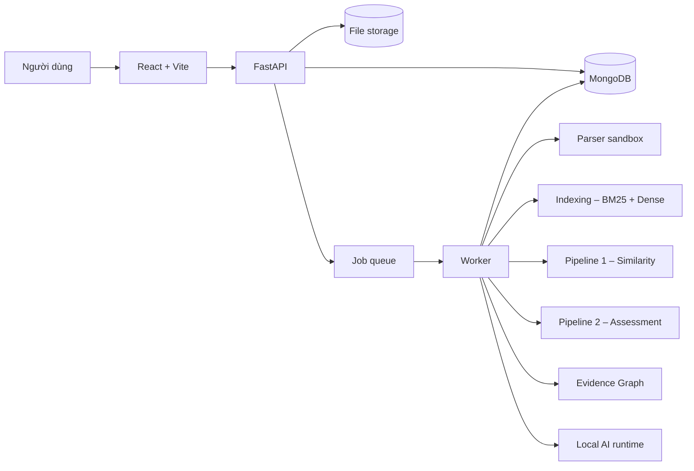

# Xây dựng hệ thống hỗ trợ kiểm tra đạo văn và đánh giá báo cáo sinh viên dựa trên bằng chứng

**Development of an Evidence-Grounded System for Plagiarism Checking and Student
Report Assessment**

Hệ thống hỗ trợ giảng viên kiểm tra tính tương đồng và đánh giá báo cáo sinh
viên theo hướng **local-first**, **evidence-first** và **human-in-the-loop**.

## Chức năng chính

1. **Xử lý và quản lý báo cáo** – Upload PDF/DOCX, nhận diện cấu trúc chương/
   mục/đoạn văn, chuẩn hóa và lập chỉ mục phục vụ truy xuất.
2. **Kiểm tra nội dung tương đồng** – BM25/Hybrid Retrieval, RRF, re-ranking
   và Similarity Report. Đã có khớp nguyên văn và tùy chọn NLI đề xuất
   paraphrase cho đoạn được so sánh; SUMMARY chưa triển khai.
3. **Đánh giá báo cáo dựa trên bằng chứng** – Rubric → Checklist → Evidence
   Retrieval (Local + Graph) → Verification → Rationale → Deterministic Scoring.
4. **Hỗ trợ giảng viên** – Lecturer Review, Feedback Log và báo cáo tổng hợp;
   Targeted Questions thuộc phạm vi phải hoàn thành, thực hiện sau khi hai
   pipeline có đầu ra issue/evidence phù hợp.

> Kết quả AI chỉ là đề xuất hỗ trợ. Hệ thống không tự kết luận đạo văn và
> không tự công bố điểm.

## Trạng thái

Đã có [bản app chạy local](apps/web/README.md) nối web → API → worker →
[core MVP hai pipeline](research/core_mvp/README.md). Đây là một luồng tích hợp
để kiểm tra tính khả thi. Có thêm [authenticated MongoDB slice](docs/architecture/authenticated-mongo-app.md)
cho session/RBAC, rubric lifecycle và upload → durable PARSE worker → chunks.
Đã nối tiếp [INDEX/ANALYZE/result/evidence/review](docs/architecture/version-locked-analysis-app.md)
cho cả hai pipeline, có real-Mongo/browser E2E; chưa phải production release.
Chất lượng hai pipeline chưa được xác nhận đủ để chấm
điểm hoặc kết luận đạo văn.

Ưu tiên hiện tại: [hoàn thành đúng phạm vi đề tài đã đăng ký](docs/planning/KE_HOACH_HOAN_THANH_PHAM_VI_DE_TAI.md),
song song [hoàn thiện bài báo nộp khoa](docs/paper/KE_HOACH_HOAN_THIEN_BAI_BAO.md).
Giữ đủ hai pipeline, graph quan hệ và hướng câu hỏi; không đổi đề tài để
khớp số liệu hiện có. Chọn cấu hình tốt hơn trên DEV làm luồng chính,
không bắt buộc GRAPH hoặc verifier hai bước phải chạy cho mọi checklist.
Bản thảo và DOCX nằm trong [docs/paper](docs/paper/); số liệu chính hiện là
diagnostic truy xuất nguồn/reranking của Pipeline 1, chưa phải đánh giá toàn
bộ hệ thống.
Đã bổ sung [đối chứng A5/A6 trên DEV1](docs/benchmarks/pan-pc-11-short-evidence-dev1-result.md):
đầu vào ngắn bỏ truncation bổ sung nhưng chưa cải thiện Recall@10; TEST0 còn giữ kín.

Đã chạy [đánh giá thăm dò P2 trên 15 bài SEFORA](docs/benchmarks/sefora-p2-single-reference-result-2026-11-07.md)
với nhãn tham chiếu một người có AI hỗ trợ: một bước khớp 37/45, hai bước
32/45, baseline luôn MET 42/45. Lượt chạy không có lỗi kỹ thuật nhưng chưa
chứng minh chất lượng hai bước tốt hơn; đây không phải gold đa giám khảo.

Ngày 08/11, đã thêm policy nghiên cứu giữ ngữ cảnh evidence theo source span,
runner DEV so không retrieval/LOCAL BM25 và công cụ tạo phiếu kiểm semantic
support. [Kiểm kê SEFORA và đầu vào](docs/benchmarks/p2-experiment-readiness-2026-11-08.md)
phân biệt nguyên liệu đã có với nhãn/phương pháp còn thiếu. Graph quan hệ và
mức rubric vẫn chưa hoàn thiện; không dùng structure PPR thay kết quả GRAPH.
Lượt [DEV mới đã hoàn tất](docs/benchmarks/sefora-p2-context-retrieval-dev-2026-11-08.md):
không retrieval khớp 35/45, LOCAL BM25 32/45, không có lỗi kỹ thuật; chưa
cải thiện so với một bước cũ 37/45. Biến thể mới chưa được chọn làm mặc định;
semantic support còn chờ phiếu kiểm, không suy từ 149 proof đúng tọa độ.

Đợt [sửa và đo đầu ra ngày 29/10](docs/benchmarks/output-quality-development-2026-10-29.md)
bổ sung NLI hai chiều cho P1 và verifier từ vựng/ngữ cảnh V4 cho P2. Bộ ca do
trợ lý soạn phục vụ phát triển, chưa phải gold do người gán nhãn độc lập;
kết quả được ghi riêng với thực nghiệm PAN trong bài báo.

Ngày 02/11 đã [nhận và đối chiếu hai phiếu SEFORA](docs/benchmarks/sefora-p2-return-review-2026-11-02.md),
mỗi phiếu 60 mục cho 10 bài. Còn 25 `UNSURE` và mapping/checklist cần chốt;
chưa có gold hoặc metric chấm rubric SEFORA.

Ngày 03/11 bổ sung [verifier LLM local cho P2](docs/architecture/p2-local-llm-verifier.md)
với profile riêng `bm25-p2-llm-v1`: Qwen3.5 4B Q4_K_M đọc yêu cầu/bằng chứng,
code kiểm proof và tính điểm. Đã có smoke bằng model thật; chưa có đánh giá
chất lượng trên gold độc lập. V4 và các số liệu PAN/QASPER giữ nguyên.

Ngày 05/11 đã chuẩn bị hai phiếu mới, mỗi người 45 mục trên 15 bài Class_2,
và [công cụ nhận Excel, evidence vắng mặt, đối chứng P2](docs/benchmarks/p2-readiness-2026-11-05.md).
Bộ so sánh dùng cùng evidence đầu vào và giới hạn trích dẫn cho cả hai
phương pháp. Sau lượt một tham chiếu 07/11 và rà soát lỗi, 15 bài này dùng
làm DEV cho thay đổi mới; lượt đã khóa giữ nguyên. Đánh giá tiếp theo cần
tập chưa dùng sửa phương pháp; nhãn một tham chiếu không tự thành gold đa giám khảo.

| Hạng mục                                  | Trạng thái                                                                                                      |
| ------------------------------------------- | ----------------------------------------------------------------------------------------------------------------- |
| Phạm vi đề tài                          | Giữ mô tả đăng ký: 2 hướng chính (Similarity, Evidence-grounded Assessment) + Targeted Questions phải hoàn thành; xem [đối chiếu yêu cầu và khoảng trống](docs/planning/KE_HOACH_HOAN_THANH_PHAM_VI_DE_TAI.md) |
| SRS/Use Case tuần 1                        | Baseline v2.0 đã đồng bộ phạm vi; chờ review chéo và GVHD xác nhận                          |
| Product Backlog/WBS                         | WBS v1.13 có [audit W1–W11](docs/planning/W1-W11_STATUS_2026-10-22.md), app Mongo và [item review/gold evaluation](docs/architecture/item-review-and-gold-evaluation.md); chờ review/ký baseline |
| C4/trust boundary/threat model (`W2.1`) | Đã review và merge vào `main` qua PR #5 |
| Cơ sở dữ liệu                           | Đã chọn MongoDB                                                                                                |
| MongoDB/provenance (`W2.2`) | Đã review và merge [ADR-001](docs/adr/ADR-001-mongodb-provenance-storage.md) cùng [data dictionary](docs/architecture/data-dictionary.md) qua PR #6 |
| API contract (`W2.3`) | Có [API Contract v1](docs/api/API_CONTRACT_V1.md) và [OpenAPI draft](docs/api/openapi-v1.yaml); YAML/$ref đã kiểm tra, chờ Yến review |
| Search/Vector Search | Baseline không phụ thuộc MongoDB Search; engine chỉ được chọn sau benchmark `G-03/W5` |
| Frontend, API, worker                       | Authenticated web → upload/PARSE/INDEX/ANALYZE workers → hai báo cáo/evidence → review/export đã chạy Mongo thật; demo local cũ vẫn riêng |
| Parser và chunking | Worker/runner gọi parser process riêng có wall/CPU/input/output budgets; stable provenance và synthetic golden có; vẫn cần corpus đủ đại diện |
| Citation context | Runner lưu marker/bibliography candidates với exact span và unknown/ambiguous status; không tự xác minh nguồn hay trừ similarity |
| MongoDB runtime/index | Migrations 001–007; 006/007 bổ sung profile NLI v1/v2. Private BM25/E5 artifacts và Mongo generation/head; run/results/evidence version-locked, item review append-only. Graph/lifecycle/backup còn mở |
| Quality/browser tests | Unit, HTTP authorization, real-Mongo auth/rubric/PDF-DOCX provenance và Chromium local/mock-auth tests; [baseline CI](docs/benchmarks/w1-w11-hardening-2026-10-22.md) không thay thế CI của commit mới hoặc gold evaluation |
| Model local | `research-v0` chạy E5 và mMARCO; `bm25-nli-v2`/`rrf-nli-v2` dùng mDeBERTa NLI trên MPS, RRF thêm E5 trên CPU và không có relevance reranker. Model revisions khóa từ cache local; chưa có đánh giá tổng quát trên nhãn độc lập |
| Search Provider bên ngoài                 | `OUT OF SCOPE`; chỉ mở lại bằng change request được Q/Y/GVHD duyệt                                      |

## Kiến trúc dự kiến



- Frontend không kết nối trực tiếp MongoDB.
- API xử lý xác thực, phân quyền, nghiệp vụ ngắn và trả `run_id` cho tác vụ dài.
- Worker xử lý parse, indexing, retrieval, AI và thực nghiệm; không chạy model lớn trong HTTP request.
- **Pipeline 1** (Similarity): BM25 + Dense → RRF → Re-ranking → Classification → Similarity Report.
- **Pipeline 2** (Assessment): Rubric Compile → Checklist Classify → Evidence Retrieval (Local/Graph) → Verification → Rationale → Scoring.
- MongoDB là source of truth. Lexical/vector index là dữ liệu dẫn xuất có thể dựng lại.
- Search Provider không thuộc WBS 24 tuần; hệ thống chỉ truy xuất trên source
  corpus đã được nạp và duyệt quyền sử dụng.

## Cấu trúc thư mục

```text
.
├── apps/
│   └── web/                      # React + Vite + TypeScript
│       ├── src/
│       │   ├── app/              # Router, provider, bootstrap
│       │   ├── features/         # Auth, reports, similarity, rubrics,
│       │   │                     # analysis, review, questions, feedback
│       │   ├── components/       # UI dùng chung
│       │   ├── lib/              # API client, helpers
│       │   └── types/
│       └── tests/
├── services/
│   └── backend/                  # Một Python codebase, hai tiến trình
│       ├── src/kltn_ai/
│       │   ├── api/              # FastAPI routes/dependencies/errors
│       │   ├── core/             # Config, auth, logging, security
│       │   ├── db/               # Mongo client, validators, indexes
│       │   ├── modules/          # Nghiệp vụ theo feature
│       │   │   ├── auth/
│       │   │   ├── reports/
│       │   │   ├── references/  # quote/citation span core; DOI checker ngoài scope
│       │   │   ├── similarity/   # Pipeline 1 – tương đồng
│       │   │   ├── rubrics/
│       │   │   ├── assessment/   # Pipeline 2 – đánh giá bằng chứng
│       │   │   ├── reviews/
│       │   │   ├── questions/   # Hướng bổ sung trong phạm vi; chưa triển khai
│       │   │   ├── feedback/     # Feedback Log
│       │   │   ├── datasets/     # Metadata dataset thực nghiệm
│       │   │   └── analysis/     # Shared analysis logic
│       │   ├── integrations/     # Adapter parser, indexing, retrieval,
│       │   │   │                 # graph, local AI và storage
│       │   │   ├── parsing/
│       │   │   ├── indexing/     # BM25 + Dense Vector indexing
│       │   │   ├── retrieval/    # Hybrid Retrieval, RRF, re-ranking
│       │   │   ├── graph/        # Evidence Graph (HippoRAG-style)
│       │   │   ├── local_ai/
│       │   │   ├── storage/
│       │   └── worker/           # Task handlers, checkpoint, retry
│       └── tests/
├── research/                     # Nghiên cứu và thực nghiệm
│   ├── protocols/
│   │   ├── rq1-similarity/       # RQ1: Phát hiện tương đồng
│   │   ├── rq2-assessment/       # RQ2: Đánh giá dựa bằng chứng
│   │   └── rq3-questions/        # RQ3: Sinh câu hỏi; cần output hai pipeline
│   ├── datasets/
│   │   ├── similarity/           # Cặp đoạn gán nhãn
│   │   ├── assessment/           # Báo cáo + rubric + labels
│   │   └── questions/            # Dataset đánh giá câu hỏi; cần xây dựng
│   ├── configs/
│   ├── scripts/
│   ├── notebooks/
│   └── results/
├── tests/e2e/                    # Kiểm thử xuyên web–API–worker
├── infra/                        # Docker/MongoDB
├── docs/
│   ├── architecture/             # Kiến trúc phân lớp
│   ├── pipelines/                # Pipeline 1 & 2
│   ├── adr/
│   ├── data/
│   ├── threat-model/
│   └── week-01/                  # Hồ sơ tuần 1
├── scripts/                      # Bootstrap, lint, test, migration
├── var/                          # Upload, model, cache, log; không commit
├── .env.example
├── .editorconfig
└── .gitignore
```

## Thiết lập

Có [Compose MongoDB phát triển riêng](infra/mongodb/README.md). Cách chạy chế
độ mới ở [authenticated MongoDB app](docs/architecture/authenticated-mongo-app.md);
demo hai pipeline cũ vẫn độc lập. Cài dependency từ thư mục repo:

```bash
python3.12 -m venv .venv-research
.venv-research/bin/python -m pip install -r research/requirements-research.txt
.venv-research/bin/python -m pip install -r services/backend/requirements-app.txt
npm --prefix apps/web ci
```

Sau đó xem [cách phê duyệt nguồn và chạy API/worker](services/backend/README.md),
[cách mở giao diện](apps/web/README.md). API chỉ bind `127.0.0.1:8001`, web
chỉ bind `127.0.0.1:5173`; nguồn chưa xác nhận quyền dùng local bị chặn trước
khi tạo job. `bm25-smoke` kiểm tra luồng tích hợp nhanh, còn `research-v0` cần
các model revision đã khóa trong cache `var/models/hf-home`.
Hai profile `bm25-nli-v2` và `rrf-nli-v2` cũng cần model trong cache và GPU
Apple hỗ trợ MPS; không tự chuyển sang CPU khi thiếu MPS. P2 trong hai profile
này giữ truy xuất BM25 và verifier V4, không dùng NLI của P1 để chấm rubric.

## Quy ước chính

- Không commit `.env`, secret, báo cáo thật, PII, model weight, cache hoặc log.
- File upload và mọi tài liệu nguồn luôn được xem là dữ liệu không tin cậy.
- Mọi kết quả AI phải lưu model/prompt/config version và evidence ID.
- Chỉ giảng viên có quyền mới được duyệt hoặc công bố kết quả.
- Logic thực nghiệm chính đặt trong script/config có version; notebook chỉ dùng khám phá.
- Thay đổi DB, provider, rubric, RQ hoặc phạm vi phải có ADR/change record.
- Branch, commit, pull request và review tuân theo
  [`CONTRIBUTING.md`](CONTRIBUTING.md); thay đổi vào `main` qua PR và cần thành
  viên còn lại approve.

## Tài liệu

- [Quy ước Git và review](CONTRIBUTING.md)
- [Product Backlog](docs/planning/PRODUCT_BACKLOG.md)
- [Mô tả đề tài gốc](docs/planning/MO_TA_DE_TAI_GOC.md)
- [Kế hoạch hoàn thành đủ phạm vi](docs/planning/KE_HOACH_HOAN_THANH_PHAM_VI_DE_TAI.md)
- [WBS và phân công theo 24 tuần](docs/planning/WBS_VA_PHAN_CONG.md)
- [Hồ sơ tuần 1](docs/week-01/README.md)
- [Đặc tả yêu cầu](docs/week-01/W1-03-dac-ta-yeu-cau-v1.md)
- [Bộ Use Case](docs/week-01/W1-04-bo-use-case.md)
- [Snapshot Backlog/WBS tuần 1 (lịch sử)](docs/week-01/W1-05-backlog-wbs.md)
- [Pipeline 1 – Similarity](docs/pipelines/pipeline-1-similarity.md)
- [Pipeline 2 – Assessment](docs/pipelines/pipeline-2-assessment.md)
- [Kiến trúc phân lớp](docs/architecture/layers.md)
- [C4 Context, Container và Deployment](docs/architecture/c4.md)
- [Data Flow và Trust Boundary](docs/architecture/data-flow.md)
- [Threat Model và Adversarial Test Plan v1](docs/threat-model/threat-model-v1.md)
