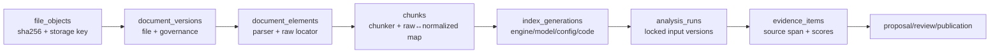

# ADR-001 — MongoDB, provenance, file storage và derived index

- **Trạng thái:** Accepted — design baseline
- **Ngày:** 10/09/2026
- **Ngày phê duyệt:** 10/09/2026
- **WBS:** `W2.2`
- **Owner:** Nguyễn Trần Ngọc Quý (Q)
- **Reviewer:** Võ Thị Kim Yến (Y)
- **Phụ thuộc:** `W2.1`

## 1. Quyết định tóm tắt

Baseline dùng **MongoDB Community 8.0.x, pin patch version khi hiện thực ở
`W3.1`, chạy bằng Docker Compose dưới dạng single-node replica set `rs0`** trên
máy được kiểm soát. Đây là deployment phát triển/demo local-first, không phải
high availability production.

MongoDB là source of truth cho identity, scope, metadata, version, lifecycle,
governance, job, run, evidence, review và audit. File gốc/artifact lớn nằm ở
local file volume qua storage adapter. Lexical/vector index là artifact dẫn
xuất, có generation và có thể rebuild; baseline không phụ thuộc `mongot` hay
Atlas Search. Evidence graph v1 lưu node/edge dẫn xuất trong MongoDB để tránh
thêm một database trên máy 16 GB.

Mọi đường đọc để phân tích phải thỏa đồng thời:

```text
lifecycle_state = ACTIVE
AND processing_state = READY
AND governance_state = APPROVED
AND purpose được cho phép
AND workspace/role scope hợp lệ
AND tombstone không tồn tại
```

Thiếu một điều kiện phải fail closed trước retrieval, index hoặc experiment.

## 2. Bối cảnh và ràng buộc

`W2.1` đã xác định MongoDB là source of truth và index là derived artifact.
`W2.2` phải khóa các quyết định còn mở về deployment, collection/reference,
provenance, transaction, file storage, job persistence, migration, rebuild và
delete cascade trước khi viết API contract ở `W2.3`.

Ràng buộc hiện hành:

- hai máy phát triển có RAM 16 GB; baseline phải chạy local và có thể demo
  offline;
- parser/chunker hiện là prototype, API/worker/MongoDB chưa được hiện thực;
- báo cáo sinh viên và evidence là `RESTRICTED`;
- dataset công khai vẫn phải qua rights/purpose/retention/approver gate;
- API và worker là hai process, không được dùng chung quyền database admin;
- file, chunk, index, run và evidence phải truy được về đúng input/config;
- xóa/revoke phải chặn sử dụng ngay, dù cleanup vật lý chạy bất đồng bộ.

## 3. Phương án đã xem xét

### 3.1. MongoDB standalone

Ưu điểm là cấu hình ít. Nhược điểm là không phù hợp transaction nhiều
collection và không tạo baseline gần với topology cần cho change stream hoặc
backup oplog. Không chọn.

### 3.2. Single-node replica set bằng Docker Compose

Cho môi trường tái lập, hỗ trợ transaction và oplog nhưng chỉ tốn một tiến
trình `mongod`. Không có HA; chấp nhận được cho phát triển/demo. **Được chọn.**

### 3.3. Atlas hoặc `atlas-local` kèm Search/Vector Search

Giảm công tự dựng search hoặc cho phép thử `$search`/`$vectorSearch`. Đổi lại,
baseline phụ thuộc thêm `mongot`, RAM và packaging; `atlas-local` được MongoDB
mô tả cho development/testing, không phải production target. Không chọn làm
baseline. Có thể benchmark như candidate ở `G-03/W5`.

### 3.4. Replica set ba node

Phù hợp HA hơn nhưng ba member trên cùng laptop không tạo fault isolation thực
và tăng RAM/disk. Chỉ xem xét khi deployment thật chuyển sang nhiều host.

### 3.5. GridFS cho mọi file

Giúp file nằm cùng hệ MongoDB nhưng làm database/backup lớn, parser phải thêm
lớp stream/materialize và không giải quyết transaction xuyên file–metadata.
Không chọn cho baseline. GridFS vẫn là implementation option sau benchmark nếu
local file volume không đáp ứng deployment mục tiêu.

## 4. Quyết định deployment

| Hạng mục | Quyết định |
|---|---|
| MongoDB | Community 8.0.x, pin digest/patch trong Compose ở `W3.1` |
| Topology | Single-node replica set `rs0` |
| Runtime | Docker Compose trên controlled host |
| Exposure | Docker internal network; host access chỉ `127.0.0.1` khi dev cần |
| Database | `kltn_plagiarism_assessment` |
| Read preference | `primary` cho luồng nghiệp vụ |
| Write concern | `majority` ở transaction/ghi authoritative |
| Search | Tắt mặc định; không giả định image `mongod` có Search/Vector Search |
| Graph | Collection MongoDB dẫn xuất, bounded traversal ở application |
| File | Local persistent volume qua storage adapter; MongoDB chỉ giữ metadata |
| Queue v1 | Collection `jobs`, claim bằng atomic `findOneAndUpdate` + lease |
| Backup | Mongo dump có oplog hoặc maintenance window; file snapshot cùng manifest |

Single-node replica set cung cấp transaction nhưng **không cung cấp HA**.
`majority` trên một data-bearing member không thay thế backup. Nếu demo qua LAN
hoặc deploy nhiều host, phải có deployment/security ADR mới.

### 4.1. Identity và least privilege

Không lưu credential trong Git hoặc client bundle. `W3.1` phải tạo ít nhất:

| Identity | Quyền dự kiến | Không được phép |
|---|---|---|
| `api_app` | Metadata nghiệp vụ ngắn, enqueue, review/publish theo repository | Schema migration, backup, đọc file volume trực tiếp, tự ghi AI result |
| `worker_app` | Claim job; ghi parse/chunk/index/run/evidence | Quản lý user/role, publish, migration, backup |
| `migration_app` | `collMod`, index, backfill và migration ledger | Dùng làm runtime credential |
| `backup_app` | Quyền tối thiểu cho backup/restore procedure | Dùng bởi API/worker |

MongoDB role chỉ là một lớp. Repository vẫn phải authorize actor + workspace +
purpose vì database không tự hiểu quyền nghiệp vụ.

## 5. Quyết định lưu trữ

| Nhóm dữ liệu | Nơi lưu authoritative | Lý do |
|---|---|---|
| User/workspace/membership | MongoDB | Scope và RBAC query được |
| Document/version/governance | MongoDB | Version/lifecycle và decision có transaction |
| Bytes PDF/DOCX/model/export lớn | File volume | Parser đọc thuận tiện; không làm phình document/database |
| Element/chunk/normalized text | MongoDB | Query theo version/scope và provenance |
| Rubric/version | MongoDB | Publish version bất biến |
| Job/run/evidence/review/audit | MongoDB | State transition và traceability |
| Lexical/vector artifact | Derived index volume qua adapter | Rebuildable, benchmark engine độc lập |
| Graph node/edge v1 | MongoDB, đánh dấu derived | Không thêm graph DB ở baseline |

Storage key do server sinh, không dùng filename hoặc path client gửi. Checksum
SHA-256 bắt buộc; không deduplicate file nhạy cảm xuyên workspace chỉ dựa trên
hash vì có thể làm lộ việc hai bên sở hữu cùng nội dung.

### 5.1. Commit file và metadata

MongoDB không transaction được với local filesystem. Upload dùng saga có thể
khôi phục:

1. ghi bytes vào quarantine bằng random temporary key;
2. kiểm size, magic/MIME và tính SHA-256;
3. `fsync` rồi atomic rename sang immutable storage key;
4. trong Mongo transaction, tạo `file_objects`, `document_versions`, audit và
   parse job bằng ID/idempotency key do server tạo;
5. nếu transaction fail, orphan sweeper chỉ xóa file không có metadata sau grace
   period; nếu file mất/checksum sai, version chuyển fail closed;
6. không sửa bytes tại storage key đã commit; nội dung mới tạo version/file mới.

## 6. Collection và reference

Data dictionary chuẩn nằm tại
[`data-dictionary.md`](../architecture/data-dictionary.md). Các nhóm collection:

- identity/scope: `users`, `workspaces`, `memberships`;
- document: `documents`, `document_versions`, `file_objects`,
  `document_elements`, `chunks`;
- governance/research: `governance_records`, `dataset_manifests`,
  `dataset_memberships`;
- rubric: `rubrics`, `rubric_versions`;
- processing/index: `jobs`, `index_generations`, `graph_nodes`, `graph_edges`;
- result/review: `analysis_runs`, `evidence_items`, `assessment_proposals`,
  `reviews`, `publications`;
- lifecycle/ops: `deletion_requests`, `tombstones`, `audit_events`,
  `schema_migrations`.

Reference dùng BSON `ObjectId`, không dùng MongoDB DBRef. Protected collections
denormalize `workspace_id` để mọi query có thể scope trước khi lấy content.
Reference integrity xuyên collection được giữ bởi repository + transaction +
reconciliation job; MongoDB JSON Schema chỉ kiểm được shape/type trong một
document, không thay foreign key.

## 7. Quy ước schema và invariant

Mọi authoritative document có:

```text
_id, schema_version, created_at, created_by
```

Document mutable thêm:

```text
updated_at, updated_by, revision
```

Quy ước bắt buộc:

- timestamp là BSON UTC Date; thời gian hiển thị mới đổi timezone;
- SHA-256 là lowercase hex 64 ký tự;
- enum phải nằm trong validator và domain type;
- không chấp nhận Mongo operator hoặc field tùy ý từ request client;
- write mutable dùng compare-and-set với `revision`;
- immutable version đã được run/publication tham chiếu không sửa tại chỗ;
- content và PII không xuất hiện trong operational log/audit before-after;
- schema validator dùng `$jsonSchema`, `validationLevel: strict` và
  `validationAction: error` sau khi backfill đạt.

## 8. Provenance chain bắt buộc



Một run hợp lệ phải khóa tối thiểu:

- report/source `document_version_id` và content checksum;
- parser/chunker name, version và config hash;
- index generation/engine/config; embedding/reranker model checksum nếu dùng;
- rubric/model/prompt/config version;
- code commit, dependency/container digest;
- dataset manifest/split, metric implementation và seed khi là experiment;
- hardware profile không chứa serial number;
- evidence locator resolve về đúng raw version.

Nếu lineage thiếu hoặc generation đã stale/revoked/tombstoned, không được ghép
artifact cũ vào run mới.

## 9. Derived index và rebuild

`index_generations` là registry authoritative cho artifact dẫn xuất. State:

```text
PLANNED → BUILDING → READY → ACTIVE → SUPERSEDED
                    ↘ FAILED
ACTIVE/SUPERSEDED → DELETING → DELETED
```

Quy tắc:

1. generation key được tạo từ corpus/source versions + parser/chunker + engine
   + model/config + code version;
2. build vào generation mới, không ghi đè generation đang active;
3. kiểm đủ count/checksum/scope/leakage rồi mới `READY`;
4. transaction chỉ cho một generation `ACTIVE` trên cùng workspace, corpus
   scope và index kind;
5. run khóa generation ID; old generation chỉ xóa khi không còn run cần giữ
   theo retention;
6. rebuild bắt đầu từ MongoDB/file source of truth, không dùng index cũ làm
   nguồn;
7. query luôn kèm workspace, purpose và allowed source/version trước rank;
8. MongoDB Search/Vector Search chỉ được bật sau benchmark + resource/security
   review; không đổi domain schema.

## 10. Job queue v1

Để giảm thêm Redis/RabbitMQ trên máy 16 GB, baseline dùng collection `jobs`:

- payload chỉ chứa `job_type`, immutable resource/run reference và config ID;
- unique idempotency key ngăn enqueue trùng;
- worker claim atomically bằng `findOneAndUpdate` trên job `QUEUED` hoặc lease
  hết hạn;
- `lease_owner`, `lease_expires_at`, heartbeat và `attempt` cho recovery;
- retry hữu hạn với `available_at`; lỗi cuối dùng error code an toàn;
- worker reload workspace/owner/version/governance từ MongoDB sau khi claim;
- job không chứa file content, prompt, evidence text hoặc credential.

Chỉ chuyển sang queue chuyên dụng nếu load/restart benchmark ở `W3.6/G-03`
cho thấy polling MongoDB không đạt latency/durability cần thiết.

## 11. Lifecycle, retention và delete cascade

Tách hai trục để tránh state tổ hợp:

- `processing_state`: `QUARANTINED`, `QUEUED`, `PARSING`, `PARSED`,
  `INDEXING`, `READY`, `FAILED`;
- `lifecycle_state`: `ACTIVE`, `ARCHIVED`, `TOMBSTONED`, `PURGING`, `PURGED`.

Governance có state riêng: `PENDING`, `APPROVED`, `REJECTED`, `REVOKED`,
`EXPIRED`.

Delete/revoke flow:

1. transaction xác minh authority/hold rồi tạo `tombstones` và đổi root sang
   `TOMBSTONED`;
2. mọi read/retrieval/job mới bị chặn ngay;
3. cancel queued job, running job fail closed tại checkpoint;
4. deletion worker purge file, element, chunk, index, graph, evidence, result,
   cache và export trong scope;
5. audit/deletion report chỉ giữ ID, actor, reason code, count/checksum cần thiết,
   không giữ nội dung đã xóa;
6. backup record lưu thời điểm hết hạn; restore bắt buộc reapply tombstone trước
   khi service active;
7. verification query chứng minh ID/span không còn retrieval được rồi mới
   chuyển `PURGED`.

TTL chỉ dùng cho dữ liệu tạm như expired lease/session hoặc operational event
được policy cho phép. TTL chạy nền và không bảo đảm xóa tức thời, nên không dùng
TTL làm cơ chế duy nhất cho privacy deletion.

Retention duration, legal/research hold, deletion authority/SLA và backup aging
phải được GVHD/data owner chốt ở `W2.6.3`; default hiện tại là không ingest dữ
liệu thật khi thiếu các trường đó.

## 12. Migration, validation và index management

Migration là forward-only, idempotent và có ID duy nhất trong
`schema_migrations`:

1. backup hoặc checkpoint được ghi;
2. tạo validator mới ở `warn/moderate` nếu dữ liệu cũ cần backfill;
3. query invalid documents, backfill theo batch có resume cursor;
4. verify count/invariant/checksum;
5. chuyển validator sang `strict/error`;
6. tạo index có tên ổn định, so sánh spec thực tế với manifest;
7. chỉ cập nhật migration ledger sau verification;
8. rollback dữ liệu dùng restore/compensating migration, không tự động drop.

Migration không được `drop collection/index` hoặc rewrite content hàng loạt mà
không có dry-run, backup và approval. CI phải kiểm tra duplicate trước khi tạo
unique index.

## 13. Backup và restore

Backup unit gồm:

- MongoDB dump đầy đủ có oplog hoặc maintenance window chặn write;
- file volume manifest gồm storage key, size và SHA-256;
- config/schema/index manifest và code commit;
- key/secret handling record; không đóng secret vào archive.

Lexical/vector/graph index có thể không backup nếu rebuild test đạt và manifest
đủ. Restore chỉ được coi thành công sau khi:

1. MongoDB và file checksum khớp;
2. reference reconciliation không có file/version mồ côi;
3. tombstone/revocation được reapply;
4. scoped retrieval không trả dữ liệu đã xóa;
5. một smoke run resolve được provenance end-to-end.

RPO/RTO và mã hóa backup còn chờ `OQ-08/OQ-17`; không tuyên bố production
readiness trước restore drill ở `W24.2`.

## 14. Acceptance tests kéo sang implementation

| ID | Test | Pass condition |
|---|---|---|
| `AT-W22-01` | Clean Compose init | Replica set healthy; version pin; không dùng default secret |
| `AT-W22-02` | Network/identity | Browser/LAN không vào DB; API/worker không dùng credential của nhau |
| `AT-W22-03` | Schema/operator injection | Invalid BSON/operator bị chặn; không bypass validator/repository |
| `AT-W22-04` | Idempotent upload/job | Cùng key không tạo version/job/artifact kép |
| `AT-W22-05` | CAS/state transition | Stale revision/out-of-order update trả conflict, không ghi đè |
| `AT-W22-06` | Provenance resolve | Evidence resolve đúng file/version/span/config/checksum |
| `AT-W22-07` | Governance gate | Thiếu rights/purpose/retention/approver bị chặn trước index/run |
| `AT-W22-08` | Generation rebuild | Rebuild từ source tạo count/checksum đúng và atomic activate |
| `AT-W22-09` | Queue restart | Lease hết hạn được reclaim hữu hạn, không commit artifact kép |
| `AT-W22-10` | Tombstone cascade | Chặn ngay; cleanup và verification không còn retrieval |
| `AT-W22-11` | Backup/restore | Restore khớp checksum và không làm sống lại tombstone |
| `AT-W22-12` | Cross-workspace query | Không content/candidate/evidence ngoài scope trước hoặc sau rank |

## 15. Hệ quả và rủi ro

### Tích cực

- đủ transaction và queue lease mà không thêm nhiều service;
- tách source of truth khỏi index để benchmark engine độc lập;
- provenance và delete cascade trở thành schema-level contract;
- phù hợp local-first và giới hạn RAM hiện tại;
- W2.3 có reference/state rõ để thiết kế API.

### Đánh đổi

- single node không có HA;
- transaction không bao trùm local filesystem, cần saga/reconciler;
- application phải giữ reference integrity và purpose-based authorization;
- Mongo queue dùng polling, chưa chắc phù hợp tải lớn;
- graph traversal bằng Mongo/application chỉ là baseline;
- search/vector engine chưa được promotion cho đến benchmark.

## 16. Điều kiện xem xét lại

Tạo ADR thay thế khi:

- deployment chuyển từ localhost sang LAN/Internet hoặc nhiều host;
- cần HA/RPO/RTO mà single node không đáp ứng;
- benchmark chứng minh Mongo queue, graph hoặc derived index adapter không đạt;
- chọn Atlas/Search/Vector Search hoặc external engine;
- file volume không đáp ứng backup/deployment;
- quyền/retention yêu cầu encryption hoặc deletion khác baseline.

## 17. Nguồn kỹ thuật

- [MongoDB — Deploy a self-managed replica set](https://www.mongodb.com/docs/manual/tutorial/deploy-replica-set/)
- [MongoDB — Replication, transactions và change streams](https://www.mongodb.com/docs/manual/replication/)
- [MongoDB — JSON Schema validation](https://www.mongodb.com/docs/manual/core/schema-validation/specify-json-schema/)
- [MongoDB — Partial indexes](https://www.mongodb.com/docs/manual/core/index-partial/)
- [MongoDB — TTL indexes](https://www.mongodb.com/docs/manual/core/index-ttl/)
- [MongoDB — `mongodump --oplog`](https://www.mongodb.com/docs/database-tools/mongodump/)
- [MongoDB — Search/Vector Search self-managed](https://www.mongodb.com/docs/search/self-managed/current/)

## 18. Review record

- [x] Owner hoàn thành decision, alternatives, consequence và test contract.
- [x] Có deployment, file storage, queue và index/rebuild decision.
- [x] Có provenance, migration, retention/tombstone/cascade design.
- [x] Yến review collection/scope/data-rights và phê duyệt trên PR #6 ngày
  10/09/2026; nhận xét về quan hệ `document_elements → chunks` đã được xử lý
  trong Data Dictionary v0.2.
- [ ] `W2.6.3` xác nhận retention/authority/SLA với data owner/GVHD.
- [ ] `W3.1` chạy clean Compose/init/index smoke test.

| Vai trò | Họ tên | Quyết định | Ngày | Evidence |
|---|---|---|---|---|
| Owner | Nguyễn Trần Ngọc Quý | Đề xuất review | 10/09/2026 | Branch `docs/w2-2-mongodb-provenance-adr` |
| Reviewer | Võ Thị Kim Yến | Phê duyệt design baseline | 10/09/2026 | [PR #6 — APPROVED](https://github.com/ngwine/evidence-grounded-report-assessment/pull/6) |
