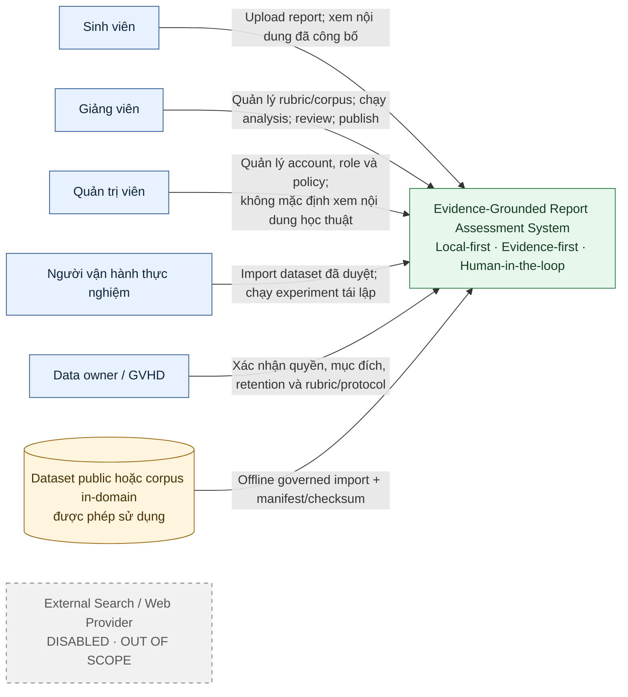
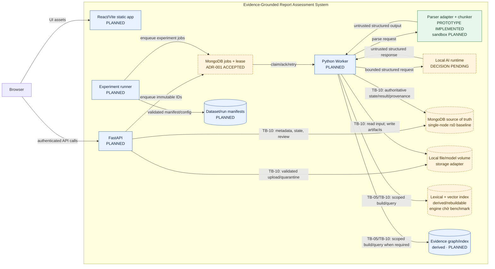
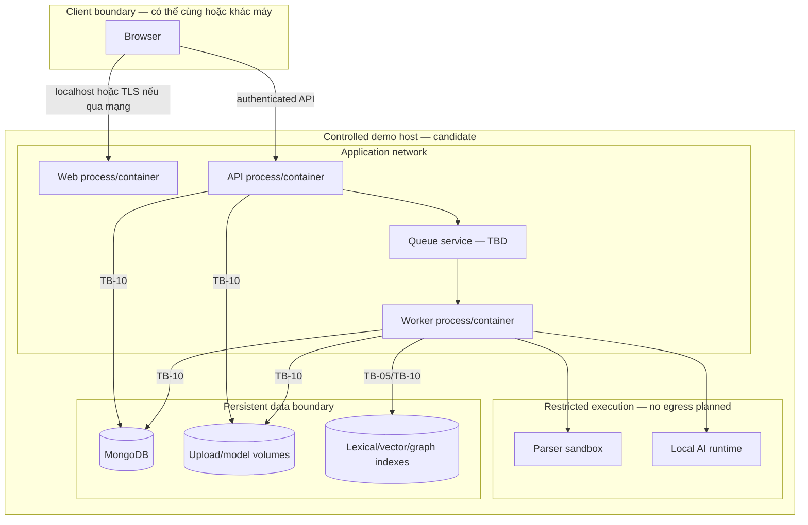

# W2.1 — C4 Context, Container và Deployment

| Thuộc tính | Giá trị |
|---|---|
| Phiên bản | 0.1 |
| Ngày | 03/09/2026 |
| Trạng thái | REVIEW CANDIDATE — chưa được reviewer phê duyệt |
| WBS | `W2.1` |
| Owner | Nguyễn Trần Ngọc Quý (Q) |
| Reviewer | Võ Thị Kim Yến (Y) |

## 1. Mục đích

C4 xác định ranh giới và trách nhiệm của hệ thống trước khi khóa MongoDB ở
`W2.2` và API ở `W2.3`. Tài liệu này giúp nhóm:

1. thống nhất actor nào được làm gì và thành phần nào xử lý từng bước;
2. tách request đồng bộ khỏi parse/retrieval/AI chạy dài;
3. xác định nơi dữ liệu nhạy cảm đi qua để đặt trust boundary và kiểm soát;
4. tránh để API, worker, database, index hoặc model cùng sở hữu một trách nhiệm;
5. phân biệt kiến trúc mục tiêu với phần code thực tế đã tồn tại.

Chi tiết luồng dữ liệu và trust boundary nằm tại
[`data-flow.md`](./data-flow.md). Threat, biện pháp giảm thiểu và kế hoạch kiểm
thử nằm tại
[`threat-model-v1.md`](../threat-model/threat-model-v1.md).

## 2. Nguồn chuẩn và phạm vi

Thứ tự ưu tiên khi tài liệu cũ mâu thuẫn:

1. [`README.md`](../../README.md), Product Backlog và WBS hiện hành;
2. kiến trúc phân lớp và hai pipeline hiện hành;
3. SRS/Use Case tuần 1 chỉ cho yêu cầu không mâu thuẫn phạm vi mới.

### 2.1. Trong phạm vi core

- Upload và quản lý phiên bản PDF text/DOCX.
- Parse, normalize, structure-aware chunking và provenance.
- Kho nguồn nội bộ được phép; lexical/vector index có thể dựng lại.
- Pipeline 1: Hybrid Retrieval → RRF → rerank → similarity classification →
  evidence report.
- Pipeline 2: rubric/checklist → LOCAL/GRAPH evidence retrieval → verification
  → rationale → deterministic score proposal.
- Lecturer Accept/Edit/Reject, Feedback Log và publish/export HTML/JSON.
- Dataset/experiment manifest, run lineage và kết quả tái lập.

### 2.2. Conditional hoặc ngoài phạm vi

- Targeted Questions là conditional, không nằm trên critical path.
- PDF export, full Docling migration và GROBID nâng cao chỉ làm khi còn
  capacity hoặc benchmark chứng minh cần thiết.
- External Search Provider, web crawling và reference metadata checker nâng
  cao là `OUT OF SCOPE`; cấu hình phải giữ `disabled` và không có data flow
  runtime trong baseline.
- OCR, AI-writing detector, cross-language và cohort dashboard là `ICEBOX`.

## 3. Chú giải trạng thái kiến trúc

| Trạng thái | Ý nghĩa tại 03/09/2026 |
|---|---|
| IMPLEMENTED PROTOTYPE | Có code/test cục bộ nhưng chưa đạt production DoD |
| PLANNED | Có scaffold hoặc trách nhiệm đã xác định, chưa có implementation |
| DECISION PENDING | Trách nhiệm cần thiết nhưng technology/deployment chưa được ADR khóa |
| DISABLED / OUT OF SCOPE | Không được gọi trong luồng runtime hiện hành |

Hiện chỉ parser PyMuPDF/python-docx và section-aware chunker có prototype/test.
React, FastAPI, MongoDB integration, queue, worker, index, graph và Local AI mới
là scaffold hoặc kiến trúc dự kiến.

## 4. C4 Level 1 — System Context

### 4.1. Actor và trách nhiệm

| Actor | Mục tiêu | Giới hạn bắt buộc |
|---|---|---|
| Sinh viên | Upload đúng report version; xem phản hồi đã công bố | Không xem draft AI, review nội bộ hoặc report của người khác |
| Giảng viên | Quản lý rubric/corpus; chạy phân tích; kiểm chứng evidence; publish | Chỉ trong lớp/scope được gán; quyết định cuối phải có audit |
| Quản trị viên | Quản lý tài khoản, role, policy, vận hành | Không mặc định có quyền xem/sửa nội dung học thuật hoặc publish điểm |
| Người vận hành thực nghiệm | Chạy protocol trên dataset được duyệt | Không dùng test set để tune; không biến annotation nghiên cứu thành kết quả chính thức |
| Data owner/GVHD | Xác nhận quyền dữ liệu, rubric/protocol và gate liên quan | Quyết định ngoài hệ thống phải có người/ngày/evidence, không được suy diễn |

## 5. C4 Level 2 — Container

Pipeline 1, Pipeline 2 và Graph processing là module nghiệp vụ chạy qua worker,
không được mô tả như ba dịch vụ deploy độc lập ở baseline. Adapter giữ cho
parser, queue, storage, index và model có thể thay sau ADR/benchmark mà không
đổi domain contract.

### 5.1. Trách nhiệm và invariant theo container

| Container | Trách nhiệm | Invariant bảo mật/toàn vẹn |
|---|---|---|
| Web | UI, trạng thái, evidence viewer và review interaction | Không kết nối DB/storage/model; không quyết định quyền bằng việc ẩn nút |
| API | Auth/RBAC/scope, validation, nghiệp vụ ngắn, enqueue và response mapping | Không chạy parser/model dài; authorization ở server cho mọi resource |
| Queue | Truyền job/run/version reference tối thiểu giữa API và worker | Không tin payload client; worker reload owner/scope/state authoritative; finite retry và idempotency |
| Worker | Orchestrate parse/index/retrieval/AI/experiment và checkpoint | Không có quyền tự publish; mọi artifact gắn immutable run/version |
| Parser sandbox | Đọc file không tin cậy và trả structured element | Read-only input, no network, non-root, CPU/RAM/time/archive limits |
| MongoDB | Source of truth cho metadata, version, state, result, review và audit | Validation/index/reference; không expose trực tiếp cho browser |
| File/model storage | File gốc, artifact lớn và model được duyệt | Ngoài web root; random name; checksum, rights, retention và access scope |
| Lexical/vector index | Candidate retrieval theo version | Derived/rebuildable; filter quyền trước rank/prompt, không post-filter đơn thuần |
| Evidence graph/index | Multi-hop evidence cho checklist GRAPH | Derived/rebuildable; node/edge truy về source version/span |
| Local AI | Embedding, reranking và structured inference | Không tool/shell/network/secret/DB/publish credential; output phải validate |
| Experiment runner/registry | Protocol, dataset/config/run manifest và metric artifact | Dataset rights/checksum/split gate; không tune bằng test set |

## 6. C4 Deployment — baseline candidate

Topology baseline là **single controlled host, local-first** để phù hợp máy demo
16 GB. Đây là ứng viên thiết kế; localhost/LAN/Internet vẫn chờ quyết định ở
`OQ-18` và ADR tương ứng.

### 6.1. Cấu hình hiện tại chỉ là development hint

| Thành phần | Giá trị hiện có | Quy tắc trước khi deploy |
|---|---|---|
| Web | `localhost:5173` | Chỉ origin được phép; không expose source map/secret |
| API | `0.0.0.0:8000` trong `.env.example` | Local demo ưu tiên bind loopback; nếu LAN phải có TLS/firewall/auth review |
| MongoDB | `localhost:27017`, replica set `rs0` | [ADR-001](../adr/ADR-001-mongodb-provenance-storage.md) chọn local single-node baseline; không expose client/LAN; auth/backup được hiện thực và test ở `W3.1` |
| Local AI | `localhost:11434` | Chỉ API/worker truy cập; model/runtime chờ `G-03` |
| Upload/model | `./var/uploads`, `./var/models` | Ngoài web root; quyền file, checksum, retention và backup phải được khóa |
| Worker | concurrency `2`, timeout `600s` | Chỉ là default dev; benchmark tài nguyên trước `G-03` |

Không ghi số sê-ri thiết bị hoặc dữ liệu nhận dạng phần cứng vào artifact. Máy Q
đã xác nhận Apple M4/16 GB; máy Y mới xác nhận 16 GB và không có GPU rời. Khả
năng chạy model phải do benchmark quyết định.

## 7. Architectural invariants

1. Browser chỉ gọi Web/API; không gọi MongoDB, storage, index hoặc model.
2. Persistent store/index chỉ nhận kết nối từ service đã định danh; quyền đọc,
   ghi, xóa và backup theo least privilege, không dùng chung quyền admin.
3. API không chạy tác vụ dài; queue chỉ mang ID/version cần thiết, worker lấy
   dữ liệu authoritative theo quyền hiện hành.
4. File, dataset, extracted text và model output luôn là dữ liệu không tin cậy.
5. Retrieval phải filter `owner/workspace/class/purpose` trước lexical/vector
   rank, rerank, prompt, cache và evidence generation.
6. MongoDB là source of truth; lexical/vector/graph index là derived artifact
   có version, có thể rebuild và phải xóa cascade.
7. Evidence luôn trỏ về document version và locator ổn định; không chỉ dùng số
   thứ tự chunk cục bộ.
8. Model/worker/admin không được tự chuyển AI proposal thành `PUBLISHED`; chỉ
   lecturer trong scope được review và publish, có audit.
9. `Public` không đồng nghĩa được phép cache/index/analyze/redistribute; dữ liệu
   thiếu rights/purpose/retention phải fail closed.
10. External Search Provider giữ `disabled`; mở lại cần change request, threat
   review và ADR mới.

## 8. Quyết định còn mở

| ID | Quyết định | Owner/đích xử lý | Tác động nếu chưa đóng |
|---|---|---|---|
| `OD-W21-01` | Demo chỉ localhost, LAN hay Internet | Q/Y + GVHD; `OQ-18` | Chưa khóa TLS/firewall/exposure model |
| `OD-W21-02` | Auth dùng session cookie hay token/SSO | [API Contract v1](../api/API_CONTRACT_V1.md), `W3.2` | Đã chọn server-side session cookie + CSRF cho baseline; duration/SSO và network deployment còn chờ review |
| `OD-W21-03` | Queue backend và persistence | [ADR-001](../adr/ADR-001-mongodb-provenance-storage.md), `W3.6` | Đã chọn MongoDB job + atomic lease cho baseline; còn implementation/restart benchmark |
| `OD-W21-04` | Parser sandbox bằng process/container nào | `W4.1.2` | Prototype hiện gọi parser trực tiếp |
| `OD-W21-05` | File storage/backup: local volume, GridFS hay adapter khác | [ADR-001](../adr/ADR-001-mongodb-provenance-storage.md) | Đã chọn local volume + storage adapter/saga; còn restore drill và policy retention |
| `OD-W21-06` | MongoDB deployment và lexical/vector/graph backend | [ADR-001](../adr/ADR-001-mongodb-provenance-storage.md), `G-03` | Đã chọn single-node `rs0`, graph MongoDB và derived-index boundary; lexical/vector engine còn chờ benchmark |
| `OD-W21-07` | Local AI runtime/model và resource cap | `G-03` benchmark | Chưa khóa context, timeout, RAM và schema retry |
| `OD-W21-08` | Rights, retention, delete authority/SLA | `W2.6.3`, `OQ-17` | Dữ liệu chưa duyệt không được vào analysis/experiment |

## 9. Traceability và điều kiện đóng `W2.1`

| Yêu cầu WBS | Evidence |
|---|---|
| C4 Context/Container/Deployment | Tài liệu này, mục 4–6 |
| Web–API–worker–DB/storage/index/local AI | Container diagram và bảng trách nhiệm mục 5 |
| Data flow và trust boundary | [`data-flow.md`](./data-flow.md) |
| Threat → mitigation → test | [`threat-model-v1.md`](../threat-model/threat-model-v1.md) |
| Phân biệt actual/planned | Mục 3 và legend trong diagram |
| Reviewer độc lập | **PENDING — Yến chưa review/approve** |

- [x] Có Context diagram bám actor/scope hiện hành.
- [x] Có Container diagram và responsibility boundary.
- [x] Có Deployment candidate, không giả vờ các quyết định TBD đã được khóa.
- [x] Có liên kết data flow/trust boundary và threat/adversarial plan.
- [ ] `W1.1` đồng bộ hoàn toàn SRS/Use Case cũ theo scope canonical.
- [ ] Yến review và ghi approval/comment truy vết được.

Vì hai mục cuối còn mở, artifact ở trạng thái `REVIEW CANDIDATE`; không tự đánh
dấu `W2.1=DONE`.
