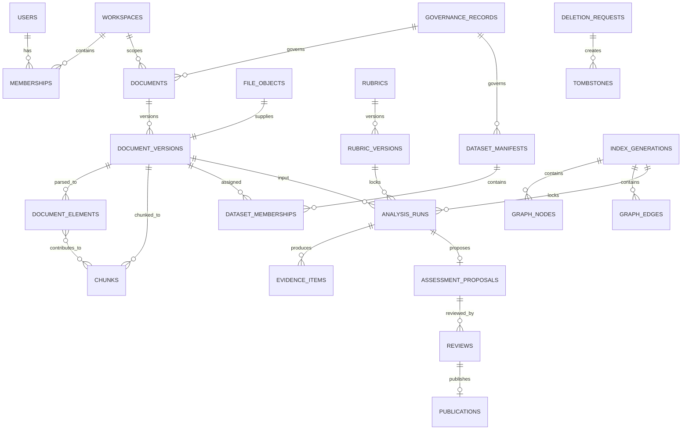

# W2.2 — MongoDB Data Dictionary và Provenance Contract

| Thuộc tính | Giá trị                                              |
| ------------ | ------------------------------------------------------ |
| Phiên bản  | 0.2                                                    |
| Ngày        | 10/09/2026                                             |
| Trạng thái | APPROVED DESIGN BASELINE                               |
| WBS          | `W2.2`                                               |
| Owner        | Nguyễn Trần Ngọc Quý (Q)                           |
| Reviewer     | Võ Thị Kim Yến (Y)                                  |
| Decision     | [ADR-001](../adr/ADR-001-mongodb-provenance-storage.md) |

## 1. Phạm vi

Tài liệu khóa tên collection, reference, field tối thiểu, index, lifecycle và
provenance cần cho `W2.3`, `W3.1` và `W4.2`. Đây là logical/physical contract
v1; validator và migration executable được hiện thực ở `W3.1`.

Không lưu password thô, secret, session token thô, stack trace, prompt đầy đủ
hoặc file bytes lớn trong các collection dưới đây.

## 2. Quy ước chung

### 2.1. Kiểu và tên field

| Quy ước        | Giá trị                                                      |
| ---------------- | -------------------------------------------------------------- |
| Primary key      | BSON `ObjectId` ở `_id`                                   |
| Reference        | BSON `ObjectId`, tên kết thúc `_id`; không dùng DBRef |
| Nhiều reference | Mảng tên kết thúc `_ids`, chỉ dùng khi bounded         |
| Timestamp        | BSON UTC Date, tên kết thúc `_at`                         |
| Hash             | Lowercase SHA-256 hex 64 ký tự, tên kết thúc `_sha256`  |
| Enum             | Upper snake case, được kiểm bởi validator/domain type     |
| Schema           | `schema_version: int >= 1`                                   |
| Optimistic lock  | `revision: int >= 1`, compare-and-set khi update             |
| Scope            | `workspace_id` denormalized trên mọi protected document    |
| Soft deny        | `lifecycle_state` + lookup/check tombstone                   |
| Pagination       | Stable sort bằng field nghiệp vụ rồi `_id`               |

### 2.2. Field dùng chung

Authoritative document bắt buộc có:

| Field              | Type          | Required | Ý nghĩa                                       |
| ------------------ | ------------- | -------: | ----------------------------------------------- |
| `_id`            | ObjectId      |      Có | ID nội bộ, không chứng minh authorization   |
| `schema_version` | int           |      Có | Phiên bản validator/document shape            |
| `created_at`     | date          |      Có | Thời điểm tạo UTC                           |
| `created_by`     | ObjectId/null |      Có | Actor; null chỉ cho bootstrap/system có audit |

Document mutable thêm:

| Field          | Type          | Required | Ý nghĩa                          |
| -------------- | ------------- | -------: | ---------------------------------- |
| `updated_at` | date          |      Có | Lần cập nhật gần nhất         |
| `updated_by` | ObjectId/null |      Có | Actor/system cập nhật            |
| `revision`   | int           |      Có | Chống stale write/last-write-wins |

Protected document thêm `workspace_id`. Repository phải lấy workspace/role từ
authoritative state; không tin `workspace_id` do client tự khai báo.

### 2.3. Access predicate chung

Một version/source chỉ được parse tiếp, index, retrieval hoặc chạy experiment
khi repository xác minh:

```text
workspace scope hợp lệ
AND lifecycle_state = ACTIVE
AND processing_state đạt trạng thái cần thiết
AND governance record hiện hành = APPROVED
AND now nằm trong validity window
AND requested purpose thuộc allowed_purposes
AND không có tombstone hiệu lực
```

Không thể enforce reference/purpose xuyên collection chỉ bằng JSON Schema;
service transaction và negative authorization test là bắt buộc.

## 3. Sơ đồ quan hệ



Quan hệ `DOCUMENT_ELEMENTS → CHUNKS` được hiện thực bằng
`chunks.element_ids`. Mỗi chunk phải tham chiếu ít nhất một element thuộc cùng
`document_version_id` và generation; một element có thể không tạo chunk riêng
(ví dụ heading chỉ cung cấp ngữ cảnh) hoặc góp vào nhiều chunk khi nội dung dài
được tách. Repository kiểm tra non-empty reference, cùng version/generation và
không cho dangling/cross-document reference trước khi commit chunk generation.

## 4. Collection catalog

| Collection               | Loại                     | Mục đích                                        |
| ------------------------ | ------------------------- | -------------------------------------------------- |
| `users`                | Source of truth           | Danh tính ứng dụng và trạng thái tài khoản |
| `workspaces`           | Source of truth           | Course/research scope                              |
| `memberships`          | Source of truth           | User–workspace role                               |
| `documents`            | Source of truth           | Logical report/corpus source                       |
| `document_versions`    | Source of truth           | Immutable content version + processing state       |
| `file_objects`         | Source of truth metadata  | Storage key/checksum của bytes ngoài MongoDB     |
| `document_elements`    | Rebuildable content       | Parser output có raw locator                      |
| `chunks`               | Rebuildable content       | Chunk text + provenance                            |
| `governance_records`   | Source of truth           | Rights/purpose/privacy/retention decision          |
| `dataset_manifests`    | Source of truth           | Version/checksum/split/metric dataset              |
| `dataset_memberships`  | Source of truth           | Item/split/label/leakage group                     |
| `rubrics`              | Source of truth           | Logical rubric                                     |
| `rubric_versions`      | Source of truth           | Immutable published rubric version                 |
| `jobs`                 | Operational authoritative | Queue/lease/retry/checkpoint                       |
| `index_generations`    | Source of truth registry  | Derived index manifest/activation                  |
| `graph_nodes`          | Derived                   | Evidence graph node theo generation                |
| `graph_edges`          | Derived                   | Evidence graph edge theo generation                |
| `analysis_runs`        | Source of truth           | Locked run lineage/state                           |
| `evidence_items`       | Result artifact           | Exact evidence + scores/verification               |
| `assessment_proposals` | Result artifact           | AI proposal, chưa phải quyết định cuối       |
| `reviews`              | Source of truth           | Lecturer Accept/Edit/Reject                        |
| `publications`         | Source of truth           | Bản kết quả đã công bố                      |
| `deletion_requests`    | Source of truth           | Authorized deletion workflow/report                |
| `tombstones`           | Source of truth           | Immediate deny và restore guard                   |
| `audit_events`         | Append-only               | Security/business audit allowlist                  |
| `schema_migrations`    | Source of truth           | Migration ledger                                   |

## 5. Identity và scope

### 5.1. `users`

| Field                | Type          | Required | Ghi chú                                 |
| -------------------- | ------------- | -------: | ---------------------------------------- |
| `email_normalized` | string        |      Có | Lowercase/normalized, không log         |
| `display_name`     | string        |      Có | PII, không đưa vào experiment        |
| `system_roles`     | array[string] |      Có | Chỉ `ADMIN` nếu thật sự cần       |
| `status`           | string        |      Có | `ACTIVE`, `DISABLED`, `DELETED`    |
| `auth_subject`     | string/null   |   Không | ID từ auth provider, không phải token |
| `revision`         | int           |      Có | CAS                                      |

Index:

- unique `{email_normalized: 1}`;
- partial unique `{auth_subject: 1}` khi field tồn tại;
- `{status: 1, _id: 1}` cho admin pagination.

### 5.2. `workspaces`

| Field               | Type   | Required | Ghi chú                           |
| ------------------- | ------ | -------: | ---------------------------------- |
| `workspace_key`   | string |      Có | Opaque stable key                  |
| `kind`            | string |      Có | `COURSE`, `RESEARCH`           |
| `name`            | string |      Có | Có thể chứa thông tin nội bộ |
| `status`          | string |      Có | `ACTIVE`, `ARCHIVED`           |
| `default_purpose` | string |      Có | Không override governance record  |
| `revision`        | int    |      Có | CAS                                |

Index: unique `{workspace_key: 1}`; `{status: 1, _id: 1}`.

### 5.3. `memberships`

| Field                           | Type          | Required | Ghi chú                                                   |
| ------------------------------- | ------------- | -------: | ---------------------------------------------------------- |
| `workspace_id`                | ObjectId      |      Có | Scope                                                      |
| `user_id`                     | ObjectId      |      Có | Member                                                     |
| `roles`                       | array[string] |      Có | `STUDENT`, `LECTURER`, `OPERATOR`, `DATA_APPROVER` |
| `status`                      | string        |      Có | `ACTIVE`, `REVOKED`                                    |
| `valid_from`, `valid_until` | date/null     |      Có | Time-bound access                                          |
| `revision`                    | int           |      Có | CAS                                                        |

Index: unique `{workspace_id: 1, user_id: 1}`; `{user_id: 1, status: 1}`.

## 6. Document, file và parsing

### 6.1. `documents`

Logical resource; report upload mới không tạo logical document mới nếu vẫn là
cùng bài nộp.

| Field                            | Type            | Required | Ghi chú                                                          |
| -------------------------------- | --------------- | -------: | ----------------------------------------------------------------- |
| `workspace_id`                 | ObjectId        |      Có | Authorization scope                                               |
| `kind`                         | string          |      Có | `REPORT`, `CORPUS_SOURCE`                                     |
| `document_key`                 | string          |      Có | Stable trong workspace                                            |
| `title`                        | string          |      Có | Untrusted text                                                    |
| `owner_user_id`                | ObjectId/null   |      Có | Student/uploader nếu có                                         |
| `subject_user_ids`             | array[ObjectId] |      Có | Bounded; người có dữ liệu trong report                       |
| `current_version_id`           | ObjectId/null   |      Có | Pointer, update bằng transaction                                 |
| `current_governance_record_id` | ObjectId/null   |      Có | Null/PENDING bị fail closed                                      |
| `lifecycle_state`              | string          |      Có | `ACTIVE`, `ARCHIVED`, `TOMBSTONED`, `PURGING`, `PURGED` |
| `revision`                     | int             |      Có | CAS                                                               |

Index:

- unique `{workspace_id: 1, kind: 1, document_key: 1}`;
- `{workspace_id: 1, lifecycle_state: 1, kind: 1, _id: 1}`;
- `{workspace_id: 1, owner_user_id: 1, lifecycle_state: 1}`.

### 6.2. `file_objects`

| Field                    | Type      | Required | Ghi chú                                                |
| ------------------------ | --------- | -------: | ------------------------------------------------------- |
| `workspace_id`         | ObjectId  |      Có | Không global-dedup nhạy cảm                          |
| `storage_backend`      | string    |      Có | `LOCAL_VOLUME` ở baseline                            |
| `storage_key`          | string    |      Có | Server-generated; không chứa filename/PII             |
| `original_filename`    | string    |      Có | Untrusted; chỉ display sau encode                      |
| `media_type`           | string    |      Có | MIME đã sniff/allowlist                               |
| `size_bytes`           | long      |      Có | Upload limit                                            |
| `content_sha256`       | string    |      Có | Integrity/provenance                                    |
| `storage_state`        | string    |      Có | `QUARANTINED`, `COMMITTED`, `MISSING`, `PURGED` |
| `data_class`           | string    |      Có | `RESTRICTED`, `INTERNAL`, `PUBLIC_LICENSED`       |
| `verified_at`          | date/null |      Có | Lần verify checksum                                    |
| `retention_expires_at` | date/null |      Có | Chỉ set khi policy đã duyệt                         |

Index:

- unique `{workspace_id: 1, storage_key: 1}`;
- `{workspace_id: 1, content_sha256: 1}` không unique;
- `{storage_state: 1, created_at: 1}` cho orphan reconciliation.

### 6.3. `document_versions`

| Field                              | Type          | Required | Ghi chú                              |
| ---------------------------------- | ------------- | -------: | ------------------------------------- |
| `workspace_id`                   | ObjectId      |      Có | Scope                                 |
| `document_id`                    | ObjectId      |      Có | Logical parent                        |
| `version_no`                     | int           |      Có | Tăng đơn điệu theo document      |
| `file_object_id`                 | ObjectId      |      Có | Immutable bytes                       |
| `content_sha256`                 | string        |      Có | Phải khớp file object               |
| `supersedes_version_id`          | ObjectId/null |      Có | Lineage                               |
| `processing_state`               | string        |      Có | Theo mục 14                          |
| `lifecycle_state`                | string        |      Có | Theo mục 14                          |
| `governance_record_id`           | ObjectId      |      Có | Record được dùng khi tạo version |
| `parser_spec`                    | object/null   |      Có | `{name, version, config_sha256}`    |
| `chunker_spec`                   | object/null   |      Có | `{name, version, config_sha256}`    |
| `element_count`, `chunk_count` | int           |      Có | Verify build                          |
| `failure_code`                   | string/null   |      Có | Safe code, không stack/content       |
| `ready_at`                       | date/null     |      Có | Chỉ khi all required artifacts pass  |
| `revision`                       | int           |      Có | State transition CAS                  |

Index:

- unique `{document_id: 1, version_no: 1}`;
- `{workspace_id: 1, processing_state: 1, lifecycle_state: 1, _id: 1}`;
- `{workspace_id: 1, content_sha256: 1}` không unique.

### 6.4. `document_elements`

Parser output. Có thể rebuild từ file + parser spec nhưng là source cho chunk
generation đang active.

| Field                   | Type          | Required | Ghi chú                                                         |
| ----------------------- | ------------- | -------: | ---------------------------------------------------------------- |
| `workspace_id`        | ObjectId      |      Có | Pre-filter scope                                                 |
| `document_version_id` | ObjectId      |      Có | Immutable version                                                |
| `element_key`         | string        |      Có | Deterministic trong version/parser generation                    |
| `order`               | int           |      Có | Thứ tự đọc                                                   |
| `element_type`        | string        |      Có | `HEADING`, `PARAGRAPH`, `TABLE`, `LIST`, `FIGURE`, ... |
| `raw_text`            | string        |      Có | Exact parser output; restricted                                  |
| `raw_text_sha256`     | string        |      Có | Integrity                                                        |
| `structure_path`      | array[string] |      Có | Heading/section path                                             |
| `locator`             | object        |      Có | Theo mục 13                                                     |
| `parser_spec`         | object        |      Có | Name/version/config hash                                         |
| `generation_key`      | string        |      Có | Rebuild isolation                                                |

Index: unique `{document_version_id: 1, generation_key: 1, element_key: 1}`;
`{workspace_id: 1, document_version_id: 1, generation_key: 1, order: 1}`.

### 6.5. `chunks`

| Field                                    | Type            | Required | Ghi chú                               |
| ---------------------------------------- | --------------- | -------: | -------------------------------------- |
| `workspace_id`                         | ObjectId        |      Có | Pre-retrieval scope                    |
| `document_id`, `document_version_id` | ObjectId        |      Có | Stable lineage                         |
| `chunk_key`                            | string          |      Có | Deterministic theo version/config/span |
| `order`                                | int             |      Có | Stable display order                   |
| `element_ids`                          | array[ObjectId] |      Có | Bounded input elements                 |
| `raw_text`                             | string          |      Có | Text đúng locator                    |
| `normalized_text`                      | string          |      Có | Text dùng retrieval/model             |
| `content_sha256`                       | string          |      Có | Normalized content hash                |
| `language`                             | string/null     |      Có | BCP-47 khi biết                       |
| `structure_path`                       | array[string]   |      Có | Section context                        |
| `locator`                              | object          |      Có | Raw page/section/span                  |
| `normalization_map`                    | object/null     |      Có | Resolve normalized → raw offset       |
| `chunker_spec`                         | object          |      Có | Name/version/config hash               |
| `generation_key`                       | string          |      Có | Không trộn generation                |

Index:

- unique `{document_version_id: 1, generation_key: 1, chunk_key: 1}`;
- `{workspace_id: 1, document_version_id: 1, generation_key: 1, order: 1}`;
- `{workspace_id: 1, lifecycle_state: 1}` nếu chunk có denormalized deny state.

## 7. Governance và dataset

### 7.1. `governance_records`

Mỗi thay đổi tạo version mới; root resource trỏ record hiện hành. Record đã
được run dùng không sửa nội dung decision, chỉ revoke bằng transition có audit.

| Field                           | Type          | Required | Ghi chú                                                                                 |
| ------------------------------- | ------------- | -------: | ---------------------------------------------------------------------------------------- |
| `workspace_id`                | ObjectId/null |      Có | Null chỉ cho public dataset global đã duyệt                                          |
| `resource_type`               | string        |      Có | `DOCUMENT`, `DATASET`, `MODEL`, `RUBRIC`                                         |
| `resource_id`                 | ObjectId      |      Có | Target                                                                                   |
| `record_version`              | int           |      Có | Version quyết định                                                                    |
| `data_owner`                  | object        |      Có | ID/role hoặc public organization, không chỉ tên tự do                               |
| `rights_basis`                | string        |      Có | `LICENSE`, `CONSENT`, `RESEARCH_USE_STATEMENT`, `INTERNAL_APPROVAL`, `UNKNOWN` |
| `license_id`                  | string/null   |      Có | SPDX khi có; không tự suy diễn                                                       |
| `rights_evidence`             | object        |      Có | URL/file ID, checksum, retrieved date                                                    |
| `allowed_purposes`            | array[string] |      Có | Allowlist, không để chuỗi mơ hồ                                                    |
| `redistribution`              | string        |      Có | `ALLOWED`, `PROHIBITED`, `UNKNOWN`                                                 |
| `data_class`                  | string        |      Có | Classification                                                                           |
| `anonymization`               | object        |      Có | Required/status/method/version                                                           |
| `retention_policy`            | object        |      Có | Basis/expiry/delete/backup rule                                                          |
| `approver_id`                 | ObjectId/null |      Có | Null không thể `APPROVED`                                                            |
| `approved_at`                 | date/null     |      Có | Decision evidence                                                                        |
| `valid_from`, `valid_until` | date/null     |      Có | Expiry gate                                                                              |
| `status`                      | string        |      Có | `PENDING`, `APPROVED`, `REJECTED`, `REVOKED`, `EXPIRED`                        |
| `revision`                    | int           |      Có | CAS transition                                                                           |

Index:

- unique `{resource_type: 1, resource_id: 1, record_version: 1}`;
- `{workspace_id: 1, status: 1, valid_until: 1}`;
- partial index `{resource_type: 1, resource_id: 1, status: 1}` cho `APPROVED`.

### 7.2. `dataset_manifests`

| Field                     | Type          | Required | Ghi chú                                           |
| ------------------------- | ------------- | -------: | -------------------------------------------------- |
| `dataset_key`           | string        |      Có | Ví dụ `pan13-text-alignment`                   |
| `dataset_version`       | string        |      Có | Không dùng `latest`                            |
| `title`, `publisher`  | string        |      Có | Identity                                           |
| `doi`, `official_url` | string/null   |      Có | Source chính thức                                |
| `retrieved_at`          | date          |      Có | Access evidence                                    |
| `files`                 | array[object] |      Có | Name/size/provider hash/local SHA-256              |
| `format_schema`         | object        |      Có | Unit/field/annotation version                      |
| `split_spec`            | object        |      Có | Official/derived, seed/script/hash                 |
| `metrics`               | array[object] |      Có | Name/version/implementation                        |
| `governance_record_id`  | ObjectId      |      Có | Approved trước final import/run                  |
| `manifest_sha256`       | string        |      Có | Canonical manifest hash                            |
| `status`                | string        |      Có | `DRAFT`, `VERIFIED`, `APPROVED`, `REVOKED` |
| `revision`              | int           |      Có | CAS                                                |

Index: unique `{dataset_key: 1, dataset_version: 1}`;
`{status: 1, dataset_key: 1}`; unique `{manifest_sha256: 1}`.

### 7.3. `dataset_memberships`

| Field                    | Type            | Required | Ghi chú                      |
| ------------------------ | --------------- | -------: | ----------------------------- |
| `dataset_manifest_id`  | ObjectId        |      Có | Frozen dataset version        |
| `item_key`             | string          |      Có | Stable sample/query key       |
| `document_version_ids` | array[ObjectId] |      Có | Input versions, bounded       |
| `split`                | string          |      Có | `TRAIN`, `DEV`, `TEST`  |
| `leakage_group_key`    | string          |      Có | Source/report/group isolation |
| `label`                | object          |      Có | Dataset-specific ground truth |
| `label_sha256`         | string          |      Có | Integrity                     |
| `source_provenance`    | object          |      Có | Original ID/reference         |

Index:

- unique `{dataset_manifest_id: 1, item_key: 1}`;
- `{dataset_manifest_id: 1, split: 1, leakage_group_key: 1}`;
- `{dataset_manifest_id: 1, document_version_ids: 1}`.

## 8. Rubric

### 8.1. `rubrics`

Fields: `workspace_id`, `rubric_key`, `title`, `current_version_id`,
`lifecycle_state`, common mutable fields.

Index: unique `{workspace_id: 1, rubric_key: 1}`;
`{workspace_id: 1, lifecycle_state: 1, _id: 1}`.

### 8.2. `rubric_versions`

| Field                              | Type               | Required | Ghi chú                              |
| ---------------------------------- | ------------------ | -------: | ------------------------------------- |
| `workspace_id`, `rubric_id`    | ObjectId           |      Có | Scope/parent                          |
| `version_no`                     | int                |      Có | Monotonic                             |
| `status`                         | string             |      Có | `DRAFT`, `PUBLISHED`, `RETIRED` |
| `criteria`                       | array[object]      |      Có | Bounded ordered criteria              |
| `criteria[].criterion_key`       | string             |      Có | Stable key                            |
| `criteria[].weight`              | decimal128         |      Có | Deterministic scoring                 |
| `criteria[].checklists`          | array[object]      |      Có | Atomic condition/evidence/mode        |
| `criteria[].levels`              | array[object]      |      Có | Score rule/example                    |
| `rubric_sha256`                  | string             |      Có | Canonical content hash                |
| `published_at`, `published_by` | date/ObjectId/null |      Có | Publish evidence                      |

Published version là immutable. Sửa rubric đã dùng phải clone version.

Index: unique `{rubric_id: 1, version_no: 1}`; unique
`{rubric_id: 1, rubric_sha256: 1}`;
partial unique `{rubric_id: 1, status: 1}` khi `status=PUBLISHED` nếu policy chỉ
cho một current published version.

## 9. Job và index generation

### 9.1. `jobs`

| Field                                      | Type        | Required | Ghi chú                                           |
| ------------------------------------------ | ----------- | -------: | -------------------------------------------------- |
| `workspace_id`                           | ObjectId    |      Có | Scope                                              |
| `job_type`                               | string      |      Có | `PARSE`, `INDEX`, `ANALYZE`, `DELETE`, ... |
| `resource_ref`                           | object      |      Có | Type + immutable ID; không chứa content          |
| `config_ref`                             | object/null |      Có | Versioned config                                   |
| `idempotency_scope`, `idempotency_key` | string      |      Có | Enqueue dedup                                      |
| `state`                                  | string      |      Có | Theo mục 14                                       |
| `priority`                               | int         |      Có | Bounded                                            |
| `available_at`                           | date        |      Có | Retry scheduling                                   |
| `lease_owner`                            | string/null |      Có | Worker instance ID                                 |
| `lease_expires_at`, `heartbeat_at`     | date/null   |      Có | Reclaim stale job                                  |
| `attempt`, `max_attempts`              | int         |      Có | Finite retry                                       |
| `progress`                               | object      |      Có | Step/count, không chứa report text               |
| `error_code`                             | string/null |      Có | Safe terminal/retry code                           |
| `correlation_id`                         | string      |      Có | Log trace                                          |
| `revision`                               | int         |      Có | Atomic transition                                  |

Index:

- unique `{idempotency_scope: 1, idempotency_key: 1}`;
- `{state: 1, available_at: 1, priority: -1, created_at: 1}` cho claim;
- `{state: 1, lease_expires_at: 1}` cho recovery;
- `{workspace_id: 1, resource_ref.id: 1, created_at: -1}`;
- TTL trên `expires_at` chỉ cho terminal job sau policy retention, không cho job
  active/audit.

### 9.2. `index_generations`

| Field                               | Type        | Required | Ghi chú                                        |
| ----------------------------------- | ----------- | -------: | ----------------------------------------------- |
| `workspace_id`                    | ObjectId    |      Có | Scope                                           |
| `index_kind`                      | string      |      Có | `LEXICAL`, `DENSE`, `GRAPH`               |
| `corpus_scope_key`                | string      |      Có | Canonical source/version scope hash             |
| `generation_key`                  | string      |      Có | Full input/config identity hash                 |
| `source_manifest`                 | object      |      Có | IDs/count/checksum; large list có artifact ref |
| `parser_spec`, `chunker_spec`   | object      |      Có | Input provenance                                |
| `engine_spec`                     | object      |      Có | Engine/version/config hash                      |
| `model_spec`                      | object/null |      Có | Model ID/version/checksum                       |
| `code_commit`                     | string      |      Có | Rebuild version                                 |
| `artifact_ref`                    | object/null |      Có | Backend/key/checksum/size                       |
| `document_count`, `chunk_count` | long        |      Có | Verification                                    |
| `state`                           | string      |      Có | Theo ADR mục 9                                 |
| `activated_at`, `superseded_at` | date/null   |      Có | Atomic promotion                                |
| `revision`                        | int         |      Có | CAS                                             |

Index:

- unique `{workspace_id: 1, index_kind: 1, generation_key: 1}`;
- partial unique `{workspace_id: 1, index_kind: 1, corpus_scope_key: 1, state: 1}`
  khi `state=ACTIVE`;
- `{workspace_id: 1, state: 1, created_at: -1}`.

### 9.3. `graph_nodes` và `graph_edges`

`graph_nodes`: `workspace_id`, `index_generation_id`, `node_key`, `node_type`,
`document_version_id`, `chunk_id`, `label`, `properties_allowlist`, `locator`,
`content_sha256`.

`graph_edges`: `workspace_id`, `index_generation_id`, `edge_key`,
`from_node_key`, `to_node_key`, `relation_type`, `weight`,
`source_evidence_ids`, `content_sha256`.

Index:

- node unique `{index_generation_id: 1, node_key: 1}`;
- edge unique `{index_generation_id: 1, edge_key: 1}`;
- traversal `{index_generation_id: 1, from_node_key: 1, relation_type: 1}` và
  chiều ngược `{index_generation_id: 1, to_node_key: 1, relation_type: 1}`.

Node/edge luôn bị giới hạn generation/workspace và có thể xóa/rebuild toàn bộ.

## 10. Run, evidence và review

### 10.1. `analysis_runs`

| Field                                  | Type            | Required | Ghi chú                                                                                        |
| -------------------------------------- | --------------- | -------: | ----------------------------------------------------------------------------------------------- |
| `workspace_id`                       | ObjectId        |      Có | Scope                                                                                           |
| `run_type`                           | string          |      Có | `SIMILARITY`, `ASSESSMENT`, `EXPERIMENT`                                                  |
| `mode`                               | string/null     |      Có | Ví dụ `LOCAL`, `GRAPH`                                                                    |
| `report_version_id`                  | ObjectId        |      Có | Frozen input                                                                                    |
| `source_scope`                       | object          |      Có | Corpus/dataset/source version IDs/hash                                                          |
| `index_generation_ids`               | array[ObjectId] |      Có | Frozen derived inputs                                                                           |
| `rubric_version_id`                  | ObjectId/null   |      Có | Assessment only                                                                                 |
| `model_specs`                        | array[object]   |      Có | Model/version/checksum                                                                          |
| `prompt_spec`, `config_spec`       | object          |      Có | Version/hash                                                                                    |
| `dataset_manifest_id`                | ObjectId/null   |      Có | Experiment only                                                                                 |
| `metric_specs`                       | array[object]   |      Có | Name/version/hash                                                                               |
| `code_commit`, `dependency_digest` | string          |      Có | Reproducibility                                                                                 |
| `seed`                               | long/null       |      Có | Experiment khi áp dụng                                                                        |
| `hardware_profile`                   | object          |      Có | CPU/RAM/GPU/OS; không serial                                                                   |
| `idempotency_key`                    | string          |      Có | Run dedup                                                                                       |
| `state`                              | string          |      Có | `CREATED`, `QUEUED`, `RUNNING`, `SUCCEEDED`, `FAILED`, `CANCELLED`, `INVALIDATED` |
| `failure_code`                       | string/null     |      Có | Safe code                                                                                       |
| `started_at`, `completed_at`       | date/null       |      Có | Timing                                                                                          |
| `revision`                           | int             |      Có | CAS                                                                                             |

Index: unique `{workspace_id: 1, idempotency_key: 1}`;
`{workspace_id: 1, report_version_id: 1, created_at: -1}`;
`{dataset_manifest_id: 1, state: 1, created_at: -1}`.

### 10.2. `evidence_items`

| Field                                 | Type            | Required | Ghi chú                                                                                                 |
| ------------------------------------- | --------------- | -------: | -------------------------------------------------------------------------------------------------------- |
| `workspace_id`, `analysis_run_id` | ObjectId        |      Có | Scope/run                                                                                                |
| `evidence_key`                      | string          |      Có | Deterministic trong run                                                                                  |
| `criterion_key`, `checklist_key`  | string/null     |      Có | Assessment trace                                                                                         |
| `source_document_version_id`        | ObjectId        |      Có | Exact source                                                                                             |
| `chunk_ids`                         | array[ObjectId] |      Có | Retrieved chunks                                                                                         |
| `locator`                           | object          |      Có | Resolve raw span                                                                                         |
| `quote_text`                        | string          |      Có | Exact bounded evidence                                                                                   |
| `quote_sha256`                      | string          |      Có | Detect tampering                                                                                         |
| `retrieval_scores`                  | object          |      Có | BM25/dense/RRF/rerank + rank                                                                             |
| `verification_state`                | string          |      Có | Quan hệ claim–evidence: `SUPPORTED`, `CONTRADICTED`, `INSUFFICIENT`                              |
| `verification_spec`                 | object          |      Có | Model/rule/config hash                                                                                   |
| `verification_reason_code`          | string          |      Có | Ví dụ `DIRECT_SUPPORT`, `DIRECT_CONTRADICTION`, `CONTEXT_MISMATCH`, `SOURCE_AUTHORITY_UNKNOWN` |
| `data_class`                        | string          |      Có | Kế thừa source                                                                                         |

Index: unique `{analysis_run_id: 1, evidence_key: 1}`;
`{workspace_id: 1, source_document_version_id: 1, analysis_run_id: 1}`;
`{analysis_run_id: 1, criterion_key: 1, checklist_key: 1}`.

### 10.3. `assessment_proposals`

Fields: `workspace_id`, `analysis_run_id`, `report_version_id`,
`rubric_version_id`, `proposal_revision`, `checklist_results`,
`criterion_scores`, `total_score`, `scoring_rule_sha256`, `rationale`,
`evidence_ids`, `status` (`DRAFT`, `READY_FOR_REVIEW`, `ACCEPTED`, `REJECTED`,
`SUPERSEDED`), common immutable timestamps.

Mỗi `checklist_results[]` bắt buộc có `checklist_key`, `status`
(`MET`, `UNMET`, `CANNOT_ASSESS`), `evidence_ids`, `reason_code` và
`decision_rule_version`. Mapping mặc định là `SUPPORTED → MET`,
`CONTRADICTED → UNMET`, `INSUFFICIENT → CANNOT_ASSESS`; mọi override phải do
rubric rule có version quyết định và được ghi trong rationale.

AI/rule engine chỉ tạo proposal. Unique `{analysis_run_id: 1}` và
`{workspace_id: 1, report_version_id: 1, created_at: -1}`.

### 10.4. `reviews`

Fields: `workspace_id`, `proposal_id`, `expected_proposal_revision`,
`review_revision`, `reviewer_id`, `decision` (`ACCEPT`, `EDIT`, `REJECT`),
`reason_code`, `reason_text`, `edited_scores`, `edited_rationale`,
`evidence_ids`, `created_at`.

Index: unique `{proposal_id: 1, review_revision: 1}`;
`{workspace_id: 1, reviewer_id: 1, created_at: -1}`.

Review insert và proposal transition phải cùng transaction, lọc expected
revision; conflict trả `409` ở API contract sau này.

### 10.5. `publications`

Fields: `workspace_id`, `report_id`, `report_version_id`, `proposal_id`,
`review_id`, `publication_no`, `artifact_file_ids`, `published_by`,
`published_at`, `state` (`ACTIVE`, `SUPERSEDED`, `WITHDRAWN`), `revision`.

Index: unique `{report_id: 1, publication_no: 1}`; partial unique
`{report_id: 1, state: 1}` khi `state=ACTIVE`.

Publication không overwrite proposal/review cũ và worker/admin không có quyền
tạo publication.

## 11. Lifecycle, deletion và audit

### 11.1. `deletion_requests`

Fields: `workspace_id`, `target_type`, `target_id`, `requested_by`,
`authority_evidence`, `reason_code`, `hold_check`, `idempotency_key`, `state`
(`REQUESTED`, `APPROVED`, `RUNNING`, `PARTIAL`, `COMPLETED`, `REJECTED`),
`checkpoints`, `purged_counts`, `remaining_counts`, `backup_expiry_refs`,
`verified_at`, `revision`.

Index: unique `{workspace_id: 1, idempotency_key: 1}`;
`{state: 1, updated_at: 1}`.

### 11.2. `tombstones`

| Field                              | Type            | Required | Ghi chú                               |
| ---------------------------------- | --------------- | -------: | -------------------------------------- |
| `workspace_id`                   | ObjectId/null   |      Có | Scope                                  |
| `resource_type`, `resource_id` | string/ObjectId |      Có | Deny target                            |
| `deletion_request_id`            | ObjectId        |      Có | Authority chain                        |
| `blocked_at`                     | date            |      Có | Immediate deny                         |
| `reason_code`                    | string          |      Có | Không chứa content                   |
| `purge_state`                    | string          |      Có | `PENDING`, `PARTIAL`, `VERIFIED` |
| `restore_guard_until`            | date/null       |      Có | Backup aging                           |

Unique `{resource_type: 1, resource_id: 1}`; `{purge_state: 1, blocked_at: 1}`.

Không TTL tombstone khi backup vẫn có thể làm dữ liệu sống lại.

### 11.3. `audit_events`

Append-only fields: `event_id`, `workspace_id`, `actor_id`, `actor_type`,
`action`, `resource_type`, `resource_id`, `outcome`, `reason_code`,
`before_revision`, `after_revision`, `correlation_id`, `occurred_at`,
`metadata_allowlist`.

Không lưu raw report/chunk/evidence/prompt, token, password, storage path hoặc
stack trace. Index unique `{event_id: 1}`;
`{workspace_id: 1, occurred_at: -1, _id: -1}`;
`{resource_type: 1, resource_id: 1, occurred_at: -1}`.

### 11.4. `schema_migrations`

Fields: `_id` là migration ID ổn định, `checksum`, `description`,
`applied_at`, `applied_by`, `code_commit`, `duration_ms`, `status`,
`verification_summary` và optional `resume_cursor`.

Migration ID/checksum mismatch phải fail startup/migration job.

## 12. Index manifest v1

| Collection              | Index key                                          | Thuộc tính/mục đích         |
| ----------------------- | -------------------------------------------------- | -------------------------------- |
| `users`               | `email_normalized`                               | Unique identity                  |
| `memberships`         | `workspace_id,user_id`                           | Unique membership                |
| `documents`           | `workspace_id,kind,document_key`                 | Unique logical resource          |
| `document_versions`   | `document_id,version_no`                         | Unique version                   |
| `file_objects`        | `workspace_id,storage_key`                       | Unique server key                |
| `document_elements`   | `document_version_id,generation_key,element_key` | Idempotent parse                 |
| `chunks`              | `document_version_id,generation_key,chunk_key`   | Idempotent chunk                 |
| `governance_records`  | `resource_type,resource_id,record_version`       | Unique decision version          |
| `dataset_manifests`   | `dataset_key,dataset_version`                    | Unique dataset version           |
| `dataset_memberships` | `dataset_manifest_id,item_key`                   | Unique sample                    |
| `rubric_versions`     | `rubric_id,version_no`                           | Unique rubric version            |
| `jobs`                | `idempotency_scope,idempotency_key`              | No duplicate enqueue             |
| `jobs`                | `state,available_at,priority,created_at`         | Atomic claim order               |
| `index_generations`   | `workspace_id,index_kind,generation_key`         | Idempotent build                 |
| `index_generations`   | `workspace_id,index_kind,corpus_scope_key,state` | Partial unique active generation |
| `analysis_runs`       | `workspace_id,idempotency_key`                   | No duplicate run                 |
| `evidence_items`      | `analysis_run_id,evidence_key`                   | Stable evidence                  |
| `reviews`             | `proposal_id,review_revision`                    | Review history                   |
| `publications`        | `report_id,publication_no`                       | Immutable publication history    |
| `deletion_requests`   | `workspace_id,idempotency_key`                   | Idempotent delete                |
| `tombstones`          | `resource_type,resource_id`                      | Immediate deny/restore guard     |
| `audit_events`        | `event_id`                                       | Append-only dedup                |

Tất cả index phải có tên explicit trong migration. `W3.1` phải so sánh key,
unique/partial/TTL options và báo drift; không chỉ kiểm tra index name tồn tại.

## 13. Locator và normalized mapping

`locator` là object versioned:

| Field                                | Type               | Required | Ghi chú                                                |
| ------------------------------------ | ------------------ | -------: | ------------------------------------------------------- |
| `locator_version`                  | int                |      Có | Shape version                                           |
| `page_index`                       | int/null           |      Có | Zero-based; null nếu format không có page đáng tin |
| `page_label`                       | string/null        |      Có | Label hiển thị nếu khác index                       |
| `bbox`                             | array[number]/null |      Có | `[x1,y1,x2,y2]` + coordinate system                   |
| `section_path`                     | array[string]      |      Có | Logical context                                         |
| `block_id`                         | string/null        |      Có | Parser-stable block key                                 |
| `raw_char_start`, `raw_char_end` | int                |      Có | Half-open `[start,end)` trên raw text version        |
| `source_element_ids`               | array[ObjectId]    |      Có | Bounded origin                                          |

`normalization_map` lưu algorithm/version/config hash và segment mapping đủ để
đổi normalized span về raw span. Không được tính offset sau khi loại ký tự rồi
gán trực tiếp lên file gốc. Evidence resolve phải kiểm quote hash và boundary.

## 14. State machine và transition guard

### 14.1. Document version

```text
QUARANTINED → QUEUED → PARSING → PARSED → INDEXING → READY
                   ↘ FAILED       ↘ FAILED      ↘ FAILED
```

Retry tạo job/attempt mới hoặc transition được allowlist; không nhảy
`QUARANTINED → READY`. `READY` yêu cầu file checksum, element/chunk count,
required index generation và provenance verification đạt.

Lifecycle độc lập:

```text
ACTIVE → ARCHIVED
ACTIVE/ARCHIVED → TOMBSTONED → PURGING → PURGED
```

Không transition ngược từ `TOMBSTONED/PURGED` sang `ACTIVE`; restore tạo
resource/version mới sau khi authority cho phép.

### 14.2. Governance

```text
PENDING → APPROVED | REJECTED
APPROVED → REVOKED | EXPIRED
```

`APPROVED` cần owner, rights evidence, allowed purpose, classification,
retention, approver và approval date. Không tự chuyển `UNKNOWN` thành license.

### 14.3. Job

```text
QUEUED → CLAIMED → RUNNING → SUCCEEDED
                      ↘ FAILED_RETRYABLE → QUEUED
                      ↘ FAILED_FINAL
QUEUED/CLAIMED/RUNNING → CANCELLED
```

Claim/heartbeat/complete lọc cả `_id`, expected `revision`, state và
`lease_owner`; stale worker không được commit.

## 15. Cascade matrix

| Root event                  | Chặn ngay                                      | Cleanup bất đồng bộ                                                    | Giữ tối thiểu nếu policy cho phép                   |
| --------------------------- | ----------------------------------------------- | -------------------------------------------------------------------------- | -------------------------------------------------------- |
| Document version tombstoned | Query/job/retrieval/publication mới            | File, element, chunk, index/graph membership, evidence/result/export/cache | Tombstone, deletion report, non-content audit            |
| Dataset revoked/expired     | Import/index/experiment mới, active generation | Dataset copies, derived index/graph/cache, unauthorized artifacts          | Manifest identity/hash và decision evidence theo policy |
| Governance purpose removed  | Luồng purpose đó                             | Derived artifact chỉ phục vụ purpose bị rút                           | Versioned decision/audit                                 |
| Rubric withdrawn            | Run/publication mới với version đó          | Draft chưa dùng theo policy                                              | Version đã dùng trong publication/run lineage         |
| Workspace archived          | Upload/run mới                                 | Theo retention từng resource                                              | Workspace identity/audit                                 |

Nếu cleanup lỗi, state là `PARTIAL`; active access vẫn bị chặn và retry dùng
cùng deletion request. Không báo `COMPLETED/PURGED` trước verification query.

## 16. Reconciliation bắt buộc

Worker/ops định kỳ phải phát hiện:

- file committed không có version và version trỏ file missing/hash mismatch;
- element/chunk count hoặc generation key không khớp version;
- nhiều active generation cùng scope/kind;
- job lease hết hạn hoặc artifact được commit hai lần;
- run/evidence trỏ generation/version bị xóa/revoke;
- tombstone còn derived record retrieval được;
- validator/index spec lệch migration manifest.

Reconciler chỉ sửa tự động các trường hợp đã có rule idempotent; còn lại đưa
quarantine/fail closed và ghi safe audit event.

## 17. Ví dụ provenance tối thiểu

```json
{
  "document_version_id": "ObjectId(...) ",
  "content_sha256": "<64-hex>",
  "parser_spec": {
    "name": "pymupdf-adapter",
    "version": "<locked-version>",
    "config_sha256": "<64-hex>"
  },
  "chunker_spec": {
    "name": "section-aware",
    "version": "<code-version>",
    "config_sha256": "<64-hex>"
  },
  "index_generation_id": "ObjectId(...) ",
  "code_commit": "<git-commit>",
  "locator": {
    "locator_version": 1,
    "page_index": 3,
    "raw_char_start": 120,
    "raw_char_end": 284
  }
}
```

Giá trị placeholder không được lưu như dữ liệu thật; ví dụ chỉ khóa field và
quan hệ.

## 18. Definition of Done `W2.2`

- [X] Có quyết định MongoDB deployment, file storage, queue và index boundary.
- [X] Có collection/reference và data dictionary.
- [X] Có unique/partial/claim indexes và invariant.
- [X] Có provenance từ file đến evidence/publication.
- [X] Có migration, validator, rebuild và reconciliation strategy.
- [X] Có rights/purpose/retention gate, tombstone và cascade matrix.
- [X] Yến review/xác nhận collection, scope, rubric và data governance fields
  trên PR #6 ngày 10/09/2026; nhận xét bổ sung quan hệ
  `document_elements → chunks` đã được xử lý trong phiên bản 0.2.
- [ ] `W2.6.3`/GVHD chốt duration, authority, hold và backup aging.
- [ ] `W3.1` hiện thực validator/index/Compose và chạy acceptance tests.

`W2.2` chỉ chuyển `DONE` sau review. Các implementation test thuộc `W3.1/W4.2`
không được ghi là đã chạy trong tài liệu thiết kế này.
