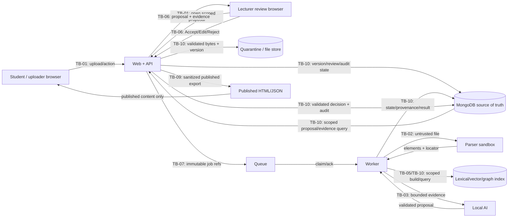
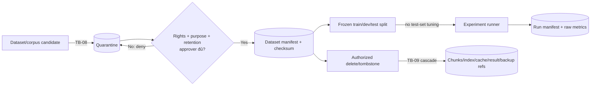

# W2.1 — Data Flow và Trust Boundary

| Thuộc tính | Giá trị |
|---|---|
| Phiên bản | 0.1 |
| Ngày | 03/09/2026 |
| Trạng thái | REVIEW CANDIDATE — chưa được reviewer phê duyệt |
| WBS | `W2.1` |
| Owner | Nguyễn Trần Ngọc Quý (Q) |
| Reviewer | Võ Thị Kim Yến (Y) |

## 1. Mục đích

Tài liệu này biến [C4](./c4.md) thành các luồng dữ liệu có thể kiểm tra được:
dữ liệu nào đi qua đâu, đổi trạng thái thế nào, thành phần nào được tin ở mức
nào và phải chặn điều gì tại mỗi ranh giới. Đây là đầu vào trực tiếp cho:

- `W2.2`: collection, reference, index, lifecycle và delete cascade;
- `W2.3`: API, authorization, idempotency, job state và error contract;
- `W3–W4`: upload, queue/worker, parser sandbox, provenance và test;
- `W8–W16`: retrieval, AI assessment, lecturer review và security test.

Không có luồng runtime ra External Search/Web Provider trong baseline hiện tại.

## 2. Phân loại dữ liệu

| Mức | Ví dụ trong hệ thống | Quy tắc tối thiểu |
|---|---|---|
| `SECRET` | Secret ký session/token, mật khẩu, credential DB, khóa mã hóa | Không ghi log/prompt/repo; chỉ process cần thiết được đọc; rotation và secret scan |
| `RESTRICTED` | Báo cáo sinh viên, extracted text, evidence span, điểm/draft assessment, feedback, định danh người dùng | RBAC + scope; mã hóa khi truyền; retention/delete; không dùng cho experiment nếu chưa được duyệt |
| `INTERNAL` | Rubric chưa công bố, config/prompt/model manifest, audit schema hoặc metric/run nội bộ đã khử PII | Chỉ thành viên/role được gán; version/audit; không public mặc định |
| `PUBLIC-LICENSED` | Dataset/source công khai đã xác minh license và allowed purpose | Vẫn phải lưu source, license, checksum, purpose, version và retention |

Dữ liệu hỗn hợp kế thừa mức hạn chế cao nhất. Nhãn “public” không tự chứng
minh quyền download, cache, index, phân tích hoặc phân phối lại.

## 3. Trust boundary

Trust boundary là nơi dữ liệu chuyển sang miền có chủ thể, quyền hoặc mức tin
cậy khác. Qua boundary không đồng nghĩa dữ liệu đã an toàn; phía nhận phải xác
thực lại các invariant thuộc trách nhiệm của mình.

| ID | Ranh giới | Dữ liệu đi qua | Kiểm soát bắt buộc |
|---|---|---|---|
| `TB-01` | Browser ↔ Web/API | Session, request, upload, review action, response | TLS khi qua mạng; auth; CSRF/CORS theo cơ chế session; server-side RBAC/scope; rate/size limit; output encoding |
| `TB-02` | File/dataset không tin cậy ↔ Parser sandbox | PDF/DOCX và parser output | Magic/MIME/size/path validation; quarantine; read-only/no-network/non-root sandbox; CPU/RAM/time limit; structured output validation |
| `TB-03` | Nội dung/evidence không tin cậy ↔ Local AI | Chunk, rubric, evidence, prompt và JSON proposal | Tách instruction khỏi content; không tool/shell/network/secret; context allowlist; schema validation; evidence verification |
| `TB-04` | Worker ↔ Internet | Không có dữ liệu trong baseline | Egress deny; provider disabled; muốn mở phải có change request, rights/privacy review, ADR và threat review |
| `TB-05` | Role/workspace ↔ Corpus/index/evidence | Query, candidate, cache, evidence span | Authorization và filter scope **trước** retrieval/rank/prompt/cache; negative cross-tenant tests |
| `TB-06` | AI proposal ↔ Quyết định/publish | Score/rationale/evidence, edit/reject/accept | Lecturer-in-scope review; evidence locator; validation; immutable audit; AI/worker/admin không tự publish |
| `TB-07` | API ↔ Queue/Worker | Job/run/version reference tối thiểu | Server-created payload; worker reload owner/scope/version/state từ source of truth; idempotency; claim/ack; finite retry; stale/replay rejection |
| `TB-08` | Nguồn dataset/corpus ↔ Governed store/index/experiment | File, license/consent, manifest, split, annotation | Deny-by-default; owner/rights/purpose/checksum/split/retention/approver gate; quarantine; leakage check |
| `TB-09` | Runtime/data store ↔ Log/export/backup | Event metadata, HTML/JSON export, backup | Redaction; structured allowlist; safe rendering/CSV handling; access control; retention; delete/tombstone propagation |
| `TB-10` | API/Worker ↔ MongoDB/File storage/Index | Query, state, file, artifact, index record, backup operation | Private endpoint; service identity/least privilege; schema/operator validation; checksum/CAS/atomic write; backup access/encryption policy; audit |

## 4. Luồng tổng thể của sản phẩm

### 4.1. `F-01` — Upload, parse, chunk và index

| Bước | Input → output | Class | Boundary | Kiểm soát/điều kiện | Trạng thái lỗi có thể quan sát |
|---:|---|---|---|---|---|
| 1 | Request + file → upload intent | `RESTRICTED` | `TB-01` | Auth/scope, extension + magic/MIME, size, filename/path, quota; server tạo ID | `REJECTED_VALIDATION`, không enqueue |
| 2 | Bytes → immutable report version + checksum | `RESTRICTED` | `TB-01`, `TB-10` | Quarantine, random storage key, checksum, rights/purpose metadata, no overwrite | `QUARANTINED` hoặc `UPLOAD_FAILED` |
| 3 | Version ID → parse job | `RESTRICTED` | `TB-07` | Payload chỉ có server-created job/version ref; worker reload owner/scope/state authoritative; idempotency và finite retry | `QUEUED`, `FAILED_RETRYABLE`, `FAILED_FINAL` |
| 4 | File → structured elements | `RESTRICTED` | `TB-02` | Sandbox/no egress/resource limits; validate parser output | `PARSE_FAILED` với mã lỗi an toàn |
| 5 | Elements → normalized text + chunks + locator | `RESTRICTED` | nội bộ worker | Stable IDs; raw↔normalized mapping; section/page/block/char locator; invariant tests | `PROVENANCE_FAILED`; không index |
| 6 | Versioned chunks → derived indexes | `RESTRICTED` | `TB-05`, `TB-10` | Scope metadata trong từng record; atomic generation/version; rebuildable | `INDEX_FAILED`; version chưa `READY` |
| 7 | Artifacts → version `READY` | hỗn hợp | `TB-10` | Service identity/least privilege; schema/CAS; chỉ commit sau khi required artifacts/checksum hoàn tất | Không cho analysis nếu incomplete/stale |

Một version mới không âm thầm ghi đè version cũ. Run luôn khóa vào đúng
`report_version_id`, parser/chunker config và index generation đã dùng.

### 4.2. `F-02` — Similarity Analysis (Pipeline 1)

| Bước | Input → output | Boundary | Invariant |
|---:|---|---|---|
| 1 | Report version + analysis config → run | `TB-01`, `TB-07` | Caller có quyền; version `READY`; request idempotent; config immutable |
| 2 | Query chunk → BM25/dense candidates | `TB-05`, `TB-10` | Corpus/version/purpose/scope filter trước rank; không dùng source chưa duyệt |
| 3 | Candidates → RRF/rerank/alignment | `TB-05`, `TB-10`, `TB-03` nếu dùng model | Candidate giữ source version + exact locator + component scores |
| 4 | Aligned spans → similarity class/report | `TB-03` | Output theo schema; label không thay thế evidence; ngưỡng/config có version |
| 5 | Proposal → lecturer review/publish | `TB-06`, `TB-09` | Không auto-publish; Accept/Edit/Reject và before/after được audit |

### 4.3. `F-03` — Evidence-grounded Assessment (Pipeline 2)

| Bước | Input → output | Boundary | Invariant |
|---:|---|---|---|
| 1 | Published rubric version → criterion/checklist plan | nội bộ | Rubric đã dùng là immutable; weight/rule validate; run khóa version |
| 2 | Checklist + report/corpus → LOCAL hoặc GRAPH evidence | `TB-05`, `TB-10` | Chọn mode theo criterion; mọi node/span truy được về source/version/locator |
| 3 | Evidence package → claim verification → checklist outcome | `TB-03` | Quan hệ claim–evidence chỉ là `SUPPORTED`, `CONTRADICTED`, `INSUFFICIENT`; kết quả checklist chỉ là `MET`, `UNMET`, `CANNOT_ASSESS`. Mâu thuẫn chỉ thành `UNMET` khi nguồn và ngữ cảnh đủ tin cậy; còn lại phải abstain/fail closed |
| 4 | Verified checklist → rationale + deterministic score proposal | `TB-03` | Model không tự tính/ghi đè rule điểm; rationale trích đúng evidence ID |
| 5 | Proposal → Accept/Edit/Reject → publish | `TB-06`, `TB-09` | Lecturer quyết định cuối; edit cần reason; student chỉ thấy bản đã publish |

Targeted Questions, nếu được đưa vào capacity sau này, chỉ đọc cùng evidence
package đã scope và chịu `TB-03`, `TB-05`, `TB-06`; nó không tạo boundary mới.

### 4.4. `F-04` — Review và publish

1. API tải proposal theo lecturer/course/report scope; không nhận owner/scope
   từ client làm nguồn sự thật.
2. UI hiển thị claim/rationale cùng evidence locator và trạng thái thiếu bằng
   chứng; text từ tài liệu/model được encode, không render HTML tùy ý.
3. Lecturer gửi `Accept`, `Edit` hoặc `Reject` kèm expected revision/version.
4. API kiểm lại quyền và optimistic concurrency, qua `TB-10` ghi actor/time/before/after/
   reason; publish là action riêng có authorization riêng.
5. Student/export chỉ đọc revision `PUBLISHED`; draft/rejected/internal notes
   không rò qua response, cache hoặc log.

## 5. Luồng dataset, experiment và lifecycle

### 5.1. `F-05` — Governed import và experiment

| Gate | Bằng chứng bắt buộc | Fail-closed behavior |
|---|---|---|
| Identity | Source URL/owner/version/file inventory/checksum | Không xác định đúng artifact → không import |
| Rights | License hoặc consent; allowed purpose; redistribution rule | Thiếu/chưa được approver xác nhận → chỉ quarantine, không index/run |
| Privacy | Data class, PII review, anonymization/pseudonymization | Có PII ngoài consent → reject hoặc xử lý trước import |
| Retention | Expiry/delete authority/backup handling | Chưa có policy → không dùng báo cáo thật |
| Research validity | Official/frozen split, label schema, leakage test | Không dùng test set để chọn prompt/model/threshold |
| Reproducibility | Dataset/config/model/prompt/code/hardware/seed manifest | Không đưa số liệu vào kết quả chính nếu thiếu lineage |

### 5.2. `F-06` — Retention, xóa và rebuild

Yêu cầu xóa hợp lệ tạo tombstone và audit event, sau đó xóa hoặc vô hiệu hóa
theo thứ tự có thể kiểm chứng:

1. chặn version khỏi query và job mới;
2. hủy job chưa chạy, làm run đang chạy fail closed;
3. xóa file gốc/normalized text/chunk/evidence/result thuộc scope;
4. xóa lexical/vector/graph record, cache và export tương ứng;
5. ghi trạng thái backup/key destruction theo policy thay vì hứa xóa tức thời
   nếu công nghệ chưa hỗ trợ;
6. verification job qua `TB-10` chứng minh không retrieval được ID/span đã xóa.

Derived artifact không có retention độc lập dài hơn nguồn nếu chưa có cơ sở
pháp lý/purpose riêng.

### 5.3. `F-07` — Log, audit và export

- Operational log dùng allowlist: request/job/run ID, event, status, duration và
  error code; không ghi file content, prompt đầy đủ, evidence text, secret hoặc
  session.
- Security/audit log ghi actor, action, resource, scope, time, outcome và
  before/after reference cần thiết; quyền đọc audit tách khỏi quyền vận hành.
- HTML/JSON/CSV phải escape/encode theo ngữ cảnh; ô CSV bắt đầu bằng
  `=`, `+`, `-`, `@` cần neutralize nếu có CSV export.
- Error trả client không chứa path, stack trace, query, secret hoặc nội dung
  report; correlation ID dùng để tra log nội bộ.

## 6. Quy tắc fail closed và consistency

1. Không rõ actor/scope/rights/purpose/version → từ chối, không suy đoán.
2. Parse/chunk/index/provenance chưa đủ → report version không `READY`.
3. Job duplicate/replay trả cùng kết quả hoặc bị chặn; không tạo artifact kép.
4. Stale index/model/rubric/config → không ghép vào run khác version.
5. Evidence thiếu, ngoài scope hoặc locator không resolve → không khẳng định
   claim; đánh dấu thiếu bằng chứng cho lecturer.
6. AI output sai schema hoặc chứa evidence ID không được cấp → reject/quarantine,
   không tự sửa thành kết quả hợp lệ.
7. Review revision conflict → trả conflict, không last-write-wins.
8. Xóa nguồn → chặn retrieval ngay cả khi cleanup derived artifact đang chạy.

## 7. Trường tối thiểu kéo sang `W2.2` và `W2.3`

Đây là invariant thiết kế, chưa phải schema/API đã khóa:

- Identity/scope: `workspace_or_course_id`, owner/actor, resource ID, immutable
  version ID và revision.
- Provenance: source/version/checksum, parser/chunker/index generation,
  page/section/block/character locator, raw↔normalized mapping.
- Governance: data class, rights/consent reference, allowed purpose, retention,
  approver/date, tombstone/delete state.
- Run lineage: job/run ID, input versions, rubric/model/prompt/config/code
  version, seed/hardware khi là experiment, timestamps và state transition.
- Review/audit: proposal revision, decision, actor, before/after, reason,
  published revision và correlation ID.
- Queue/API: idempotency key, expected revision, retry count, terminal error
  code, pagination và safe error envelope.

Tên field, collection và endpoint chỉ được khóa trong `W2.2/W2.3` để tránh
biến data-flow thành ADR ngầm.

## 8. Traceability và review

| Yêu cầu | Evidence |
|---|---|
| C4/container responsibility | [`c4.md`](./c4.md) |
| Asset/threat/control/test | [`threat-model-v1.md`](../threat-model/threat-model-v1.md) |
| Pipeline 1 | [`pipeline-1-similarity.md`](../pipelines/pipeline-1-similarity.md) |
| Pipeline 2 | [`pipeline-2-assessment.md`](../pipelines/pipeline-2-assessment.md) |
| MongoDB | [ADR-001](../adr/ADR-001-mongodb-provenance-storage.md) và [data dictionary](./data-dictionary.md) (`W2.2`, review candidate) |
| API | [API Contract v1](../api/API_CONTRACT_V1.md) và [OpenAPI draft](../api/openapi-v1.yaml) (`W2.3`, review candidate) |

- [x] Có data class và quy tắc mixed data.
- [x] Có boundary cho browser, parser, AI, Internet, tenant retrieval,
  publish, queue, dataset, log/export và persistent stores.
- [x] Có product, experiment và deletion flow.
- [x] Có fail-closed rule và invariant chuyển sang DB/API.
- [ ] `W1.1` đồng bộ SRS/Use Case cũ theo scope canonical.
- [ ] Yến review, thử trace ít nhất một happy path và ba abuse path, rồi ghi
  approval/comment truy vết được.
