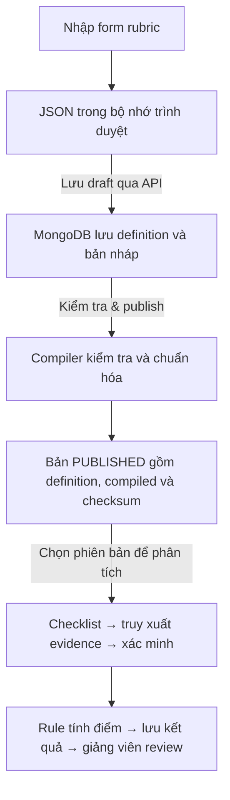

# Kịch bản demo giữa kỳ

Bản cập nhật theo giao diện, P2 `SCOPED_PHRASE_CONTEXT_V4` và hai cấu hình
NLI v2 đã chạy thật ngày 29/10/2026. Luồng chính khoảng 10–12 phút, dùng bộ báo cáo LIP đã lưu trên
máy demo. Quý thao tác web và trình bày kiến trúc, Pipeline 1; Yến trình bày
rubric, Pipeline 2 và phần cần hoàn thiện. Một người trình bày cũng dùng được
thứ tự này.

Các đoạn trích dẫn bên dưới là **lời nói gợi ý**, có thể diễn đạt lại theo
cách nói của mình. Phần **Code liên quan** để mở khi thầy hỏi, không cần đọc
hết trong lúc demo.

## Chuẩn bị trước khi trình bày

Tại thư mục gốc dự án, kiểm tra các dịch vụ:

```bash
.venv-research/bin/python scripts/dev_app.py status
```

Nếu chưa chạy, mở Docker Desktop, bảo đảm MongoDB của dự án đang hoạt động,
rồi khởi động web, API và worker:

```bash
.venv-research/bin/python scripts/dev_app.py start
```

Web ở <http://127.0.0.1:5173>. Trạng thái mong đợi: web trả HTTP 200; API và
proxy trả HTTP 401 khi chưa đăng nhập. Script dùng launchd trên macOS, giữ
các dịch vụ chạy khi đóng terminal hoặc phiên chat trong cùng phiên đăng nhập.

**Bộ đầu vào dùng xuyên suốt:**

| Thành phần | Chọn trên web |
|---|---|
| Workspace | Workspace có mã `demo-midterm-20261024` |
| Báo cáo | **LIP Midterm Report — đối chiếu và đánh giá** |
| Nguồn 1 | **LIP S1 — Quy trình xử lý và version** |
| Nguồn 2 | **LIP S2 — Diễn giải đánh giá search và ASR** |
| Nguồn 3 | **LIP S3 — Chăm sóc cây trong nhà kính** |
| Rubric | **Đánh giá báo cáo giữa kỳ nền tảng video bài giảng**, mã `lip-midterm-report-v1` |
| Pipeline | **Cả hai pipeline** |

Chỉ chọn ba nguồn S1/S2/S3 của bộ này; bỏ chọn nguồn `[DEMO]` có sẵn từ trước.
Dùng phiên bản rubric đã publish. Đầu vào và nhãn kỳ vọng đã được chốt trước
lượt chạy đầu tiên; giữ nguyên để so sánh kết quả giữa các phiên bản.

Trước buổi trình bày, mở thử lượt BM25 và lượt **BM25 + kiểm tra ngữ nghĩa** v2.
Nếu máy có GPU Apple MPS và model đã lưu trong cache, có thể mở thêm lượt
**BM25 + E5 + RRF, kiểm tra ngữ nghĩa** v2. Hai cấu hình này không dùng
relevance Cross-Encoder; P2 cùng giữ BM25 để so bước xác minh.
Workspace có cả các lượt cũ và lượt thử trung gian, nên cần chọn đúng lượt.
Mã lượt và đường dẫn các file riêng của bộ LIP nằm trong
[hướng dẫn trên máy demo](../../var/demo/lip-midterm-2026-10-25/KET_QUA_VA_CACH_MO_WEB.md).
Thư mục `var/` chỉ có trên máy đã chuẩn bị, không chứa trong bản Git.

**Code liên quan:** [scripts/dev_app.py](../../scripts/dev_app.py) quản lý
web/API/worker; [infra/mongodb/compose.yaml](../../infra/mongodb/compose.yaml)
chạy MongoDB và tác vụ khởi tạo. Luồng demo hiện dùng Docker cho MongoDB;
web, API và worker chạy trực tiếp trên máy.

## 1. Mở đầu và giới thiệu hai pipeline — khoảng 40 giây

**Thao tác:** đăng nhập → chọn workspace → **Phân tích báo cáo**.

> Thưa thầy, hôm nay nhóm em demo phần kiểm tra và đánh giá báo cáo trên web.
> Hệ thống có hai luồng: luồng thứ nhất đối chiếu nội dung báo cáo với các
> nguồn được chọn; luồng thứ hai kiểm tra báo cáo theo rubric. Khi xem kết
> quả, thầy có thể mở đoạn bằng chứng và ghi lại nhận xét cho từng mục.

> Đầu vào lần này là báo cáo LIP của nhóm. Nhóm chuẩn bị thêm ba nguồn để thử
> ba tình huống: một nguồn có đoạn nguyên văn, một nguồn diễn giải lại và một
> nguồn không liên quan. Các nguồn này được dựng để kiểm tra hệ thống, nên
> kết quả không dùng để kết luận báo cáo đã sao chép từ đâu.

**Code liên quan:**

- [AuthenticatedApp.tsx](../../apps/web/src/AuthenticatedApp.tsx): `signIn`,
  chọn workspace và điều hướng các màn hình.
- [auth/service.py](../../services/backend/src/kltn_ai/auth/service.py):
  `AuthService.login`, `authenticate`, `list_workspaces` xử lý tài khoản và phiên.
- [domain/access.py](../../services/backend/src/kltn_ai/domain/access.py):
  `AccessPolicy.require` kiểm tra quyền trong workspace.

## 2. Xem báo cáo và các nguồn — khoảng 50 giây

**Thao tác:** **Kho tài liệu** → chỉ báo cáo LIP và ba nguồn đã xử lý → mở
một file nếu cần. Có thể chỉ nhanh form **Thêm tài liệu** để giới thiệu upload.
Không cần tải lại cả bộ trong buổi trình bày.

> Ở đây em đã tải sẵn báo cáo và ba nguồn để tiết kiệm thời gian chờ. Khi
> người dùng tải file mới lên, backend lưu file thành một phiên bản riêng,
> rồi đưa công việc vào hàng đợi. Worker đọc nội dung và chia thành các đoạn;
> mỗi đoạn vẫn giữ thông tin vị trí để sau này tìm lại bằng chứng.

> Pipeline 1 sẽ tìm trong những nguồn mình chọn ở đây. Phiên bản hiện tại
> chưa tự tìm nguồn trên toàn bộ Internet.

Nếu thầy muốn xem upload trực tiếp: chọn loại tài liệu, file và tên tài liệu,
rồi **Tải lên và xử lý tài liệu**. Dùng một tài liệu phụ đã chuẩn bị để thử;
giữ nguyên phiên bản của bộ LIP đang dùng đối chiếu. Với tài liệu tự tạo,
thông báo cạnh nút upload ghi nhận xác nhận khi tải lên; giao diện không còn
ba ô checkbox bắt buộc như trước.

**Code liên quan:**

- [AuthenticatedReports.tsx](../../apps/web/src/AuthenticatedReports.tsx):
  `submitUpload` xử lý form, SHA-256 và gửi file qua API.
- [domain/documents.py](../../services/backend/src/kltn_ai/domain/documents.py):
  `DocumentService.upload` kiểm tra file, lưu phiên bản và tạo job.
- [worker/mongo_worker.py](../../services/backend/src/kltn_ai/worker/mongo_worker.py):
  `MongoParseWorker.process_one` và `_persist` chạy parse, lưu kết quả.
- [docx_parser.py](../../services/backend/src/kltn_ai/integrations/parsing/docx_parser.py):
  `extract_docx_elements` đọc DOCX của báo cáo này; PDF dùng
  [pdf_parser.py](../../services/backend/src/kltn_ai/integrations/parsing/pdf_parser.py).
- [chunking.py](../../services/backend/src/kltn_ai/integrations/indexing/chunking.py):
  `chunk_elements` chia đoạn và giữ liên kết về phần văn bản gốc.

## 3. Nhập rubric và giải thích cách hệ thống sử dụng — khoảng 2 phút 30 giây

**Thao tác:** **Rubric đánh giá** → mở rubric LIP → lần lượt chỉ thông tin
rubric, một tiêu chí, một checklist và các yêu cầu bằng chứng. Nếu muốn thử
nhập, mở một draft riêng; giữ nguyên bản publish của bộ LIP.

### Lời nói gợi ý khi chỉ từng phần trên form

> Khi tạo rubric, đầu tiên em nhập mã, tên và điểm tối đa. Sau đó em thêm các
> tiêu chí và phân bổ điểm cho từng tiêu chí. Với báo cáo LIP này, nhóm có
> ba tiêu chí, trọng số 3, 3 và 4, tổng cộng 10 điểm.

> Trong mỗi tiêu chí, em nhập các checklist, tức là từng điều cụ thể cần kiểm
> tra. Mỗi checklist có phát biểu, phạm vi tìm bằng chứng là LOCAL hay GRAPH,
> và mức quan trọng là cốt lõi, bắt buộc hoặc tùy chọn. LOCAL dùng các đoạn
> liên quan trong báo cáo; GRAPH hỗ trợ tập hợp bằng chứng từ nhiều vùng.

> Tiếp theo là yêu cầu bằng chứng. Ví dụ, checklist cần kiểm tra báo cáo có
> mô tả dữ liệu và cách chia tập. Em tạo hai yêu cầu riêng: một cho dữ liệu,
> một cho cách chia tập. Cả hai đều phải có bằng chứng. Trong từng yêu cầu,
> em có thể nhập nhiều cách diễn đạt tương đương; tìm được một cách là có
> ứng viên bằng chứng cho yêu cầu đó, rồi hệ thống còn kiểm tra ngữ cảnh.

> Nhóm phải nhập đến mức này vì phiên bản hiện tại chưa tự hiểu một tiêu chí
> viết chung chung để tách ra thành checklist. Các cụm từ giúp hệ thống biết
> cần tìm nội dung gì, thay vì tự đoán ý người chấm. Nếu có phản chứng rõ,
> người soạn có thể khai báo thêm cụm thể hiện yêu cầu chưa được đáp ứng.

**Thao tác tiếp:** mở **JSON nâng cao** để chỉ cùng dữ liệu dưới dạng JSON;
không sửa JSON của rubric đã publish. Nếu dùng draft riêng, **Lưu draft**
rồi **Kiểm tra & publish** sau khi đã điền đủ.

> Khi em điền form, web đã cập nhật những thông tin đó thành cấu trúc JSON
> trong ứng dụng. JSON ở đây là định dạng để gửi và lưu rubric, chưa phải
> kết quả chấm. Người dùng vẫn nhập bằng form; không cần tự viết một file JSON.

> Bấm “Lưu draft” thì dữ liệu được gửi qua API và lưu thành bản nháp trong
> MongoDB. Khi bấm “Kiểm tra & publish”, backend gọi compiler để kiểm tra và
> chuẩn hóa: chẳng hạn tổng trọng số phải bằng điểm tối đa, mã không bị
> trùng và mỗi checklist có đủ yêu cầu bằng chứng. Nếu hợp lệ, hệ thống lưu
> bản dùng để thực thi và khóa phiên bản đó lại.

> Đến lúc phân tích, em chọn đúng phiên bản rubric đã publish. Backend lấy
> checklist trong phiên bản đó, tìm các đoạn liên quan trong báo cáo, xác
> minh từng yêu cầu rồi mới tính điểm bằng rule. Vì vậy mình truy lại được
> lượt này dùng rubric nào, có những yêu cầu gì và dựa vào bằng chứng nào.

### Các mục thực sự nhập/chọn trên giao diện

Bảng này để giải thích thêm khi thầy hỏi, không cần đọc lần lượt mọi dòng.

| Cấp | Mục nhập/chọn | Dùng để làm gì? |
|---|---|---|
| Rubric | **Mã rubric**, **Tên rubric**, **Điểm tối đa** | Định danh bộ rubric và xác định thang điểm chung. |
| Tiêu chí | **Tên tiêu chí**, **Mã tiêu chí**, **Trọng số (điểm)** | Xác định phần cần chấm và số điểm tối đa của phần đó; tổng trọng số phải bằng điểm tối đa. |
| Checklist | **Phát biểu cần kiểm chứng**, **Mã checklist** | Biến tiêu chí lớn thành một điều cụ thể cần kiểm tra và liên kết kết quả về đúng mục. |
| Checklist | **Phạm vi bằng chứng**: `LOCAL` hoặc `GRAPH` | Chọn đường truy xuất bằng chứng; `GRAPH` hiện dùng graph cấu trúc/từ vựng. |
| Checklist | **Mức quan trọng**: `CORE`, `REQUIRED`, `OPTIONAL` | Áp dụng quy tắc tính điểm tương ứng; đây không phải nhãn đạt/chưa đạt của báo cáo. |
| Yêu cầu bằng chứng | **Mã yêu cầu**, **Mô tả** không bắt buộc | Tách rõ từng nội dung phải được hỗ trợ bằng bằng chứng. |
| Yêu cầu bằng chứng | **Cách diễn đạt cần tìm**, có thể thêm nhiều cách | Khai báo các cụm được tìm trong report, bằng ngôn ngữ có thể xuất hiện trong report. Mỗi yêu cầu cần ít nhất một cách diễn đạt. |
| Phản chứng, tùy chọn | **Cụm từ thể hiện không đáp ứng** | Khai báo dấu hiệu trực tiếp cho thấy checklist không đạt; verifier còn kiểm tra ngữ cảnh trước khi dùng. |

Form có gợi ý mã tiêu chí/checklist/yêu cầu để người dùng khỏi tự đánh số;
có thể sửa các mã này. Điểm tối đa mặc định là 10, phạm vi mặc định `LOCAL`,
mức quan trọng mặc định `REQUIRED`. `LOCAL` cần ít nhất một yêu cầu bằng chứng;
`GRAPH` cần ít nhất hai yêu cầu. Cách chấm `PROPORTIONAL_CHECKLIST_V0` được
hệ thống điền sẵn. Người dùng chưa nhập được thang mức tùy chỉnh để thực thi.

Ở bước soạn rubric, người dùng khai báo **điều cần kiểm tra**, không nhập sẵn
`MET/UNMET/CANNOT_ASSESS` cho báo cáo. Các nhãn đó xuất hiện sau bước đánh giá
hoặc trong phần review riêng.

### Vì sao phải phân biệt “và” với “hoặc”?

Ví dụ minh họa cách nhập, không phải thay đổi rubric LIP đang dùng:

| Cấp | Nội dung |
|---|---|
| Checklist | Báo cáo mô tả bộ dữ liệu và cách chia tập. |
| Yêu cầu R1 | Tìm `bộ dữ liệu` **hoặc** `dataset`. |
| Yêu cầu R2 | Tìm `chia tập` **hoặc** `data split`. |
| Điều kiện hỗ trợ checklist | Cần bằng chứng cho **R1 và R2**, sau khi kiểm tra ngữ cảnh và phản chứng. |

Nếu đưa cả bốn cụm vào cùng một `any_of`, chỉ cần tìm được một cụm là đã có
hit cho yêu cầu đó, dù nội dung còn lại chưa xuất hiện. Vì vậy các ý độc lập
phải tách thành các yêu cầu riêng. Có hit mới là bước đầu; câu dự kiến làm,
câu phủ định hoặc phản chứng chưa phân xử vẫn có thể dẫn đến `CANNOT_ASSESS`.

### Sau khi nhập, dữ liệu đi qua những bước nào?



1. **Đang nhập form:** `RubricVisualEditor` cập nhật dữ liệu JSON ngay khi sửa
   một trường. Chưa có file `.json` nào tự được ghi ra ổ đĩa.
2. **Lưu draft:** web gửi JSON đến API. Lần tạo mới gửi
   `{rubric_key, title, definition}`; khi sửa draft gửi definition mới cho
   phiên bản đó. Backend kiểm tra cấu trúc API và lưu vào `rubrics`,
   `rubric_versions`. Lưu được draft chưa có nghĩa compiler đã chấp nhận để chạy.
3. **Kiểm tra & publish:** backend kiểm revision, gọi adapter và compiler để
   kiểm nội dung có thực thi được không, tổng trọng số, mã và cấu trúc yêu cầu.
   Adapter chuyển các tên như `criterion_key` thành `criterion_id`,
   `checklist_key` thành `checklist_id`, `evidence_mode` thành `mode`;
   compiler chuẩn hóa và bổ sung các giá trị mặc định.
4. **Khóa bản publish:** lưu definition người soạn, bản `compiled`, phiên bản
   compiler và SHA-256. Chỉ bản `PUBLISHED` dùng được để phân tích; muốn sửa
   nội dung thì tạo draft phiên bản mới.
5. **Tạo lượt phân tích:** backend kiểm tra tính toàn vẹn của rubric, khóa ID
   phiên bản và checksum vào lượt chạy, rồi chuyển snapshot cho worker.
6. **Chạy Pipeline 2:** checklist được dùng để truy xuất evidence; verifier
   xét support, phủ định, kế hoạch và phản chứng; `_score_criteria` tính điểm
   theo rule. Bất kỳ checklist nào còn `CANNOT_ASSESS` đều giữ điểm tiêu chí
   liên quan và điểm tổng ở `null`, kể cả checklist `OPTIONAL`.

**Nhập JSON từ file** là đường nhập bổ sung cho người đã chuẩn bị cấu trúc
rubric; không phải bước bắt buộc sau khi nhập form. Nút **Export JSON kết quả**
ở màn hình phân tích xuất kết quả của lượt chạy, là chức năng khác với soạn
rubric. Hiện giao diện chưa có nút xuất riêng một file rubric.

<details>
<summary>Ví dụ JSON tương ứng với form — mở khi cần chỉ dữ liệu</summary>

Đây là ví dụ request tạo rubric, gồm thông tin rubric và `definition`. JSON
này không chứa kết quả của một báo cáo. Ví dụ dùng một tiêu chí 10 điểm để dễ
đọc; bộ LIP thực tế vẫn có ba tiêu chí và 10 checklist.

```json
{
  "rubric_key": "example-data-rubric",
  "title": "Rubric ví dụ về trình bày dữ liệu",
  "definition": {
    "max_score": 10,
    "criteria": [
      {
        "criterion_key": "C1",
        "title": "Trình bày dữ liệu",
        "weight": 10,
        "scoring_mode": "PROPORTIONAL_CHECKLIST_V0",
        "checklists": [
          {
            "checklist_key": "C1.1",
            "statement": "Báo cáo mô tả bộ dữ liệu và cách chia tập.",
            "evidence_mode": "LOCAL",
            "importance": "REQUIRED",
            "requirements": [
              {
                "requirement_id": "R1",
                "description": "Có mô tả bộ dữ liệu.",
                "any_of": ["bộ dữ liệu", "dataset"]
              },
              {
                "requirement_id": "R2",
                "description": "Có mô tả cách chia tập.",
                "any_of": ["chia tập", "data split"]
              }
            ],
            "contradiction_patterns": ["chưa chuẩn bị dữ liệu"]
          }
        ]
      }
    ]
  }
}
```

JSON nâng cao trong editor hiển thị phần `definition`; mã và tên rubric nằm
ở các ô bên ngoài. Đường nhập file nhận được cả definition riêng hoặc request
có wrapper như ví dụ trên. Mở file vào editor chưa lưu vào database; vẫn phải
**Lưu draft** và **Kiểm tra & publish**.

</details>

**Code liên quan, theo đúng thứ tự dữ liệu đi qua:**

- [RubricVisualEditor.tsx](../../apps/web/src/RubricVisualEditor.tsx):
  `blankRubricDefinition` tạo cấu trúc rỗng; `updateDefinition`,
  `updateCriterion`, `updateChecklist`, `updateRequirement` chuyển thay đổi
  trên form thành JSON bằng `JSON.stringify`.
- [AuthenticatedApp.tsx](../../apps/web/src/AuthenticatedApp.tsx): `saveDraft`
  đọc JSON bằng `parseDefinition` rồi gửi API; `publish` gọi publish;
  `clone` tạo draft mới; `importDefinition` đọc file JSON nếu người dùng chọn.
- [authenticatedApi.ts](../../apps/web/src/authenticatedApi.ts): `createRubric`,
  `updateRubricDraft`, `publishRubricVersion` gửi request JSON đến backend.
- [domain/rubrics.py](../../services/backend/src/kltn_ai/domain/rubrics.py):
  `RubricService.create`, `update_draft` lưu definition; `publish_version`
  lưu bản compiled; `get_compiled_published` kiểm tra và lấy đúng bản đã khóa.
- [rubric_api.py](../../research/core_mvp/rubric_api.py):
  `compile_api_rubric_definition` ánh xạ định dạng API sang định dạng thực thi;
  [rubric.py](../../research/core_mvp/rubric.py): `compile_rubric` kiểm tra,
  chuẩn hóa và tạo checksum cho bản compiled.
- [domain/analysis.py](../../services/backend/src/kltn_ai/domain/analysis.py):
  `AnalysisService.create`, `snapshot` khóa phiên bản rubric vào lượt chạy;
  [assessment.py](../../research/core_mvp/assessment.py):
  `run_assessment_pipeline`, `_verify`, `_score_criteria` dùng rubric để đánh giá.
- [rubric-v1.md](../rubric/rubric-v1.md): thiết kế rubric/checklist của Yến;
  bộ 43 checklist mẫu trong tài liệu dành cho Mobile Banking, còn bộ đang
  demo đã được soạn riêng theo báo cáo LIP.

## 4. Chạy BM25 trực tiếp — khoảng 45 giây

**Thao tác:** quay lại **Phân tích báo cáo** → chọn báo cáo LIP, ba nguồn,
rubric đã publish → **Cả hai pipeline** → mở **Cấu hình phân tích** và chọn
**BM25** → bấm **Phân tích báo cáo** ở cuối form.

> Em chạy cấu hình BM25 trước để thầy xem trọn luồng. Sau khi bấm, web yêu
> cầu chuẩn bị index cho những nguồn đã chọn. Khi index sẵn sàng, hệ thống
> mới tạo lượt phân tích và worker chạy cả hai pipeline ở phía backend.

> Mỗi lượt giữ lại đúng phiên bản báo cáo, nguồn, rubric và cấu hình đã dùng.
> Vì vậy sau này có sửa tài liệu thì mình vẫn xem lại được đầu vào của lượt cũ.

**Code liên quan:**

- [AuthenticatedReports.tsx](../../apps/web/src/AuthenticatedReports.tsx):
  `startRun` gửi yêu cầu index, chờ sẵn sàng rồi mới gọi tạo lượt phân tích.
- [worker/mongo_index_worker.py](../../services/backend/src/kltn_ai/worker/mongo_index_worker.py):
  `MongoIndexWorker.process_one` thực hiện công việc index.
- [domain/analysis.py](../../services/backend/src/kltn_ai/domain/analysis.py):
  `AnalysisService.create` và `snapshot` khóa đầu vào của lượt chạy.
- [db/mongo_jobs.py](../../services/backend/src/kltn_ai/db/mongo_jobs.py):
  `MongoJobQueue` quản lý hàng đợi, nhận việc và lease.
- [worker/bounded_pipeline.py](../../services/backend/src/kltn_ai/worker/bounded_pipeline.py):
  `execute_snapshot` gọi hai pipeline; `run_bounded` giới hạn quá trình xử lý.

## 5. Pipeline 1: xem đoạn trùng và nguồn — khoảng 1 phút

**Thao tác:** **Đối chiếu nguồn** → **Khớp nguyên văn** → mở một cặp báo cáo–S1.
Sau đó chỉ sang **Ứng viên cần review** nếu cần.

> Ở phần này, đoạn trong báo cáo và đoạn nguồn được đặt cạnh nhau. Với nguồn
> S1, hệ thống tìm đúng hai đoạn nguyên văn đã chuẩn bị. Trên màn hình, mức
> bao phủ được làm tròn khoảng 3,5%. Đây là phần nội dung có khớp nguyên văn
> trong phạm vi nguồn đang chọn, chưa phải tỷ lệ đạo văn.

> Nguồn S2 có nội dung diễn giải lại. Hệ thống đã truy xuất được nguồn liên
> quan. Lượt BM25 thường chưa xác nhận paraphrase. Khi mở lượt NLI v2 và bấm
> “Diễn đạt tương đương”, hệ thống đề xuất được một cặp ở đoạn P128; cặp dự
> kiến ở P131 vẫn chưa đủ căn cứ. Hai câu được so sánh nằm cạnh nhau để thầy
> kiểm tra. Đề xuất này không làm tăng phần trăm khớp nguyên văn.

> NLI đọc theo hai chiều: câu báo cáo có được câu nguồn hỗ trợ không, và
> ngược lại. Cả hai phải qua ngưỡng cùng các kiểm tra số liệu và phạm vi câu.
> Đây là đề xuất tương đương nghĩa của đoạn được hiển thị; chưa chứng minh
> báo cáo đã sao chép nguồn. Những cặp chưa xác định vẫn được giữ riêng.

**Ghi chú khi trình bày:** số chính xác của bộ hiện tại là 125/3.611 token,
tương đương 3,4616%. Hai anchor nguyên văn nằm trong cùng một chunk báo cáo.
Với DOCX, có thể mở file gốc; chưa có highlight chính xác đến vùng văn bản
như một PDF viewer hoàn chỉnh. Nếu lượt đang xem có số khác, đọc theo kết
quả thực tế và kiểm tra lại phạm vi nguồn, không đọc cố định số đã chuẩn bị.

**Code liên quan:**

- [similarity.py](../../research/core_mvp/similarity.py):
  `run_similarity_pipeline` chạy Pipeline 1; `_classify` tách exact match và
  ứng viên; `_alignment` xác định span; `_is_evidence_backed_exact_span`
  kiểm tra bằng chứng trước khi tính coverage.
- [AuthenticatedResults.tsx](../../apps/web/src/AuthenticatedResults.tsx):
  tab đối chiếu, bộ lọc và hai đoạn báo cáo–nguồn trên giao diện.
- [semantic_verification.py](../../research/core_mvp/semantic_verification.py):
  `BidirectionalNliVerifier` so cửa sổ 1–2 câu, giữ span gốc và abstain khi
  thiếu cơ sở. `_linked_citation_number_ranges` trong `similarity.py` chỉ
  bỏ số của marker đã liên kết bibliography khỏi numeric guard; chưa xác
  minh nội dung trích dẫn. Ngưỡng được chọn trên DEV, chưa calibration.

## 6. Pipeline 2: giải thích ba trạng thái — khoảng 1 phút 30 giây

**Thao tác:** **Đánh giá rubric** → chỉ số tổng hợp → xem lần lượt C1.1,
C3.1 và C2.3 để có đủ ví dụ đạt, chưa đạt và chưa đủ căn cứ.

> Với Pipeline 2, mỗi checklist có kết luận và đoạn bằng chứng đi kèm.
> Ở lượt hiện tại có 6 mục đạt, 3 mục chưa đạt và 1 mục chưa đủ căn cứ.

> C1.1 là ví dụ đạt: báo cáo có nội dung mô tả các thành phần kiến trúc.
> C3.1 là ví dụ chưa đạt: báo cáo nói rõ các mốc phân chia chủ đề chưa được
> xác minh độc lập. Còn C2.3 là chưa đủ căn cứ vì chưa có bằng chứng về độ bất định
> của kết quả, như khoảng tin cậy hoặc độ phân tán theo từng video.

> Mỗi trạng thái có ý nghĩa khác nhau. Nhắc đến một phương pháp chưa chứng
> minh đã thực hiện phương pháp đó; còn thiếu bằng chứng cũng chưa đủ để
> kết luận công việc đã làm sai.

> Do vẫn còn mục chưa đánh giá được, hệ thống đang để điểm tổng là “Chưa đủ
> cơ sở”. Con số 6/10 trên dashboard là số checklist đạt, không phải báo cáo
> được chấm 6 điểm trên 10.

**Kết quả để đối chiếu, không cần đọc cả bảng:**

| Nội dung | Lượt gốc | V3 (25/10) | V4 (29/10) |
|---|---:|---:|---:|
| Checklist đạt | 2 | 4 | 6 |
| Checklist chưa đạt | 0 | 1 | 3 |
| Checklist chưa đủ căn cứ | 8 | 5 | 1 |
| Nhãn trùng với kỳ vọng đã chốt | 3/10 | 6/10 | 10/10 |
| Điểm tổng | Chưa xác định | Chưa xác định | Chưa xác định |

> Sau khi sửa bước xác minh, cả 10 nhãn đã khớp kỳ vọng của bộ LIP. Nhóm giữ
> nguyên rubric, bằng chứng và nhãn; sửa cách đọc kế hoạch, pending và phạm
> vi phủ định. Kết quả này là trên bộ đang dùng để phát triển. Nhóm vẫn cần đánh giá
> trên báo cáo khác có người gán nhãn độc lập để biết mức cải thiện tổng quát.

**Code liên quan:**

- [assessment.py](../../research/core_mvp/assessment.py):
  `run_assessment_pipeline` chạy Pipeline 2; `_rank_local` tìm evidence;
  `_verify` quyết định trạng thái; `_score_criteria` tính điểm theo rule.
- Cũng trong `assessment.py`: `_negated_clause` xử lý cue phủ định,
  `_non_asserted_context` tách kế hoạch/chờ thực hiện/giả định,
  `_denied_counterclaim_context` kiểm tra phản chứng bị bác bỏ trực tiếp.
  Chốt `UNRESOLVED_COUNTERCLAIM_SCOPE` trong `_verify` giữ các trường hợp
  chưa rõ phạm vi để giảng viên xem lại.
- [graph.py](../../research/core_mvp/graph.py): `rank_graph` phục vụ checklist
  GRAPH; hiện là graph cấu trúc/từ vựng với Personalized PageRank.
- [AuthenticatedResults.tsx](../../apps/web/src/AuthenticatedResults.tsx):
  số checklist, trạng thái, lý do và các trích đoạn đang hiển thị.

## 7. Mở lượt NLI v2 đã lưu để so sánh — khoảng 40 giây

**Thao tác:** ngay trong **Kết quả & bằng chứng**, chọn **Xem kết quả của báo
cáo** → báo cáo LIP → **Lượt phân tích đã lưu** → lượt BM25 + NLI v2 hoặc RRF + NLI v2.
Có thể dùng **Mở lượt phân tích bằng mã** theo hướng dẫn riêng trên máy.

> Đây là lượt RRF + NLI nhóm đã chạy và lưu. Pipeline 1 kết hợp BM25 với E5,
> hợp nhất thứ hạng bằng RRF, rồi kiểm tra tương đương từng cặp đoạn bằng NLI
> hai chiều. Lượt này không dùng relevance Cross-Encoder. Pipeline 2 giữ
> truy xuất BM25; checklist GRAPH vẫn dùng graph cấu trúc và từ vựng.

> Trên báo cáo này, hai lượt NLI cùng đề xuất được một cặp paraphrase và
> cùng 10 nhãn checklist. RRF chưa cải thiện thêm so với BM25 + NLI trong ca
> này, còn nhiều cặp hệ thống chưa xác định được quan hệ. Nhóm giữ những
> kết quả đó để tiếp tục phân tích thay vì ép model đưa ra nhãn chắc chắn.

Nếu đủ thời gian có thể chạy NLI v2 trực tiếp; báo rõ đang chạy lượt mới và
đợi worker hoàn tất. Không dùng thời gian core của một lượt đã lưu để gọi
là thời gian chờ end-to-end của lượt đang trình bày.

**Code liên quan:**

- [AuthenticatedReports.tsx](../../apps/web/src/AuthenticatedReports.tsx):
  `selectReport`, `loadRun`, `openRun`, `moreRuns` chọn và mở lại lượt đã lưu.
- [bm25-nli-v2.json](../../services/backend/configs/bm25-nli-v2.json) và
  [rrf-nli-v2.json](../../services/backend/configs/rrf-nli-v2.json): model và
  policy của hai lượt mới; [bounded_pipeline.py](../../services/backend/src/kltn_ai/worker/bounded_pipeline.py):
  `configuration` chọn cấu hình phía server.
- [offline_retrieval/](../../research/offline_retrieval/): BM25, dense, RRF
  và Cross-Encoder; `_rerank_chunks` trong `similarity.py` nối bước rerank.

## 8. Review, export và kết thúc — khoảng 1 phút

**Thao tác:** mở lại lượt BM25 vừa chạy → **Review chi tiết từng cặp đoạn /
checklist** → chọn một mục, nhãn, evidence và lý do → lưu. Bấm **Export JSON
kết quả**, rồi mở lại lượt đó nếu còn thời gian.

> Sau khi xem đoạn bằng chứng, giảng viên có thể lưu nhãn và nhận xét riêng.
> Phần review được giữ tách khỏi kết quả máy. Khi mở lại lượt phân tích, mình
> vẫn kiểm tra được máy đã đề xuất gì và người review đã nhận xét thế nào.

> Hiện nhóm đã nối được luồng từ tải tài liệu, soạn rubric đến chạy hai
> pipeline và xem bằng chứng trên web. Phần tiếp theo nhóm ưu tiên là bộ dữ
> liệu gán nhãn, nhận diện diễn giải lại ở Pipeline 1 và xác minh ngữ nghĩa
> ở Pipeline 2. LIP đã khớp các nhãn kỳ vọng nhưng chưa đủ chứng minh tổng
> quát; ở bộ ca mới vẫn còn lỗi. Nhóm sẽ bổ sung người gán nhãn độc lập và
> giữ lại các trường hợp model chưa xác nhận được.

Nhãn kỳ vọng đã nhập từ trước nằm trên **lượt Hybrid gốc**. Các lượt mới không
được tự sao chép những nhãn đó sang. Khi minh họa review, dùng lượt mới và
nhận xét đúng bằng chứng; thao tác đã xem dự đoán máy không phải gán gold độc lập.

**Code liên quan:**

- [AuthenticatedItemAnnotations.tsx](../../apps/web/src/AuthenticatedItemAnnotations.tsx):
  chọn nhãn, evidence, lý do và lưu review từng mục.
- [domain/item_annotations.py](../../services/backend/src/kltn_ai/domain/item_annotations.py):
  `ItemAnnotationService.create`, `history`, `export` lưu và đọc lịch sử.
- [AuthenticatedReports.tsx](../../apps/web/src/AuthenticatedReports.tsx):
  `exportRun` tải JSON kết quả; [api/analysis_routes.py](../../services/backend/src/kltn_ai/api/analysis_routes.py)
  có route export và review toàn lượt.
- [worker/mongo_analysis_worker.py](../../services/backend/src/kltn_ai/worker/mongo_analysis_worker.py):
  `_evidence` và `_persist` lưu kết quả máy cùng bằng chứng vào MongoDB.

## Nếu thầy hỏi thêm

### “Hai pipeline là backend hay frontend?”

> Hai pipeline xử lý ở phía backend. Code phương pháp nằm trong
> `research/core_mvp`, còn worker trong `services/backend` gọi phần đó và lưu
> kết quả. Frontend gửi yêu cầu, theo dõi trạng thái rồi hiển thị kết quả.

Mở [bounded_pipeline.py](../../services/backend/src/kltn_ai/worker/bounded_pipeline.py),
hàm `execute_snapshot`, rồi đi đến `run_similarity_pipeline` và
`run_assessment_pipeline` nếu cần chỉ luồng gọi.

### “Vì sao có checklist rồi mà kết quả vẫn chưa đúng hết?”

> Checklist giúp xác định cần kiểm tra nội dung gì. Khó hơn là đọc đúng bằng
> chứng: câu đó nói đã làm, đang dự kiến làm hay đang phủ định một việc khác.
> Bản hiện tại có bổ sung rule cho các trường hợp này nhưng chưa có bộ xác
> minh ngữ nghĩa đầy đủ, nên vẫn giữ những mục chưa chắc để người chấm xem lại.

Mở `_verify` trong [assessment.py](../../research/core_mvp/assessment.py).
V4 đã sửa bốn mục lệch của LIP ở V3, nhưng trên challenge mới vẫn có một ca
phủ định tiếng Việt bị giữ ở CANNOT_ASSESS. Nguồn ngoài đang phục vụ Pipeline 1;
Pipeline 2 chưa tự xác minh claim với tài liệu đối chứng ngoài.

### “Graph đã làm đến đâu?”

> Nhóm đã có graph cấu trúc và liên kết từ vựng để tập hợp các đoạn liên quan.
> Phần trích xuất claim, entity và quan hệ ngữ nghĩa đầy đủ vẫn cần làm tiếp.
> Nhóm sẽ so với LOCAL trên cùng dữ liệu để kiểm tra graph giúp được loại
> checklist nào.

Mở `_build_graph`, `rank_graph` trong [graph.py](../../research/core_mvp/graph.py).

### “Rubric và cách chấm đã giống thiết kế ban đầu chưa?”

> Hiện đã nhập, chuẩn hóa, publish và chạy checklist được. Phần tự tách tiêu
> chí thành checklist và cách nội suy theo các mức điểm trong thiết kế ban
> đầu chưa được thực thi đầy đủ. Bản đang chạy tính điểm theo tỷ lệ checklist
> và giữ điểm chưa xác định khi còn mục chưa đủ căn cứ.

Đối chiếu [rubric-v1.md](../rubric/rubric-v1.md) với `compile_rubric` và
`_score_criteria`. Quy tắc hiện hành giữ thiếu evidence ở `CANNOT_ASSESS`;
khác biệt này cần thống nhất với thiết kế chấm điểm của nhóm và GVHD.

### “Đã kiểm chứng bằng cách nào?”

> Nhóm có test cho parser, quyền truy cập, lưu phiên bản, quyết định checklist
> và luồng trình duyệt qua MongoDB thật. Với phần P2 vừa sửa, có 80 kiểm tra
> ngữ cảnh và regression. Các test này giúp kiểm tra phần mềm; độ chính xác
> của phương pháp vẫn cần đo riêng trên dữ liệu có nhãn độc lập.

| Cần mở | File |
|---|---|
| 68 ca ngữ cảnh tổng hợp Việt/Anh | [test_assessment_context_verification.py](../../research/tests/test_assessment_context_verification.py) |
| 12 regression về phủ định và giữ điểm chưa xác định | [test_core_mvp_assessment_regression.py](../../research/tests/test_core_mvp_assessment_regression.py) |
| Browser → API → Mongo → worker thật | [authenticated.mongo.ts](../../apps/web/tests/authenticated.mongo.ts) |
| Thực nghiệm retrieval thành phần đã có | [Báo cáo DEV0 A1–A5](../benchmarks/pan-pc-11-cross-encoder-ablation-dev0-result.md) |
| So sánh đầu ra mới, gồm các trường hợp chưa đạt | [Kết quả 29/10](../benchmarks/output-quality-development-2026-10-29.md) |

Snapshot sạch `9b9721d`: **868 test Python pass, 21 skip**; build web pass;
ba lượt BM25 / BM25 + NLI v2 / RRF + NLI v2 hoàn tất qua web thật, giữ nguyên
kết quả máy cũ. Đây là kiểm tra phần mềm. Bộ challenge do trợ lý soạn, chưa
phải gold độc lập và không đưa vào bảng độ chính xác của bài báo PAN.

## Những ý cần xin thầy góp ý

Chọn hai hoặc ba câu phù hợp thời gian còn lại:

- Với mục bắt buộc nhưng báo cáo không đề cập, thầy muốn giữ “chưa đủ căn cứ”
  hay đánh dấu “chưa đạt” sau khi đã kiểm tra đủ phạm vi báo cáo?
- Với các mục còn chưa đánh giá được, cách giữ điểm tổng chưa xác định có phù
  hợp không, hay cần một quy trình giảng viên xác nhận để chốt điểm?
- Nhóm nên ưu tiên loại checklist và nguồn báo cáo nào cho pilot gán nhãn
  độc lập, để có bộ kiểm chứng phù hợp phạm vi khóa luận?
- Với bài báo, nhóm dự kiến tập trung thực nghiệm truy xuất nguồn và reranking;
  phạm vi đó có phù hợp, trong khi phần đánh giá rubric tiếp tục hoàn thiện
  trong khóa luận không?

## Khi thiếu thời gian hoặc luồng chạy gặp lỗi

- **Chỉ còn 4–5 phút:** mở lượt v2 đã lưu, nói rõ đã chạy trước; trình bày một
  cặp nguyên văn, ba trạng thái checklist, một review và phần cần hoàn thiện.
- **Không thấy kết quả:** chọn báo cáo ngay trong **Kết quả & bằng chứng**, rồi
  chọn lượt ở **Lượt phân tích đã lưu**. Nếu khó phân biệt các lượt, mở bằng
  mã trong hướng dẫn riêng trên máy.
- **Mạng/API hoặc worker lỗi:** kiểm tra `.venv-research/bin/python scripts/dev_app.py status`.
  Dùng JSON export hoặc ảnh kết quả đã lưu để trình bày phần đã chạy, nói rõ
  thời điểm lưu; chưa có output mới thì không gọi là lượt vừa chạy thành công.
- **NLI chờ lâu:** mở lượt NLI v2 đã lưu để đối chiếu và giới thiệu đúng
  cấu hình đó. Không đổi sang BM25 rồi gọi kết quả là Hybrid.
