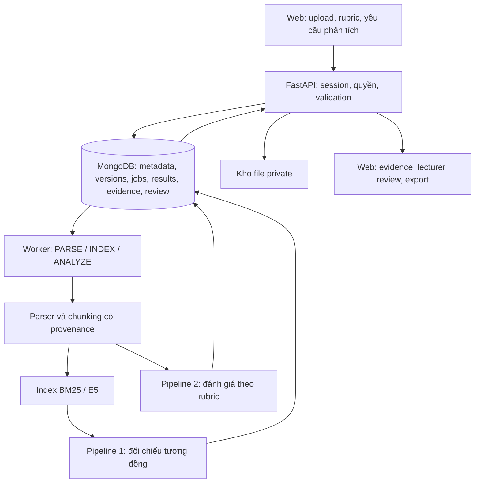

# Tổng hợp backend cho báo cáo giữa kỳ

Đối chiếu mã nguồn và tài liệu ngày **24/10/2026**; dùng để chuẩn bị buổi báo
cáo ngày **25/10/2026**. Nội dung mô tả implementation hiện tại, không thay cho
approval/review hoặc kết luận chất lượng nghiên cứu.

## 1. Hai pipeline có thuộc backend không?

**Có.** Backend của dự án gồm API, nghiệp vụ, worker, xử lý tài liệu, thuật toán
của hai pipeline, lưu trữ và công cụ thực nghiệm. Frontend chỉ thu thập đầu vào,
gửi yêu cầu, theo dõi tiến độ và trình bày kết quả/evidence.

Logic nghiên cứu hiện ở `research/core_mvp/` và `research/offline_retrieval/`.
Dù nằm trong thư mục `research`, các module này được worker backend gọi thật
khi chạy phân tích trên web.



API và worker là các tiến trình riêng dùng chung codebase Python. Tác vụ
parse/model không chạy dài trong HTTP request. Hiện MongoDB chạy Docker;
API/worker/web chạy trên macOS, có launcher `scripts/dev_app.py` quản bằng launchd.
Đây là triển khai local; chưa phải toàn bộ ứng dụng đã được container hóa.

## 2. Các thành phần backend đã triển khai

| Thành phần | Đã làm | Ý nghĩa khi demo |
|---|---|---|
| API và phân quyền | FastAPI, session cookie, scrypt password, CSRF, workspace RBAC/ownership, audit | Dữ liệu được truy cập theo người dùng/workspace; web không kết nối DB trực tiếp |
| MongoDB | Replica set, schema validators, indexes, migrations 001–005; identities riêng cho migration/API/worker | Lưu trạng thái thật; hỗ trợ transaction và kiểm quyền DB |
| Upload và quản lý version | PDF/DOCX/TXT/MD, giới hạn 20 MiB, kiểm định dạng/hash/quyền dùng; file/version riêng; danh sách và lịch sử | Upload file mới hoặc version mới, không cần dùng kết quả tính sẵn |
| Parsing | PyMuPDF cho PDF, python-docx cho DOCX; bóc text, cấu trúc và vị trí; chuẩn hóa nội dung | Chuẩn bị đầu vào chung cho cả hai pipeline |
| Chunking và provenance | Chia đoạn theo cấu trúc, stable IDs, raw/normalized mapping, source spans; lưu elements/chunks trong Mongo | Từ một kết quả truy ngược về đoạn và version gốc |
| Queue và worker | PARSE/INDEX/ANALYZE, lease/heartbeat, retry, idempotency, kiểm stale/cancel; transaction khi ghi output | Web theo dõi job; retry không tự tạo kết quả trùng hoặc ghi nửa chừng |
| Indexing | BM25 postings và E5 vectors; index generations, active head, checksum, rebuild; reuse source vectors khi phù hợp | Chuẩn bị nguồn để truy xuất; khóa đúng index dùng trong lượt chạy |
| Rubric lifecycle | Tạo/sửa draft, validate, publish bất biến, clone/version; compiler và compiled hash; từ chối chế độ điểm chưa hỗ trợ | Nhập rubric mới trên form, publish rồi dùng đúng version |
| Kết quả và evidence | Chạy BOTH/SIMILARITY/ASSESSMENT; lưu report/source/rubric/config/index versions; đọc lại, evidence API và JSON export | Chứng minh kết quả do worker tạo, lưu được và truy vết được |
| Lecturer review | Chấp nhận/loại đề xuất ở cấp run; review nhãn/evidence/lý do từng cặp hoặc checklist; lịch sử append-only | Giảng viên giữ quyền quyết định; đầu ra máy và nhận xét người dùng được lưu riêng |
| Công cụ đánh giá | Retrieval runner, manifest/checksum, metric tests; hai phiếu annotation, agreement/kappa, adjudication, freeze/evaluate gold | Đã có công cụ kiểm chứng; còn cần nhãn con người đủ điều kiện |

Parser và model chạy trong subprocess có giới hạn thời gian, CPU và kích
thước input/output. Có address-space cap trên Linux; không tuyên bố hard RAM
cap tương đương trên macOS. JSON Schema và integrity checks được dùng để
kiểm đầu ra trước khi lưu/đọc.

## 3. Pipeline 1 — Đối chiếu nội dung tương đồng

### Luồng đã chạy

```text
Các đoạn báo cáo + kho nguồn đã chọn
→ BM25 và, nếu cấu hình bật, Dense E5
→ RRF hợp nhất danh sách
→ Cross-Encoder xếp hạng lại, nếu cấu hình bật
→ đối chiếu exact spans và xác định ứng viên cần review
→ hợp nhất coverage, tổng hợp theo nguồn
→ Similarity Report + evidence
```

- **BM25:** tìm đoạn nguồn khớp từ vựng.
- **Dense:** dùng `intfloat/multilingual-e5-small` để bổ sung ứng viên liên quan
  ngữ nghĩa; revision đã khóa và chạy từ cache local.
- **RRF:** hợp nhất thứ hạng của các phương pháp; có regression cho ID trùng.
- **Cross-Encoder:** dùng `cross-encoder/mmarco-mMiniLMv2-L12-H384-v1` để xếp
  hạng mức liên quan; không phải bộ xác minh đạo văn.
- **Đối chiếu:** xác định các đoạn khớp nguyên văn có evidence; giữ các ứng
  viên chưa được xác minh ở nhóm cần review.
- **Tổng hợp:** coverage dùng hợp các token/ranges để tránh cộng trùng khi
  nhiều nguồn khớp cùng một phần báo cáo.

Có hai cấu hình: `bm25-smoke` chỉ dùng BM25 cho luồng kiểm thử nhanh;
`research-v0` bật Dense/RRF/Cross-Encoder. Không gọi lượt BM25 là Hybrid.

### Chưa hoàn thiện

Chưa có bộ phân loại ngữ nghĩa bốn nhãn
`VERBATIM/PARAPHRASE/SUMMARY/NONE` được hiệu chỉnh và đánh giá độc lập.
Ứng viên không được xác minh có thể trả nhãn `null`,
`semantic_verification_status=NOT_RUN`; không được đọc `null` thành `NONE`.

Hệ thống chỉ tìm trong corpus được chọn, chưa tự tìm toàn Internet. Coverage
khớp nguyên văn không phải tỷ lệ đạo văn. Citation marker đã có provenance,
nhưng chưa tự xác minh trích dẫn hợp lệ hoặc tự trừ phần trích dẫn khỏi coverage.

### Kết quả thực nghiệm có thể trình bày

Trên DEV0 gồm 30 parent annotations, parent-balanced Recall@10:

| Cấu hình | Recall@10 |
|---|---:|
| BM25 | 0,8594 |
| Dense | 0,8219 |
| RRF | 0,8300 |
| Dense + Cross-Encoder | 0,6597 |
| RRF + Cross-Encoder | 0,7558 |

Đây là chẩn đoán thành phần, chưa phải chất lượng toàn pipeline hay kết quả
holdout cuối. Cross-Encoder hiện làm giảm early ranking trong pilot này.
Candidate gating, cách chọn passage và truncation là các nguyên nhân cần
kiểm soát; chưa có cơ sở chọn cấu hình đó làm phương pháp tốt nhất.

## 4. Pipeline 2 — Đánh giá báo cáo theo rubric và bằng chứng

### Luồng đã chạy

```text
Published rubric + các đoạn của báo cáo
→ Rubric Compiler
→ checklist được khai báo LOCAL hoặc GRAPH
→ truy xuất evidence trong báo cáo
→ kiểm evidence pack và provenance
→ verification baseline
→ MET / UNMET / CANNOT_ASSESS + rationale và spans
→ tính điểm theo quy tắc
→ Assessment Report → giảng viên review
```

**Rubric Compiler:** chuyển rubric có cấu trúc sang tiêu chí/checklist/yêu cầu
evidence và decision rules. Người soạn vẫn nhập checklist, mode và các cách
diễn đạt được chấp nhận; chưa tự phân rã rubric viết tự do bằng AI.

**LOCAL:** tìm các đoạn trong báo cáo bằng BM25 hoặc Hybrid/RRF/reranker tùy
cấu hình, rồi xây evidence pack. **GRAPH:** dùng BM25 chọn seed rồi Personalized
PageRank trên các đoạn liền kề/có thuật ngữ chung; nhánh GRAPH hiện không có
Cross-Encoder rerank. Đây là graph baseline, chưa là HippoRAG đầy đủ.

**Verification:** hiện tìm các phrase trong `requirements.any_of`, xử lý một
số dấu hiệu phủ định gần đó và `contradiction_patterns` do người soạn khai báo:

| Trạng thái | Cách baseline hiện xử lý |
|---|---|
| MET | Đủ các yêu cầu evidence đã khai báo và không có xung đột theo quy tắc |
| UNMET | Có contradiction pattern do người soạn khai báo, không đồng thời đủ evidence hỗ trợ |
| CANNOT_ASSESS | Thiếu evidence, phủ định chưa giải quyết được hoặc evidence xung đột |

Không tìm thấy evidence không tự động trở thành UNMET. Rationale hiện được
ghép từ kết quả kiểm chứng theo mẫu, có evidence IDs/spans; chưa phải LLM tự
viết giải thích và đã được kiểm chứng ngữ nghĩa.

**Scoring:** dùng chế độ tỷ lệ checklist và decision rules đã hỗ trợ. Không
để model tự quyết định điểm. Checklist chưa đánh giá được làm criterion và
tổng điểm bị giữ ở `null`; subtotal chỉ là thông tin chẩn đoán. Chưa hỗ trợ mọi
thang điểm/levels tùy chỉnh trong rubric.

### Chưa hoàn thiện

- Tìm đúng cụm từ chưa đủ chứng minh nội dung hoặc lập luận đúng.
- Chưa có semantic entailment/contradiction verifier được đánh giá trên gold.
- Pipeline 2 hiện chỉ dùng evidence trong chính report, chưa fact-check claim
  với source corpus hoặc tài liệu bên ngoài. Nguồn chọn trên web hiện phục vụ P1.
- Graph chưa trích xuất claim/concept/entity/relation hoặc kiểm các quan hệ
  mục tiêu → phương pháp → kết quả → kết luận đầy đủ.
- Có graph contract/store SQLite độc lập; chưa có Mongo graph API/build worker
  tích hợp đầy đủ trong ứng dụng.

## 5. Các khó khăn nên xin ý kiến thầy

Các câu dưới đây là đề xuất để xin quyết định về phạm vi/phương pháp; chưa
phải quyết định đã được thầy duyệt.

| Ưu tiên | Khó khăn và hệ quả | Câu hỏi có thể hỏi trực tiếp |
|---|---|---|
| 1 | Thiếu gold trong miền: cần report/rubric có quyền dùng, evidence spans, nhãn độc lập và phân xử bất đồng. Chưa thể suy độ chính xác từ test phần mềm | “Thầy có thể hỗ trợ báo cáo và rubric môn học nào để nhóm làm pilot? Nhóm cần quy mô, cách chọn mẫu và ai kiểm tra nhãn để đáp ứng yêu cầu khóa luận?” |
| 2 | P2 phụ thuộc phrase/rule; yêu cầu có tính chất lượng như ‘phương pháp phù hợp’ không thể xác nhận chỉ vì xuất hiện tên phương pháp | “Nhóm nên ưu tiên verifier cho các checklist cụ thể, có evidence rõ, trước khi mở sang tiêu chí định tính không? Thầy giúp chốt bộ tiêu chí và cách xử lý thiếu/mâu thuẫn evidence được không?” |
| 3 | P1 cần phân biệt cùng chủ đề với paraphrase/summary, đồng thời tránh kết luận sai về gian lận | “Có bắt buộc đánh giá đủ bốn nhãn ngay không, hay triển khai theo giai đoạn? Thầy góp ý guideline phân biệt paraphrase, summary và nội dung chỉ liên quan giúp nhóm được không?” |
| 4 | CE làm giảm Recall@10; tiếp tục ghép thêm model chưa chắc có ích | “Nhóm giữ BM25 làm baseline và báo cáo kết quả âm của reranker, rồi ablation candidate depth, passage và truncation có phù hợp trọng tâm nghiên cứu không?” |
| 5 | Graph đầy đủ vừa cần extraction đúng, vừa cần provenance và gold cho quan hệ; dễ mở phạm vi quá rộng | “Đối với phần graph, nhóm có thể tập trung một hoặc hai quan hệ như kết quả–mục tiêu và kết luận–evidence không? Cần chứng minh lợi ích so với LOCAL bằng những case/metric nào?” |
| 6 | Mô hình local và corpus dài bị giới hạn tài nguyên; chưa có benchmark local LLM structured output trên gold | “Máy demo và mức thời gian xử lý chấp nhận được là bao nhiêu? Nhóm nên chốt phạm vi tiếng Việt/Anh và loại report trước khi chọn verifier/model thế nào?” |
| 7 | Parser mới được kiểm trên corpus hữu hạn; scan, bảng/công thức và layout phức tạp có thể làm mất evidence | “Trong phạm vi nghiệm thu, nhóm có thể ưu tiên PDF có text và DOCX, còn OCR/bảng phức tạp ghi giới hạn không? Thầy có bộ báo cáo đại diện để kiểm parser không?” |

Nếu thời gian hỏi ngắn, ưu tiên **dữ liệu/gold**, **phạm vi verification P2** và
**graph tối thiểu**. Đây là những quyết định tác động trực tiếp tới phần thực
nghiệm và đóng góp khóa luận.

Ngoài ra còn công việc kỹ thuật: account lifecycle, archive/delete và physical
purge, backup/restore, load/restart/cancellation acceptance, geometric PDF
highlight và triển khai bảo mật. Đã khắc phục việc demo phụ thuộc phiên chat
bằng launchd; chưa coi đó là production deployment. Targeted Questions và
cảnh báo AI-writing chưa phải khả năng hoàn thiện trong demo hiện tại.

## 6. Bằng chứng và cách nói về mức hoàn thành

- Lượt kiểm tra trong phiên khôi phục: **643 Python tests passed, 21 skipped**;
  mock browser auth/rubric/review **6 passed**; build/Ruff/Mypy slice/Bandit và
  OpenAPI checks đạt. Các lượt này không bật toàn bộ Mongo/model opt-in.
- Hồ sơ kiểm chứng trước đó ghi **663 passed, 1 skipped** khi bật dedicated
  Mongo và cached models; real browser → Mongo → worker E2E đã chạy với file
  mới, report v2, rubric tạo từ form, BOTH, evidence/review/export/reload.
- Kiểm tra trước push ngày 25/10 sau khi bỏ checkbox upload: real-Mongo
  browser E2E đạt **1 passed** (24,7 giây), gồm upload mới/version 2, rubric,
  BOTH, evidence/review/export/reload; app demo vẫn chạy ở cổng riêng.
  Bộ Python bật Mongo/model sau cập nhật dependency đạt **663 passed,
  1 skipped**; xem [preflight 25/10](../benchmarks/demo-pre-push-2026-10-25.md).
- Test xác minh hành vi phần mềm, không chứng minh precision/recall/F1 của mô
  hình. Review đã thấy prediction không được coi là gold annotation độc lập.
- Code tích hợp mới còn phần chờ review/merge; không dùng ‘đã triển
  khai’ để thay cho ‘đã nghiệm thu’ hoặc tự đóng gate nghiên cứu.

Một đoạn có thể dùng để trình bày khoảng một phút:

> Thưa thầy, về backend nhóm đã xây dựng luồng từ upload PDF/DOCX, bóc tách và
> chia đoạn có thông tin vị trí, lưu MongoDB, lập chỉ mục và chạy hai pipeline
> bằng worker. Pipeline 1 đã có BM25, Dense, RRF và reranker theo cấu hình, đối
> chiếu nguyên văn và tổng hợp coverage kèm nguồn. Pipeline 2 đã có rubric
> compiler, truy xuất evidence, ba trạng thái đánh giá, giải thích có dẫn chứng
> và tính điểm bằng quy tắc. Kết quả được lưu theo version và có thể review,
> mở lại hoặc export. Tuy nhiên, P1 chưa hoàn thiện classifier paraphrase/summary;
> P2 hiện vẫn là baseline phrase/rule và chưa xác minh claim với nguồn ngoài;
> graph mới là baseline cấu trúc và thuật ngữ. Khó khăn lớn nhất là gold độc lập
> và lựa chọn phạm vi semantic verification/graph vừa sức. Nhóm muốn xin thầy
> chốt dữ liệu, bộ tiêu chí và mức graph cần đạt để tập trung thực nghiệm.

## 7. Tài liệu và mã nguồn đối chiếu

- [App hai pipeline, index và version-locked evidence](../architecture/version-locked-analysis-app.md)
- [Auth, rubric và ingestion Mongo](../architecture/authenticated-mongo-app.md)
- [Parser/chunker provenance](../architecture/parser-chunker-provenance-v2.md)
- [Core MVP](../../research/core_mvp/README.md)
- [Pipeline 1 implementation](../../research/core_mvp/similarity.py)
- [Pipeline 2 implementation](../../research/core_mvp/assessment.py)
- [Graph baseline](../../research/core_mvp/graph.py)
- [ADR model và kết quả DEV0](../adr/ADR-003-provisional-model-selection.md)
- [Review từng mục và gold evaluation](../architecture/item-review-and-gold-evaluation.md)
- [Gold annotation protocol/tooling](../../research/gold_annotation/README.md)
- [Evidence direct upload/rubric](../benchmarks/direct-upload-rubric-demo-2026-10-24.md)
- [WBS hiện hành](../planning/WBS_VA_PHAN_CONG.md)
- [Kịch bản demo](./kich-ban-demo-giua-ky.md)
