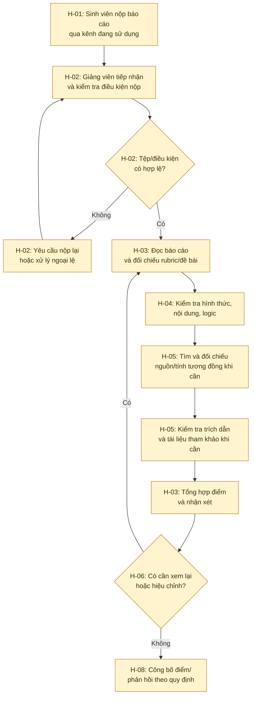
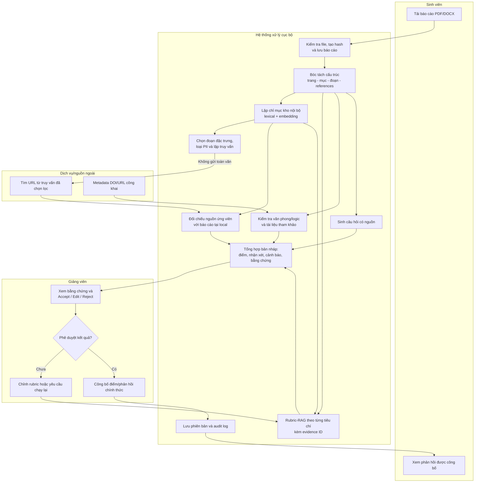

# W1-01 — Quy trình đánh giá báo cáo AS-IS/TO-BE

| Thuộc tính | Giá trị |
|---|---|
| Phiên bản | 1.0-draft |
| Ngày lập | 13/08/2026 |
| Trạng thái AS-IS | **Giả thuyết chờ phỏng vấn; không phải quy trình thực tế đã xác nhận** |
| Trạng thái TO-BE | Đề xuất suy ra từ bản mô tả khóa luận; chờ giảng viên duyệt |
| Người xác nhận | Chưa có |
| Ngày xác nhận | Chưa có |

## 1. Cách đọc tài liệu

- `D-*`: nội dung có trong bản mô tả/lịch dự án, chưa đồng nghĩa được giảng viên khảo sát xác nhận.
- `H-*`: giả thuyết về thực tế cần kiểm tra qua phỏng vấn.
- `C-*`: chỉ được dùng sau khi có người, ngày và bằng chứng xác nhận.
- Các sơ đồ là công cụ dẫn dắt phỏng vấn và thiết kế, không phải kết quả nghiên cứu thực địa ở phiên bản hiện tại.

## 2. AS-IS — quy trình hiện tại giả định

### 2.1. Sơ đồ bản nháp

Mọi nút trong sơ đồ AS-IS dưới đây mang trạng thái `H` cho đến khi hoàn thành phỏng vấn `INT-01`.

### 2.2. Bảng bước cần xác nhận

| Bước giả định | Actor | Input giả định | Hoạt động/công cụ cần hỏi | Output giả định | Điểm chưa biết |
|---|---|---|---|---|---|
| AS-01 Tiếp nhận | Sinh viên, giảng viên/LMS | File báo cáo, metadata nộp | Kênh nộp thực tế | Danh sách bài nhận được | Kênh, định dạng, deadline, ai kiểm tra |
| AS-02 Kiểm tra điều kiện | Giảng viên/trợ giảng | File và yêu cầu môn học | Mở file, kiểm tra điều kiện | Bài hợp lệ hoặc yêu cầu xử lý | Điều kiện bắt buộc và ngoại lệ |
| AS-03 Đọc/chấm | Giảng viên | Báo cáo, đề bài, rubric nếu có | PDF/Word, giấy, ghi chú, bảng tính? | Ghi chú/điểm theo tiêu chí | Có rubric không, thứ tự chấm, thời gian |
| AS-04 Kiểm tra bổ sung | Giảng viên | Đoạn nghi vấn, nguồn, references | Google/công cụ tương đồng/DOI? | Nguồn đối chứng/cảnh báo | Công cụ, ngưỡng và bằng chứng đủ dùng |
| AS-05 Tổng hợp/hiệu chỉnh | Một hoặc nhiều giảng viên | Điểm, nhận xét, bằng chứng | Tổng hợp, trao đổi chéo? | Điểm và phản hồi dự kiến | Cách xử lý bất đồng/sai lệch |
| AS-06 Công bố/lưu | Giảng viên/hệ thống hiện có | Kết quả đã duyệt | LMS, email, file? | Kết quả sinh viên được xem | Nội dung công bố, quyền và thời hạn lưu |

### 2.3. Input AS-IS cần thu thập

Các mục này là **danh sách cần hỏi**, không phải khẳng định đang tồn tại:

| Input ứng viên | Điều cần xác nhận | Câu hỏi |
|---|---|---|
| File báo cáo | PDF/DOCX/bản in; ngôn ngữ; scan; giới hạn file | Q01, Q04 |
| Metadata nộp | Họ tên/MSSV/lớp/nhóm/deadline/phiên bản | Q03, Q04 |
| Đề bài/hướng dẫn | Nguồn và phiên bản | Q03, Q05 |
| Rubric/thang điểm | Có hay không; tiêu chí, trọng số, điểm liệt, phiên bản | Q05 |
| Kho báo cáo/tài liệu | Có được dùng đối chiếu hay không; phạm vi quyền | Q07, Q15 |
| Công cụ/nguồn ngoài | Công cụ tương đồng, web search, DOI/metadata | Q07, Q08 |
| Điểm/nhận xét lịch sử | Có được lưu/tái sử dụng; quyền và thời hạn | Q15, Q16 |

### 2.4. Output AS-IS cần thu thập

| Output ứng viên | Điều cần xác nhận | Câu hỏi |
|---|---|---|
| Điểm tổng/điểm tiêu chí | Thang điểm, công thức, ai quyết định | Q05, Q10 |
| Nhận xét | Mức chi tiết, vị trí lỗi, mẫu phản hồi | Q10 |
| Bằng chứng đối chứng | Có lưu đoạn/URL/DOI hay chỉ xem tạm thời | Q08, Q11 |
| Cảnh báo/nội dung cần sửa | Ai được xem; cách xử lý | Q10, Q14 |
| Câu hỏi vấn đáp | Có dùng không; cách chọn | Q10, Q13 |
| Hồ sơ chấm | Nơi lưu, audit, thời hạn | Q14, Q16 |

### 2.5. Pain points: nguồn tài liệu và giả thuyết

| ID | Nhận định cần kiểm tra | Cơ sở hiện có | Trạng thái | Dữ liệu cần lấy |
|---|---|---|---|---|
| P-H01 | Khối lượng/độ dài báo cáo và thời hạn tạo áp lực thời gian. | Nhận định tại mục 2 bản mô tả | Chưa xác nhận thực địa | Số bài, độ dài, thời gian/bài, deadline |
| P-H02 | Phải kiểm tra đồng thời nội dung, logic, nguồn và tương đồng. | Mục 2 và 2.1 bản mô tả | Chưa xác nhận thực địa | Các bước thật và mức ưu tiên |
| P-H03 | Công cụ cho từng nhiệm vụ tách rời, có thao tác chuyển đổi thủ công. | Nhận định tại mục 2 bản mô tả | Chưa xác nhận thực địa | Danh sách công cụ và thao tác chuyển dữ liệu |
| P-H04 | Nhận xét AI chung chung/không có bằng chứng khó kiểm tra. | Khoảng trống được nêu tại mục 2 | Chưa xác nhận thực địa | Loại bằng chứng và tỷ lệ lỗi chấp nhận |
| P-H05 | Kiểm tra nguồn/trích dẫn thủ công tốn thời gian hoặc dễ bỏ sót. | Vấn đề dự án tại mục 2.1 | Chưa xác nhận thực địa | Thời gian, tần suất, ví dụ và hậu quả |
| P-H06 | Cách chấm có thể thiếu nhất quán giữa bài hoặc giữa người chấm. | Lý do cần Rubric-RAG/thực nghiệm | Giả thuyết mới | Cách hiệu chỉnh điểm và trường hợp bất đồng |

Sau phỏng vấn, pain point chỉ được giữ trong danh sách phát hiện nếu có phát biểu hoặc bằng chứng thực tế; cần ghi tần suất, mức ảnh hưởng và người xác nhận.

## 3. TO-BE — quy trình hỗ trợ được đề xuất

### 3.1. Nguyên tắc thiết kế từ tài liệu dự án

Các nguyên tắc sau có căn cứ trong bản mô tả, nhưng vẫn cần giảng viên duyệt về mức phù hợp nghiệp vụ:

1. Local-first: file gốc và phân tích chính xử lý cục bộ (`D-06`).
2. Evidence-first: nhận xét/cảnh báo quan trọng phải truy về trang, mục, đoạn hoặc nguồn đối chứng (`D-05`).
3. Human-in-the-loop: AI đề xuất, giảng viên chấp nhận/sửa/loại bỏ và quyết định kết quả (`D-04`).
4. Không đồng nhất “tương đồng” với “đạo văn”; không dùng cảnh báo phong cách làm bằng chứng duy nhất về AI/gian lận.
5. Chỉ gửi truy vấn chọn lọc đã loại PII ra dịch vụ tìm kiếm; không gửi toàn văn báo cáo.

### 3.2. Sơ đồ TO-BE bản nháp

### 3.3. Các bước TO-BE và trách nhiệm

| Bước | Chủ thể chính | Input | Xử lý đề xuất | Output | Kiểm soát con người |
|---|---|---|---|---|---|
| TB-01 Tiếp nhận | Sinh viên/hệ thống | PDF/DOCX, metadata | Kiểm tra MIME/kích thước, hash, quyền | Report ID và trạng thái | Quy tắc nộp cần giảng viên xác nhận |
| TB-02 Parse/chunk | Hệ thống local | File hợp lệ | Bóc tách trang/mục/đoạn/references | Tài liệu có cấu trúc, evidence ID | Báo lỗi rõ khi parse không tin cậy |
| TB-03 Truy xuất nội bộ | Hệ thống local | Chunk, kho được phép dùng | BM25/n-gram + embedding/reranker | Cặp đoạn–nguồn và điểm thành phần | Giảng viên xem đoạn hai phía |
| TB-04 Tìm nguồn web | Hệ thống + search provider | Truy vấn ngắn đã loại PII | Tìm URL ứng viên, cache/quota; đối chiếu local | URL/snippet/nội dung truy cập được | Không kết luận khi chỉ có bằng chứng yếu |
| TB-05 Chấm rubric | Hệ thống local | Rubric phiên bản hóa, chunks | Truy xuất theo tiêu chí, JSON có evidence | Điểm/nhận xét đề xuất | Giảng viên sửa/duyệt từng tiêu chí |
| TB-06 Phân tích bổ trợ | Hệ thống local + metadata công khai | Tài liệu/references | Văn phong, logic, DOI/URL/citation | Cảnh báo có vị trí và trạng thái | Không suy diễn nếu thiếu bằng chứng |
| TB-07 Sinh câu hỏi | Hệ thống local | Nội dung/điểm bất thường | Sinh câu hỏi, đáp án tham khảo, nguồn | Bộ câu hỏi nháp | Giảng viên chọn/sửa/loại |
| TB-08 Kiểm duyệt | Giảng viên | Tất cả đề xuất và bằng chứng | Accept/Edit/Reject; yêu cầu chạy lại | Kết quả được phê duyệt | Giảng viên quyết định cuối cùng |
| TB-09 Công bố/lưu vết | Giảng viên/hệ thống | Kết quả đã duyệt | Xuất/công bố theo quyền, ghi audit | Phản hồi chính thức và lịch sử | Sinh viên chỉ xem phần được công bố |

### 3.4. Input TO-BE dự kiến

| Input | Bắt buộc dự kiến | Nguồn | Kiểm soát/chưa rõ |
|---|---|---|---|
| Báo cáo PDF/DOCX | Có | Sinh viên/giảng viên | Kích thước, scan, ngôn ngữ cần chốt |
| Metadata báo cáo | Có | Luồng nộp bài | Cần tối thiểu hóa PII |
| Rubric phiên bản hóa | Có cho chấm rubric | Giảng viên | Cấu trúc/điểm liệt/trọng số cần khảo sát |
| Đề bài/yêu cầu môn học | Nên có | Giảng viên | Quyền và phiên bản |
| Kho báo cáo/tài liệu nội bộ | Tùy quyền | Trường/giảng viên | Chỉ dùng tài liệu được phép và ẩn danh |
| Cấu hình model/ngưỡng/quota | Có | Quản trị viên | Cần role và audit |
| Nguồn web/metadata công khai | Tùy module | Search provider/Crossref hoặc tương đương | Điều khoản truy cập, quota, cache, privacy |

### 3.5. Output TO-BE dự kiến

| Output | Nội dung tối thiểu | Người xem dự kiến | Trạng thái trước duyệt |
|---|---|---|---|
| Kết quả tương đồng | Đoạn báo cáo, đoạn/URL nguồn, loại và điểm thành phần, trạng thái trích dẫn | Giảng viên | Cảnh báo, không phải kết luận đạo văn |
| Đánh giá rubric | Tiêu chí, điểm đề xuất, lý do, evidence, confidence, gợi ý | Giảng viên | Đề xuất |
| Lỗi văn phong/logic | Vị trí, loại lỗi, giải thích, gợi ý | Giảng viên; sinh viên nếu công bố | Đề xuất |
| Xác thực references | DOI/URL/metadata, loại lỗi, trạng thái xác minh | Giảng viên | Cảnh báo/không xác định |
| Cảnh báo phong cách | Vị trí, tín hiệu và giới hạn diễn giải | Giảng viên | Không dùng làm bằng chứng duy nhất |
| Câu hỏi | Câu hỏi, đáp án tham khảo, mục đích, độ khó, đoạn nguồn | Giảng viên trước; sinh viên khi giao | Bản nháp |
| Báo cáo tổng hợp | Chỉ số, nhận xét, cảnh báo, quyết định duyệt | Theo phân quyền | Chưa chính thức đến khi GV duyệt |
| Audit log | Người/thời gian/hành động/phiên bản/config | Giảng viên/quản trị viên theo quyền | Nhật ký hệ thống |

## 4. So sánh AS-IS giả thuyết và TO-BE đề xuất

| Khía cạnh | AS-IS giả thuyết — cần xác nhận | TO-BE đề xuất | Giá trị cần đo | Rủi ro/kiểm soát |
|---|---|---|---|---|
| Tiếp nhận | Một/nhiều kênh, kiểm tra thủ công | Upload có trạng thái và kiểm tra file | Tỷ lệ file xử lý được | Không khóa người dùng khi parser lỗi |
| Đọc và tra cứu | Giảng viên đọc/tra cứu qua nhiều bước | Hệ thống chuẩn bị ứng viên và vị trí bằng chứng | Thời gian/bài, recall nguồn | Nguồn web không bao phủ toàn Internet |
| Chấm rubric | Có thể thủ công/khác nhau theo người | Rubric-RAG theo tiêu chí, có evidence | MAE/tương quan, tỷ lệ nhận xét chấp nhận | AI không quyết định điểm cuối |
| Kiểm tra nguồn | Có thể tìm tay hoặc dùng công cụ riêng | Kiểm tra DOI/URL/metadata/citation | Precision/Recall/F1 | Thiếu metadata ≠ nguồn giả |
| Phản hồi | Có thể tổng hợp thủ công | Dashboard kiểm duyệt và xuất báo cáo | Thời gian, mức hữu ích | Phân quyền nội dung công bố |
| Truy vết | Cách lưu chưa biết | Phiên bản rubric/kết quả và audit log | Khả năng tái hiện quyết định | Không log API key/PII nhạy cảm |

## 5. Điểm quyết định khi phỏng vấn

| ID | Cần xác nhận | Câu hỏi | Tác động nếu khác giả thuyết |
|---|---|---|---|
| V-01 | Phạm vi loại báo cáo và kênh nộp | Q01, Q03 | Thay actor, input và tích hợp |
| V-02 | Trình tự AS-IS và ngoại lệ | Q03, Q04 | Vẽ lại toàn bộ AS-IS/use case |
| V-03 | Cấu trúc rubric/cách hiệu chỉnh điểm | Q05 | Đổi data model/rubric engine |
| V-04 | Top pain points dựa trên thời gian/ảnh hưởng | Q06–Q09 | Đổi thứ tự ưu tiên MVP |
| V-05 | Bằng chứng tối thiểu và ranh giới tự động hóa | Q11–Q13 | Đổi output schema/review workflow |
| V-06 | Quyền xem của sinh viên | Q14 | Đổi RBAC và luồng công bố |
| V-07 | Quyền dùng dữ liệu, ẩn danh, retention | Q15, Q16 | Giới hạn dataset/storage/logging |
| V-08 | Chấp thuận truy vấn web đã loại PII | Q17 | Bật/tắt hoặc giới hạn web provider |
| V-09 | Mức phù hợp và top 3 TO-BE | Q18, Q19 | Đổi phạm vi MVP |
| V-10 | Tiêu chí hữu ích/an toàn | Q20 | Đổi tiêu chí nghiệm thu/thực nghiệm |

## 6. Checklist cập nhật sau phỏng vấn

- [ ] Thay từng nút AS-IS giả thuyết bằng bước được người tham gia mô tả; giữ mã phiên nguồn.
- [ ] Thêm nhánh ngoại lệ và vòng lặp thực tế.
- [ ] Ghi kênh/công cụ cụ thể chỉ khi đã xác nhận.
- [ ] Điền input/output, thời gian và actor cho từng bước.
- [ ] Xếp hạng pain point theo tần suất và ảnh hưởng.
- [ ] Ghi thay đổi người tham gia yêu cầu với TO-BE.
- [ ] Đánh dấu phần người tham gia không có thẩm quyền phê duyệt là “cần xác nhận thêm”.
- [ ] Gửi bản tóm tắt/sơ đồ cập nhật và lưu ngày/kênh xác nhận.
- [ ] Đồng bộ các quyết định đã xác nhận sang yêu cầu, Use Case và backlog.

## 7. Kết luận trạng thái hiện tại

- **AS-IS:** chưa thể công bố là quy trình hiện tại; hiện chỉ là giả thuyết phỏng vấn.
- **TO-BE:** phản ánh hướng thiết kế trong bản mô tả khóa luận, chưa phải yêu cầu đã duyệt.
- **Bước tiếp theo bắt buộc:** thực hiện `INT-01`, điền biên bản, cập nhật sơ đồ và xin người tham gia xác nhận.

## 8. Nguồn

1. `Schedule_KLTN.xlsx`, tuần 1 (08/08/2026–14/08/2026).
2. `KLTN_He_thong_danh_gia_bao_cao_AI_cuc_bo.docx`, phiên bản 1.0 ngày 29/07/2026, đặc biệt các mục 2, 4, 5, 6 và 10.

