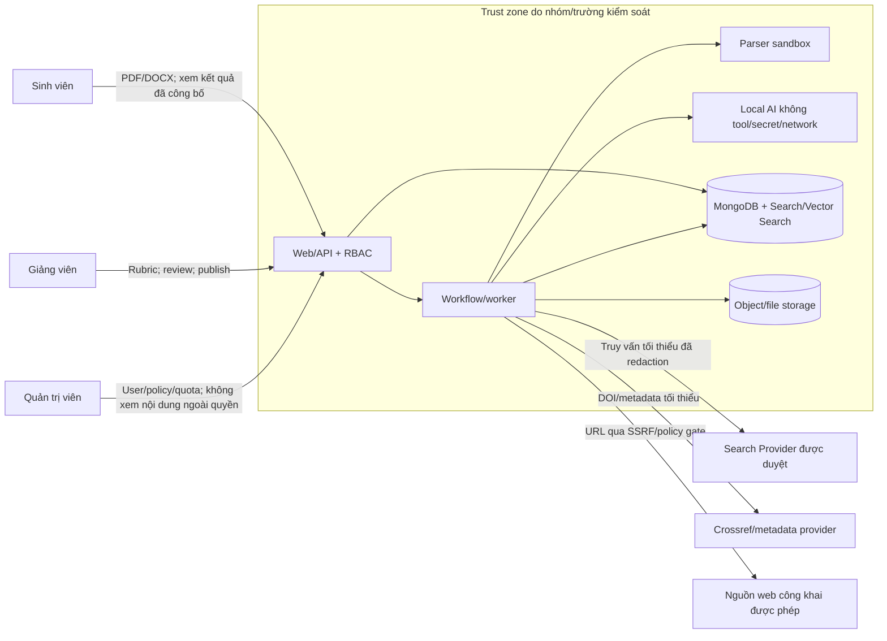

# ĐẶC TẢ YÊU CẦU V1

## Hệ thống hỗ trợ đánh giá báo cáo sinh viên bằng AI cục bộ

## 1. Thông tin tài liệu

| Thuộc tính | Giá trị |
|---|---|
| Mã tài liệu | `SRS-KLTN-01` |
| Phiên bản | `1.2-review-candidate` |
| Trạng thái | **CONTENT-COMPLETE / REVIEW CANDIDATE — toàn bộ phê duyệt vẫn PENDING** |
| Ngày lập | 13/08/2026 |
| Người lập | Nhóm sinh viên thực hiện khóa luận |
| Người cần duyệt | GVHD; giảng viên tham gia khảo sát; đại diện người dùng nếu có |
| Phạm vi tài liệu | Ứng viên baseline yêu cầu cho toàn bộ sản phẩm khóa luận; đầu ra W1-03 của tuần 1 |
| Tuần áp dụng | Tuần 1, 08/08/2026–14/08/2026 |
| Tên đề tài dùng trong tài liệu | Xây dựng hệ thống hỗ trợ đánh giá báo cáo sinh viên bằng AI cục bộ kết hợp truy xuất bằng chứng và tìm kiếm nguồn trên Internet |
| Inventory v1.1 | 47 FR; 34 NFR; 20 business rules; 17 Use Case; 22 open questions; 18 risks; 10 threat/abuse cases |

### 1.1. Nguồn đầu vào

1. `Schedule_KLTN.xlsx`, đặc biệt kế hoạch tuần 1 và kế hoạch 24 tuần.
2. `KLTN_He_thong_danh_gia_bao_cao_AI_cuc_bo.docx`, phiên bản 1.0 ngày 29/07/2026.
3. Kết quả khảo sát/phỏng vấn giảng viên: **chưa có tại thời điểm lập tài liệu**; W1-01 hiện chỉ cung cấp giả thuyết và công cụ khảo sát, không được dùng như bằng chứng người dùng đã xác nhận.
4. [ISO/IEC/IEEE 29148:2018](https://www.iso.org/standard/72089.html) (được ISO xác nhận còn hiện hành sau lần review năm 2024) được dùng làm khung chất lượng và vòng đời yêu cầu.
5. [ISO/IEC 25010:2023](https://www.iso.org/standard/78176.html) được dùng làm khung tham chiếu cho thuộc tính chất lượng sản phẩm.
6. [NIST AI RMF: Generative AI Profile](https://nvlpubs.nist.gov/nistpubs/ai/NIST.AI.600-1.pdf), [NIST SSDF SP 800-218](https://csrc.nist.gov/pubs/sp/800/218/final), [OWASP ASVS 5.0](https://owasp.org/www-project-application-security-verification-standard/), [OWASP File Upload Cheat Sheet](https://cheatsheetseries.owasp.org/cheatsheets/File_Upload_Cheat_Sheet.html) và [OWASP LLM Prompt Injection](https://genai.owasp.org/llmrisk/llm01-prompt-injection/) được dùng làm nguồn kiểm soát AI/an toàn phần mềm.
7. [WCAG 2.2](https://www.w3.org/TR/WCAG22/) được dùng làm chuẩn tham chiếu cho accessibility.
8. [Gemini API Additional Terms of Service](https://ai.google.dev/gemini-api/terms) và [Custom Search JSON API overview](https://developers.google.com/custom-search/v1/overview), đối chiếu ngày 13/08/2026 cho ràng buộc Grounding/Search Provider; phải kiểm tra lại đúng điều khoản, tier và trạng thái dịch vụ tại thời điểm triển khai.

Tài liệu này hệ thống hóa yêu cầu từ hai nguồn đã cung cấp và các thực hành kỹ thuật có liên quan, nhưng **không được xem là bằng chứng rằng GVHD hoặc người dùng đã xác nhận yêu cầu**. Các chuẩn/khung nêu trên chỉ là nguồn thiết kế và kiểm tra chất lượng; tài liệu không tuyên bố sản phẩm đã được chứng nhận phù hợp với bất kỳ chuẩn nào. Mọi mức ưu tiên, ngưỡng đo, quy tắc nghiệp vụ và quyết định kỹ thuật trong bản này là ứng viên baseline để review.

### 1.2. Quy ước

- **MUST**: bắt buộc để nghiệm thu phạm vi MVP.
- **SHOULD**: nên thực hiện sau khi các chức năng MUST ổn định.
- **COULD**: phần mở rộng nếu còn thời gian và nguồn lực.
- **WON'T (v1)**: chủ động không cam kết trong phiên bản khóa luận.
- **AI cục bộ / Local AI**: mô hình suy luận tại máy hoặc hạ tầng do nhóm/trường kiểm soát.
- **Bằng chứng**: vị trí truy nguyên được trong báo cáo hoặc nguồn ngoài, tối thiểu gồm định danh đoạn và metadata trang/chương; với nguồn web có thêm URL và thời điểm truy cập.
- **Kết quả chính thức**: kết quả đã được giảng viên kiểm duyệt và công bố; không phải đầu ra thô của AI.

### 1.3. Trạng thái và vòng đời yêu cầu

| Trạng thái | Ý nghĩa | Điều kiện chuyển trạng thái |
|---|---|---|
| `PROPOSED` | Yêu cầu được tổng hợp/đề xuất nhưng chưa qua review | Có nguồn, lý do, mức ưu tiên, AC và phương pháp kiểm chứng |
| `REVIEW-CANDIDATE` | Nội dung đủ để các bên review | Qua quality check về tính đơn nghĩa, khả thi, cần thiết, đo được và truy vết được |
| `APPROVED` | Người có thẩm quyền chấp thuận | Có quyết định/ngày/người duyệt; các OQ/DEC liên quan đã đóng |
| `BASELINED` | Yêu cầu approved được khóa cho một release | Có version/commit/tag; Use Case, backlog và test đã đồng bộ |
| `BLOCKED` | Chưa thể thực hiện do phụ thuộc/quyết định bắt buộc | Blocker được giải quyết hoặc scope được đổi qua change control |
| `DEFERRED` | Hợp lệ nhưng không cam kết trong release hiện tại | Được đưa lại phạm vi qua change request |
| `RETIRED` | Không còn áp dụng | Có lý do, tác động và yêu cầu thay thế nếu có |

Tại phiên bản này, toàn bộ FR/NFR là `REVIEW-CANDIDATE / Approval: PENDING`, ngoại trừ `FR-SIM-04` và `FR-SIM-05` là `BLOCKED` theo `DEC-WEB-01`. Các NFR fail-closed/provider-policy vẫn là yêu cầu kiểm soát cần review, không phải feature bị blocked. `SHOULD/COULD` không đồng nghĩa `APPROVED`; chúng chỉ mô tả thứ tự ưu tiên đề xuất.

### 1.4. Quy tắc chất lượng và định danh

- Mỗi FR/NFR phải biểu đạt một nghĩa vụ kiểm thử được; các từ “nhanh”, “dễ dùng”, “an toàn”, “phù hợp” chỉ hợp lệ khi kèm phép đo hoặc câu hỏi mở chốt ngưỡng.
- `MUST/SHOULD/COULD/WON'T` thể hiện mức cam kết sản phẩm; `Blocker/High/Medium/Low` ở OQ/risk thể hiện mức ảnh hưởng quản trị, không thay thế nhau.
- AC mô tả điều kiện pass/fail; **không** được dùng kết quả nghiên cứu mong muốn (ví dụ hybrid phải thắng baseline) làm điều kiện để hợp thức hóa giả thuyết. Thực nghiệm hợp lệ dù kết quả không thuận giả thuyết nếu protocol và báo cáo trung thực.
- Phương pháp kiểm chứng dùng bốn mã: `T`—test tự động/thủ công có expected result; `A`—phân tích số liệu/benchmark; `I`—inspection tài liệu/cấu hình/code/log; `D`—demonstration theo kịch bản người dùng. Một yêu cầu có thể dùng nhiều mã.
- ID đã phát hành không được tái sử dụng cho nghĩa khác. Yêu cầu thay đổi đáng kể tạo ID mới hoặc change record; yêu cầu cũ được giữ lịch sử và đánh dấu `RETIRED`.
- Mọi ngưỡng “đề xuất/chờ chốt” phải gắn OQ; trước khi OQ đóng, phép đo được báo cáo nhưng không được tuyên bố là đã đạt yêu cầu approved.

## 2. Tóm tắt quyết định kỹ thuật và tuân thủ

### DEC-DB-01 — MongoDB là nguồn dữ liệu chuẩn

**Quyết định của chủ dự án ngày 13/08/2026:** kiến trúc baseline sử dụng **MongoDB** làm source of truth cho dữ liệu nghiệp vụ, metadata/chunk, kết quả đánh giá, cấu hình phiên bản và audit log. Quyết định này đồng bộ với `Schedule_KLTN.xlsx` và thay thế ứng viên PostgreSQL + pgvector trong bản DOCX/SRS trước đó.

**Ranh giới quyết định:** tên hệ quản trị đã được chọn; các chi tiết sau vẫn phải đóng tại `OQ-04` bằng spike/benchmark và review kiến trúc:

1. MongoDB Community self-managed, Atlas hay một deployment khác; không mặc định gửi dữ liệu báo cáo lên cloud.
2. Cách triển khai full-text/BM25 và vector search trong môi trường đã chọn; phải giữ A1 lexical và A2 dense là hai baseline độc lập, không đổi RQ1 để phù hợp công cụ.
3. Cách biểu diễn quan hệ và toàn vẹn giữa user–report–run–rubric–evidence–review bằng collection/schema validation, stable reference, unique/compound index, atomic write/transaction khi deployment hỗ trợ và application invariant/compensation.
4. Migration/versioning, backup/restore, retention/deletion toàn lineage và retrieval isolation.

**Phương án kỹ thuật ứng viên:** MongoDB 8.2 Community có thể chạy `$search`/`$vectorSearch` với tiến trình `mongot` self-managed; `atlas-local` chỉ phù hợp development/test, không phải production target. Cần benchmark chính trên đúng deployment sẽ demo và lưu server/search/index version trong artifact. Nếu deployment được chọn không đáp ứng lexical/vector search hoặc tài nguyên local, phải dùng adapter retrieval tách rời có ADR và cập nhật WBS; không được âm thầm đổi baseline.

**Trạng thái quản trị:** `DECIDED BY PROJECT OWNER / GVHD ACKNOWLEDGEMENT PENDING`; việc triển khai data layer chưa qua `G-02` cho tới khi đóng các lựa chọn ở `OQ-04`. DOCX đang ghi PostgreSQL + pgvector phải được sửa hoặc lập change record để hồ sơ nguồn không mâu thuẫn.

### DEC-WEB-01 — Không dùng Gemini Grounding làm bộ thu thập URL cho pipeline similarity

**Phát hiện blocker:** điều khoản Gemini API có hiệu lực từ 23/03/2026, bản được đối chiếu ngày 13/08/2026, quy định Grounded Results/Search Suggestions/Links chỉ phục vụ phản hồi cho người dùng đã gửi prompt. Điều khoản cấm phân tích hoặc thu thập tự động các thành phần này cho mục đích khác, và nêu cụ thể việc dùng Links để xây chỉ mục hoặc xác định trang đích cho crawling/scraping là vi phạm.

Vì vậy, kiến trúc trong DOCX “Gemini Grounding → lấy URL ứng viên → fetch nội dung → index/đối chiếu local” **xung đột với điều khoản hiện hành và chưa được phép triển khai**.

**Quyết định baseline:**

1. Không cấu hình Gemini Grounding as a Search Provider cho chức năng thu thập URL, fetch, cache, index hoặc local similarity.
2. Vẫn giữ interface `SearchProvider`, nhưng chỉ bật một provider khi hồ sơ review xác nhận license/ToS cho phép rõ ràng: truy vấn tự động, thu thập và lưu kết quả/URL, dùng URL làm ứng viên fetch, và phân tích local cho mục đích nghiên cứu này.
3. Việc fetch trang đích còn phải tuân điều khoản, robots/access policy, bản quyền và quyền dữ liệu của từng nguồn; quyền từ search provider không tự động cấp quyền crawl trang đích.
4. Gemini Grounding chỉ có thể là tính năng hiển thị Grounded Result riêng cho chính người dùng gửi prompt, đúng cách hiển thị/lưu trữ trong điều khoản; đầu ra đó không được đưa vào kho candidate/index/similarity. Ngoại lệ chỉ áp dụng nếu có văn bản pháp lý rõ ràng cho phép đúng use case.
5. Nếu không tìm được provider hợp lệ, phương án fallback là kho nội bộ, corpus công khai được tải hợp pháp/curated thủ công, hoặc sửa RQ2 và phạm vi sau khi GVHD duyệt. Không được âm thầm thay provider hay bỏ RQ2.
6. Custom Search JSON API không được giả định là fallback sẵn có: tài liệu chính thức được đối chiếu ngày 13/08/2026 ghi dịch vụ đã đóng với khách hàng mới và khách hàng hiện hữu phải chuyển đổi trước khi dịch vụ ngừng ngày 01/01/2027. Chỉ được cân nhắc nếu nhóm chứng minh tài khoản hiện hữu/quyền sử dụng và kế hoạch migration phù hợp timeline; điều đó vẫn không tự cấp quyền fetch/index trang đích.

**Trạng thái:** **BLOCKED — Legal/ToS review**. Yêu cầu “bắt buộc dùng Google Search để lấy URL ứng viên” trong DOCX chưa thể coi là yêu cầu khả thi. Phải đóng OQ-16 trước khi hiện thực FR-SIM-04/05 cho nguồn web.

## 3. Bối cảnh và mục tiêu

### 3.1. Vấn đề

Giảng viên phải đánh giá báo cáo dài trong thời gian giới hạn và đồng thời kiểm tra chất lượng nội dung, logic, nguồn tham khảo, tương đồng và mức độ hiểu bài. Các công cụ đơn lẻ thường thiếu khả năng giải thích hoặc không liên kết nhận xét với bằng chứng. Hệ thống đề xuất gom các bước này vào một workflow local-first, evidence-first và có giảng viên kiểm duyệt.

### 3.2. Mục tiêu tổng quát

Xây dựng và đánh giá một ứng dụng web hỗ trợ giảng viên phân tích báo cáo sinh viên bằng AI cục bộ, tìm nguồn công khai qua cơ chế/provider được phép, truy xuất bằng chứng, đề xuất đánh giá theo rubric, kiểm chứng tài liệu tham khảo và sinh câu hỏi kiểm tra mức độ hiểu bài. Mục tiêu gốc yêu cầu Google Search đang bị chặn bởi DEC-WEB-01 và phải được GVHD điều chỉnh hoặc có phương án tuân thủ được phê duyệt.

### 3.3. Mục tiêu cụ thể

| ID | Mục tiêu | Chỉ dấu hoàn thành dự kiến |
|---|---|---|
| OBJ-01 | Xử lý báo cáo PDF/DOCX tiếng Việt và tiếng Anh, giữ cấu trúc và vị trí | Parse không lỗi nghiêm trọng ≥ 90% corpus khóa trước; ≥ 95% chunk sinh ra có `section_path` và vị trí/thứ tự, có trang khi định dạng nguồn cung cấp được |
| OBJ-02 | Phát hiện tương đồng bằng truy xuất lai | Có baseline lexical, dense, hybrid và hybrid + reranker; báo cáo Recall@K, MRR, nDCG và F1 |
| OBJ-03 | Tìm nguồn web có kiểm soát và đúng quyền sử dụng | Có provider đã qua review cho phép thu thập URL/fetch/phân tích; chọn truy vấn, quota, cache, log số query/chi phí và đối chiếu local; nếu không có thì phạm vi/RQ2 được sửa chính thức |
| OBJ-04 | Đề xuất đánh giá theo rubric có bằng chứng | Điểm/nhận xét theo từng tiêu chí, đầu ra có cấu trúc, bằng chứng hợp lệ và trạng thái duyệt |
| OBJ-05 | Kiểm tra văn phong, logic và tài liệu tham khảo | Phát hiện có vị trí, giải thích; reference checker được đánh giá Precision/Recall/F1 |
| OBJ-06 | Sinh câu hỏi có căn cứ | Câu hỏi có đoạn nguồn, đáp án tham khảo, mục đích, độ khó và được giảng viên đánh giá |
| OBJ-07 | Chứng minh chất lượng bằng thực nghiệm | Dataset manifest, baseline, protocol, metrics, phân tích sai số, thời gian và chi phí truy về được commit/config/model/dataset; không bắt buộc kết quả phải thuận giả thuyết |
| OBJ-08 | Bảo vệ dữ liệu và quyền quyết định của giảng viên | Không gửi toàn văn đến dịch vụ tìm kiếm; AI chỉ đề xuất; có RBAC, audit và human-in-the-loop |

Các chỉ tiêu trên được trích hoặc chuẩn hóa từ bản mô tả; cách tính chính xác và tập kiểm thử vẫn cần GVHD xác nhận.

### 3.4. Nhu cầu các bên liên quan

| ID | Bên liên quan | Nhu cầu/giá trị cần đạt | Nguồn | Cách xác nhận | Trạng thái |
|---|---|---|---|---|---|
| STK-01 | Giảng viên | Giảm công việc rà soát lặp lại nhưng vẫn xem được bằng chứng và giữ toàn quyền sửa/duyệt/công bố | DOCX §2, §4, §5.8 | Phỏng vấn + usability/acceptance test | Chờ khảo sát/xác nhận |
| STK-02 | Sinh viên | Dữ liệu và kết quả chỉ đến đúng người; cảnh báo AI/tương đồng không bị diễn giải thành kết luận gian lận tự động | DOCX §4.3, §10.2 | Phỏng vấn/chính sách + test RBAC/privacy | Chờ khảo sát/xác nhận |
| STK-03 | Quản trị viên | Cài đặt, cấu hình, giám sát, quota, backup/restore và xử lý lỗi được mà không tiếp xúc secret/nội dung ngoài quyền | DOCX §4.4, §10 | Demonstration + security/operations test | Chờ xác nhận |
| STK-04 | GVHD/nhóm nghiên cứu | Hai đóng góp chính có baseline, protocol, artifact và kết quả tái lập; kết quả âm vẫn được báo cáo trung thực | DOCX §3, §11, §15 | Review protocol/artifact/traceability | Chờ GVHD duyệt |
| STK-05 | Khoa/đơn vị quản lý dữ liệu | Có căn cứ sử dụng dữ liệu, phân quyền, retention/deletion, audit và quy trình ứng phó sự cố | Suy ra từ loại dữ liệu + NIST/OWASP | Review chính sách và hồ sơ nghiệm thu | Chưa xác định người phê duyệt |
| STK-06 | Nhóm phát triển/vận hành | Phạm vi khả thi trong 24 tuần, phụ thuộc rõ, interface provider thay thế được và release gate không mơ hồ | DOCX §12–§15 + Excel | Review backlog/kiến trúc/release plan | Chờ GVHD duyệt |

`STK-01`–`STK-06` là nhu cầu đề xuất, không thay thế kết quả khảo sát W1-01. Khi phỏng vấn có dữ liệu thật, mỗi nhu cầu phải được xác nhận, sửa hoặc loại qua change control.

## 4. Câu hỏi nghiên cứu

| Mã | Câu hỏi nghiên cứu | Trạng thái triển khai |
|---|---|---|
| RQ1 | Phương pháp truy xuất lai BM25 + embedding + reranker có cải thiện khả năng tìm đúng nguồn tương đồng so với chỉ dùng từ khóa hoặc chỉ dùng embedding hay không? | Review candidate; chờ khóa corpus/guideline/OQ-11 |
| RQ2 | Việc dùng Google Search để tìm URL ứng viên và đối chiếu nội dung tại local có đạt cân bằng hợp lý giữa độ bao phủ, chi phí và thời gian xử lý hay không? | **Blocked** theo DEC-WEB-01/OQ-16 |
| RQ3 | Rubric-RAG có bằng chứng có giúp điểm đề xuất và nhận xét nhất quán hơn so với Local AI chấm trực tiếp toàn báo cáo hay không? | Review candidate; chờ rubric/ground truth/OQ-05–06 |
| RQ4 | Hệ thống có thể phát hiện chính xác các tài liệu tham khảo sai DOI, sai metadata hoặc không nhất quán với trích dẫn trong nội dung ở mức nào? | Review candidate; chờ guideline/dataset |
| RQ5 | Câu hỏi được sinh từ nội dung và điểm bất thường có được giảng viên đánh giá là đúng, liên quan và hữu ích cho vấn đáp hay không? | Review candidate; chờ giảng viên tham gia/OQ-01, OQ-06 |

**Ghi chú RQ2:** đây là câu hỏi nghiên cứu nguyên văn từ bản mô tả, nhưng cách hiện thực bằng Gemini Grounding làm URL harvester không hợp lệ theo DEC-WEB-01. RQ2 chỉ được chạy sau khi chọn một cơ chế/provider cho phép đúng luồng candidate collection/fetch/local analysis, hoặc phải được sửa và GVHD duyệt.

## 5. Phạm vi và mức ưu tiên

### 5.1. MVP bắt buộc — MUST

1. Đăng nhập, phân quyền cơ bản cho Sinh viên, Giảng viên và Quản trị viên.
2. Upload, lưu trữ, quản lý trạng thái và lịch sử báo cáo PDF/DOCX.
3. Bóc tách cấu trúc, trang/chương/mục/đoạn, trích dẫn và danh mục tài liệu tham khảo.
4. Lập chỉ mục nội bộ bằng full-text và vector trên MongoDB theo deployment/indexing được chốt ở OQ-04.
5. Tìm nguồn ứng viên trên Internet qua Search Provider **đã được review và cho phép** thu thập URL/fetch/phân tích, có chọn truy vấn, cache, quota và log chi phí. Hạng mục này hiện `BLOCKED` theo DEC-WEB-01; Gemini Grounding không phải provider hợp lệ cho luồng này ở baseline.
6. Đối chiếu tại local bằng lexical/n-gram/BM25, embedding và reranker; hiển thị nguồn và đoạn đối chứng.
7. Quản lý rubric và Rubric-RAG theo từng tiêu chí, bắt buộc gắn bằng chứng.
8. Kiểm tra văn phong, ngữ pháp và logic ở cấp đoạn/tài liệu, có vị trí và giải thích.
9. Bóc tách và kiểm chứng DOI/URL/metadata; đối chiếu trích dẫn trong nội dung với danh mục.
10. Sinh câu hỏi kiến thức, phương pháp và xác minh, có nguồn và quy trình giảng viên duyệt.
11. Giao diện giảng viên Accept/Edit/Reject từng kết quả và lưu audit log.
12. Xuất báo cáo tổng hợp HTML/PDF và chỉ công bố kết quả sau bước kiểm duyệt.
13. Worker/queue cho tác vụ dài, trạng thái tiến trình, retry và xử lý lỗi.
14. Dataset, baseline, script metrics và thực nghiệm cho RQ1–RQ5.
15. Đóng gói Docker Compose và tài liệu cài đặt/sử dụng.

Hai đóng góp phải được ưu tiên trước các module bổ trợ là: **(a) hybrid similarity có tìm nguồn web; (b) Rubric-RAG có bằng chứng**.

### 5.2. Phần mở rộng — SHOULD/COULD

| Hạng mục | Mức | Điều kiện bắt đầu |
|---|---|---|
| Cảnh báo bất thường phong cách có thể liên quan việc dùng AI | SHOULD | Hai đóng góp chính đã có baseline; thông điệp không kết luận gian lận |
| OCR cho PDF scan chất lượng thấp | COULD | Parser MVP ổn định và còn thời gian |
| Đối chiếu xuyên ngôn ngữ Việt–Anh | COULD | Dataset và baseline đơn ngôn ngữ đã khóa |
| Dashboard thống kê theo lớp/học kỳ | COULD | Luồng đánh giá end-to-end đã feature freeze |
| Reranker lớn hơn/tối ưu GPU | COULD | Có phần cứng và benchmark chứng minh lợi ích |
| Phân tích bảng, biểu đồ và công thức phức tạp | COULD | Parser văn bản đạt tiêu chí nghiệm thu |
| Tích hợp OpenAlex hoặc Search Provider bổ sung | COULD | Provider/corpus đã qua legal/ToS review và baseline nội bộ hoàn tất |

### 5.3. Ngoài phạm vi/cam kết — WON'T (v1)

1. Không kiểm tra được toàn bộ Internet; chỉ truy vấn nguồn công khai được lập chỉ mục và có thể truy cập.
2. Không tự động kết luận sinh viên gian lận/đạo văn.
3. Không đưa ra “phần trăm chắc chắn văn bản do AI viết”.
4. Không thay thế quyết định chấm điểm cuối cùng của giảng viên.
5. Không fine-tune LLM lớn.
6. Không xây kiến trúc multi-agent tự do/phức tạp; dùng workflow có bước, schema và trạng thái xác định.
7. Không cam kết đọc chính xác mọi PDF scan, công thức, bảng hoặc biểu đồ phức tạp.
8. Không cố vượt paywall, robots policy, cơ chế chặn truy cập hoặc điều khoản của website.
9. Không dùng báo cáo sinh viên để huấn luyện bên ngoài nếu chưa có sự đồng ý phù hợp.

## 6. Tác nhân và quyền tổng quát

| Actor | Mục tiêu/chức năng chính | Giới hạn chính |
|---|---|---|
| Sinh viên | Tải báo cáo; theo dõi trạng thái; xem phản hồi đã được công bố; làm bộ câu hỏi nếu được giao | Không xem kết quả nháp/chưa duyệt; không truy cập báo cáo người khác |
| Giảng viên | Quản lý rubric/kho tài liệu; chạy phân tích; xem bằng chứng; Accept/Edit/Reject; chọn câu hỏi; công bố/xuất kết quả | Quyết định cuối cùng; chỉ truy cập lớp/báo cáo được phân quyền |
| Quản trị viên | Quản lý tài khoản/vai trò; cấu hình model/API key/quota; theo dõi queue/log/chi phí; chính sách lưu dữ liệu | Không được làm lộ secret hoặc sửa kết quả mà không có audit |
| Search Provider đã được phê duyệt (hệ thống ngoài) | Trả URL/snippet ứng viên từ truy vấn đã chọn lọc trong phạm vi license cho phép | Không nhận toàn văn; không quyết định tương đồng cuối; không bật trước legal/ToS review |
| Crossref/nhà cung cấp metadata | Trả metadata DOI/tài liệu để đối chiếu | Không tìm thấy không đồng nghĩa tài liệu giả |
| Local AI runtime | Embedding, reranking, sinh/đánh giá nội dung có cấu trúc | Đầu ra phải được validate và giảng viên kiểm duyệt |

Search Provider, Crossref và Local AI runtime là tác nhân hệ thống/phụ trợ, không phải vai trò người dùng.

### 6.1. Ranh giới hệ thống và luồng tin cậy

**Trong ranh giới sản phẩm:** web/API, xác thực và authorization, workflow/queue, parser sandbox, local AI adapter, MongoDB và search/vector index đã duyệt, file storage, provider adapters, policy gate, evidence/review/audit/export và artifact thực nghiệm.

**Ngoài ranh giới:** độ đúng/sẵn sàng của Crossref/Search Provider/trang web, quyền sở hữu báo cáo đầu vào, quyết định chấm cuối của giảng viên, chính sách cấp khoa/trường và hạ tầng mạng/phần cứng vật lý. Hệ thống vẫn phải kiểm soát request, timeout, dữ liệu lưu và cách diễn giải lỗi của các phụ thuộc này.

**Trust boundary bắt buộc:** (TB-01) trình duyệt ↔ API; (TB-02) tệp người dùng ↔ parser; (TB-03) nội dung báo cáo/web không tin cậy ↔ prompt/local AI; (TB-04) worker ↔ Internet; (TB-05) role/tenant ↔ evidence/index; (TB-06) kết quả AI ↔ quyết định/công bố của giảng viên. Không coi văn bản trong file, trang web, metadata hoặc output model là lệnh hệ thống đáng tin cậy.

## 7. Giả định và phụ thuộc

### 7.1. Giả định cần xác nhận

| ID | Giả định baseline | Ảnh hưởng nếu sai | Trạng thái |
|---|---|---|---|
| ASM-01 | Có ít nhất một giảng viên tham gia khảo sát, duyệt rubric và đánh giá một tập kết quả | Không có ground truth/user evaluation đáng tin cậy | Chờ xác nhận |
| ASM-02 | Có quyền sử dụng báo cáo thật đã ẩn danh hoặc có thể kết hợp dữ liệu công khai/tổng hợp | Giảm tính đại diện của benchmark | Chờ xác nhận |
| ASM-03 | Dataset mục tiêu gồm 30–50 báo cáo, 500–1.000 cặp tương đồng, 20–30 mẫu rubric, 300–500 reference entry và 100–200 câu hỏi | Phải điều chỉnh power/phạm vi thực nghiệm | Chờ GVHD duyệt |
| ASM-04 | Máy phát triển có ít nhất 16 GB RAM và 30–80 GB ổ đĩa trống | Cần dùng model nhỏ hơn hoặc hạ tầng khác | Chờ kiểm kê |
| ASM-05 | Có thể cấp billing/quota cho một Search Provider hợp lệ trong ngân sách được duyệt | RQ2 phải sửa hoặc chỉ dùng corpus nội bộ/curated | Chờ ngân sách và provider hợp lệ |
| ASM-06 | Đầu vào MVP ưu tiên PDF có text và DOCX; tiếng Việt/Anh | Parser/embedding phải thay đổi nếu có nhiều scan/ngôn ngữ khác | Chờ khảo sát dữ liệu |
| ASM-07 | Dịch vụ web ngoài được phép nhận truy vấn đã loại PII | Phải tắt web search hoặc xin quy trình phê duyệt dữ liệu | Chờ xác nhận chính sách |
| ASM-08 | Giảng viên chịu trách nhiệm công bố điểm/nhận xét chính thức | Phải thiết kế quy trình phê duyệt khác nếu khoa quy định | Chờ GVHD/giảng viên xác nhận |

### 7.2. Phụ thuộc kỹ thuật và tổ chức

- MongoDB; deployment và Search/Vector Search engine/version chờ OQ-04/G-02.
- Docling; GROBID cho tài liệu học thuật/reference nếu cần.
- Ollama hoặc llama.cpp và model instruct/embedding/reranker được benchmark.
- Một Search Provider hoặc corpus công khai có quyền sử dụng phù hợp; chưa có provider web nào được phê duyệt tại thời điểm lập tài liệu.
- Gemini Grounding không được dùng làm URL harvester/index seed theo DEC-WEB-01. Ngoài hạn chế sử dụng, điều khoản được đối chiếu ngày 13/08/2026 còn nêu việc lưu prompt, thông tin ngữ cảnh và output trong 30 ngày. Bất kỳ tính năng hiển thị Grounding riêng nào cũng phải xác minh tier/DPA, chỉ gửi truy vấn tối thiểu đã redaction và không gửi toàn văn.
- Crossref REST API; rate limit, cache và retry.
- Docker/Compose và đủ tài nguyên local.
- Rubric mẫu, báo cáo mẫu, quyền dữ liệu và thời gian phản hồi của giảng viên.
- Giá/quota/API có thể thay đổi; phải kiểm tra lại trước benchmark lớn.

## 8. Yêu cầu chức năng

Tất cả yêu cầu dưới đây là **Review Candidate / Approval Pending** theo §1.3 cho đến khi người có thẩm quyền duyệt; `FR-SIM-04/05` là `Blocked`. Acceptance Criteria (AC) là điều kiện kiểm thử tối thiểu; các ngưỡng cấu hình chưa chốt được ghi trong Open Questions. Trạng thái content-complete chỉ nói tài liệu đủ nội dung để review, không phải sản phẩm/yêu cầu đã được chấp thuận.

### 8.1. Tài khoản và phân quyền

| ID | Yêu cầu | Mức | Acceptance Criteria |
|---|---|---|---|
| FR-AUTH-01 | Hệ thống cho phép người dùng đăng nhập, đăng xuất và duy trì phiên an toàn | MUST | Tài khoản hợp lệ đăng nhập được; sai thông tin trả lỗi không làm lộ tài khoản; đăng xuất làm phiên/token không còn dùng được |
| FR-AUTH-02 | Hệ thống áp dụng RBAC cho ba vai trò Sinh viên, Giảng viên, Quản trị viên | MUST | Mỗi API/màn hình bảo vệ từ chối vai trò không có quyền; test ma trận quyền đạt 100% ca bắt buộc |
| FR-AUTH-03 | Giảng viên chỉ truy cập lớp/báo cáo được gán; sinh viên chỉ truy cập dữ liệu của mình và nội dung đã công bố | MUST | Kiểm thử truy cập chéo trả `403/404`; kết quả `pending` không hiển thị cho sinh viên |
| FR-AUTH-04 | Quản trị viên quản lý tài khoản, vai trò và trạng thái tài khoản | MUST | Tạo/khóa/mở khóa/gán vai trò được; mọi thay đổi có actor, timestamp và audit event |

### 8.2. Tiếp nhận và quản lý báo cáo

| ID | Yêu cầu | Mức | Acceptance Criteria |
|---|---|---|---|
| FR-RPT-01 | Sinh viên/giảng viên có quyền có thể upload PDF hoặc DOCX | MUST | Hệ thống kiểm tra extension, MIME và kích thước cấu hình; tệp hợp lệ tạo report ID; tệp sai bị từ chối với lý do rõ ràng |
| FR-RPT-02 | Hệ thống lưu file gốc, metadata, chủ sở hữu, hash, ngôn ngữ, phiên bản và trạng thái xử lý | MUST | Sau upload có bản ghi đầy đủ; SHA-256 xác định tệp trùng; không ghi đè im lặng lên phiên bản cũ |
| FR-RPT-03 | Người dùng theo dõi trạng thái pipeline và lỗi có thể xử lý | MUST | Trạng thái tối thiểu gồm queued/processing/review-ready/failed/completed; lỗi hiển thị mã và bước lỗi, không lộ secret |
| FR-RPT-04 | Người có quyền có thể liệt kê, tìm, xem và tải lại báo cáo | MUST | Kết quả đúng phạm vi RBAC; metadata và phiên bản nhất quán với file đã lưu |
| FR-RPT-05 | Hệ thống quản lý hồ sơ quản trị dữ liệu của từng báo cáo/corpus | MUST | Trước khi phân tích hoặc đưa vào corpus/thực nghiệm, bản ghi có provenance, chủ thể/quyền sở hữu, căn cứ/đồng ý sử dụng, mức phân loại, mục đích được phép, retention và người xác nhận; hành động vượt mục đích bị từ chối và audit |
| FR-RPT-06 | Người có thẩm quyền có thể archive/xóa báo cáo và dữ liệu dẫn xuất theo policy | MUST | Một yêu cầu xóa hợp lệ làm file, chunk, embedding, result/cache thuộc phạm vi không còn truy cập ở active store; backup hết hạn theo lịch; hệ thống tạo deletion report/tombstone không chứa nội dung và giữ audit tối thiểu theo policy |

### 8.3. Bóc tách và lập chỉ mục tài liệu

| ID | Yêu cầu | Mức | Acceptance Criteria |
|---|---|---|---|
| FR-DOC-01 | Hệ thống bóc tách tiêu đề, chương, mục, đoạn, bảng/hình khi parser hỗ trợ, trích dẫn và danh mục tham khảo | MUST | Với corpus kiểm thử, ít nhất 90% PDF text/DOCX parse không lỗi nghiêm trọng; cấu trúc trích xuất được lưu |
| FR-DOC-02 | Mỗi đoạn/chunk giữ metadata truy nguyên về tài liệu gốc | MUST | Mỗi chunk hợp lệ có `report_id`, `section_path`, vị trí/thứ tự, ngôn ngữ và trang khi nguồn cho phép; bấm bằng chứng mở đúng vùng hoặc trang liên quan |
| FR-DOC-03 | Chunking ưu tiên ranh giới cấu trúc, chỉ chia đoạn dài với overlap cấu hình | MUST | Không chia mất liên kết section; chunk có quan hệ trước/sau; kiểm thử không tạo nội dung trùng vô hạn do overlap |
| FR-DOC-04 | Hệ thống làm sạch header/footer/boilerplate nhưng giữ bản gốc để đối chiếu | MUST | Text chuẩn hóa và text/vị trí gốc đều truy xuất được; thao tác làm sạch có phiên bản cấu hình |
| FR-DOC-05 | Hệ thống tạo full-text index và vector index cho chunk trên data/search deployment đã duyệt theo DEC-DB-01 | MUST | Chunk xử lý thành công tìm được độc lập qua lexical và vector; database/search/index/model version được lưu; job lỗi có thể chạy lại idempotent |

### 8.4. Tìm nguồn và phát hiện tương đồng

| ID | Yêu cầu | Mức | Acceptance Criteria |
|---|---|---|---|
| FR-SIM-01 | Hệ thống đối chiếu báo cáo với kho nội bộ bằng lexical/n-gram/BM25 và embedding | MUST | Mỗi match lưu nguồn, đoạn–đoạn, lexical score, semantic score và vị trí; chạy được ít nhất hai baseline độc lập |
| FR-SIM-02 | Hệ thống chọn câu/cụm từ đặc trưng để tạo truy vấn web, không tìm từng câu mặc định | MUST | Loại mục lục/reference/boilerplate; truy vấn lưu điểm chọn và hash; số truy vấn không vượt giới hạn report/mode |
| FR-SIM-03 | Hệ thống loại hoặc che PII/secret khỏi truy vấn trước khi gọi dịch vụ ngoài | MUST | Bộ test PII quy định không để họ tên/MSSV/email/điện thoại/secret đi ra; bản ghi outbound lưu truy vấn đã redaction, không lưu API key |
| FR-SIM-04 | Search Provider hợp lệ trả URL/snippet ứng viên và hỗ trợ quota/cache trong phạm vi license | MUST — BLOCKED | Provider mặc định `disabled`; chỉ chuyển `approved/enabled` khi hồ sơ legal/ToS ghi rõ quyền truy vấn tự động, thu thập/lưu URL-kết quả và dùng làm candidate cho fetch/local analysis; kết quả có query hash, URL, timestamp; cache/hard cap chỉ áp dụng nếu license cho phép. Gemini Grounding không đạt AC này theo điều khoản đã đối chiếu |
| FR-SIM-05 | Hệ thống chuẩn hóa, loại trùng và tải nội dung từ URL ứng viên khi cả provider và trang đích cho phép | MUST — BLOCKED | Mỗi source ghi provider, cơ sở/quyền sử dụng, access status và thời điểm review; chỉ fetch domain/URL đáp ứng policy; URL không đủ quyền hoặc không truy cập được bị bỏ qua/đánh dấu, không crawl; chỉ lưu snippet/snapshot khi license cho phép |
| FR-SIM-06 | Hệ thống đối chiếu nội dung nguồn được phép tại local và xếp hạng bằng hybrid + reranker | MUST | Có điểm thành phần và điểm tổng hợp; cấu hình/trọng số/model version được lưu; kết quả/snippet của provider không tự quyết định nhãn cuối và chỉ được phân tích khi điều khoản cho phép |
| FR-SIM-07 | Hệ thống phân loại match tối thiểu thành gần nguyên văn, một phần, tương đồng ngữ nghĩa và không đủ bằng chứng | MUST | Mỗi kết quả có nhãn, confidence, đoạn báo cáo, đoạn nguồn và URL/nội bộ; nhãn có thể được giảng viên sửa |
| FR-SIM-08 | Hệ thống tính độ bao phủ tương đồng trên token/vùng duy nhất | MUST | Vùng chồng lặp chỉ tính một lần; mục lục, danh mục tham khảo, cụm phổ biến và trích dẫn hợp lệ được loại/đánh dấu theo rule; giao diện ghi rõ “tương đồng không đồng nghĩa đạo văn” |
| FR-SIM-09 | Hệ thống hiển thị đối chứng và cho giảng viên xem vị trí hai phía | MUST | Từ một match, giảng viên mở được trang/chunk trong báo cáo và bằng chứng nguồn; URL/snapshot chỉ được lưu/hiển thị theo license; link hỏng không làm mất evidence được phép lưu |

### 8.5. Rubric-RAG và kiểm duyệt

| ID | Yêu cầu | Mức | Acceptance Criteria |
|---|---|---|---|
| FR-RUB-01 | Giảng viên tạo, sửa, nhân bản và phiên bản hóa rubric gồm tiêu chí, mô tả, trọng số, thang điểm và yêu cầu | MUST | Rubric hợp lệ lưu được; tổng trọng số tuân rule cấu hình; phiên đã dùng để chấm không bị sửa ngầm |
| FR-RUB-02 | Hệ thống truy xuất bằng chứng riêng cho từng tiêu chí | MUST | Mỗi evidence ID tồn tại và thuộc báo cáo đang đánh giá; top-k và model/index version được lưu để tái lập |
| FR-RUB-03 | Local AI trả điểm đề xuất, lý do, confidence, issues, recommendations và evidence theo schema | MUST | Đầu ra sai JSON Schema, điểm ngoài thang hoặc evidence ID giả bị reject/retry; không đưa vào kết quả chờ duyệt |
| FR-RUB-04 | Mọi nhận xét có thể công bố phải có bằng chứng hợp lệ hoặc được đánh dấu rõ là không đủ bằng chứng | MUST | Validator đạt 100% với kết quả được công bố; mục không đủ bằng chứng không được trình bày như kết luận chắc chắn |
| FR-RUB-05 | Giảng viên Accept/Edit/Reject từng điểm/nhận xét và có thể ghi lý do | MUST | Mỗi hành động lưu giá trị trước/sau, actor, timestamp và lý do khi sửa/loại; kết quả AI gốc không bị ghi đè |
| FR-RUB-06 | Điểm chính thức chỉ được tạo/công bố bởi giảng viên có quyền | MUST | Không có API AI/worker nào tự chuyển sang `published`; thao tác công bố kiểm tra rubric và trạng thái review |

### 8.6. Văn phong và logic

| ID | Yêu cầu | Mức | Acceptance Criteria |
|---|---|---|---|
| FR-WRI-01 | Hệ thống phát hiện vấn đề ngữ pháp, diễn đạt, câu dài/lặp, thuật ngữ không nhất quán và văn phong học thuật | MUST | Mỗi phát hiện có loại, mức độ, vị trí, trích đoạn, giải thích và gợi ý; giảng viên có thể Accept/Edit/Reject |
| FR-WRI-02 | Hệ thống phân tích logic cấp đoạn và quan hệ mục tiêu–phương pháp–kết quả–kết luận | MUST | Mỗi mâu thuẫn/thiếu liên kết chỉ ra tối thiểu một vị trí liên quan; nếu thiếu căn cứ phải mang trạng thái “cần xác minh” |
| FR-WRI-03 | Hệ thống có thể cảnh báo thay đổi bất thường về phong cách giữa các phần | SHOULD | Chỉ trả mức thấp/trung bình/cao kèm đặc trưng/vị trí; mọi màn hình/báo cáo ghi rõ đây không phải bằng chứng kết luận dùng AI |

### 8.7. Kiểm chứng tài liệu tham khảo

| ID | Yêu cầu | Mức | Acceptance Criteria |
|---|---|---|---|
| FR-REF-01 | Hệ thống trích xuất DOI, URL, tiêu đề, tác giả, năm, nguồn xuất bản và marker trích dẫn | MUST | Entry/marker có vị trí nguồn; parser failure được ghi trạng thái thay vì tự suy diễn metadata |
| FR-REF-02 | Hệ thống đối chiếu DOI/metadata với Crossref và kiểm tra URL/canonical URL | MUST | Lưu request/cache/timestamp và từng trường khớp/sai; retry/backoff tuân cấu hình; lỗi API không biến thành kết luận “tài liệu giả” |
| FR-REF-03 | Hệ thống phát hiện DOI không tồn tại/sai metadata, URL hỏng, citation thiếu entry và entry không được trích dẫn | MUST | Mỗi cảnh báo có loại, evidence và trạng thái verified/warning/unknown; test từng nhóm lỗi và báo Precision/Recall/F1 |
| FR-REF-04 | Hệ thống đánh dấu trường hợp nguồn có thể không hỗ trợ phát biểu để giảng viên kiểm tra | MUST | Không tự kết luận sai trích dẫn nếu chỉ có snippet/metadata; liên kết claim–citation–reference được hiển thị khi trích xuất được |

### 8.8. Sinh và duyệt câu hỏi

| ID | Yêu cầu | Mức | Acceptance Criteria |
|---|---|---|---|
| FR-QST-01 | Hệ thống sinh câu hỏi kiến thức, phương pháp và xác minh từ nội dung/điểm bất thường | MUST | Mỗi câu có loại, câu hỏi, đáp án tham khảo, evidence ID, mục đích và độ khó; evidence ID giả làm câu bị reject |
| FR-QST-02 | Giảng viên chọn, sửa, loại và giao bộ câu hỏi | MUST | Chỉ câu đã duyệt được giao/công bố; lịch sử sửa và người duyệt được lưu |
| FR-QST-03 | Hệ thống thu thập đánh giá chất lượng câu hỏi phục vụ RQ5 | MUST | Ghi được điểm 1–5 cho độ đúng/liên quan/khả năng trả lời/độ khó/hữu ích và trạng thái accepted/edited/rejected |

### 8.9. Báo cáo, vận hành và thực nghiệm

| ID | Yêu cầu | Mức | Acceptance Criteria |
|---|---|---|---|
| FR-OPS-01 | Hệ thống điều phối pipeline bằng workflow/queue có bước và trạng thái xác định | MUST | Job dài không chặn request web; mỗi bước có input/output schema, timeout, retry và có thể tiếp tục từ bước lỗi phù hợp |
| FR-OPS-02 | Hệ thống theo dõi API usage, số query, token/thời gian và chi phí ước tính | MUST | Log gắn report/job/provider; dashboard/admin xem tổng theo báo cáo/ngày/tháng; không log API key hoặc nội dung nhạy cảm ngoài chính sách |
| FR-OPS-03 | Hệ thống tạo báo cáo tổng hợp tách chỉ số định lượng, nhận xét định tính và cảnh báo cần xác minh | MUST | Bản HTML/PDF chứa nguồn/bằng chứng và trạng thái duyệt; không gộp các tín hiệu thành một “điểm gian lận” duy nhất |
| FR-OPS-04 | Hệ thống lưu phiên phân tích, phiên bản model/prompt/config/rubric và audit log | MUST | Có thể xác định cấu hình tạo ra mọi kết quả; chỉnh sửa không xóa bản AI gốc; audit event có actor/time/action/target |
| FR-EXP-01 | Nhóm xây dataset, ground truth, baseline và script metrics cho RQ1–RQ5 | MUST | Tách train/validation/test khi phù hợp; test set không dùng chọn ngưỡng; script tạo được bảng metrics từ artifact đã khóa |
| FR-EXP-02 | Hệ thống lưu dữ liệu thực nghiệm về chất lượng, thời gian và chi phí | MUST | Mỗi run có experiment ID, code/model/config/dataset version, seed khi áp dụng và kết quả; có thể xuất CSV/JSON phục vụ phân tích |
| FR-EXP-03 | Mỗi dataset/release thực nghiệm có manifest về nguồn gốc, quyền sử dụng, biến đổi, nhãn, split và checksum | MUST | Validator từ chối run chính thức nếu manifest thiếu trường bắt buộc; kiểm tra hash phát hiện thay đổi; report contamination/duplicate giữa split và chỉ xuất mẫu trong phạm vi consent/license |

### 8.10. Catalog nguồn, lý do, trạng thái và phương pháp kiểm chứng FR

Catalog này bổ sung metadata quản trị cho các bảng yêu cầu ở trên; AC tại từng dòng vẫn là điều kiện pass/fail chính. “DOCX” là bản mô tả 29/07/2026; “Governance/Safety” là yêu cầu suy ra từ loại dữ liệu và các khung tham chiếu ở §1.1.

| Phạm vi ID | Nguồn/lý do | Trạng thái | V&V chính | Artifact bắt buộc |
|---|---|---|---|---|
| FR-AUTH-01–04 | DOCX §4.4/§10.2; STK-01–03; ngăn truy cập chéo | Review candidate / Pending | T, I | Auth/RBAC matrix, API tests, audit sample |
| FR-RPT-01–04 | DOCX §4/§5.1; quản lý đầu vào và provenance kỹ thuật | Review candidate / Pending | T, D, I | Upload corpus, state-transition tests, file/hash records |
| **FR-RPT-05–06** | STK-02/05; privacy/data lifecycle; tránh dùng/xóa thiếu kiểm soát | Review candidate / Pending; policy chi tiết chờ OQ-17 | T, I, D | Data-governance record, authorization/deletion tests, deletion report |
| FR-DOC-01–05 | DOCX §5.1/§6.1–6.2; evidence phải truy nguyên | Review candidate / Pending | T, A, D | Locked parser corpus, extraction metrics, evidence-link test |
| FR-SIM-01–03, 06–09 | DOCX §5.2/§11.2; RQ1–RQ2; privacy | Review candidate / Pending | T, A, D | Labeled pairs, retrieval runs, redaction/evidence tests |
| **FR-SIM-04–05** | DOCX yêu cầu web candidate nhưng bị DEC-WEB-01/ToS ràng buộc | **Blocked / Approval pending** | I, T, A | Signed provider review, fail-closed integration test, fetch-policy log |
| FR-RUB-01–06 | DOCX §5.3/§11.3; RQ3; human control | Review candidate / Pending | T, A, D | Versioned rubric, schema/evidence tests, lecturer review audit |
| FR-WRI-01–02 | DOCX §5.4; hỗ trợ review văn phong/logic | Review candidate / Pending | T, A, D | Curated cases, schema/location tests, acceptance/error analysis |
| FR-WRI-03 | DOCX §5.6; chỉ là cảnh báo phụ | Review candidate / Pending; SHOULD | T, A, I | Subgroup results, wording/UX test, false-positive analysis |
| FR-REF-01–04 | DOCX §5.5/§11.4; RQ4 | Review candidate / Pending | T, A, D | Labeled reference dataset, API fault tests, per-class metrics |
| FR-QST-01–03 | DOCX §5.7/§11.5; RQ5 | Review candidate / Pending | T, A, D | Grounded question set, review logs, lecturer ratings |
| FR-OPS-01–04 | DOCX §5.8/§7/§9/§10; vận hành/tái lập/audit | Review candidate / Pending | T, I, D | Workflow fault tests, usage dashboard, audit/reproducibility records |
| FR-EXP-01–03 | DOCX §11/§15; STK-04; tính hợp lệ khoa học | Review candidate / Pending; dataset chờ OQ-06/11 | I, A, T | Preregistered protocol, manifest, locked splits, scripts/results |

Mỗi FR `MUST` phải có tối thiểu một acceptance test ID dạng `AT-<FR-ID>-NN` trước khi chuyển `BASELINED`; các yêu cầu có `A` còn phải chỉ rõ dataset version, metric, cách tính và confidence interval/độ bất định phù hợp.

## 9. Yêu cầu phi chức năng

Các ngưỡng ghi “đề xuất” phải được hiệu chỉnh sau benchmark nhỏ trên máy đích; không được tuyên bố đạt khi chưa đo.

| ID | Nhóm | Yêu cầu/tiêu chí đo được | Mức |
|---|---|---|---|
| NFR-SEC-01 | Phân quyền | 100% API/màn hình bảo vệ vượt qua ma trận test RBAC; truy cập chéo bị từ chối | MUST |
| NFR-SEC-02 | Secret | Không có API key/mật khẩu thật trong Git, image hoặc client bundle; secret scanner có 0 phát hiện mức cao trước release | MUST |
| NFR-SEC-03 | Upload | 100% upload qua kiểm tra MIME, extension, kích thước và tên/path; tệp không hợp lệ không được parser thực thi | MUST |
| NFR-SEC-04 | Parser isolation | File dùng tên sinh ngẫu nhiên, lưu ngoài web root, không có quyền execute; parser chạy sandbox/container không network, input read-only, user không đặc quyền và có cap CPU/RAM/time/số entry/kích thước giải nén. Bộ test malformed/polyglot/archive bomb phải bị reject/terminate trong cap, không ghi ra ngoài workdir và không làm worker/host mất khả dụng | MUST |
| NFR-SEC-05 | SSRF/source fetch | Fetcher chỉ cho `http/https`, không nhận credential trong URL, giới hạn redirect/time/byte/content-type; resolve và kiểm tra lại mọi hop, chặn loopback/private/link-local/multicast/reserved IPv4/IPv6, cloud-metadata endpoint và DNS rebinding. 100% payload SSRF trong security suite bị chặn trước kết nối hoặc ở lần revalidation | MUST |
| NFR-SEC-06 | LLM trust boundary | Nội dung report/web được đóng nhãn “untrusted data”; Local AI không có tool, shell, secret, network, quyền publish hoặc DB credential trực tiếp. Adversarial suite chứa direct/indirect prompt injection không được tạo side effect, đổi policy, truy cập canary khác quyền hoặc làm rò secret; mọi side effect đặc quyền phải bằng 0 | MUST |
| NFR-SEC-07 | Untrusted output | Output model/parser/web phải qua schema/type/range/evidence validation và context-aware escaping/sanitization trước UI/HTML/PDF/CSV; test payload XSS, script URL, path và spreadsheet formula không được thực thi khi xem/xuất | MUST |
| NFR-PRV-01 | Local-first | 0 trường hợp gửi toàn văn báo cáo đến Search Provider trong integration test; outbound payload được log dạng đã redaction | MUST |
| NFR-PRV-02 | PII | Bộ test chuẩn cho họ tên, MSSV, email, điện thoại và chuỗi secret đạt 100% redaction trước truy vấn web | MUST |
| NFR-PRV-03 | Lưu dữ liệu | Retention cho file/cache/log cấu hình được và có tác vụ xóa; thời hạn cụ thể chờ GVHD/chính sách trường xác nhận | MUST |
| NFR-PRV-04 | Điều khoản provider | Search Provider chỉ được bật sau khi lưu hồ sơ kiểm tra điều khoản/tier/DPA, thời hạn lưu và quyền thu thập URL/fetch/cache/analyze; cấu hình có ngày/người phê duyệt; integration test xác nhận provider chưa duyệt bị fail-closed | MUST |
| NFR-PRV-05 | Lifecycle và bảo vệ dữ liệu | Mọi bản sao/dẫn xuất của report có owner, classification, purpose và retention link; truyền dữ liệu nhạy cảm dùng TLS trong deployment không phải localhost; backup nhạy cảm được mã hóa và kiểm soát quyền; deletion test truy vấn active store/index/cache không còn trả nội dung sau SLA chờ OQ-17 | MUST |
| NFR-AI-01 | Grounding | 100% nhận xét rubric/câu hỏi được công bố có evidence ID hợp lệ; đầu ra không hợp lệ bị reject | MUST |
| NFR-AI-02 | Human control | 0 điểm/nhận xét AI tự chuyển sang trạng thái `published`; mọi bản chính thức có lecturer approval event | MUST |
| NFR-AI-03 | Uncertainty/safe failure | Không hiển thị confidence như xác suất đúng nếu chưa calibration; khi evidence thiếu, model/schema lỗi hoặc score ngoài phạm vi, kết quả chuyển `insufficient-evidence/failed/pending-review`, không tự suy diễn để lấp trường. Test fault/adversarial đạt 100% safe-state transition | MUST |
| NFR-AI-04 | Quality regression | Trước release, báo metric và error analysis theo ngôn ngữ, loại file, loại biến đổi/tiêu chí có đủ mẫu; model/prompt/index mới không được promotion nếu vi phạm regression threshold đã khóa, safety/evidence/RBAC gate hoặc thiếu artifact so sánh | MUST |
| NFR-DOC-01 | Parser | Parse không lỗi nghiêm trọng tối thiểu 90% corpus PDF text/DOCX khóa trước; báo riêng theo định dạng/ngôn ngữ | MUST |
| NFR-PERF-01 | API | API đồng bộ không chạy AI (đăng nhập, danh sách, metadata) có p95 ≤ 2 giây trên môi trường benchmark đề xuất | SHOULD |
| NFR-PERF-02 | Pipeline | Báo cáo 30 trang ở chế độ Standard hoàn tất trong ≤ 15 phút trên máy benchmark đề xuất; phải báo p50/p95 và cấu hình máy | SHOULD |
| NFR-REL-01 | Job | Job có retry tối đa cấu hình, idempotency key và resume; restart worker không làm mất trạng thái đã commit | MUST |
| NFR-REL-02 | Lỗi ngoài | Search Provider/Crossref timeout hoặc provider bị vô hiệu hóa không làm hỏng kết quả local; job chuyển partial/failed có lý do và cho phép chạy lại | MUST |
| NFR-COST-01 | Quota | Số request/query không vượt hard cap theo report/ngày/tháng; đạt cap phải dừng trước lời gọi tiếp theo và cảnh báo | MUST |
| NFR-COST-02 | Cache | Với provider cho phép cache, cùng normalized query/provider/config trong TTL chỉ phát sinh tối đa một lời gọi ngoài và đo cache-hit ratio; nếu license cấm cache thì adapter phải tắt cache và ghi rõ tác động chi phí | MUST |
| NFR-OBS-01 | Truy vết | 100% job/experiment có correlation ID và log bước, thời gian, trạng thái, model/provider/config version | MUST |
| NFR-OBS-02 | Quan sát và cảnh báo | Có metric tối thiểu cho queue depth, success/failure/partial, latency từng bước, schema/evidence failure, outbound request/quota và resource use; alert test tạo được cảnh báo khi vượt threshold; log không chứa secret và mẫu PII quy định | MUST |
| NFR-DATA-01 | Toàn vẹn/khôi phục | Collection validator, stable reference, unique/compound index và service invariant bảo đảm evidence thuộc đúng report/run/scope; cập nhật nhiều document có atomic boundary hoặc compensation/idempotency rõ; migration/backfill có version và forward/recovery plan; backup/restore được diễn tập trước release, đạt RPO ≤ 24 giờ và RTO ≤ 4 giờ theo ngưỡng đề xuất chờ OQ-08 | MUST |
| NFR-REP-01 | Tái lập | Mọi bảng số liệu chính truy về code commit, dataset version, model, prompt/config và script metrics | MUST |
| NFR-REP-02 | Môi trường tái lập | Release/experiment manifest khóa dependency/container digest, migration, model artifact+checksum+license, seed và hardware; chạy lại cùng artifact tạo cùng input set/config và metrics sai khác không vượt tolerance đã công bố | MUST |
| NFR-USE-01 | Khả dụng | Trong usability test đề xuất, ≥ 80% giảng viên thử nghiệm mở được bằng chứng và hoàn tất Accept/Edit/Reject không cần trợ giúp | SHOULD |
| NFR-ACC-01 | Accessibility | Luồng đăng nhập, upload, theo dõi, mở evidence, review và publish đáp ứng các tiêu chí WCAG 2.2 mức AA áp dụng: dùng bàn phím được, focus thấy rõ, label/name/role, thông báo lỗi không chỉ dựa màu và tương phản; audit tự động + manual keyboard/screen-reader không còn lỗi mức blocker/critical trước release | SHOULD |
| NFR-PORT-01 | Triển khai | Trên máy sạch đáp ứng prerequisite, `docker compose up` khởi động dịch vụ và health check đạt theo README | MUST |
| NFR-COMP-01 | Ngôn ngữ | Luồng chính xử lý được tài liệu tiếng Việt và tiếng Anh; metrics phải báo tách theo ngôn ngữ khi đủ mẫu | MUST |
| NFR-RET-01 | Retrieval isolation | Mọi lexical/vector/retrieval/rerank phải áp filter server-side theo report/class/owner/tenant trước khi tạo prompt/evidence; trong test có canary chéo quyền, 0 chunk trái quyền xuất hiện ở candidate, prompt, cache, log nội dung hoặc kết quả | MUST |
| NFR-ETH-01 | Equity/claim discipline | Báo coverage, metric và CI/độ bất định theo nhóm dữ liệu có đủ mẫu; không tuyên bố hỗ trợ công bằng/ngôn ngữ/định dạng chưa đánh giá; nhóm dưới cỡ mẫu chốt trước phải ghi “không đủ bằng chứng”, không suy rộng | MUST |

### 9.1. Catalog kiểm chứng NFR

| Nhóm ID | Nguồn/lý do | V&V | Artifact/pass gate |
|---|---|---|---|
| NFR-SEC-01–07 | NIST SSDF; OWASP ASVS/File Upload/LLM Prompt Injection; TB-01–04 | T, I, A | Security suite + threat-model review; 0 lỗi critical/high chưa xử lý hoặc chưa được risk-accept có thời hạn |
| NFR-PRV-01–05 | DOCX §10.2; STK-02/05; provider terms | T, I | Data-flow/privacy review, outbound/redaction/lifecycle/deletion evidence |
| NFR-AI-01–04 | DOCX evidence-first/HITL; NIST AI RMF GenAI Profile | T, A, I, D | Evidence/schema/adversarial/regression report + lecturer approval audit |
| NFR-DOC-01, NFR-COMP-01, NFR-ETH-01 | DOCX §3/§11; claim discipline | A, T | Locked representative corpus; per-group results/limitations |
| NFR-PERF-01–02 | DOCX feasibility; STK-01/06 | A, T | Benchmark protocol, machine config, raw latency/resource data |
| NFR-REL-01–02, NFR-DATA-01 | ISO/IEC 25010 reliability; operational needs | T, D, I | Fault injection, restart/idempotency, migration and restore drill |
| NFR-COST-01–02 | DOCX §9/§13 | T, A, I | Hard-cap/cache tests, usage/cost report, provider-license decision |
| NFR-OBS-01–02 | Tái lập, vận hành và incident analysis | T, I, D | Correlated traces, dashboard/alert test, log-redaction scan |
| NFR-REP-01–02 | DOCX §11/§15; STK-04 | I, A, T | Release/experiment manifest + independent rerun record |
| NFR-USE-01, NFR-ACC-01 | STK-01–03; WCAG 2.2 | D, T, I | Usability record + automated/manual accessibility report |
| NFR-PORT-01 | DOCX deliverable | T, D | Clean-machine installation and health-check record |
| NFR-RET-01 | TB-05; ngăn cross-tenant evidence leakage | T, I | Canary isolation tests ở DB/retrieval/prompt/cache/output |

## 10. Dữ liệu, đầu vào và đầu ra

### 10.1. Đầu vào

| Nhóm | Dữ liệu | Kiểm tra tối thiểu |
|---|---|---|
| Báo cáo | PDF text, DOCX; metadata môn/lớp/sinh viên | MIME, size, hash, quyền sở hữu, PII classification |
| Rubric | Tiêu chí, mô tả, trọng số, thang điểm, yêu cầu/ví dụ | Schema, phạm vi điểm, tổng trọng số, version |
| Kho nội bộ | Báo cáo/tài liệu được phép sử dụng | Quyền dữ liệu, hash, nguồn, license/consent, version |
| Cấu hình phân tích | Model, prompt, threshold, top-k, trọng số fusion, mode/quota | Schema, range, version và quyền admin |
| Dữ liệu web | URL, snippet, nội dung công khai mà provider và trang đích cho phép thu thập/xử lý | Provider/license decision, canonical URL, timestamp, access status, hash và retention rule |
| Metadata học thuật | DOI, title, author, year, venue từ Crossref/nguồn | Provider, timestamp, cache key, response status |
| Phản hồi giảng viên | Accept/Edit/Reject, điểm chính thức, đánh giá câu hỏi | Actor, quyền, timestamp, before/after, lý do |

### 10.2. Thực thể lưu trữ chính

`User`, `Role`, `Course/Class` (nếu được duyệt), `Report`, `ReportVersion`, `Section`, `Chunk`, `AnalysisRun`, `SearchQuery`, `SearchResult`, `SourceDocument`, `SimilarityMatch`, `Rubric`, `Criterion`, `Evaluation`, `Evidence`, `ReferenceEntry`, `ReferenceValidation`, `GeneratedQuestion`, `ReviewAction`, `AuditLog`, `UsageRecord`, `ExperimentRun`.

Mỗi artifact AI phải liên kết được với `analysis_run_id`, model/prompt/config version và input/evidence đã dùng. Nội dung nhạy cảm phải được phân quyền và tuân retention policy.

### 10.3. Đầu ra

1. Tài liệu đã bóc tách có cấu trúc và chunk truy nguyên trang/chương.
2. Danh sách nguồn/match tương đồng có điểm thành phần, loại, confidence, URL và đối chứng.
3. Kết quả rubric theo tiêu chí: điểm đề xuất, lý do, issues, recommendations, evidence và trạng thái duyệt.
4. Danh sách lỗi văn phong/logic có vị trí và gợi ý.
5. Kết quả kiểm chứng tài liệu tham khảo/citation ở trạng thái verified/warning/unknown.
6. Bộ câu hỏi có đáp án tham khảo, nguồn, mục đích, độ khó và trạng thái duyệt.
7. Báo cáo HTML/PDF đã kiểm duyệt; lịch sử/audit; CSV/JSON cho thực nghiệm.
8. Dashboard vận hành về job, quota, query, thời gian và chi phí ước tính.

### 10.4. Phân loại dữ liệu và mục đích sử dụng

| Mức | Ví dụ | Quy tắc tối thiểu |
|---|---|---|
| `SECRET` | Mật khẩu, signing key, API key, credential DB/provider | Không đưa vào prompt/log/client/image/Git; chỉ secret store/environment có kiểm soát; rotate khi nghi lộ |
| `RESTRICTED` | File/nội dung báo cáo, PII, điểm/nhận xét chưa công bố, prompt chứa nội dung báo cáo, evidence, backup | Least privilege theo report/class; local-first; mã hóa truyền/backup; retention/deletion; không dùng ngoài mục đích đã duyệt |
| `INTERNAL` | Metadata không nhận diện, config/prompt template, usage aggregate, log đã redaction | Chỉ người dùng/vận hành có nhu cầu; không công khai mặc định |
| `PUBLIC/LICENSED` | Tài liệu công khai/curated có hồ sơ license, artifact được phép công bố | Ghi nguồn/license/phạm vi; public không đồng nghĩa được crawl, cache hay tái phân phối tùy ý |

Nếu một artifact trộn nhiều mức, áp dụng mức hạn chế cao nhất. Hash/pseudonym không tự động làm dữ liệu vô danh; mapping định danh phải tách quyền và retention.

### 10.5. Vòng đời dữ liệu

| Giai đoạn | Kiểm soát bắt buộc | Bằng chứng kiểm tra |
|---|---|---|
| Thu nhận | Xác minh quyền/mục đích, classify, hash, owner, retention; validate/quarantine file | `DataGovernanceRecord`, upload/security log |
| Xử lý active | RBAC và retrieval isolation; parser sandbox; model không tool/secret/network; version mọi dẫn xuất | Correlation/audit log, run manifest, isolation tests |
| Gọi dịch vụ ngoài | Data minimization + redaction; provider approval; quota; outbound record không chứa secret/toàn văn | Provider decision, redaction test, outbound sample |
| Review/công bố | AI output ở trạng thái nháp; giảng viên duyệt; bản published bất biến theo version | `ReviewAction`, approval/publish audit |
| Dùng cho nghiên cứu | Pseudonymize/ẩn danh phù hợp; manifest quyền/license; split khóa; chỉ export trường được phép | Dataset manifest/checksum, access/export log |
| Lưu trữ/sao lưu | Retention theo class/purpose; backup mã hóa/quyền tối thiểu; restore drill | Retention schedule, backup/restore record |
| Hết hạn/xóa | Ngừng truy cập active ngay theo SLA; xóa file/chunk/vector/cache/result; backup aging; tombstone/audit tối thiểu không chứa nội dung | Deletion report và truy vấn xác minh sau xóa |

Thời hạn cụ thể, căn cứ xử lý, ai có quyền yêu cầu/duyệt xóa và SLA phải được đóng ở `OQ-17`; bảng này không tự đặt ra quyền pháp lý chưa được trường/GVHD xác nhận.

## 11. Quy tắc nghiệp vụ

| ID | Quy tắc |
|---|---|
| BR-01 | AI chỉ đề xuất; giảng viên là người quyết định điểm, nhận xét và nội dung công bố chính thức. |
| BR-02 | “Tỷ lệ tương đồng” không đồng nghĩa “tỷ lệ đạo văn”; hệ thống không tự kết luận gian lận. |
| BR-03 | Mọi nhận xét rubric/câu hỏi được công bố phải có evidence ID hợp lệ; trường hợp thiếu bằng chứng phải ghi rõ “cần xác minh/không đủ bằng chứng”. |
| BR-04 | Chỉ provider đã được phê duyệt rõ quyền thu thập URL/fetch/phân tích mới được tìm nguồn ứng viên; Gemini Grounding không được dùng làm URL harvester/index seed theo DEC-WEB-01. |
| BR-05 | Không gửi toàn văn báo cáo ra dịch vụ tìm kiếm; truy vấn phải được chọn lọc và redaction PII/secret. |
| BR-06 | Vùng nội dung chồng lặp chỉ tính một lần; mục lục, reference, boilerplate, cụm phổ biến và trích dẫn hợp lệ không được tự động tính như nghi vấn. |
| BR-07 | Chỉ lưu/phân tích snippet hoặc nội dung nguồn khi license cho phép; nguồn không tải được hoặc không đủ quyền phải bị bỏ qua/đánh dấu “không đủ bằng chứng”, không dùng làm kết luận độc lập. |
| BR-08 | Crossref không tìm thấy hoặc API lỗi không đồng nghĩa tài liệu giả; kết quả phải có trạng thái `unknown` phù hợp. |
| BR-09 | Điểm đề xuất phải nằm trong thang của tiêu chí; tổng điểm áp dụng đúng trọng số và quy tắc làm tròn của rubric. |
| BR-10 | Rubric/config/model/prompt đã dùng trong một phiên phân tích phải bất biến đối với phiên đó; thay đổi tạo version/run mới. |
| BR-11 | Sinh viên chỉ xem phản hồi/câu hỏi đã được giảng viên công bố hoặc giao. |
| BR-12 | Mọi Accept/Edit/Reject, thay đổi quyền, cấu hình quota và công bố kết quả đều phải có audit event. |
| BR-13 | Hard cap chi phí/quota được ưu tiên hơn độ bao phủ; hết quota vẫn phải cho phép phân tích local/kho nội bộ. |
| BR-14 | Cảnh báo bất thường phong cách không được hiển thị như xác suất nội dung do AI viết hoặc bằng chứng duy nhất để xử lý sinh viên. |
| BR-15 | Dữ liệu báo cáo không được dùng để huấn luyện/chia sẻ bên ngoài khi chưa có quyền và sự đồng ý phù hợp. |
| BR-16 | Văn bản trong báo cáo, metadata và nguồn web luôn là dữ liệu không tin cậy, không phải chỉ dẫn cho hệ thống/model; không nội dung nào từ đó được cấp quyền gọi tool, network, secret, DB hoặc publish. |
| BR-17 | Retrieval/evidence phải bị giới hạn quyền trước khi xếp hạng và tạo prompt; post-filter sau retrieval không đủ để bảo vệ dữ liệu chéo lớp/người dùng. |
| BR-18 | Nghiệm thu nghiên cứu yêu cầu protocol và báo cáo trung thực, không yêu cầu RQ phải cho kết quả dương; thay đổi test set/ngưỡng để “đạt” sau khi xem kết quả bị cấm và phải lưu như run khám phá riêng. |
| BR-19 | Xóa báo cáo phải xử lý các dẫn xuất liên kết; audit/tombstone được giữ tối thiểu chỉ khi policy cho phép và không chứa nội dung đã yêu cầu xóa. |
| BR-20 | Một nguồn “công khai” hoặc provider “truy cập được” không tự động cấp quyền cache, index, phân tích hay tái phân phối; mục đích và license phải được kiểm tra riêng. |

### 11.1. AI safety và human oversight

**Intended use:** ưu tiên/rà soát bằng chứng, đề xuất nhận xét/điểm/câu hỏi để giảng viên kiểm tra. **Không intended:** quyết định kỷ luật, chứng minh đạo văn/dùng AI, tự động công bố điểm, chẩn đoán năng lực cá nhân hoặc tạo hồ sơ dùng ngoài môn học khi chưa có phê duyệt.

| Điểm quyết định | AI được phép | AI không được phép | Người chịu trách nhiệm |
|---|---|---|---|
| Chọn candidate/chunk | Xếp hạng trong phạm vi quyền và policy | Mở rộng quyền, tự fetch URL bị chặn, coi snippet là bằng chứng đủ | Hệ thống policy gate; giảng viên xem kết quả |
| Rubric/nhận xét | Đề xuất theo schema + evidence có sẵn | Tạo evidence ID, sửa rubric đang dùng, tự đặt điểm chính thức | Giảng viên Accept/Edit/Reject |
| Tương đồng/AI-writing | Gắn loại/cảnh báo/độ bất định | Kết luận gian lận hoặc đưa “x% AI” như sự thật | Giảng viên đối chứng theo quy định |
| Reference/question | Đề xuất cảnh báo/câu hỏi có nguồn | Biến API failure/not-found thành “nguồn giả”; tự giao câu chưa duyệt | Giảng viên xác nhận/chọn/giao |
| Vận hành | Trả output có cấu trúc | Dùng tool, secret, network, shell, DB trực tiếp hoặc publish | Orchestrator deterministic + admin policy |

Khi output bị sửa/loại, hệ thống giữ cả bản AI gốc và hành động review để đo lỗi/acceptance. Người review phải nhìn thấy nguồn, trạng thái bằng chứng, model/config version và hạn chế liên quan trước khi publish. Không được dùng “human-in-the-loop” như hình thức: release test phải chứng minh có thể dừng, sửa, từ chối và truy vết quyết định.

## 12. Tóm tắt Use Case

| ID | Use Case | Actor chính | Tiền điều kiện | Luồng/kết quả chính |
|---|---|---|---|---|
| UC-01 | Đăng nhập và truy cập theo vai trò | Tất cả người dùng | Có tài khoản hoạt động | Xác thực; tạo phiên; chỉ hiển thị chức năng đúng quyền |
| UC-02 | Nộp/quản lý báo cáo | Sinh viên, Giảng viên | Đăng nhập; có quyền lớp/báo cáo | Upload; validate; tạo version/report ID; theo dõi trạng thái |
| UC-03 | Tạo và quản lý rubric | Giảng viên | Đăng nhập; có quyền đánh giá | Tạo tiêu chí/trọng số/thang; validate; xuất bản version rubric |
| UC-04 | Chạy phân tích báo cáo | Giảng viên | Report parse được; chọn rubric/mode | Tạo job; parse/index/search/similarity/rubric/reference/question; chuyển review-ready |
| UC-05 | Kiểm tra tương đồng và nguồn | Giảng viên | Có kết quả similarity | Xem highlight/đối chứng/score/URL; sửa nhãn hoặc đánh dấu trích dẫn hợp lệ |
| UC-06 | Kiểm duyệt điểm và nhận xét | Giảng viên | Có kết quả rubric/style/logic | Mở evidence; Accept/Edit/Reject; tạo điểm/nhận xét chính thức |
| UC-07 | Kiểm chứng tài liệu tham khảo | Giảng viên | Reference được trích xuất | Xem DOI/metadata/citation consistency; xác nhận hoặc sửa cảnh báo |
| UC-08 | Duyệt và giao câu hỏi | Giảng viên | Có câu hỏi grounded | Chọn/sửa/loại; giao bộ câu hỏi; ghi đánh giá chất lượng |
| UC-09 | Xem phản hồi/thực hiện câu hỏi | Sinh viên | Nội dung đã công bố/giao | Xem phản hồi đúng phạm vi; thực hiện câu hỏi nếu use case được bật |
| UC-10 | Công bố và xuất báo cáo | Giảng viên | Hoàn tất review bắt buộc | Tạo HTML/PDF; công bố; lưu version và audit |
| UC-11 | Quản trị hệ thống và chi phí | Quản trị viên | Đăng nhập admin | Quản lý user/model/provider/quota/retention; xem job/log/usage |
| UC-12 | Chạy và xuất thực nghiệm | Nhóm nghiên cứu | Dataset/config đã khóa | Chạy baseline/ablation; lưu version/metrics; xuất bảng dữ liệu |
| UC-13 | Kiểm duyệt văn phong, logic và cảnh báo phong cách | Giảng viên | Có finding từ analysis run | Xem vị trí/lý do/disclaimer; Accept/Edit/Reject; không kết luận dùng AI/gian lận |
| UC-14 | Theo dõi, hủy và chạy lại pipeline | Giảng viên, Quản trị viên | Có analysis job và đúng quyền | Xem trạng thái/usage; hủy ở checkpoint; retry/resume idempotent; giữ lỗi/partial rõ |
| UC-15 | Quản lý kho tài liệu nội bộ | Giảng viên | Có quyền corpus và hồ sơ quyền dữ liệu | Thêm/version/remove tài liệu; parse/index; dùng làm candidate nội bộ có scope |
| UC-16 | Thu thập candidate web qua provider được phép | Giảng viên (khởi phát gián tiếp) | Guard provider/license/quota/policy đều đạt | Chọn/redact query; candidate/fetch qua policy; skip/fail-closed có lý do; **Blocked hiện tại** |
| UC-17 | Quản lý vòng đời dữ liệu | Quản trị viên/người được ủy quyền | Có policy và căn cứ/quyền trên dữ liệu | Ghi hồ sơ mục đích/retention; archive/xóa; xử lý dẫn xuất; tạo deletion report/audit |

Ngoại lệ chung: file không hợp lệ, parser lỗi, provider hết quota/timeout, nguồn chặn tải, model trả sai schema và evidence không tồn tại phải tạo trạng thái lỗi/partial rõ ràng; không được tạo kết luận giả để tiếp tục luồng.

## 13. Ràng buộc

1. Thời gian đề xuất là 6 tháng; lịch 24 tuần bắt đầu 08/08/2026. Ngày kết thúc chính thức còn mâu thuẫn giữa hai tài liệu và phải chốt ở OQ-03.
2. Nhân lực là nhóm sinh viên khóa luận; số thành viên chính thức đang khác nhau giữa bìa DOCX và Excel, cần xác nhận.
3. Local-first và evidence-first là ràng buộc kiến trúc chính.
4. Phân tích AI/embedding/reranking chính chạy local; dịch vụ ngoài chỉ nhận truy vấn chọn lọc sau redaction và sau khi provider được phê duyệt. Gemini Grounding không cung cấp candidate URL cho pipeline theo DEC-WEB-01.
5. Ngân sách tìm kiếm/thực nghiệm đề xuất 1.500.000–3.000.000 VNĐ, chưa phải khoản đã được duyệt.
6. Không thuê GPU là baseline; model phải phù hợp máy 16–32 GB RAM hoặc cấu hình thực tế được xác nhận.
7. MVP ưu tiên PDF text/DOCX; OCR và tài liệu phức tạp là phần mở rộng.
8. Phải tuân license/điều khoản/rate limit của Search Provider, Crossref và từng website nguồn; không vượt cơ chế chặn. Quyền dùng search result không mặc nhiên là quyền crawl/index trang đích.
9. MongoDB là source of truth theo DEC-DB-01; Search/Vector Search deployment phải được chốt và benchmark trước G-02/G-03.
10. Mọi kết quả nghiên cứu phải báo cả chất lượng, thời gian, tài nguyên/chi phí và hạn chế; không chỉ demo chức năng.

## 14. Rủi ro và giảm thiểu

### 14.1. Threat model và abuse cases ưu tiên

| ID | Tác nhân/kịch bản lạm dụng | Tài sản/hậu quả | Kiểm soát yêu cầu | Cách xác minh |
|---|---|---|---|---|
| THR-01 | Người dùng đổi ID/API để xem report/evidence/cache của lớp hoặc sinh viên khác | Rò báo cáo, điểm, PII | FR-AUTH-02/03; NFR-SEC-01; NFR-RET-01 | RBAC/IDOR và cross-tenant canary test ở DB→retrieval→prompt→output |
| THR-02 | Upload PDF/DOCX giả MIME, malformed, archive/zip bomb hoặc payload khai thác parser | RCE/DoS/path traversal/ghi file | FR-RPT-01; NFR-SEC-03/04 | Malicious fixture suite + resource/isolation observation |
| THR-03 | Báo cáo hoặc trang web chứa chỉ dẫn “bỏ qua system prompt”, yêu cầu tiết lộ dữ liệu hoặc thao túng điểm | Prompt injection, evidence/score sai, rò dữ liệu | BR-16; NFR-SEC-06/07; NFR-AI-01–03 | Direct/indirect prompt-injection suite với secret/cross-tenant canary và 0 privileged side effect |
| THR-04 | URL/redirect/DNS trỏ localhost, mạng nội bộ, cloud metadata hoặc payload quá lớn | SSRF, secret theft, network scan, DoS | FR-SIM-05; NFR-SEC-05 | IPv4/IPv6/redirect/DNS-rebinding/metadata/size-time test |
| THR-05 | PII/toàn văn/secret đi ra provider hoặc vào log/telemetry | Vi phạm riêng tư/ToS | FR-SIM-03; NFR-SEC-02; NFR-PRV-01–05; NFR-OBS-02 | DLP/redaction/outbound/log scan và provider fail-closed test |
| THR-06 | Nội dung/model output chứa XSS, `javascript:` URL hoặc CSV formula | Chiếm phiên/thực thi khi xem hoặc export | NFR-SEC-07 | UI/export security test với payload encode đa lớp |
| THR-07 | Người dùng coi confidence/tương đồng/cảnh báo phong cách là kết luận gian lận | Quyết định học vụ sai, tổn hại sinh viên | BR-01/02/14; NFR-AI-02/03; FR-RUB-05/06 | Wording/usability test + publish-state/audit test |
| THR-08 | Corpus/label/test set bị đầu độc, duplicate hoặc test leakage; đổi prompt/ngưỡng sau khi xem test | Kết quả nghiên cứu không hợp lệ | FR-EXP-01–03; BR-18; NFR-REP-01/02 | Manifest/hash/dedup/contamination check + independent rerun |
| THR-09 | Spam upload/retry/search làm cạn RAM/CPU/quota/chi phí | Từ chối dịch vụ, vượt ngân sách | FR-OPS-01/02; NFR-COST-01/02; NFR-REL-01; NFR-SEC-04/05 | Rate/quota/resource/fault-injection test |
| THR-10 | Tài khoản đặc quyền sửa config/result/audit hoặc bật provider chưa duyệt | Mất toàn vẹn/truy trách nhiệm, vi phạm ToS | FR-AUTH-04; FR-RUB-05/06; FR-OPS-04; NFR-PRV-04 | Separation-of-duty/access/audit-tamper test; config approval inspection |

Threat model phải được review lại khi thêm provider, parser, model/tool, deployment public, SSO hoặc thay ranh giới dữ liệu. Kết quả threat test là release artifact, không chỉ là nội dung mô tả.

### 14.2. Risk register

| ID | Rủi ro | Mức | Dấu hiệu/trigger | Giảm thiểu |
|---|---|---|---|---|
| RSK-01 | Thiếu dataset/ground truth hoặc không có giảng viên gán nhãn | Cao | Hết tháng đầu chưa có quyền dữ liệu/rubric/mẫu chấm | Xin dữ liệu sớm; ẩn danh; dữ liệu tổng hợp có kiểm soát; thu hẹp nhưng ghi rõ giới hạn |
| RSK-02 | Search Provider tạo nhiều query/chi phí hơn dự kiến | Cao | Query/report hoặc chi phí vượt 70% cap | Quota cứng, cache khi được phép, gộp truy vấn, dừng sớm, chạy pilot 2–3 báo cáo |
| RSK-03 | Trang web không cho phép/chặn tải, có paywall hoặc nguồn biến mất | Cao | Legal/access review fail hoặc tỷ lệ fetch failure cao | Bỏ qua nguồn không đủ quyền; chỉ dùng snippet khi được phép; tăng corpus nội bộ/curated; không vượt chặn |
| RSK-04 | Local LLM chậm, thiếu RAM hoặc đầu ra không ổn định | Cao | OOM, pipeline vượt ngưỡng thời gian, schema failure cao | Benchmark sớm; model 3B–4B quantized; giới hạn context; queue; JSON Schema/retry |
| RSK-05 | LLM hallucinate hoặc gắn evidence sai | Cao | Evidence ID giả/nhận xét không được GV chấp nhận | Validator bắt buộc; chỉ dùng ID từ context; human-in-the-loop; đo evidence correctness |
| RSK-06 | PDF scan/cấu trúc phức tạp parse kém | Trung bình | Parser success dưới 90% corpus mục tiêu | Giới hạn MVP ở PDF text/DOCX; báo lỗi rõ; OCR là extension |
| RSK-07 | Crossref thiếu record/rate limit | Trung bình | API failure/not-found cao | Cache, polite pool, retry/backoff; trạng thái unknown; kiểm tra DOI/URL/metadata kết hợp |
| RSK-08 | Rò rỉ dữ liệu cá nhân qua search/log | Cao | PII xuất hiện trong outbound payload/log test | PII redaction, allowlist trường dữ liệu, RBAC, không log secret, review outbound samples |
| RSK-09 | Phạm vi quá rộng | Cao | Hai module nghiên cứu chính chưa có baseline nhưng vẫn làm extension | Đóng băng MUST; similarity và Rubric-RAG trước; feature gate phần mở rộng |
| RSK-10 | Giá/API/provider thay đổi | Trung bình | Pricing/deprecation/contract thay đổi | Provider abstraction; kiểm tra trước benchmark; cấu hình environment; lưu ngày/phiên bản provider |
| RSK-11 | Hai tài liệu tiếp tục bất nhất về DB/timeline/team | Cao | Backlog/code/tài liệu dùng quyết định khác nhau | Dùng decision log; chốt OQ với GVHD; cập nhật đồng thời schedule, SRS, kiến trúc và backlog |
| RSK-12 | Grounding provider lưu prompt/context/output ngoài hệ thống trong thời hạn của nhà cung cấp (điều khoản được đối chiếu hiện nêu 30 ngày) | Cao | Privacy review cho thấy dữ liệu truy vấn vẫn có thể nhận diện sinh viên hoặc điều khoản/tier không phù hợp | Không gửi toàn văn; giảm thiểu truy vấn; redaction; xác minh đúng tier/DPA; xin phê duyệt; tắt provider và dùng kho nội bộ nếu không đạt yêu cầu |
| RSK-13 | Gemini Grounding cấm dùng Links để xây index/xác định trang crawl và cấm phân tích/thu thập Grounded Results cho mục đích pipeline | **Blocker** | Thiết kế hoặc code lấy URL Grounding rồi fetch/cache/index/local similarity | Chặn adapter Gemini cho similarity; DEC-WEB-01; chọn provider có license rõ ràng/permission bằng văn bản hoặc sửa RQ2/phạm vi; review trước code |
| RSK-14 | Indirect prompt injection trong báo cáo hoặc nguồn web thao túng model/evidence | Cao | Adversarial test làm model theo lệnh trong content, lộ canary hoặc tạo action ngoài schema | Tách untrusted content; model không tool/secret/network/DB; schema/evidence validator; adversarial regression; human approval |
| RSK-15 | File độc/archive bomb hoặc source fetch SSRF gây RCE, đọc mạng nội bộ hay DoS | Cao | Parser/fetcher vượt resource cap, kết nối private/metadata IP hoặc ghi ngoài workdir | Sandbox parser; SSRF guard mỗi redirect/DNS; limit type/size/time; security fixture suite; fail closed |
| RSK-16 | Dataset bias, duplicate/test leakage hoặc ground truth yếu làm kết luận phóng đại | Cao | Metric khác lớn theo nhóm; duplicate giữa split; chỉ một người gán nhãn không guideline | Manifest/provenance; split lock/dedup; subgroup+uncertainty; inter-rater nếu có; báo giới hạn và không suy rộng |
| RSK-17 | Retention/xóa không bao phủ embedding, cache, export hoặc backup | Cao | Report đã xóa còn tìm thấy qua retrieval/export/backup active | Data lineage; deletion workflow/report; test sau xóa; backup aging; chốt owner/SLA ở OQ-17 |
| RSK-18 | Giao diện evidence/review không tiếp cận hoặc quá khó dùng khiến giảng viên bỏ qua kiểm chứng | Trung bình | Usability success < 80% hoặc accessibility audit còn blocker | Thiết kế keyboard/label/focus/contrast; test sớm với giảng viên; WCAG audit; sửa trước release |

## 15. Definition of Done

### 15.1. DoD cho Đặc tả yêu cầu v1 (W1-03)

- [x] Có mục tiêu, RQ1–RQ5, actor, phạm vi MUST/extension/out-of-scope.
- [x] Có yêu cầu chức năng/phi chức năng định danh và acceptance criteria.
- [x] Có dữ liệu input/output, business rules, use-case summary, constraints và risks.
- [x] Có traceability RQ → FR → metrics.
- [x] Ghi nhận quyết định dùng MongoDB và đánh dấu DOCX cần change record do đang ghi PostgreSQL + pgvector.
- [x] Không trình bày giả định/phỏng vấn chưa có như yêu cầu đã xác nhận.
- [x] Có stakeholder needs, system/trust boundary, requirement status/source/V&V và kiểm tra coverage.
- [x] Có data classification/lifecycle, AI oversight, threat/abuse cases và measurable security/privacy controls.
- [x] Có acceptance strategy, release gates và change control; phân biệt content-complete với approved/baselined.
- [ ] GVHD xác nhận mục tiêu, RQ, phạm vi và thứ tự ưu tiên.
- [ ] Giảng viên/người dùng xác nhận quy trình, actor, quyền, rubric và luồng công bố.
- [ ] Các Open Questions mức Blocker/High được đóng hoặc có quyết định tạm thời có hạn dùng.
- [ ] Excel, backlog/WBS, Use Case và kiến trúc được đồng bộ với bản đã duyệt.

Vì bốn mục cuối chưa hoàn thành, tài liệu chỉ là **REVIEW CANDIDATE / APPROVAL PENDING**, chưa phải `APPROVED` hoặc `BASELINED`.

### 15.2. DoD tối thiểu cho MVP hệ thống

- [ ] Pipeline end-to-end từ upload đến báo cáo được kiểm duyệt chạy được bằng Docker Compose theo README.
- [ ] Parse không lỗi nghiêm trọng tối thiểu 90% corpus PDF text/DOCX khóa trước; ít nhất 95% chunk sinh ra có `section_path` và vị trí/thứ tự, có trang khi nguồn cung cấp được.
- [ ] Hybrid similarity có ít nhất ba baseline được chạy trên cùng test set/protocol; báo metric, confidence interval/độ bất định phù hợp, latency/resource và phân tích sai số trung thực. Kết quả không cần vượt baseline để được coi là thí nghiệm hợp lệ.
- [ ] Web search chỉ dùng provider đã qua legal/ToS review cho phép candidate collection/fetch/local analysis; có chọn truy vấn, cache khi được phép, hard quota, log query/chi phí và vẫn chạy local khi provider không khả dụng.
- [ ] 100% nhận xét/câu hỏi được công bố có evidence hợp lệ; mọi kết quả có human approval.
- [ ] Reference checker báo Precision/Recall/F1 cho các nhóm lỗi chính.
- [ ] RQ1–RQ5 có protocol, dataset/version, kết quả, phân tích sai số và hạn chế.
- [ ] Security/privacy gates pass: RBAC và retrieval isolation chéo quyền; parser/file isolation; SSRF guard; prompt-injection/output validation; secret/PII protection; deletion lineage; audit và backup/restore; không còn lỗi Critical/High chưa xử lý.
- [ ] Core journey đạt usability/accessibility target đã duyệt; observability/alert và clean restore được demonstration bằng artifact.
- [ ] Có tài liệu cài đặt/sử dụng/API, migration, artifact thực nghiệm và gói release tái lập được.

## 16. Câu hỏi mở cần chốt

| ID | Câu hỏi | Mức | Người cần trả lời | Ảnh hưởng |
|---|---|---|---|---|
| OQ-01 | GVHD có duyệt nguyên văn RQ1–RQ5 và hai đóng góp chính không? | Blocker | GVHD | Khóa phạm vi nghiên cứu và thực nghiệm |
| OQ-02 | Nhóm chính thức có một hay hai sinh viên? DOCX ghi một người, Excel ghi Nguyễn Trần Ngọc Quý và Võ Thị Kim Yến | High | GVHD/Khoa | Phân công, tác giả, quyền truy cập và kế hoạch nguồn lực |
| OQ-03 | Mốc kết thúc chính thức là 23/01/2027 theo lịch nộp Excel hay 07/02/2027 theo DOCX? | Blocker | GVHD/Khoa | Sprint/release và thời gian viết báo cáo |
| OQ-04 | GVHD ghi nhận lựa chọn MongoDB; nhóm dùng Community self-managed hay Atlas, phiên bản nào, full-text/BM25 và vector search bằng cơ chế nào, cùng transaction/schema validation/backup nào? | Blocker | Nhóm đề xuất; GVHD duyệt | Data model, RQ1 baseline, API, migration, privacy, tài nguyên và môi trường demo |
| OQ-05 | Rubric chính thức gồm tiêu chí, trọng số, thang điểm, quy tắc làm tròn và điều kiện công bố nào? | Blocker | GVHD/giảng viên | Rubric engine, test và ground truth |
| OQ-06 | Nguồn/quyền sử dụng báo cáo thật, quy trình ẩn danh và số người chấm ground truth? | Blocker | GVHD/Khoa | Dataset, đạo đức/quyền riêng tư, độ tin cậy kết quả |
| OQ-07 | Cách xác thực dùng tài khoản local, tài khoản trường/SSO hay phương án khác? | Medium | GVHD/Khoa | Auth/RBAC và effort |
| OQ-08 | Giới hạn kỹ thuật file, quota storage, RPO/RTO backup và phạm vi sinh viên được xem phản hồi là gì? (Quyền/mục đích/retention/deletion governance được chốt riêng ở OQ-17.) | High | GVHD/giảng viên/nhóm | Storage, performance, recovery, UI và acceptance test |
| OQ-09 | Billing Search Provider hợp lệ và ngân sách tối đa được ai phê duyệt; cap theo report/ngày/tháng là bao nhiêu? | High | Nhóm/GVHD | RQ2 và khả năng chạy benchmark |
| OQ-10 | Cấu hình máy triển khai/demo chính xác là gì? | High | Nhóm/GVHD | Chọn model và chốt NFR thời gian |
| OQ-11 | Corpus, guideline gán nhãn, ngưỡng match và quy tắc “trích dẫn hợp lệ” do ai duyệt? | Blocker | GVHD/giảng viên | RQ1, BR-06 và metrics |
| OQ-12 | Có bắt buộc chức năng sinh viên trả lời câu hỏi trong hệ thống hay chỉ xuất bộ câu hỏi cho giảng viên? | Medium | GVHD/giảng viên | UC-09 và effort frontend/backend |
| OQ-13 | Định dạng báo cáo bắt buộc (HTML/PDF/DOCX), mẫu biểu và chữ ký/phê duyệt có yêu cầu gì? | Medium | GVHD/Khoa | Export và nghiệm thu |
| OQ-14 | Ngưỡng p95 API và thời gian xử lý report Standard trong NFR có phù hợp máy thật không? | Medium | Nhóm/GVHD | Performance acceptance |
| OQ-15 | Nhà trường/GVHD có chấp nhận chính sách lưu prompt/context/output của Grounding provider (điều khoản đối chiếu hiện nêu 30 ngày), và tài khoản/tier/DPA nào được phép dùng? | Blocker | GVHD/Khoa/nhóm | Privacy approval; quyết định bật/tắt web provider; thiết kế outbound payload |
| OQ-16 | Provider/cơ chế nào có văn bản cho phép truy vấn tự động, thu thập/lưu URL-kết quả, dùng URL để fetch và phân tích local? Nếu không có, GVHD chọn bỏ/đổi yêu cầu Google Search hay chuyển sang corpus curated? | **Blocker** | GVHD/nhóm/người phụ trách pháp lý-chính sách | Khả thi pháp lý của RQ2, FR-SIM-04/05 và đóng góp web similarity |
| OQ-17 | Căn cứ/quyền sử dụng dữ liệu, data owner, retention cho file/chunk/vector/cache/log/backup, ai được yêu cầu/duyệt xóa và deletion SLA là gì? | Blocker | GVHD/Khoa/người phụ trách dữ liệu | FR-RPT-05/06, NFR-PRV-03/05, dataset và release privacy gate |
| OQ-18 | Môi trường demo/triển khai là localhost, LAN hay Internet; ai security-review, có antivirus/sandbox/container policy và quy trình incident nào? | High | Nhóm/GVHD/Khoa | Threat surface, NFR-SEC-03–07 và vận hành |
| OQ-19 | Có chấp thuận mục tiêu WCAG 2.2 AA cho luồng cốt lõi và có người dùng/công cụ nào tham gia accessibility/usability test? | Medium | GVHD/giảng viên | NFR-ACC-01, UI effort và bằng chứng nghiệm thu |
| OQ-20 | Ai có quyền ký từng release gate, chấp nhận rủi ro có thời hạn và quyết định feature blocked được loại khỏi release? | High | GVHD/nhóm/Khoa | Change control, waiver và quyết định go/no-go |
| OQ-21 | License/model card của model embedding/reranker/LLM và quyền tái phân phối container/artifact/dataset nào được chấp nhận? | High | Nhóm/GVHD/người phụ trách dữ liệu | NFR-REP-02, artifact release và khả năng tái lập hợp lệ |
| OQ-22 | Cỡ mẫu tối thiểu, confidence interval, regression tolerance và ngưỡng chất lượng/safety nào được khóa trước test chính? | Blocker | GVHD/nhóm/người gán nhãn | NFR-AI-04, NFR-ETH-01, RQ1–RQ5 và tránh cherry-picking |

### 16.1. Thứ tự cần giải đáp

Không cần mang cả 22 câu đi hỏi GVHD trong một buổi. Thứ tự xử lý đề xuất:

| Nhóm | OQ | Ai chuẩn bị/trả lời | Hạn chốt |
|---|---|---|---|
| Hỏi GVHD/Khoa ngay | OQ-01–06, OQ-11–13, OQ-17, OQ-20 | Nhóm gửi đề xuất ngắn; GVHD/Khoa/giảng viên quyết định | W02; riêng rubric/dữ liệu muộn nhất trước pilot W03 |
| Nhóm khảo sát/benchmark rồi trình duyệt | OQ-07–10, OQ-14–16, OQ-18, OQ-21–22 | Nhóm thu cấu hình máy, protocol, chi phí, policy/license và số đo; người có thẩm quyền duyệt tại gate | W02–W06; OQ-22 khóa trước test chính W17 |
| Có thể chốt sau prototype | OQ-19 | Nhóm áp accessibility cho luồng core từ đầu, chốt người/công cụ test trước beta | Trước G-06/W15 |

**Tám câu ưu tiên nhất cho buổi trao đổi đầu:** OQ-01 (RQ/phạm vi), OQ-02 (nhân lực), OQ-03 (deadline), OQ-04 (MongoDB deployment/search), OQ-05 (rubric), OQ-06 (quyền dữ liệu/người chấm), OQ-11 (ground truth/ngưỡng) và OQ-17 (retention/xóa). Các câu còn lại có thể gửi thành phụ lục hoặc chốt tại gate tương ứng.

**Thống kê hiện tại:** 22 câu mở gồm 10 `Blocker`, 7 `High` và 5 `Medium`. Việc chọn MongoDB đã đóng phần “chọn tên DB”, nhưng `OQ-04` vẫn là Blocker vì deployment và cơ chế retrieval quyết định local-first, privacy, RQ1 và khả năng chạy trên máy demo.

## 17. Ma trận truy vết RQ → yêu cầu → thí nghiệm/metric

| RQ | Yêu cầu liên quan chính | Baseline/đối chứng | Metrics bắt buộc đề xuất | Tiêu chí diễn giải |
|---|---|---|---|---|
| RQ1 | FR-DOC-02/05; FR-SIM-01/06/07/08/09; FR-EXP-01–03; NFR-RET-01; NFR-REP-01/02; NFR-AI-04; NFR-ETH-01 | A1 Keyword/BM25; A2 dense; A3 hybrid; A4 hybrid + reranker | Recall@5, Recall@10, MRR, nDCG@10; Precision/Recall/F1 cấp cặp; F1 theo loại; latency/RAM; CI/độ bất định | Chỉ kết luận cải thiện khi đánh giá cùng test set/protocol khóa trước và báo sai số/giới hạn; kết quả âm vẫn hợp lệ |
| RQ2 | FR-SIM-02/03/04/05/06; FR-OPS-02; FR-EXP-03; NFR-SEC-05; NFR-COST-01/02; NFR-PRV-01/02/04/05; DEC-WEB-01 | A4 local candidate so với A5 candidate từ provider được phép; các mức quota. Không dùng Gemini Grounding làm URL harvester | Recall/coverage nguồn; query/report; cache-hit khi được phép; thời gian; chi phí/report; fetch success/failure theo policy | Chỉ chạy sau legal/ToS approval; báo đường cong chất lượng–chi phí–thời gian; nếu không có provider hợp lệ thì sửa RQ2, không tạo A5 giả |
| RQ3 | FR-RUB-01–06; FR-EXP-01–03; NFR-SEC-06/07; NFR-AI-01–04; NFR-REP-01/02 | B1 LLM trực tiếp; B2 LLM + rubric; B3 Rubric-RAG; B4 + validation | MAE, Spearman, QWK khi phù hợp; evidence correctness; lecturer acceptance; latency; schema/injection failure | So sánh cùng rubric/tập mẫu; điểm GV là reference chứ không mặc định chân lý tuyệt đối; báo độ bất định |
| RQ4 | FR-REF-01–04; FR-EXP-01–03; NFR-REL-02; NFR-REP-01/02; NFR-ETH-01 | Rule/metadata baseline; DOI + metadata + citation consistency | Precision/Recall/F1 theo nhóm lỗi; DOI match accuracy; field accuracy; API failure/time; CI | Tách not-found/API failure khỏi lỗi tài liệu; báo theo loại nguồn và nhóm đủ mẫu |
| RQ5 | FR-QST-01–03; FR-EXP-01–03; NFR-AI-01–04; NFR-ETH-01 | Câu hỏi chỉ từ nội dung trọng tâm so với nội dung + điểm bất thường (nếu đủ mẫu) | Điểm 1–5: đúng, liên quan, trả lời được, độ khó, hữu ích; tỷ lệ accept nguyên/sau sửa/reject; mức đồng thuận | Kết luận dựa trên đánh giá giảng viên và nêu số người đánh giá/mức đồng thuận/độ bất định |

### 17.1. Truy vết mục tiêu hệ thống

| Mục tiêu | Yêu cầu chính | Bằng chứng nghiệm thu |
|---|---|---|
| OBJ-01 | FR-RPT-01/02; FR-DOC-01–05; NFR-DOC-01; NFR-SEC-03/04 | Corpus parser khóa trước, report parse và link evidence |
| OBJ-02 | FR-SIM-01/06–09; FR-EXP-01–03; NFR-RET-01 | Kết quả thí nghiệm RQ1 |
| OBJ-03 | FR-SIM-02–06; FR-OPS-02; NFR-SEC-05; NFR-COST-01/02 | Kết quả RQ2, provider decision và log quota/cache/cost |
| OBJ-04 | FR-RUB-01–06; NFR-SEC-06/07; NFR-AI-01–04 | Kết quả RQ3, adversarial test và audit review |
| OBJ-05 | FR-WRI-01/02; FR-REF-01–04 | Bộ ca lỗi và kết quả RQ4 |
| OBJ-06 | FR-QST-01–03 | Kết quả RQ5 |
| OBJ-07 | FR-EXP-01–03; NFR-REP-01/02; NFR-ETH-01 | Dataset/protocol/script/artifact/manifest có version |
| OBJ-08 | FR-AUTH-01–04; FR-RPT-05/06; FR-RUB-05/06; BR-01–05/15–20; NFR-SEC/PRV/AI/RET | Security/privacy/isolation/lifecycle tests và lecturer approval audit |

### 17.2. Truy vết Use Case → yêu cầu

| Use Case | FR chính | NFR/cross-cutting chính |
|---|---|---|
| UC-01 | FR-AUTH-01–03 | NFR-SEC-01/02; NFR-ACC-01 |
| UC-02 | FR-RPT-01–04 | NFR-SEC-03/04; NFR-PRV-01/03/05; NFR-RET-01 |
| UC-03 | FR-RUB-01 | NFR-DATA-01; NFR-ACC-01 |
| UC-04 | FR-DOC-01–05; FR-OPS-01/02/04 | NFR-REL-01/02; NFR-OBS-01/02; NFR-PORT-01 |
| UC-05 | FR-SIM-01–09 | NFR-SEC-05–07; NFR-PRV-01–05; NFR-COST-01/02; NFR-RET-01 |
| UC-06 | FR-RUB-02–06; FR-WRI-01–03 | NFR-AI-01–04; NFR-USE-01; NFR-ACC-01 |
| UC-07 | FR-REF-01–04 | NFR-REL-02; NFR-ETH-01 |
| UC-08/09 | FR-QST-01–03 | NFR-AI-01–03; NFR-SEC-01; NFR-ACC-01 |
| UC-10 | FR-OPS-03/04; FR-RUB-06 | NFR-AI-02/03; NFR-SEC-07; NFR-REP-01 |
| UC-11 | FR-AUTH-04; FR-OPS-01/02/04 | NFR-SEC-01/02; NFR-PRV-03/04; NFR-OBS-01/02; NFR-DATA-01 |
| UC-12 | FR-EXP-01–03 | NFR-AI-04; NFR-REP-01/02; NFR-ETH-01 |
| UC-13 | FR-WRI-01–03 | NFR-AI-02/03; NFR-ACC-01; NFR-ETH-01 |
| UC-14 | FR-RPT-03; FR-OPS-01/02/04 | NFR-REL-01/02; NFR-OBS-01/02; NFR-COST-01 |
| UC-15 | FR-DOC-05; FR-SIM-01; FR-RPT-05 | NFR-RET-01; NFR-PRV-03/05; NFR-DATA-01 |
| UC-16 | FR-SIM-02–06; FR-OPS-02 | NFR-SEC-05; NFR-PRV-01–05; NFR-COST-01/02; DEC-WEB-01 |
| UC-17 | FR-RPT-05/06 | NFR-PRV-03/05; NFR-DATA-01; NFR-SEC-01 |

### 17.3. Kiểm tra coverage

- Mọi `OBJ-01`–`OBJ-08` có ít nhất một FR, NFR và artifact nghiệm thu.
- Mọi FR hiện có nguồn/lý do, trạng thái, mức ưu tiên, AC, V&V và liên kết Use Case; FR-SIM-04/05 còn chủ động `Blocked`, không được che bằng mock khi nghiệm thu.
- Mọi NFR có phương pháp kiểm chứng theo nhóm ở §9.1; trước baseline phải tách thành test case cụ thể và owner trong W1-05.
- `STK-01`–`STK-06` chưa được xác nhận qua phỏng vấn; đây là coverage thiết kế, không phải validation người dùng. Kết quả W1-01 có thể tạo change request.
- Các gap còn lại được biểu diễn bằng `OQ-01`–`OQ-22`, không được tự coi là đã chốt.

## 18. Chiến lược kiểm chứng và nghiệm thu

### 18.1. Nguyên tắc

1. Mỗi `MUST` có ít nhất một test case truy về requirement ID; tên chuẩn `AT-<REQ-ID>-NN`, gồm precondition, fixture, steps, expected result, environment và evidence path.
2. Dataset chính được version/checksum và khóa trước evaluation; test set không dùng để chọn model/prompt/threshold. Run khám phá sau khi xem test phải ghi riêng và không thay kết quả chính.
3. Kết quả benchmark phải kèm code commit, manifest, máy chạy, raw output, metric script và độ bất định phù hợp; screenshot/demo không thay thế test artifact.
4. Test dữ liệu nhạy cảm dùng synthetic fixture khi có thể; dữ liệu thật chỉ dùng theo hồ sơ quyền/mục đích. Security test không được làm rò payload vào log hoặc dịch vụ ngoài.
5. `Blocked` không được ghi `Pass`, không được thay bằng mock để tuyên bố feature hoàn thành. Release có thể loại feature đó chỉ qua quyết định scope/change control được GVHD chấp thuận.

### 18.2. Các lớp kiểm chứng

| Lớp | Phạm vi | Ví dụ artifact | Điều kiện pass đề xuất |
|---|---|---|---|
| Static/inspection | SRS/traceability, decision/provider/license, architecture, schema, secret/dependency/config | Review checklist, SBOM/lockfile, provider decision | Không còn mâu thuẫn/blocker không có owner/quyết định; 0 secret mức cao |
| Unit/component | Rule, parser adapter, redaction, chunking, score/fusion, schema/evidence validator | Test report + fixtures | 100% test MUST đã baseline pass; coverage code chỉ là chỉ báo, không thay test yêu cầu |
| Integration/contract | API↔DB/queue/model/provider, state/retry/idempotency, migrations | Contract/fault-injection report | Expected states/data constraints đúng; phụ thuộc lỗi chuyển safe/partial rõ |
| Security/privacy/abuse | RBAC/IDOR, upload/parser, SSRF, prompt injection, XSS/CSV, tenant retrieval, deletion, quota | Security suite, DLP scan, threat log | 0 Critical/High mở; 0 cross-tenant/secret/privileged side effect; waiver chỉ theo §20 |
| AI/data quality | RQ baselines, evidence correctness, schema failures, subgroup/regression/error analysis | Locked runs, metric tables, error taxonomy | Protocol/artifact đầy đủ; không yêu cầu giả thuyết dương; mọi claim nằm trong dữ liệu đo |
| System/operations | End-to-end, performance/resource, backup/restore, clean install, observability | E2E video+log, benchmark, restore drill | Đạt ngưỡng đã duyệt hoặc có change/waiver; health/alert/recovery hoạt động |
| Usability/accessibility | Lecturer core journey, keyboard/screen reader, error/wording | Task record, WCAG audit | Đạt NFR-USE-01/NFR-ACC-01 sau khi các ngưỡng được duyệt |
| User acceptance | Upload→review→publish/export; admin lifecycle; research rerun | Biên bản UAT ký bởi đúng actor | Tất cả kịch bản MUST trong scope pass, không có blocker bị che |

### 18.3. Trách nhiệm và bằng chứng

Người triển khai không tự xác nhận duy nhất cho security/data leakage và kết quả nghiên cứu chính nếu có thể bố trí người review độc lập. GVHD/giảng viên xác nhận rubric, workflow, cách diễn giải và UAT; nhóm lưu raw evidence; người quản trị dữ liệu/khoa xác nhận quyền/retention khi được chỉ định. Mọi pass/fail phải có ngày, environment, commit, người chạy/review và link artifact.

## 19. Release gates

| Gate | Phải có trước khi Pass | Trạng thái hiện tại |
|---|---|---|
| G0 — Requirements | SRS approved/baselined; OQ Blocker đóng hoặc scope change; Use Case/backlog/test trace đồng bộ | Pending |
| G1 — Data/legal/provider | Quyền dataset/report; retention/deletion; license model/artifact; provider + target-page policy. RQ2 chỉ vào scope khi DEC-WEB-01/OQ-16 được giải quyết | **Blocked** bởi OQ-06/16/17/21 |
| G2 — Functional/evidence | E2E MUST; evidence validity; Accept/Edit/Reject/publish audit; reference/question flows | Pending implementation |
| G3 — Security/privacy | Threat model/test: RBAC/tenant, parser, SSRF, injection, output, secrets, redaction, lifecycle; 0 Critical/High mở | Pending implementation |
| G4 — AI/data quality | Baseline/protocol locked; schema/evidence/safe-failure; subgroup/regression/error analysis; claim review | Pending dataset/implementation |
| G5 — Research/reproducibility | Dataset/run/release manifest; RQ1–RQ5 result hoặc scope decision; independent rerun; limitations | Pending |
| G6 — Operations/UX | Clean install, performance/resource, retry/recovery, backup/restore, observability, usability/accessibility | Pending |
| G7 — Final acceptance | UAT đúng actor; tài liệu cài đặt/sử dụng/API; release artifact/checksum/tag; GVHD ký go/no-go | Pending approval |

Gate chỉ có `Pass`, `Fail`, `Blocked` hoặc `Conditional Pass` có owner, lý do, ngày hết hạn và biện pháp giới hạn. Không được “Conditional Pass” cho cross-tenant leakage, secret exposure, tự publish điểm, hoặc provider use trái điều khoản. Release demo có thể chạy local-only và tắt web provider nếu scope change nêu rõ RQ2 chưa được thực hiện.

## 20. Kiểm soát thay đổi yêu cầu

1. Tạo `CR-YYYY-NNN` nêu nguồn yêu cầu, lý do, thay đổi đề xuất, urgency và người yêu cầu.
2. Phân tích tác động đến OBJ/RQ, actor/Use Case, FR/NFR/BR, dữ liệu/privacy/threat, kiến trúc/DEC, provider/license, dataset/test/metrics, backlog/lịch/chi phí và tài liệu luận văn.
3. GVHD quyết định thay đổi mục tiêu/RQ/phạm vi/hypothesis; người có thẩm quyền dữ liệu quyết định quyền/retention; nhóm kỹ thuật quyết định implementation trong phạm vi approved. Người quyết định cụ thể còn chờ `OQ-20`.
4. Khi chấp thuận: cập nhật SRS, traceability, Use Case W1-04, backlog W1-05, test cases và decision/risk log trong cùng CR; tăng version; ghi commit/tag. Không sửa requirement approved âm thầm.
5. Khi từ chối/defer: giữ record và lý do; không xóa/reuse ID. Emergency security fix được triển khai fail-closed trước nhưng phải hồi tố CR/review ngay sau đó.

Một baseline chỉ được tạo sau G0. Trước thời điểm đó, `1.2-review-candidate` có thể tiếp tục sửa theo review nhưng mọi thay đổi ID/nghĩa vẫn phải ghi Change Log để W1-04/W1-05 không lệch.

## 21. Change Log

| Phiên bản | Ngày | Trạng thái | Thay đổi |
|---|---|---|---|
| 0.1 | 29/07/2026 | Nguồn đề xuất | Bản mô tả đề tài xác định local-first, evidence-first, PostgreSQL + pgvector, RQ1–RQ5, phạm vi và tiêu chí dự kiến |
| 0.2 | 08/08/2026 | Kế hoạch | Excel đưa W1-03 “chốt mục tiêu, phạm vi, actor, Use Case, tiêu chí hoàn thành”; đồng thời ghi MongoDB ở tuần 2–3 |
| 1.0-draft | 13/08/2026 | Draft chờ duyệt | Chuẩn hóa mục tiêu/phạm vi/FR/NFR/AC/business rules/DoD/traceability/open questions; ban hành DEC-DB-01 dùng PostgreSQL + pgvector; bổ sung DEC-WEB-01 chặn Gemini Grounding làm URL harvester/index seed, cùng provider gate, risk và open question về quyền sử dụng |
| 1.1-review-candidate | 13/08/2026 | Content-complete; approval pending | Bổ sung stakeholder needs, system/trust boundary, requirement lifecycle/metadata/V&V, data lifecycle/classification, AI oversight, threat/abuse cases, accessibility, isolation/SSRF/prompt-injection controls, reproducibility, acceptance/release gates và change control. Giữ nguyên ID cũ; thêm FR-RPT-05/06, FR-EXP-03, đồng bộ UC-13–16 với W1-04 và thêm UC-17, thêm 12 NFR, OQ-17–22 và RSK-14–18 |
| 1.2-review-candidate | 13/08/2026 | Content-complete; GVHD acknowledgement pending | Theo quyết định chủ dự án, sửa DEC-DB-01 dùng MongoDB để đồng bộ Excel; giữ deployment, lexical/BM25, Vector Search, atomicity và backup là blocker OQ-04; đánh dấu DOCX cần change record. Không sửa các dòng lịch sử 0.1–1.0 |

## 22. Phê duyệt

| Vai trò | Họ tên | Quyết định | Ngày | Ghi chú |
|---|---|---|---|---|
| Đại diện nhóm sinh viên |  | Chờ ký |  |  |
| GVHD |  | Chờ duyệt |  |  |
| Giảng viên/người dùng khảo sát |  | Chờ xác nhận quy trình |  |  |

Sau khi duyệt, tài liệu phải được gắn phiên bản baseline, liên kết commit/tag, và mọi thay đổi tiếp theo phải có change request hoặc decision log tương ứng.
