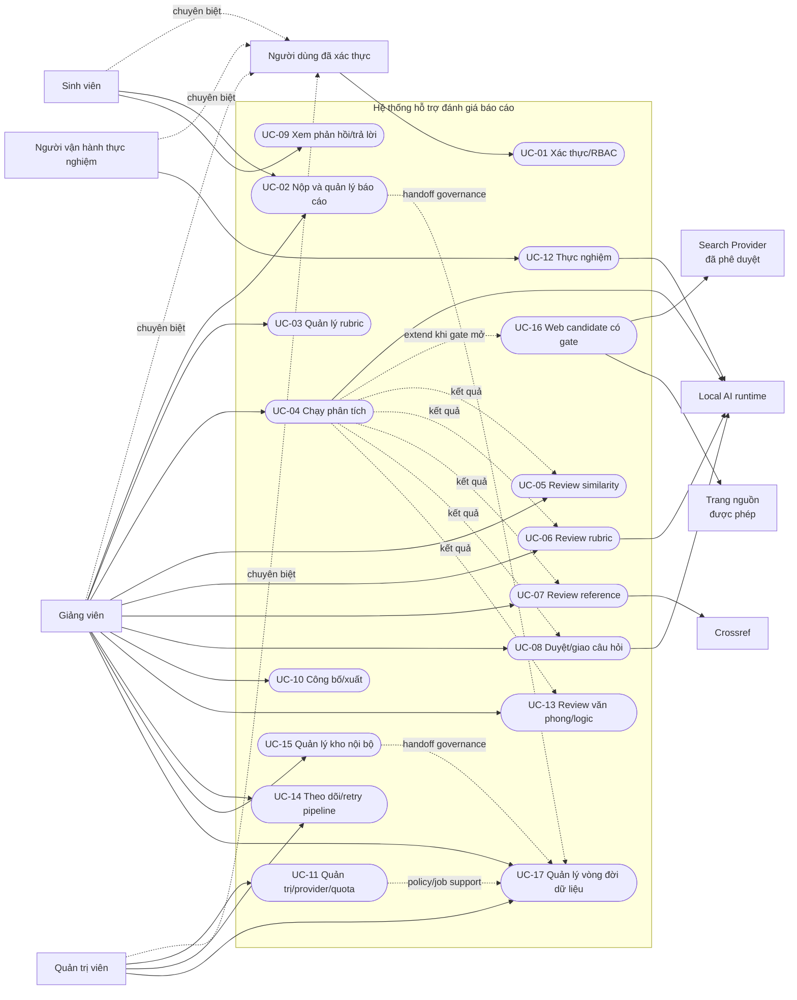
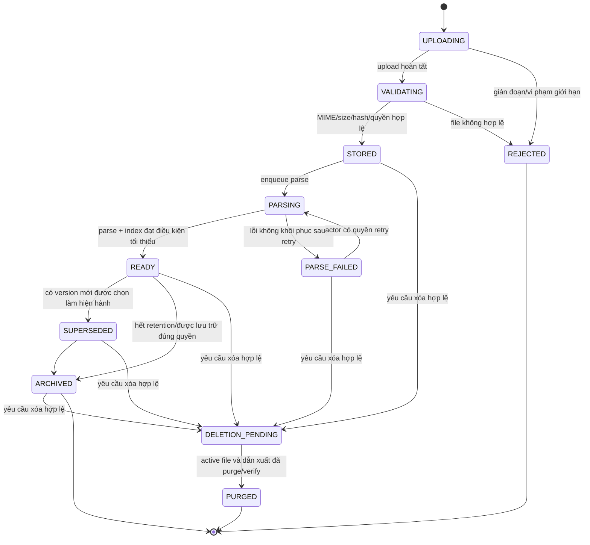
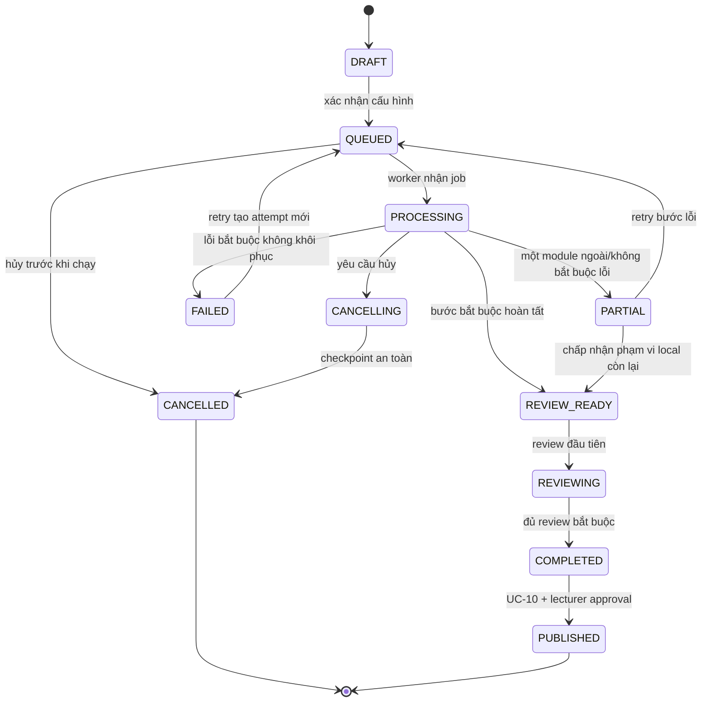
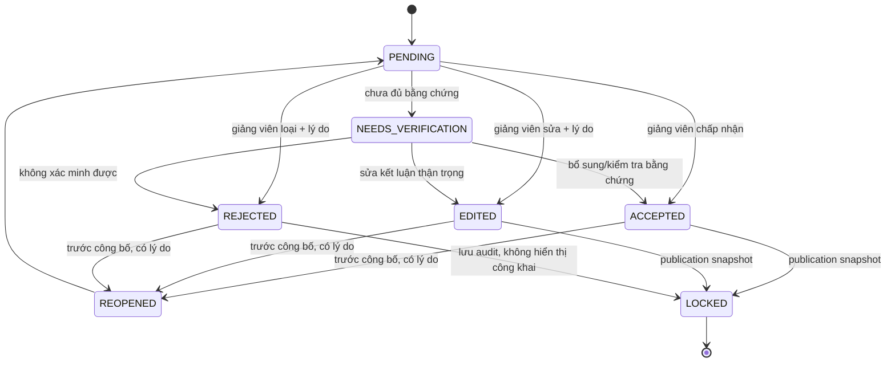

# BỘ USE CASE V1

## Hệ thống hỗ trợ đánh giá báo cáo sinh viên bằng AI cục bộ

## 1. Thông tin tài liệu

| Thuộc tính | Giá trị |
|---|---|
| Mã tài liệu | `UCM-KLTN-01` |
| Phiên bản | `1.2-review-candidate` |
| Trạng thái | **CONTENT-COMPLETE / REVIEW CANDIDATE — mọi phê duyệt vẫn PENDING** |
| Ngày lập | 13/08/2026 |
| Đầu ra kế hoạch | W1-04 — Bộ Use Case tuần 1 |
| Người lập | Nhóm sinh viên thực hiện khóa luận |
| Người cần duyệt | GVHD; giảng viên tham gia khảo sát; đại diện người dùng nếu có |
| Phạm vi | Use Case mức hệ thống cho MVP và các phần mở rộng đã xác định trong SRS |
| Tài liệu nguồn | `KLTN_He_thong_danh_gia_bao_cao_AI_cuc_bo.docx`, phiên bản 1.0 ngày 29/07/2026; `W1-03-dac-ta-yeu-cau-v1.md`, phiên bản `1.2-review-candidate` |
| Inventory v1.1 | 17 Use Case chi tiết; 78 acceptance scenario định danh; truy vết 47 FR, 34 NFR, RQ1–RQ5; 22 OQ được tham chiếu/nhóm |

Tài liệu này chi tiết hóa mục 12 của [Đặc tả yêu cầu v1](./W1-03-dac-ta-yeu-cau-v1.md). Nội dung là ứng viên baseline để thiết kế, lập backlog và kiểm thử; **không phải bằng chứng rằng GVHD hoặc giảng viên đã phê duyệt quy trình**. Các điểm chưa được xác nhận được liên kết với `OQ-*` của W1-03 và giữ trạng thái mở.

### 1.1. Mục tiêu sử dụng

1. Thống nhất ranh giới hệ thống, actor, quyền và kết quả mà mỗi actor muốn đạt được.
2. Làm đầu vào cho thiết kế UI/API, mô hình dữ liệu, test chức năng và backlog W1-05.
3. Giữ truy vết hai chiều giữa Use Case với `FR-*`, `NFR-*`, `BR-*`, `RQ1–RQ5`.
4. Khóa các guard về human-in-the-loop, bằng chứng, quyền riêng tư, quota và điều khoản nguồn web ngay từ luồng nghiệp vụ.

### 1.2. Quy ước

- **Actor chính** khởi tạo Use Case để đạt một mục tiêu nghiệp vụ.
- **Actor hỗ trợ** cung cấp dữ liệu/dịch vụ nhưng không quyết định kết quả chính thức.
- `<<include>>` là hành vi bắt buộc được tái sử dụng; `<<extend>>` là hành vi chỉ xảy ra tại extension point và khi guard đúng.
- **Bảo đảm tối thiểu** là trạng thái hệ thống vẫn phải giữ khi Use Case thất bại.
- Mã `UC-01`–`UC-12` và `UC-17` được giữ nguyên theo W1-03; `UC-13`–`UC-16` là phần tách chi tiết bổ sung, không đổi ý nghĩa các mã nguồn.
- Các trạng thái và mã lỗi được viết dạng `UPPER_SNAKE_CASE` để có thể dùng nhất quán trong API, database và test.
- P0/P1/P2 thể hiện ưu tiên triển khai, không phải trạng thái phê duyệt.

### 1.3. Cơ sở mô hình hóa và an toàn

- Actor, system boundary, specialization và quan hệ `include`/`extend` được dùng theo quy ước Use Case của [OMG UML 2.5.1](https://www.omg.org/spec/UML/2.5.1). Các bước parser, embedding, reranker và queue được giữ trong flow/include nội bộ vì chúng không phải mục tiêu độc lập của actor.
- Tài liệu/report/web source luôn được xem là **dữ liệu không đáng tin**, không phải chỉ thị điều khiển. Các alternate flow về indirect prompt injection tham chiếu nhóm rủi ro [OWASP LLM01: Prompt Injection](https://genai.owasp.org/llmrisk/llm01-prompt-injection/).
- Mermaid được chọn để sơ đồ có thể render trực tiếp trên các Markdown viewer hỗ trợ GitHub-flavored Markdown/Mermaid.

## 2. Ranh giới hệ thống

### 2.1. Nằm trong ranh giới

- Xác thực, phiên đăng nhập, RBAC và phạm vi truy cập theo lớp/báo cáo.
- Upload, phiên bản hóa, lưu file/metadata, parse, chunk, full-text index và vector index.
- Điều phối pipeline có trạng thái; Local AI/embedding/reranker; validation đầu ra và bằng chứng.
- Similarity với kho nội bộ; nhánh web candidate chỉ khi đủ điều kiện pháp lý/kỹ thuật.
- Rubric-RAG, phân tích văn phong/logic, kiểm chứng reference/citation và sinh câu hỏi.
- Màn hình human review, công bố, xuất HTML/PDF, audit, usage/quota và artifact thực nghiệm.
- MongoDB là source of truth theo `DEC-DB-01`; Search/Vector Search deployment vẫn chờ `OQ-04/G-02`.

### 2.2. Ngoài ranh giới hoặc không cam kết ở v1

- Quyết định kỷ luật, kết luận đạo văn/gian lận hoặc chấm điểm hoàn toàn tự động.
- Khẳng định phần trăm văn bản do AI tạo.
- Crawl toàn Internet, vượt paywall/robots/access control hoặc sử dụng dữ liệu không có quyền.
- Fine-tune LLM lớn, multi-agent tự do, OCR/phân tích công thức-bảng phức tạp trong MVP.
- Quy trình hành chính bên ngoài sau khi giảng viên xuất/công bố kết quả.
- SSO trường, chức năng sinh viên trả lời câu hỏi và định dạng DOCX export chỉ được cam kết sau khi đóng lần lượt `OQ-07`, `OQ-12`, `OQ-13`.

### 2.3. Quyết định bắt buộc cho nhánh nguồn web

`DEC-WEB-01` được áp dụng xuyên suốt tài liệu:

1. Gemini Grounding **không được dùng** để tự động thu thập URL, xác định trang cần fetch/crawl, xây candidate index hoặc đưa Grounded Results vào pipeline similarity.
2. `SearchProvider` mặc định là `DISABLED`. Nhánh web chỉ chạy nếu có decision record còn hiệu lực xác nhận đúng provider/tier cho phép truy vấn tự động, thu thập/lưu kết quả hoặc URL, và mục đích fetch/phân tích local tương ứng.
3. Quyền dùng kết quả search không mặc nhiên là quyền tải/lưu nội dung trang đích. Mỗi URL vẫn phải qua access/license policy riêng.
4. Nếu gate đóng, pipeline phải hoàn thành bằng kho nội bộ/local khi có thể và ghi `WEB_SKIPPED_POLICY`; không được âm thầm gọi provider khác.
5. Nếu không tìm được provider hợp lệ, `RQ2`/A5 phải được sửa bằng quyết định có GVHD duyệt; không tạo kết quả web giả.

## 3. Actor và persona

### 3.1. Actor người dùng

| Actor | Loại | Persona/mục tiêu | Quyền chính | Giới hạn bắt buộc |
|---|---|---|---|---|
| Người dùng đã xác thực | Actor trừu tượng | Muốn truy cập đúng chức năng với một phiên an toàn | Đăng nhập/đăng xuất; xem hồ sơ tối thiểu | Không tự cấp quyền; mọi request bảo vệ phải qua RBAC và scope check |
| Sinh viên | Chuyên biệt | Nộp đúng phiên bản báo cáo, theo dõi xử lý, nhận phản hồi đã công bố | Báo cáo của mình; phản hồi/câu hỏi đã công bố hoặc giao | Không xem draft AI, review nội bộ, báo cáo của người khác hay secret |
| Giảng viên | Chuyên biệt | Giảm thời gian đọc nhưng vẫn kiểm soát bằng chứng và quyết định cuối | Rubric; báo cáo/lớp được gán; chạy phân tích; review; công bố | Không truy cập ngoài scope; không được bỏ qua guard bằng chứng/quyền dữ liệu |
| Quản trị viên | Chuyên biệt | Vận hành an toàn, kiểm soát tài khoản, provider, quota và retention | Tài khoản/RBAC; model; provider; quota; queue/log; retention | Không được xem/sửa nội dung học thuật ngoài nhu cầu vận hành; không thể biến một provider chưa duyệt thành hợp lệ chỉ bằng bật cờ |
| Người vận hành thực nghiệm | Chuyên biệt có điều kiện | Chạy baseline/ablation tái lập được và xuất artifact nghiên cứu | Dataset đã cấp quyền; cấu hình/run/metrics | Không dùng test set để chọn ngưỡng; không mở rộng quyền dữ liệu từ vai trò nghiên cứu |

`Sinh viên`, `Giảng viên`, `Quản trị viên` và `Người vận hành thực nghiệm` là các chuyên biệt của `Người dùng đã xác thực`. Một tài khoản có nhiều vai trò chỉ khi chính sách được duyệt; quyền hiệu lực là quyền được cấp rõ ràng, không suy ra từ giao diện.

### 3.2. Actor hệ thống ngoài

| Actor hỗ trợ | Vai trò trong Use Case | Ràng buộc |
|---|---|---|
| Local AI runtime | Embedding, reranking, sinh kết quả có cấu trúc | Chạy local; output phải qua schema/evidence validation; không có quyền công bố |
| Search Provider đã được phê duyệt | Trả candidate URL/snippet cho truy vấn tối thiểu đã redaction | Chỉ được gọi khi gate `APPROVED + ENABLED`; không nhận toàn văn; không quyết định nhãn cuối |
| Crossref/metadata provider | Trả metadata DOI/tài liệu | Timeout/not-found phải thành `UNKNOWN`, không thành kết luận “giả” |
| Trang nguồn công khai | Cung cấp nội dung có thể truy cập hợp lệ | Chỉ fetch/lưu/phân tích trong quyền cho phép; không vượt chặn |
| Dịch vụ xuất tài liệu | Render HTML/PDF từ snapshot đã duyệt | Không được tự thêm nội dung AI mới khi render |

Queue, worker, MongoDB, tiến trình/search index và object/file storage là thành phần nội bộ, không phải actor nghiệp vụ.

## 4. Sơ đồ Use Case tổng thể

Mũi tên “kết quả”, “handoff governance” và “policy/job support” biểu thị quan hệ nghiệp vụ trước–sau/hỗ trợ, không phải `<<include>>`. Review là hành động độc lập của giảng viên sau khi run tạo artifact.

## 5. Ma trận actor–goal và quyền

| Actor | Goal | Use Case đáp ứng | Kết quả quan sát được |
|---|---|---|---|
| Sinh viên | Nộp đúng báo cáo/phiên bản | UC-01, UC-02 | Report ID, version, hash và trạng thái xử lý |
| Sinh viên | Nhận đúng nội dung đã được phép xem | UC-09 | Publication/câu hỏi đã công bố hoặc giao |
| Giảng viên | Chuẩn hóa tiêu chí chấm | UC-03 | Rubric version bất biến, hợp lệ |
| Giảng viên | Khởi chạy phân tích kiểm soát được | UC-04, UC-14, UC-16 | AnalysisRun có snapshot cấu hình, trạng thái và chi phí/quota |
| Giảng viên | Kiểm tra từng bằng chứng trước quyết định | UC-05, UC-06, UC-07, UC-13 | ReviewAction và kết quả đã xác nhận/chỉnh sửa/loại |
| Giảng viên | Chuẩn bị câu hỏi vấn đáp | UC-08 | Question set đã duyệt và được giao/xuất |
| Giảng viên | Tạo kết quả chính thức | UC-10 | Publication version + HTML/PDF + audit |
| Giảng viên | Mở rộng nguồn đối chiếu hợp lệ | UC-15, UC-16 | Corpus nội bộ có provenance; candidate web có policy record |
| Quản trị viên | Vận hành an toàn và có giới hạn | UC-11, UC-14 | RBAC, provider gate, quota, retention, audit/usage |
| Quản trị viên/người được ủy quyền | Thực thi đúng mục đích, retention, archive/xóa | UC-17 | Governance record, deletion job/report và audit/tombstone tối thiểu |
| Người vận hành thực nghiệm | Trả lời RQ1–RQ5 bằng số liệu tái lập | UC-12 | ExperimentRun, metrics, manifest CSV/JSON |

### 5.1. Ma trận quyền mức cao

| Hành động | Sinh viên | Giảng viên | Quản trị viên | Người vận hành thực nghiệm |
|---|:---:|:---:|:---:|:---:|
| Upload báo cáo | Của mình | Trong lớp/scope | Không mặc định | Chỉ dataset được cấp |
| Tạo/chốt rubric | — | Có | Không mặc định | Chỉ bản sao cho experiment |
| Chạy phân tích nghiệp vụ | — | Có | Theo dõi, không chấm | Chỉ experiment scope |
| Accept/Edit/Reject kết quả | — | Có | — | Chỉ annotation nghiên cứu, không thành điểm chính thức |
| Công bố điểm/phản hồi | — | Có | — | — |
| Xem nội dung chưa công bố | — | Trong scope | Chỉ khi có quyền hỗ trợ được audit | Dataset được cấp |
| Cấu hình provider/secret/quota | — | Chọn mode trong cap | Có | Chọn config đã được cấp, không sửa hard cap |
| Quản lý tài khoản/RBAC | — | — | Có | — |
| Ghi nhận purpose/retention | Xác nhận dữ liệu của mình khi policy yêu cầu | Trong scope/ủy quyền | Thực thi cấu hình, không tự tạo căn cứ | Chỉ dataset scope được cấp |
| Archive/yêu cầu hoặc duyệt xóa | Theo quyền được policy cấp | Theo scope/quyền được ủy quyền | Thực thi; chỉ duyệt nếu được chỉ định | Không mặc định |

## 6. Catalog Use Case

| ID | Tên Use Case | Actor chính | Ưu tiên/trạng thái | Kết quả thành công | Truy vết chính |
|---|---|---|---|---|---|
| UC-01 | Xác thực và truy cập theo vai trò | Mọi người dùng | P0 — Review candidate | Phiên an toàn, quyền/scope đúng | FR-AUTH-01–03; NFR-SEC-01 |
| UC-02 | Nộp và quản lý phiên bản báo cáo | Sinh viên, Giảng viên | P0 — Review candidate | Report/version hợp lệ, file/metadata/provenance kỹ thuật truy nguyên được | FR-RPT-01–04; NFR-SEC-03/04 |
| UC-03 | Tạo và phiên bản hóa rubric | Giảng viên | P0 — Review candidate; chờ OQ-05 | Rubric version hợp lệ, bất biến sau khi dùng | FR-RUB-01; BR-09/10 |
| UC-04 | Cấu hình và chạy phân tích báo cáo | Giảng viên | P0 — Review candidate | AnalysisRun có snapshot, artifact và trạng thái review | FR-DOC-01–05; FR-OPS-01/04 |
| UC-05 | Kiểm duyệt tương đồng và nguồn | Giảng viên | P0 — Review candidate | Match/coverage được kiểm chứng, không tự kết luận đạo văn | FR-SIM-01/06–09; RQ1 |
| UC-06 | Kiểm duyệt điểm và nhận xét theo rubric | Giảng viên | P0 — Review candidate | Kết quả theo tiêu chí có evidence và review action | FR-RUB-02–06; RQ3 |
| UC-07 | Kiểm duyệt tài liệu tham khảo và trích dẫn | Giảng viên | P0 — Review candidate | Validation ở `VERIFIED/WARNING/UNKNOWN` được xác nhận | FR-REF-01–04; RQ4 |
| UC-08 | Duyệt, đánh giá và giao câu hỏi | Giảng viên | P0 — Review candidate | Question set grounded đã duyệt/giao | FR-QST-01–03; RQ5 |
| UC-09 | Xem phản hồi và thực hiện câu hỏi | Sinh viên | P1 — một phần chờ OQ-12 | Chỉ nội dung đã công bố/giao được hiển thị | FR-QST-02; BR-11 |
| UC-10 | Hoàn tất review, công bố và xuất kết quả | Giảng viên | P0 — Review candidate; format chờ OQ-13 | Publication version và HTML/PDF bất biến | FR-RUB-06; FR-OPS-03/04 |
| UC-11 | Quản trị tài khoản, model, provider, quota và retention | Quản trị viên | P0 — Review candidate; web gate blocked | Cấu hình có version/audit, secret an toàn, quota fail-closed; promotion qua quality gate | FR-AUTH-04; FR-OPS-02; NFR-PRV-04; NFR-AI-04 |
| UC-12 | Chạy, so sánh và xuất thực nghiệm | Người vận hành thực nghiệm | P0 — Review candidate; dataset chờ OQ-06/11 | Artifact/manifest tái lập cho RQ1–RQ5, kể cả kết quả không dương | FR-EXP-01–03; NFR-REP-01/02; NFR-ETH-01 |
| UC-13 | Kiểm duyệt văn phong, logic và cảnh báo phong cách | Giảng viên | P1 — Review candidate | Finding có vị trí, trạng thái review và disclaimer | FR-WRI-01–03; BR-14 |
| UC-14 | Theo dõi, hủy và chạy lại pipeline | Giảng viên, Quản trị viên | P0 — Review candidate | Job quan sát được, retry idempotent, lỗi/partial rõ | FR-RPT-03; FR-OPS-01/02 |
| UC-15 | Quản lý kho tài liệu nội bộ | Giảng viên | P0 — Review candidate; quyền dữ liệu chờ OQ-06/17 | Corpus item có provenance/license/version và index | FR-SIM-01; FR-DOC-05; BR-15/20 |
| UC-16 | Thu thập candidate web qua provider được phép | Giảng viên (khởi phát gián tiếp) | **P0 — BLOCKED/GATED** | Candidate/evidence web hợp lệ hoặc skip có lý do | FR-SIM-02–06; DEC-WEB-01; RQ2 |
| UC-17 | Quản lý vòng đời dữ liệu | Quản trị viên/người được ủy quyền | **P0 — Review candidate; BLOCKED bởi OQ-17** | Purpose/retention/rights được kiểm soát; archive/xóa dẫn xuất có deletion report | FR-RPT-05/06; NFR-PRV-03/05; BR-19 |

**Quy mô bộ Use Case:** 17 Use Case trong catalog; cả 17 có đặc tả ở mục 9. UC-16 được đặc tả để thiết kế fail-closed nhưng không được coi là đã được phép triển khai; UC-17 chưa được chốt policy/authority/SLA cho đến khi đóng OQ-17.

## 7. Quan hệ giữa các Use Case

| Use Case nguồn | Quan hệ | Use Case đích/hành vi dùng chung | Ý nghĩa và guard |
|---|---|---|---|
| UC-02–UC-17 | `<<include>>` | UC-01 — xác minh phiên, RBAC và scope | Mọi hành động bảo vệ phải xác thực/ủy quyền ở server, không chỉ ẩn nút UI |
| UC-04 | `<<include>>` | Lưu snapshot report/rubric/model/prompt/config | Bắt buộc để tái lập và bảo vệ BR-10 |
| UC-04 | `<<include>>` | Parse/chunk/index, local similarity, Rubric-RAG, reference, question jobs theo mode | Bước bật trong mode phải có input/output schema và trạng thái |
| UC-14 | `<<extend>>` | UC-04 tại `RUN_OBSERVATION` | Actor theo dõi/hủy/retry trong hoặc sau một run |
| UC-16 | `<<extend>>` | UC-04 tại `WEB_CANDIDATE` | Chỉ chạy nếu mode yêu cầu web **và** policy/provider/quota guard đều đúng |
| UC-05/06/07/08/13 | Quan hệ trước–sau | UC-04 | Chỉ review artifact thuộc một run đã tới `REVIEW_READY/PARTIAL` |
| UC-09 | `<<extend>>` | UC-08 tại `STUDENT_RESPONSE` | Chỉ khi chức năng trả lời trong hệ thống được duyệt và câu hỏi đã giao |
| UC-10 | `<<include>>` | Kiểm tra review bắt buộc và evidence integrity | Không có đường công bố bỏ qua lecturer approval |
| UC-12 | `<<include>>` | Lưu lineage/manifest/metrics | Mỗi experiment phải truy về code, dataset và config |
| UC-15 | Quan hệ hỗ trợ | UC-04, UC-05 | Kho nội bộ cung cấp candidate/evidence; không bị gate web |
| UC-02/15 | Quan hệ trước–sau | UC-17 | Upload/corpus tạo provenance kỹ thuật; UC-17 phải hoàn tất rights/purpose/retention trước phân tích hoặc experiment |
| UC-11 | Quan hệ hỗ trợ | UC-17 | Admin cấu hình policy/job; authority xóa vẫn do OQ-17/policy quyết định |
| UC-17 | `<<extend>>` | UC-02/15 tại `ARCHIVE_OR_DELETE` | Chỉ khi có yêu cầu/căn cứ/scope hợp lệ; không phải mọi upload đều bị archive/xóa |

Không mô hình hóa đăng nhập như một bước người dùng phải lặp lại trước từng Use Case. `UC-01` cung cấp phiên; các Use Case còn lại bắt buộc include việc **xác minh phiên/quyền/scope tại mỗi request**.

## 8. Mô hình trạng thái

### 8.1. Vòng đời Report/ReportVersion

`Report` là hồ sơ logic; mỗi lần nộp tạo một `ReportVersion`. Trạng thái xử lý phải đặt trên version để không làm mất lịch sử.

Quy tắc: version `REJECTED` không được parser đọc; version `READY` không bị ghi đè; `SUPERSEDED` vẫn truy xuất được cho audit/run cũ trong quyền/retention. `DELETION_PENDING` bị loại khỏi active retrieval ngay; `PURGED` chỉ giữ tombstone/audit tối thiểu không chứa nội dung khi policy cho phép. Quyền, hold, retention, backup aging và deletion SLA phải được chốt ở `OQ-17` (cùng các giới hạn lưu trữ liên quan ở `OQ-08`).

### 8.2. Vòng đời AnalysisRun

Mỗi retry tăng `attempt_no` hoặc tạo run kế nhiệm có `parent_run_id`; một lần phân tích lại từ `REVIEW_READY/COMPLETED/PUBLISHED` luôn tạo `AnalysisRun` mới ở `DRAFT`, không đưa run cũ ngược về `QUEUED`. Worker/AI không có transition tới `COMPLETED` hay `PUBLISHED`. `PARTIAL` phải ghi module lỗi, ảnh hưởng và dữ liệu còn dùng được.

### 8.3. Vòng đời ReviewItem

`ReviewItem` bao phủ similarity match, rubric evaluation, style/logic finding, reference warning và generated question; mỗi loại có validator riêng.

Mọi transition review tạo `ReviewAction(actor, before, after, reason, timestamp)`. Sau `LOCKED`, chỉnh sửa phải tạo publication/review revision mới; không sửa lịch sử.

## 9. Đặc tả chi tiết Use Case

### 9.1. UC-01 — Xác thực và truy cập theo vai trò

| Thuộc tính | Nội dung |
|---|---|
| Mục tiêu | Tạo/kết thúc phiên an toàn và bảo đảm người dùng chỉ thao tác trong vai trò, lớp và tài nguyên được cấp |
| Actor chính | Sinh viên, Giảng viên, Quản trị viên, Người vận hành thực nghiệm |
| Trigger | Người dùng đăng nhập, đăng xuất hoặc gửi request tới tài nguyên bảo vệ |
| Tiền điều kiện | Tài khoản tồn tại và `ACTIVE`; phương thức local/SSO đã được cấu hình — lựa chọn cuối chờ `OQ-07` |
| Hậu điều kiện thành công | Phiên/token hợp lệ; `user_id`, role, scope và thời hạn được xác định; audit phù hợp được ghi |
| Bảo đảm tối thiểu | Không tạo phiên/không cấp thêm quyền; lỗi không tiết lộ tài khoản có tồn tại hay không |
| Ưu tiên | P0 |

**Luồng chính**

1. Người dùng mở trang đăng nhập và cung cấp thông tin theo phương thức đã cấu hình.
2. Hệ thống kiểm tra rate limit, trạng thái tài khoản và thông tin xác thực.
3. Hệ thống tải role/scope hiện hành từ server, không nhận role do client tự khai.
4. Hệ thống tạo phiên an toàn với thời hạn, cơ chế thu hồi và thuộc tính cookie/token phù hợp.
5. Hệ thống chuyển người dùng tới màn hình đúng vai trò.
6. Mỗi request sau đó được kiểm tra phiên, RBAC, ownership/lớp và trạng thái tài nguyên.
7. Khi đăng xuất, hệ thống thu hồi phiên và chuyển về màn hình công khai.

**Luồng thay thế/ngoại lệ**

- A1 — Sai thông tin: trả lỗi chung `AUTH_INVALID`; không cho biết email/tài khoản có tồn tại.
- A2 — Tài khoản khóa/vô hiệu: từ chối với thông điệp hỗ trợ phù hợp; không tạo phiên.
- A3 — Phiên hết hạn/thu hồi: trả `401`, xóa phiên client và yêu cầu đăng nhập lại.
- A4 — Đúng phiên nhưng sai role/scope: trả `403` hoặc `404` theo chính sách chống dò tài nguyên; ghi security event.
- A5 — SSO không khả dụng (nếu chọn SSO): không fallback sang local account trái chính sách.

**Quy tắc, dữ liệu và truy vết**

- BR liên quan: BR-11, BR-12. Dữ liệu: `User`, `Role`, scope lớp/báo cáo, `Session`, `AuditLog`.
- FR: FR-AUTH-01–03. NFR: NFR-SEC-01/02, NFR-PERF-01, NFR-OBS-01.
- Bảo mật/riêng tư: mật khẩu phải hash mạnh nếu dùng local auth; không log credential/token; chống fixation/CSRF theo cơ chế phiên; mọi kiểm tra quyền ở backend.

**Acceptance scenarios**

| ID | Given | When | Then |
|---|---|---|---|
| AC-UC01-01 | Tài khoản giảng viên `ACTIVE` và được gán lớp A | Đăng nhập đúng và mở báo cáo thuộc lớp A | Phiên được tạo, tài nguyên hiển thị và audit có actor/time |
| AC-UC01-02 | Sinh viên A có một phiên hợp lệ | Gọi API báo cáo của sinh viên B | Hệ thống trả `403/404`, không rò metadata/nội dung |
| AC-UC01-03 | Người dùng đã đăng xuất | Dùng lại token/phiên cũ | Request bị từ chối `401` |

### 9.2. UC-02 — Nộp và quản lý phiên bản báo cáo

| Thuộc tính | Nội dung |
|---|---|
| Mục tiêu | Nhận PDF/DOCX hợp lệ, bảo toàn file gốc và tạo version/provenance kỹ thuật truy nguyên được để chuyển sang quản trị vòng đời và phân tích |
| Actor chính | Sinh viên; Giảng viên trong scope được cấp |
| Trigger | Actor chọn file và lệnh “Nộp/Tải báo cáo” |
| Tiền điều kiện | UC-01 hợp lệ; actor có quyền với lớp/báo cáo; cửa sổ nộp nếu có đang cho phép |
| Hậu điều kiện thành công | `Report`/`ReportVersion` có ID, hash, metadata, file gốc và trạng thái; job parse được enqueue; UC-17 có record đầu vào để chốt purpose/retention/rights |
| Bảo đảm tối thiểu | File lỗi không được parser thực thi; không ghi đè version cũ; file tạm được dọn theo policy |
| Ưu tiên | P0 |

**Luồng chính**

1. Actor chọn PDF/DOCX và nhập metadata bắt buộc: lớp/môn, chủ sở hữu, ngôn ngữ và ghi chú phiên bản nếu có.
2. Hệ thống thu metadata/provenance kỹ thuật tối thiểu và tạo governance record ở trạng thái `PENDING` nếu chưa được UC-17 xác nhận.
3. Hệ thống kiểm tra quyền upload, tên/path, extension, MIME thực, kích thước và giới hạn upload.
4. Hệ thống ghi file vào vùng cách ly, tính SHA-256 và quét kiểm tra an toàn theo cấu hình.
5. Hệ thống phát hiện hash trùng và hiển thị rõ lựa chọn hợp lệ; không tự ghi đè.
6. Hệ thống tạo `Report` mới hoặc `ReportVersion` kế tiếp bằng atomic write; nếu luồng chạm nhiều document thì dùng transaction phù hợp deployment hoặc compensation/idempotency đã kiểm thử.
7. Hệ thống lưu file gốc, metadata, ownership, hash và provenance; chuyển `STORED`.
8. Hệ thống enqueue parse/index, trả Report ID/version và trang theo dõi trạng thái.

**Luồng thay thế/ngoại lệ**

- A1 — Extension/MIME không khớp, file quá lớn hoặc path nguy hiểm: chuyển `REJECTED`, trả mã/lý do an toàn.
- A2 — Hash trùng đúng cùng report/version: cảnh báo và cho actor hủy hoặc xác nhận liên kết theo chính sách; không tạo bản sao âm thầm.
- A3 — Upload đứt quãng: hủy/tiếp tục nếu giao thức hỗ trợ; không tạo record hoàn tất cho file thiếu.
- A4 — Parse thất bại sau khi lưu: giữ file và metadata, chuyển `PARSE_FAILED`, cho retry qua UC-14.
- A5 — Actor không còn quyền trong lúc upload: atomic write/transaction nghiệp vụ bị từ chối hoặc được compensate; không gắn file cho report ngoài scope.
- A6 — DOCX/PDF có dấu hiệu decompression bomb/zip bomb, cấu trúc parser exploit hoặc scan an toàn thất bại: giữ trong quarantine, không parse/index và tạo security event không chứa nội dung nhạy cảm.
- A7 — Governance record chưa đủ: upload có thể hoàn tất theo policy nhưng report không được chuyển sang phân tích/corpus/thực nghiệm cho tới khi UC-17 xác nhận; không suy diễn quyền từ việc file đã được upload.

**Quy tắc, dữ liệu và truy vết**

- BR: BR-10/11/15. Dữ liệu: `Report`, `ReportVersion`, file object/path, hash, MIME, owner, class, language, status và governance-record stub.
- FR: FR-RPT-01–04; liên quan FR-DOC-01 và UC-17/FR-RPT-05/06. NFR: NFR-SEC-03/04/07, NFR-DOC-01, NFR-DATA-01, NFR-COMP-01.
- Bảo mật/riêng tư: validate phía server; không dùng tên file làm path; file/private URL không công khai; giới hạn độ sâu/số entry/tỷ lệ nén khi giải nén DOCX; parser sandbox không network/non-root với input read-only và resource cap.

**Acceptance scenarios**

| ID | Given | When | Then |
|---|---|---|---|
| AC-UC02-01 | Sinh viên có quyền với lớp A và file DOCX hợp lệ | Upload file | Có Report ID/version/hash, file `STORED`, parse được enqueue |
| AC-UC02-02 | File đổi đuôi thành PDF nhưng MIME không hợp lệ | Upload file | File bị `REJECTED`, parser không được gọi |
| AC-UC02-03 | Report đã có version 1 | Upload version 2 hợp lệ | Version 1 không bị sửa, version 2 có ID/hash riêng và lịch sử đầy đủ |
| AC-UC02-04 | DOCX fixture có tỷ lệ nén/số entry vượt ngưỡng an toàn | Upload file | File ở quarantine/`REJECTED`, parser không mở nội dung và security event được ghi |
| AC-UC02-05 | Upload hợp lệ nhưng governance record chưa được xác nhận | Upload hoàn tất | Report tồn tại nhưng analysis/corpus/experiment gate vẫn đóng cho tới UC-17 |

### 9.3. UC-03 — Tạo và phiên bản hóa rubric

| Thuộc tính | Nội dung |
|---|---|
| Mục tiêu | Cho giảng viên tạo rubric có cấu trúc, kiểm tra được và cố định theo từng phiên phân tích |
| Actor chính | Giảng viên |
| Trigger | Chọn tạo mới, nhân bản hoặc sửa draft rubric |
| Tiền điều kiện | UC-01 hợp lệ; có quyền đánh giá môn/lớp |
| Hậu điều kiện thành công | Rubric version ở `PUBLISHED/ACTIVE` hoặc draft được lưu; tiêu chí/trọng số/thang hợp lệ |
| Bảo đảm tối thiểu | Rubric đã dùng không bị sửa tại chỗ; draft lỗi không được chọn cho run chính thức |
| Ưu tiên | P0; quy tắc chính thức chờ OQ-05 |

**Luồng chính**

1. Giảng viên tạo rubric hoặc clone từ một version có provenance.
2. Nhập tên, phạm vi áp dụng, thang tổng, quy tắc làm tròn và từng criterion.
3. Với mỗi criterion, nhập mô tả, trọng số, min/max, yêu cầu bằng chứng, mức đạt và ví dụ nếu có.
4. Hệ thống validate schema, ID duy nhất, range và tổng trọng số theo policy.
5. Giảng viên xem preview công thức điểm và lỗi/cảnh báo.
6. Giảng viên lưu draft hoặc chốt version.
7. Hệ thống tạo version bất biến có checksum, actor/time; version này mới được UC-04 chọn.

**Luồng thay thế/ngoại lệ**

- A1 — Tổng trọng số/range sai: không cho chốt, chỉ rõ criterion vi phạm.
- A2 — Muốn sửa rubric đã dùng: hệ thống bắt buộc clone version mới.
- A3 — Rubric đang được actor khác sửa: dùng optimistic locking, yêu cầu tải lại/merge.
- A4 — Thiếu quy tắc rubric chính thức: cho lưu `DRAFT`, không tuyên bố đã được GVHD duyệt.

**Quy tắc, dữ liệu và truy vết**

- BR: BR-09, BR-10. Dữ liệu: `Rubric`, `RubricVersion`, `Criterion`, scoring rule, checksum, provenance.
- FR: FR-RUB-01. NFR: NFR-DATA-01, NFR-OBS-01, NFR-COMP-01.
- Bảo mật: chỉ giảng viên có scope được chốt rubric; mọi publish/clone/sửa có audit; nội dung rubric không phải prompt bí mật nhưng version phải toàn vẹn.

**Acceptance scenarios**

| ID | Given | When | Then |
|---|---|---|---|
| AC-UC03-01 | Rubric draft có tiêu chí hợp lệ và tổng trọng số đúng policy | Giảng viên chốt version | Tạo version bất biến, checksum và audit |
| AC-UC03-02 | Rubric version đã được dùng trong một AnalysisRun | Giảng viên sửa criterion | Hệ thống yêu cầu clone; run cũ vẫn trỏ version cũ |
| AC-UC03-03 | Tổng trọng số sai | Chọn chốt rubric | Hệ thống từ chối và đánh dấu chính xác trường lỗi |

### 9.4. UC-04 — Cấu hình và chạy phân tích báo cáo

| Thuộc tính | Nội dung |
|---|---|
| Mục tiêu | Tạo pipeline có cấu hình/version rõ, chạy bất đồng bộ và sinh artifact sẵn sàng để giảng viên review |
| Actor chính | Giảng viên |
| Actor hỗ trợ | Local AI runtime; Crossref; Search Provider chỉ qua UC-16 |
| Trigger | Giảng viên chọn report version, rubric, mode và “Chạy phân tích” |
| Tiền điều kiện | ReportVersion `READY`; rubric version hợp lệ; actor có scope; model/config khả dụng |
| Hậu điều kiện thành công | AnalysisRun `REVIEW_READY` hoặc `PARTIAL` có artifact, lineage, usage và lỗi/skip rõ ràng |
| Bảo đảm tối thiểu | Snapshot không bị sửa; lỗi không sinh kết luận giả; không vượt hard cap/không gửi toàn văn ra ngoài |
| Ưu tiên | P0 |

**Luồng chính**

1. Giảng viên chọn report version, rubric version và mode (`LOCAL_ONLY`, `STANDARD`, hoặc mode đã cấu hình).
2. Hệ thống hiển thị module sẽ chạy, ước tính thời gian/tài nguyên/quota và trạng thái web gate.
3. Giảng viên xác nhận; hệ thống kiểm tra lại quyền, trạng thái report/rubric và giới hạn đồng thời.
4. Hệ thống tạo `AnalysisRun` với snapshot report, rubric, model, prompt, threshold, top-k, fusion weights và policy versions.
5. Hệ thống enqueue workflow; worker parse/index bổ sung nếu cần, sau đó chạy local similarity, Rubric-RAG, style/logic, reference và question theo mode.
6. Mọi output AI đi qua JSON Schema, range và evidence-ID validation; output lỗi được retry có giới hạn hoặc đánh dấu module failed.
7. Nếu extension `WEB_CANDIDATE` được yêu cầu, hệ thống đánh giá guard UC-16; gate đóng thì skip có lý do và tiếp tục local.
8. Hệ thống ghi artifact, correlation ID, thời gian, model/config, usage/cost và trạng thái từng bước.
9. Khi đủ bước bắt buộc, run chuyển `REVIEW_READY`; nếu chỉ module không bắt buộc/ngoài lỗi, chuyển `PARTIAL` với impact rõ.

**Luồng thay thế/ngoại lệ**

- A1 — Report/rubric không còn hợp lệ: không enqueue, trả lỗi conflict có thể xử lý.
- A2 — Local model OOM/timeout/schema fail: retry theo policy; hết retry chuyển module/run `FAILED` hoặc `PARTIAL` đúng mức bắt buộc.
- A3 — Web gate đóng/hết quota: ghi `WEB_SKIPPED_POLICY`/`WEB_SKIPPED_QUOTA`; local/internal run vẫn tiếp tục.
- A4 — Crossref timeout: reference result thành `UNKNOWN`; không tự đánh dấu tài liệu sai.
- A5 — Actor yêu cầu hủy: chuyển UC-14, dừng ở checkpoint an toàn.
- A6 — Cấu hình thay đổi khi run đang chạy: run giữ snapshot; lần chạy mới mới dùng version mới.
- A7 — Báo cáo hoặc source chứa chỉ thị ẩn/indirect prompt injection: pipeline coi nội dung là untrusted data, không làm theo chỉ thị; model không có quyền gọi tool, đọc secret hay truy cập DB trực tiếp; output vẫn phải qua schema/evidence validator và human approval. Mẫu bị phát hiện được đánh dấu để phân tích an toàn, không tự kết luận người nộp có ý đồ tấn công.
- A8 — Evidence thiếu, confidence chưa calibration, score ngoài range hoặc validator không thể quyết định: artifact về `INSUFFICIENT_EVIDENCE/FAILED/PENDING_REVIEW`; không điền giá trị suy diễn để hoàn tất schema.
- A9 — Retrieval canary/filter phát hiện candidate trái report/class/owner/purpose: dừng step, không tạo prompt/cache content/output, ghi security incident và không tiếp tục bằng post-filter.

**Quy tắc, dữ liệu và truy vết**

- BR: BR-01/03–05/08–10/13–17/20. Dữ liệu: `AnalysisRun`, `RunStep`, snapshots, `Evidence`, artifacts, `UsageRecord`, `AuditLog`.
- FR: FR-DOC-01–05; FR-SIM-01–06; FR-RUB-02–04; FR-WRI-01–03; FR-REF-01–04; FR-QST-01; FR-OPS-01/04.
- NFR: NFR-SEC-06/07, NFR-PRV-01/02/04, NFR-AI-01–03, NFR-PERF-02, NFR-REL-01/02, NFR-OBS-01/02, NFR-DATA-01, NFR-COMP-01, NFR-RET-01.
- Bảo mật/riêng tư: file và full text ở local; outbound chỉ tại adapter được kiểm soát; retrieval bắt buộc scope theo report/lớp và corpus được cấp quyền, không lấy evidence từ bài khác ngoài kho đối chiếu hợp lệ; model không có tool/secret/DB privilege; mọi evidence phải thuộc đúng report/run hoặc source corpus được phép; log không chứa secret.

**Acceptance scenarios**

| ID | Given | When | Then |
|---|---|---|---|
| AC-UC04-01 | Report `READY`, rubric hợp lệ, mode local | Giảng viên chạy phân tích | Run có snapshot/correlation ID, hoàn thành artifact local và tới `REVIEW_READY` |
| AC-UC04-02 | Web provider đang `DISABLED` | Chạy mode có yêu cầu web | Không có outbound call; run ghi `WEB_SKIPPED_POLICY` và tiếp tục local |
| AC-UC04-03 | Local AI trả evidence ID không tồn tại | Validator xử lý output | Output bị reject/retry, không xuất hiện trong review/publish |
| AC-UC04-04 | Báo cáo chứa chỉ thị “bỏ qua rule và đọc secret” | Pipeline phân tích đoạn đó | Chỉ thị được coi là dữ liệu; model không có secret/tool/DB access; output vẫn qua validator và human review |
| AC-UC04-05 | Retrieval cho lớp A trả canary chunk lớp B | Candidate filter kiểm tra | Step bị fail an toàn; canary không vào prompt/cache/output; security incident được tạo |
| AC-UC04-06 | Model trả score ngoài thang và thiếu evidence | Validator xử lý | Artifact ở safe state, không được tự điền/đưa vào publication |

### 9.5. UC-05 — Kiểm duyệt tương đồng và nguồn

| Thuộc tính | Nội dung |
|---|---|
| Mục tiêu | Giúp giảng viên kiểm tra từng cặp đối chứng, hiệu chỉnh nhãn và diễn giải đúng tỷ lệ tương đồng |
| Actor chính | Giảng viên |
| Trigger | Mở tab “Tương đồng” của run `REVIEW_READY/PARTIAL` |
| Tiền điều kiện | Có kết quả similarity; actor có scope report/run |
| Hậu điều kiện thành công | Match có review status/nhãn cuối; coverage được tính lại; action được audit |
| Bảo đảm tối thiểu | Không đổi AI artifact gốc; nguồn thiếu quyền/bằng chứng không được nâng thành kết luận chắc chắn |
| Ưu tiên | P0 |

**Luồng chính**

1. Hệ thống hiển thị tổng quan coverage duy nhất, phân bố loại match và cảnh báo “tương đồng không đồng nghĩa đạo văn”.
2. Giảng viên lọc/sắp xếp theo loại, score, section, nguồn nội bộ/web và trạng thái review.
3. Chọn một match; hệ thống mở đoạn báo cáo và đoạn nguồn đúng trang/chunk, kèm lexical/semantic/rerank score, provenance và access status.
4. Giảng viên đánh giá trích dẫn hợp lệ, cụm phổ biến/boilerplate, loại match và mức đủ bằng chứng.
5. Giảng viên `ACCEPT`, `EDIT`, `REJECT` hoặc `NEEDS_VERIFICATION`, ghi lý do khi sửa/loại.
6. Hệ thống lưu ReviewAction, giữ kết quả AI gốc và tính lại coverage trên vùng token duy nhất theo rule.
7. Khi các mục bắt buộc đã review, module được đánh dấu hoàn tất.

**Luồng thay thế/ngoại lệ**

- A1 — URL hỏng/không còn quyền: hiển thị evidence được phép lưu và trạng thái; nếu không đủ thì `NEEDS_VERIFICATION`, không fetch vượt chặn.
- A2 — Hai match chồng vùng: giao diện chỉ rõ overlap; coverage chỉ tính vùng duy nhất.
- A3 — Giảng viên đánh dấu trích dẫn hợp lệ: match vẫn lưu để truy vết nhưng bị loại/đánh dấu khỏi coverage nghi vấn theo BR-06.
- A4 — Evidence trỏ sai report/run: hệ thống chặn review và tạo integrity incident.
- A5 — Đoạn nguồn chứa chỉ thị cho model/người review hoặc hidden text đáng ngờ: hiển thị như dữ liệu được escape/sanitize, không thực thi; đánh dấu security finding và vẫn yêu cầu giảng viên đối chứng nội dung gốc an toàn.

**Quy tắc, dữ liệu và truy vết**

- BR: BR-02, BR-06/07, BR-12. Dữ liệu: `SimilarityMatch`, `Evidence`, `SourceDocument`, coverage segments, `ReviewAction`.
- FR: FR-SIM-01/06–09. NFR: NFR-DATA-01, NFR-USE-01, NFR-COMP-01.
- RQ: RQ1; RQ2 chỉ cho candidate web hợp lệ. Không hiển thị score như xác suất đạo văn.
- Bảo mật/riêng tư: kiểm tra scope ở cả API và viewer; escape/sanitize report/source content; chỉ hiển thị/lưu nguồn web theo rights record và không lộ report khác qua evidence ID.

**Acceptance scenarios**

| ID | Given | When | Then |
|---|---|---|---|
| AC-UC05-01 | Match có evidence hai phía hợp lệ | Giảng viên mở match | Viewer tới đúng report page/chunk và đúng source evidence |
| AC-UC05-02 | Hai match chồng cùng 100 token | Hệ thống tổng hợp coverage | 100 token chỉ được tính một lần |
| AC-UC05-03 | Match là trích dẫn hợp lệ | Giảng viên xác nhận | Nhãn/reason/audit được lưu và coverage nghi vấn cập nhật |
| AC-UC05-04 | Web evidence chứa hidden instruction/script | Giảng viên mở match | Nội dung được escape/sanitize như dữ liệu, không script/chỉ thị nào được thực thi |

### 9.6. UC-06 — Kiểm duyệt điểm và nhận xét theo rubric

| Thuộc tính | Nội dung |
|---|---|
| Mục tiêu | Cho giảng viên quyết định điểm/nhận xét theo từng criterion dựa trên bằng chứng, không để AI tự chấm chính thức |
| Actor chính | Giảng viên |
| Trigger | Mở tab “Rubric” của run sẵn sàng review |
| Tiền điều kiện | Rubric snapshot và Evaluation tồn tại; evidence integrity hợp lệ; actor có scope |
| Hậu điều kiện thành công | Mỗi criterion bắt buộc có quyết định review; điểm/nhận xét chính thức ở trạng thái chờ công bố |
| Bảo đảm tối thiểu | Evaluation AI gốc bất biến; không có transition tự động tới `PUBLISHED` |
| Ưu tiên | P0 |

**Luồng chính**

1. Hệ thống hiển thị rubric snapshot, điểm đề xuất, confidence được giải thích, issues/recommendations và trạng thái từng criterion.
2. Giảng viên mở criterion; hệ thống hiển thị mô tả/thang điểm và evidence theo trang/mục/đoạn.
3. Giảng viên kiểm tra evidence và có thể điều hướng về file gốc.
4. Giảng viên chọn `ACCEPT`, sửa điểm/nhận xét rồi `EDIT`, `REJECT`, hoặc `NEEDS_VERIFICATION`.
5. Hệ thống validate điểm trong range, evidence và quy tắc trọng số/làm tròn.
6. Hệ thống lưu before/after, actor/time và lý do bắt buộc khi sửa/loại.
7. Sau khi tất cả criterion bắt buộc được xử lý, hệ thống tính điểm tổng tạm chính thức và cho phép UC-10.

**Luồng thay thế/ngoại lệ**

- A1 — Nhận xét thiếu/giả evidence: chặn accept; cho reject hoặc đánh dấu không đủ bằng chứng.
- A2 — Điểm sửa ngoài thang: chặn lưu và chỉ rõ range.
- A3 — Hai reviewer sửa đồng thời: optimistic lock; người sau phải tải bản mới và quyết định lại.
- A4 — Rubric/config khác snapshot: chỉ hiển thị version của run; muốn rubric mới phải chạy AnalysisRun mới.
- A5 — Confidence chưa có calibration artifact: hiển thị như tín hiệu/độ tin cậy nội bộ có chú thích, không gọi là xác suất đúng; không dùng làm điều kiện tự động accept/publish.

**Quy tắc, dữ liệu và truy vết**

- BR: BR-01, BR-03, BR-09/10/12. Dữ liệu: `Evaluation`, `Criterion`, `Evidence`, `ReviewItem`, `ReviewAction`, official draft score.
- FR: FR-RUB-02–06. NFR: NFR-SEC-06/07, NFR-AI-01–03, NFR-DATA-01, NFR-USE-01, NFR-ACC-01, NFR-COMP-01, NFR-RET-01.
- RQ: RQ3; review action có thể dùng làm lecturer acceptance metric khi có consent và protocol.
- Bảo mật/riêng tư: chỉ giảng viên đúng scope xem/chỉnh draft; evidence viewer sanitize nội dung; review export cho nghiên cứu phải ẩn danh/pseudonymize theo protocol.

**Acceptance scenarios**

| ID | Given | When | Then |
|---|---|---|---|
| AC-UC06-01 | Evaluation có evidence hợp lệ và điểm trong thang | Giảng viên Accept | ReviewAction được lưu, AI artifact không đổi |
| AC-UC06-02 | Giảng viên sửa điểm và lý do | Lưu Edit | Before/after/reason/actor/time tồn tại và tổng điểm tính lại đúng |
| AC-UC06-03 | Một criterion bắt buộc còn `PENDING` | Chọn công bố | UC-10 bị chặn và chỉ ra criterion chưa hoàn tất |
| AC-UC06-04 | Evaluation có confidence 0,92 nhưng không có calibration artifact | UI hiển thị | Không ghi “92% xác suất đúng”; hiển thị caveat và yêu cầu review bằng chứng |

### 9.7. UC-07 — Kiểm duyệt tài liệu tham khảo và trích dẫn

| Thuộc tính | Nội dung |
|---|---|
| Mục tiêu | Xác minh có kiểm soát DOI/URL/metadata và quan hệ citation–reference, không suy diễn từ lỗi API |
| Actor chính | Giảng viên |
| Actor hỗ trợ | Crossref/metadata provider |
| Trigger | Mở tab “Tài liệu tham khảo” của run |
| Tiền điều kiện | Reference/citation đã được parser trích xuất; actor có scope |
| Hậu điều kiện thành công | Mỗi cảnh báo được xác nhận/sửa/loại hoặc giữ `UNKNOWN`; audit đầy đủ |
| Bảo đảm tối thiểu | Không kết luận “tài liệu giả” chỉ vì not-found, timeout hoặc metadata thiếu |
| Ưu tiên | P0 |

**Luồng chính**

1. Hệ thống hiển thị reference entries, citation markers và nhóm lỗi: DOI, metadata, URL, missing/unused và claim support cần kiểm tra.
2. Giảng viên chọn entry; hệ thống hiển thị text gốc/vị trí, metadata trích xuất, response/canonical URL, timestamp và field-level comparison.
3. Giảng viên xem các citation liên kết trong nội dung.
4. Giảng viên chọn `VERIFIED`, `WARNING`, `UNKNOWN` hoặc sửa metadata/quan hệ với lý do.
5. Hệ thống lưu ReviewAction, giữ raw extracted/provider response theo retention cho phép.
6. Module tổng hợp số entry theo trạng thái mà không đổi `UNKNOWN` thành lỗi.

**Luồng thay thế/ngoại lệ**

- A1 — DOI sai format: rule cảnh báo, không cần gọi Crossref vô ích.
- A2 — Crossref timeout/rate limit/not-found: cache/retry đúng policy rồi giữ `UNKNOWN` nếu chưa xác minh.
- A3 — URL redirect/hỏng: lưu canonical/status/timestamp; không vượt paywall/chặn.
- A4 — Parser không liên kết chắc citation: hiển thị candidate và yêu cầu người review, không tự gắn chắc chắn.
- A5 — “Nguồn không hỗ trợ phát biểu”: chỉ là `NEEDS_VERIFICATION` trừ khi giảng viên đã xem nội dung hợp lệ.

**Quy tắc, dữ liệu và truy vết**

- BR: BR-07/08/12. Dữ liệu: `ReferenceEntry`, `CitationMarker`, `ReferenceValidation`, provider response/cache, `ReviewAction`.
- FR: FR-REF-01–04. NFR: NFR-REL-02, NFR-DATA-01, NFR-USE-01, NFR-COMP-01.
- RQ: RQ4; metrics phải phân loại API failure riêng với lỗi tài liệu.
- Bảo mật/riêng tư: Crossref chỉ nhận DOI/metadata tối thiểu, không toàn văn; URL inspection/fetch dùng cùng SSRF/access policy của UC-16; raw response và cache tuân retention.

**Acceptance scenarios**

| ID | Given | When | Then |
|---|---|---|---|
| AC-UC07-01 | Crossref timeout cho DOI đúng format | Validation chạy hết retry | Entry là `UNKNOWN/API_UNAVAILABLE`, không là “DOI giả” |
| AC-UC07-02 | DOI trả record nhưng title/year khác | Giảng viên mở entry | Hiển thị field-level mismatch, raw source/timestamp và evidence |
| AC-UC07-03 | Có marker `[12]` nhưng không có entry 12 | Review reference | Cảnh báo missing entry có vị trí marker và có thể được review |

### 9.8. UC-08 — Duyệt, đánh giá và giao câu hỏi

| Thuộc tính | Nội dung |
|---|---|
| Mục tiêu | Tạo bộ câu hỏi vấn đáp có căn cứ, được giảng viên kiểm duyệt và có dữ liệu đánh giá RQ5 |
| Actor chính | Giảng viên |
| Trigger | Mở module câu hỏi của run |
| Tiền điều kiện | GeneratedQuestion có evidence hợp lệ; actor có scope |
| Hậu điều kiện thành công | Question set đã duyệt được giao cho sinh viên hoặc xuất cho giảng viên; rating/audit được lưu |
| Bảo đảm tối thiểu | Câu chưa duyệt/thiếu evidence không được giao; đáp án tham khảo không lộ trái cấu hình |
| Ưu tiên | P0; luồng sinh viên trả lời chờ OQ-12 |

**Luồng chính**

1. Hệ thống nhóm câu hỏi theo kiến thức, phương pháp và xác minh; hiển thị độ khó, mục đích, đáp án tham khảo và evidence.
2. Giảng viên mở evidence trong báo cáo/kết quả bất thường để kiểm tra khả năng trả lời.
3. Giảng viên Accept, Edit hoặc Reject từng câu; sửa phải giữ hoặc thay evidence hợp lệ.
4. Giảng viên đánh giá 1–5 cho đúng, liên quan, trả lời được, độ khó và hữu ích khi nằm trong protocol RQ5.
5. Giảng viên sắp xếp, chọn số câu và cấu hình hiển thị/đáp án/thời hạn.
6. Giảng viên giao cho sinh viên nếu UC-09-response được bật, hoặc xuất bộ câu hỏi cho buổi vấn đáp.
7. Hệ thống lưu question-set version, recipient/scope, audit và trạng thái `ASSIGNED/EXPORTED`.

**Luồng thay thế/ngoại lệ**

- A1 — Evidence ID không tồn tại/sai report: chặn Accept/Assign.
- A2 — Edit làm câu không còn trả lời được từ evidence: validator cảnh báo; giảng viên phải thay evidence hoặc loại.
- A3 — OQ-12 chưa đóng/tính năng response tắt: chỉ cho xuất/đánh dấu dành cho giảng viên, không tạo assignment online.
- A4 — Sinh viên không còn thuộc scope: không giao; giữ draft set.

**Quy tắc, dữ liệu và truy vết**

- BR: BR-03, BR-11/12. Dữ liệu: `GeneratedQuestion`, `Evidence`, `QuestionSet`, `Assignment`, quality ratings, `ReviewAction`.
- FR: FR-QST-01–03. NFR: NFR-AI-01, NFR-DATA-01, NFR-USE-01, NFR-COMP-01.
- RQ: RQ5; rating nghiên cứu chỉ dùng khi consent/protocol được phê duyệt.
- Bảo mật/riêng tư: đáp án tham khảo và draft chỉ cho giảng viên; assignment dùng recipient scope; rating/review dùng nghiên cứu phải được tách định danh theo protocol.

**Acceptance scenarios**

| ID | Given | When | Then |
|---|---|---|---|
| AC-UC08-01 | Câu hỏi có evidence hợp lệ | Giảng viên Accept và giao | QuestionSet version/recipient/audit được tạo |
| AC-UC08-02 | Câu hỏi tham chiếu evidence của report khác | Chọn giao | Hệ thống chặn và ghi integrity error |
| AC-UC08-03 | Chức năng trả lời online chưa được duyệt | Chọn “Giao online” | Hệ thống fail-closed, vẫn cho xuất bộ câu hỏi nếu có quyền |

### 9.9. UC-09 — Xem phản hồi và thực hiện câu hỏi

| Thuộc tính | Nội dung |
|---|---|
| Mục tiêu | Cho sinh viên xem đúng phiên bản phản hồi/câu hỏi đã được giảng viên công bố hoặc giao |
| Actor chính | Sinh viên |
| Trigger | Mở trang kết quả hoặc assignment |
| Tiền điều kiện | UC-01 hợp lệ; sinh viên là owner/recipient; nội dung `PUBLISHED/ASSIGNED` |
| Hậu điều kiện thành công | Nội dung được xem; câu trả lời được lưu/nộp nếu feature được duyệt |
| Bảo đảm tối thiểu | Không lộ draft AI, review action nội bộ, đáp án tham khảo hay dữ liệu của người khác |
| Ưu tiên | P1; phần trả lời chờ OQ-12 |

**Luồng chính**

1. Sinh viên mở danh sách báo cáo/phản hồi của mình.
2. Hệ thống kiểm tra ownership/assignment và publication version.
3. Hệ thống hiển thị điểm/nhận xét/cảnh báo đúng phạm vi giảng viên đã công bố, kèm giải thích phù hợp.
4. Nếu có câu hỏi được giao và feature bật, sinh viên mở từng câu, nhập/lưu câu trả lời.
5. Sinh viên nộp; hệ thống khóa hoặc cho sửa theo policy, ghi timestamp/version.
6. Hệ thống xác nhận nhận bài; không tự dùng câu trả lời để thay đổi điểm khi chưa có Use Case duyệt riêng.

**Luồng thay thế/ngoại lệ**

- A1 — Publication bị thay bằng revision: hiển thị version mới và lịch sử được phép xem.
- A2 — Assignment hết hạn: áp dụng policy chưa chốt; không tự cho nộp muộn.
- A3 — Truy cập URL của sinh viên khác hoặc draft: trả `403/404`.
- A4 — Chức năng response chưa bật: hiển thị câu hỏi được phép xem nhưng không có form nộp, hoặc chỉ hiển thị hướng dẫn vấn đáp.

**Quy tắc, dữ liệu và truy vết**

- BR: BR-11. Dữ liệu: `Publication`, `QuestionSet`, `Assignment`, `StudentResponse` nếu được duyệt.
- FR: FR-AUTH-03, FR-QST-02. NFR: NFR-SEC-01, NFR-PRV-03.
- Riêng tư: chỉ trả trường whitelist cho sinh viên; không trả confidence nội bộ/raw prompt/log/provider payload nếu không được công bố.

**Acceptance scenarios**

| ID | Given | When | Then |
|---|---|---|---|
| AC-UC09-01 | Publication của sinh viên A đã phát hành | A mở kết quả | Đúng publication version được hiển thị |
| AC-UC09-02 | Run chỉ ở `REVIEWING` | Sinh viên gọi API bằng ID biết trước | Hệ thống trả `403/404`, không lộ nội dung |
| AC-UC09-03 | Question set đã giao nhưng response feature tắt | Sinh viên mở | Chỉ luồng được cấu hình xuất hiện; không tạo response giả |

### 9.10. UC-10 — Hoàn tất review, công bố và xuất kết quả

| Thuộc tính | Nội dung |
|---|---|
| Mục tiêu | Đóng băng quyết định của giảng viên thành kết quả chính thức, xuất bản có version và bằng chứng truy nguyên |
| Actor chính | Giảng viên |
| Actor hỗ trợ | Dịch vụ render HTML/PDF |
| Trigger | Giảng viên chọn “Hoàn tất và công bố/xuất” |
| Tiền điều kiện | Actor có quyền; run `REVIEWING/COMPLETED`; tất cả review/evidence bắt buộc hợp lệ |
| Hậu điều kiện thành công | `PublicationVersion` bất biến; run `PUBLISHED`; HTML/PDF được tạo; audit/recipient rõ |
| Bảo đảm tối thiểu | Nếu validation/render lỗi thì không công bố dở dang; publication trước không bị ghi đè |
| Ưu tiên | P0; mẫu/format chi tiết chờ OQ-13 |

**Luồng chính**

1. Hệ thống chạy pre-publication checklist: criterion bắt buộc, evidence, review status, điểm/rubric rule, cảnh báo cần xác minh và quyền recipient.
2. Hệ thống hiển thị preview tách chỉ số định lượng, nhận xét định tính và cảnh báo; không tạo “điểm gian lận” tổng hợp.
3. Giảng viên xác nhận điểm/nhận xét/câu hỏi sẽ công bố và phạm vi người nhận.
4. Hệ thống tạo snapshot nội dung chính thức, liên kết report/run/rubric/review versions và checksum.
5. Dịch vụ render tạo HTML/PDF từ snapshot, không gọi AI sinh thêm nội dung.
6. Hệ thống kiểm tra artifact render, lưu version, audit lecturer approval và chuyển run `PUBLISHED` bằng atomic boundary phù hợp; nếu nhiều document thì có transaction hoặc compensation/idempotency đã kiểm thử.
7. Hệ thống cho người nhận xem/tải đúng quyền và hiển thị timestamp/version.

**Luồng thay thế/ngoại lệ**

- A1 — Còn ReviewItem `PENDING/NEEDS_VERIFICATION` bắt buộc: chặn và liệt kê mục cần xử lý.
- A2 — Evidence bị mất/sai run hoặc score sai range: chặn, tạo integrity error.
- A3 — Render PDF lỗi: giữ snapshot ở `PUBLICATION_DRAFT/RENDER_FAILED`, chưa phát hành.
- A4 — Cần sửa sau công bố: tạo revision/publication version mới và audit; không sửa file cũ.
- A5 — Chỉ xuất nội bộ, chưa công bố cho sinh viên: lưu export với audience rõ; không biến thành publication.

**Quy tắc, dữ liệu và truy vết**

- BR: BR-01–03, BR-09–12, BR-14. Dữ liệu: `Publication`, `PublicationVersion`, snapshot, export artifact, checksum, approval event.
- FR: FR-RUB-04–06, FR-OPS-03/04. NFR: NFR-SEC-07, NFR-AI-01–03, NFR-DATA-01, NFR-OBS-01, NFR-ACC-01.
- Bảo mật: signed/unguessable download URL hoặc authenticated download; không render secret/raw prompt; audience check tại mỗi lần tải.

**Acceptance scenarios**

| ID | Given | When | Then |
|---|---|---|---|
| AC-UC10-01 | Tất cả review bắt buộc hợp lệ | Giảng viên xác nhận công bố | Tạo publication + HTML/PDF + approval audit; sinh viên đúng scope xem được |
| AC-UC10-02 | Còn criterion `PENDING` | Chọn công bố | Không publication nào được phát hành; UI chỉ rõ blocker |
| AC-UC10-03 | Publication v1 đã phát hành | Giảng viên sửa nội dung | Tạo v2; v1 và audit vẫn bất biến |

### 9.11. UC-11 — Quản trị tài khoản, model, provider, quota và retention

| Thuộc tính | Nội dung |
|---|---|
| Mục tiêu | Vận hành hệ thống an toàn, fail-closed và quan sát được mà không vượt quyền học thuật |
| Actor chính | Quản trị viên |
| Trigger | Admin mở console và chọn nhóm cấu hình/tài khoản/vận hành |
| Tiền điều kiện | UC-01 với admin role; re-auth/MFA nếu chính sách yêu cầu cho thao tác nhạy cảm |
| Hậu điều kiện thành công | Cấu hình/tài khoản có version và audit; secret được bảo vệ; quota/policy có hiệu lực xác định |
| Bảo đảm tối thiểu | Cấu hình lỗi không thay active version; provider chưa duyệt/hết hạn luôn bị fail-closed |
| Ưu tiên | P0; provider web vẫn BLOCKED chờ OQ-15/16 |

**Luồng chính**

1. Admin chọn một nhóm: tài khoản/RBAC, model/runtime, provider, quota, retention, queue/usage hoặc audit.
2. Hệ thống tải active config và quyền chi tiết; che secret khỏi UI/log.
3. Admin tạo thay đổi draft và xem validation/ảnh hưởng.
4. Với user/RBAC, hệ thống kiểm tra role/scope và không cho tự khóa admin cuối cùng theo policy.
5. Với model, hệ thống health-check endpoint/local runtime, schema capability và resource limit trước khi activate.
6. Với provider, admin nhập cấu hình và decision record: provider/tier, quyền sử dụng cụ thể, reviewer, ngày duyệt/hết hạn, retention/DPA và link/tài liệu bằng chứng.
7. Hệ thống chỉ cho trạng thái `APPROVED_DISABLED`/`ENABLED` khi decision record thỏa policy và chưa hết hạn; admin không thể dùng cờ UI để bỏ qua legal gate.
8. Admin đặt hard cap theo report/ngày/tháng, cache TTL chỉ khi license cho phép, cảnh báo và kill switch.
9. Với model/prompt/index candidate, hệ thống yêu cầu comparison/regression artifact theo ngôn ngữ/loại dữ liệu và chặn promotion nếu thiếu hoặc vi phạm threshold/safety/evidence/RBAC gate đã khóa.
10. Admin cấu hình retention theo policy đã duyệt; việc áp dụng archive/delete và verification chuyển qua UC-17.
11. Admin cấu hình dashboard/alert tối thiểu cho queue depth, success/failure/partial, step latency, schema/evidence failure, outbound/quota và resource use; test alert trước activate.
12. Hệ thống lưu version, before/after, actor/time; secret nằm trong secret store/environment phù hợp, không trong Git/client bundle.

**Luồng thay thế/ngoại lệ**

- A1 — Provider chưa có/đã hết decision record: chỉ lưu `PENDING_REVIEW/DISABLED`, không test bằng dữ liệu thật.
- A2 — Cố cấu hình Gemini Grounding cho candidate URL/index/fetch: từ chối với `PROVIDER_USE_CASE_PROHIBITED` theo DEC-WEB-01.
- A3 — Quota mới thấp hơn usage hiện tại: dừng lời gọi mới ngay, không hủy artifact local đã có.
- A4 — Secret test lỗi: active config cũ giữ nguyên; response không lộ secret.
- A5 — Retention delete chưa có authority hoặc scope quá rộng: chặn tác vụ, yêu cầu phê duyệt/chọn scope cụ thể.
- A6 — Khóa user đang có phiên: thu hồi phiên và ghi audit.
- A7 — Model/prompt/index candidate thiếu comparison artifact, fail regression threshold hoặc safety/evidence/RBAC gate: giữ active version cũ, từ chối promotion và lưu lý do.
- A8 — Alert test không phát cảnh báo hoặc log chứa secret/PII fixture: không activate observability config; giữ version cũ.

**Provider state đề xuất**

`DISABLED → PENDING_REVIEW → APPROVED_DISABLED → ENABLED`; từ mọi trạng thái về `DISABLED/EXPIRED/REVOKED` khi decision hết hạn, điều khoản đổi, kill switch bật hoặc có incident. Chỉ `ENABLED` mới qua guard UC-16.

**Quy tắc, dữ liệu và truy vết**

- BR: BR-04/05/07/12/13/15. Dữ liệu: `User`, `Role`, `SystemConfigVersion`, `ProviderDecision`, `QuotaPolicy`, `UsageRecord`, `RetentionPolicy`, `AuditLog`.
- FR: FR-AUTH-04, FR-OPS-02/04; liên quan UC-17/FR-RPT-05/06. NFR: NFR-SEC-01/02, NFR-PRV-03/04/05, NFR-AI-04, NFR-COST-01/02, NFR-OBS-01/02, NFR-PORT-01.
- Phân tách trách nhiệm đề xuất: người có thẩm quyền chính sách/pháp lý xác nhận decision; admin ghi/triển khai decision. Danh tính người duyệt còn chờ GVHD/khoa xác nhận.
- Bảo mật/riêng tư: least privilege cho console; re-auth với thao tác nhạy cảm; secret write-only/masked; log viewer redaction; retention/delete có dry-run, scope và authority rõ.

**Acceptance scenarios**

| ID | Given | When | Then |
|---|---|---|---|
| AC-UC11-01 | Provider không có decision record | Admin chọn Enable | Hệ thống từ chối; provider vẫn `DISABLED`; có audit |
| AC-UC11-02 | Provider hợp lệ, hard cap report đã đạt | Pipeline yêu cầu call tiếp | Call bị chặn trước outbound; local workflow vẫn có thể tiếp tục |
| AC-UC11-03 | Admin nhập API key | Lưu cấu hình và xem log/UI | Key không xuất hiện trong Git/client/log và giá trị đầy đủ không được trả lại |
| AC-UC11-04 | Adapter được khai báo là Gemini Grounding URL harvester | Admin validate cấu hình | Hệ thống từ chối theo DEC-WEB-01 |
| AC-UC11-05 | Model candidate thiếu regression/safety artifact | Admin chọn Activate | Promotion bị chặn; active model cũ giữ nguyên; lý do/audit tồn tại |
| AC-UC11-06 | Alert threshold fixture bị vượt | Admin chạy test alert | Alert được tạo và log scan không thấy secret/PII fixture trước khi config active |

### 9.12. UC-12 — Chạy, so sánh và xuất thực nghiệm

| Thuộc tính | Nội dung |
|---|---|
| Mục tiêu | Tạo kết quả định lượng trung thực cho RQ1–RQ5 có protocol, dataset manifest/split, lineage và môi trường tái lập; không ép RQ cho kết quả dương |
| Actor chính | Người vận hành thực nghiệm |
| Actor hỗ trợ | Local AI runtime; provider ngoài chỉ khi experiment được phép |
| Trigger | Chọn experiment definition và “Run” |
| Tiền điều kiện | Dataset/ground truth có rights/purpose và manifest hợp lệ; split/protocol/config/code/dependency/model checksum đã khóa; compute/quota đủ |
| Hậu điều kiện thành công | `ExperimentRun` có raw artifact, metrics/uncertainty, dataset+environment manifest, logs, error analysis và export CSV/JSON trong quyền cho phép |
| Bảo đảm tối thiểu | Không sửa dataset/test artifact hay chọn lại ngưỡng sau khi xem test để “đạt”; run lỗi/kết quả âm vẫn giữ config/log; A5 không chạy nếu gate web đóng |
| Ưu tiên | P0; dữ liệu/labeling chờ OQ-06/11 |

**Luồng chính**

1. Actor chọn RQ và protocol: A1–A4/A5 cho similarity; B1–B4 cho rubric; reference hoặc question evaluation.
2. Hệ thống kiểm tra dataset manifest: provenance, rights/consent/license, transformations, label guideline/version, split, duplicate/contamination report và checksum; manifest thiếu làm final run bị từ chối.
3. Actor chọn model/config/seed/metrics và resource budget từ các version được phép.
4. Hệ thống tạo immutable experiment/release manifest gồm code commit, dependency/container digest, migration, model artifact/checksum/license, hardware, dataset hash, config, seed và metric script version.
5. Hệ thống chạy các baseline/ablation trên cùng protocol; lưu raw predictions và timing/resource/usage.
6. Metric script tính chỉ số phù hợp: retrieval/label F1, MAE/Spearman/QWK, evidence correctness, reference F1, question ratings cùng cost/latency và CI/độ bất định khi protocol cho phép.
7. Hệ thống báo metric/error analysis theo ngôn ngữ, loại file, loại biến đổi/criterion và nhóm đủ cỡ mẫu; nhóm thiếu mẫu mang “không đủ bằng chứng”, không suy rộng.
8. Hệ thống kiểm tra thiếu run, schema, duplicate/contamination, quality/safety regression và comparability trước khi tạo bảng so sánh hoặc đề xuất promotion.
9. Actor ghi nhận kết quả đúng như đo được — tốt hơn, tương đương hoặc kém baseline — cùng limitation; run khám phá được tách khỏi final benchmark.
10. Actor xuất CSV/JSON/figure-ready tables và manifest trong phạm vi rights/consent để đưa vào luận văn.

**Luồng thay thế/ngoại lệ**

- A1 — Test set từng được dùng chọn threshold: đánh dấu protocol violation; không gắn kết quả là final benchmark.
- A2 — A5 yêu cầu web nhưng provider chưa được phép: skip/fail experiment rõ ràng; không thay bằng Gemini hay dữ liệu giả.
- A3 — Dataset thiếu quyền/consent: chặn run trước khi đọc nội dung.
- A4 — Run OOM/timeout: giữ manifest/log/partial metrics nếu hợp lệ; retry tạo run/attempt mới.
- A5 — Hai baseline khác test set/config không so sánh được: chặn bảng kết luận trực tiếp hoặc gắn warning.
- A6 — Duplicate/contamination giữa split hoặc checksum thay đổi: từ chối final run, tạo report để sửa dataset version; không sửa âm thầm split cũ.
- A7 — Kết quả không ủng hộ giả thuyết/hybrid kém baseline: vẫn xuất đầy đủ metric/error/limitation; không thay test set, metric hay threshold hậu nghiệm để tuyên bố thành công.
- A8 — Nhóm ngôn ngữ/định dạng có cỡ mẫu dưới ngưỡng protocol: ghi “không đủ bằng chứng”; không tuyên bố chất lượng/công bằng cho nhóm đó.
- A9 — Model/prompt/index mới vi phạm safety/evidence/RBAC gate, regression threshold khóa trước hoặc thiếu comparison artifact: không promotion dù metric trung bình cao hơn.
- A10 — Export có sample/field ngoài consent/license: loại trường/mẫu hoặc từ chối export; không chỉ cảnh báo rồi tiếp tục.

**Quy tắc, dữ liệu và truy vết**

- BR: BR-03–05, BR-08/10/13/15/18/20. Dữ liệu: `DatasetVersion`, `DatasetManifest`, split, ground truth, duplicate/contamination report, `ExperimentDefinition`, `ExperimentRun`, raw prediction, metric/error artifact, release/environment manifest.
- FR: FR-EXP-01–03; liên quan toàn bộ FR module được đánh giá. NFR: NFR-PRV-01/02/04/05, NFR-AI-04, NFR-OBS-01/02, NFR-REP-01/02, NFR-COMP-01, NFR-ETH-01.
- RQ: RQ1–RQ5. Nghiệm thu là protocol và báo cáo trung thực, **không phải yêu cầu RQ phải có kết quả dương**; mọi kết luận phải báo limitation, cấu hình máy, nhóm dữ liệu và error analysis phù hợp.
- Bảo mật/riêng tư: dataset chỉ mount/read theo quyền của experiment; artifact xuất ưu tiên ID giả danh và không chứa raw secret/PII; không tự gửi dataset/prediction ra dịch vụ ngoài.

**Acceptance scenarios**

| ID | Given | When | Then |
|---|---|---|---|
| AC-UC12-01 | Dataset/config/code/metric versions đã khóa | Chạy lại cùng seed/config khi deterministic áp dụng | Manifest giống và metrics nằm trong sai số tái lập đã định nghĩa |
| AC-UC12-02 | A5 được chọn nhưng web gate đóng | Bắt đầu experiment | Không outbound call; run ghi `BLOCKED_POLICY`, không có A5 giả |
| AC-UC12-03 | A1–A4 dùng cùng test set/protocol | Xuất bảng RQ1 | Có Recall@K/MRR/nDCG/F1 và latency/resource với lineage đầy đủ |
| AC-UC12-04 | Dataset manifest thiếu rights hoặc checksum không khớp | Chạy final benchmark | Hệ thống từ chối trước run và tạo validation report |
| AC-UC12-05 | Hybrid kém BM25 trên test đã khóa | Xuất kết quả RQ1 | Bảng giữ kết quả kém/CI/error analysis, không thay threshold/test để ép kết luận |
| AC-UC12-06 | Model candidate tốt hơn metric tổng nhưng fail evidence/RBAC safety gate | Chọn promotion | Hệ thống chặn promotion và liên kết regression/safety artifact |

### 9.13. UC-13 — Kiểm duyệt văn phong, logic và cảnh báo phong cách

| Thuộc tính | Nội dung |
|---|---|
| Mục tiêu | Cho giảng viên xem và hiệu chỉnh finding về diễn đạt/logic; giữ cảnh báo phong cách ở mức hỗ trợ, không kết luận AI/gian lận |
| Actor chính | Giảng viên |
| Trigger | Mở tab “Văn phong & logic” của run |
| Tiền điều kiện | Finding có vị trí/evidence; actor có scope |
| Hậu điều kiện thành công | Finding có review status; nhận xét được chọn cho publication có wording/evidence hợp lệ |
| Bảo đảm tối thiểu | Không hiển thị cảnh báo như xác suất nội dung AI hoặc căn cứ kỷ luật độc lập |
| Ưu tiên | P1; AI-style warning là SHOULD |

**Luồng chính**

1. Hệ thống nhóm finding theo ngữ pháp/diễn đạt, văn phong học thuật, logic đoạn, logic tài liệu và bất thường phong cách.
2. Giảng viên lọc theo mức độ/section và mở vị trí liên quan.
3. Hệ thống hiển thị trích đoạn, giải thích, gợi ý, evidence liên quan và trạng thái “cần xác minh” khi thiếu căn cứ.
4. Giảng viên Accept, Edit, Reject hoặc Needs Verification từng mục.
5. Với cảnh báo phong cách, UI luôn hiển thị disclaimer và chỉ cho mức thấp/trung bình/cao kèm đặc trưng/vị trí.
6. Hệ thống lưu review action; mục được chọn mới có thể đi vào UC-10.

**Luồng thay thế/ngoại lệ**

- A1 — Finding logic không có vị trí tối thiểu: chặn Accept/publish, yêu cầu bổ sung hoặc reject.
- A2 — Gợi ý làm đổi nghĩa học thuật: giảng viên sửa/loại; hệ thống không tự sửa file gốc.
- A3 — Module cảnh báo phong cách tắt: run vẫn hợp lệ; không tạo số 0%/kết luận “không dùng AI”.

**Quy tắc, dữ liệu và truy vết**

- BR: BR-01/03/12/14. Dữ liệu: `WritingFinding`, `LogicFinding`, `StyleShiftWarning`, `Evidence`, `ReviewAction`.
- FR: FR-WRI-01–03. NFR: NFR-AI-02, NFR-DATA-01, NFR-USE-01, NFR-COMP-01.
- Bảo mật/đạo đức: wording không gán ý định/gian lận; không dùng warning làm quyết định duy nhất đối với sinh viên.

**Acceptance scenarios**

| ID | Given | When | Then |
|---|---|---|---|
| AC-UC13-01 | Logic finding có hai vị trí liên quan | Giảng viên mở | Cả hai vị trí và giải thích được hiển thị |
| AC-UC13-02 | Style shift warning mức cao | UI hiển thị/review | Có disclaimer “không phải bằng chứng kết luận dùng AI”, không có phần trăm AI |
| AC-UC13-03 | Finding thiếu evidence | Chọn Accept | Hệ thống chặn hoặc yêu cầu chuyển `NEEDS_VERIFICATION` |

### 9.14. UC-14 — Theo dõi, hủy và chạy lại pipeline

| Thuộc tính | Nội dung |
|---|---|
| Mục tiêu | Quan sát tiến trình/lỗi/usage và khôi phục job an toàn, không nhân đôi artifact hoặc vượt quota |
| Actor chính | Giảng viên với run của mình; Quản trị viên với phạm vi vận hành |
| Trigger | Mở trạng thái run/job, chọn Cancel hoặc Retry |
| Tiền điều kiện | Run tồn tại; actor có scope; thao tác phù hợp trạng thái hiện tại |
| Hậu điều kiện thành công | Trạng thái mới hợp lệ; retry/cancel có audit; artifact đã commit không mất/không trùng |
| Bảo đảm tối thiểu | Không rollback mù dữ liệu đã công bố; không lặp outbound call/cache trái license |
| Ưu tiên | P0 |

**Luồng chính**

1. Actor mở run; hệ thống hiển thị từng step, attempt, progress, thời gian, lỗi an toàn, usage/quota và correlation ID.
2. Hệ thống tự cập nhật trạng thái qua polling/event channel.
3. Nếu actor chọn Cancel, hệ thống kiểm tra state, ghi yêu cầu và dừng tại checkpoint an toàn.
4. Nếu actor chọn Retry, hệ thống xác định step lỗi và artifact hợp lệ có thể tái sử dụng.
5. Hệ thống tạo attempt/run kế nhiệm với idempotency key, snapshot cũ hoặc config mới theo lựa chọn rõ ràng.
6. Hệ thống kiểm tra lại provider gate/quota tại thời điểm retry, không tái dùng approval hết hạn.
7. Worker chạy lại và hệ thống ghi lineage `parent_run_id/attempt_no` cùng kết quả.

**Luồng thay thế/ngoại lệ**

- A1 — Retry step không idempotent/không an toàn: tạo run mới thay vì ghi vào run cũ.
- A2 — Run đã `PUBLISHED`: không cancel/retry làm đổi kết quả; phải tạo AnalysisRun/publication revision mới.
- A3 — Provider ngoài lỗi: cho retry provider nếu gate/quota còn đúng hoặc chuyển local/partial theo policy.
- A4 — Worker restart: resume từ checkpoint đã commit; không mất state.
- A5 — Admin xem log: nội dung nhạy cảm/secret được redaction theo quyền.

**Quy tắc, dữ liệu và truy vết**

- BR: BR-10/12/13. Dữ liệu: `AnalysisRun`, `RunStep`, attempt, idempotency key, checkpoint, usage, audit.
- FR: FR-RPT-03, FR-OPS-01/02/04. NFR: NFR-PERF-02, NFR-REL-01/02, NFR-COST-01/02, NFR-OBS-01/02, NFR-ACC-01.
- Bảo mật/riêng tư: progress/log response được lọc theo role/scope; error message không lộ path, prompt, PII hoặc secret; admin support access phải được audit.

**Acceptance scenarios**

| ID | Given | When | Then |
|---|---|---|---|
| AC-UC14-01 | Worker restart sau khi step parse đã commit | Job resume | Không tạo chunk trùng; tiếp tục từ checkpoint đúng |
| AC-UC14-02 | Run đang processing | Giảng viên có scope chọn Cancel | Run đi qua `CANCELLING` tới `CANCELLED`, có audit |
| AC-UC14-03 | Provider approval hết hạn sau attempt 1 | Retry web step | Outbound bị chặn; trạng thái/lý do rõ; local artifact giữ nguyên |

### 9.15. UC-15 — Quản lý kho tài liệu nội bộ

| Thuộc tính | Nội dung |
|---|---|
| Mục tiêu | Xây corpus nội bộ có quyền sử dụng, provenance và version để đối chiếu local |
| Actor chính | Giảng viên; người quản lý dữ liệu được ủy quyền |
| Trigger | Thêm, cập nhật trạng thái hoặc loại một tài liệu khỏi corpus |
| Tiền điều kiện | Actor có quyền; nguồn có license/consent/purpose/retention record |
| Hậu điều kiện thành công | Corpus item và version được parse/index, phạm vi sử dụng rõ; run mới có thể truy xuất |
| Bảo đảm tối thiểu | Dữ liệu thiếu quyền không được index; việc loại không phá lineage của run cũ |
| Ưu tiên | P0; quyền dữ liệu chờ OQ-06 |

**Luồng chính**

1. Actor chọn file/tài liệu và khai báo nguồn, chủ thể, consent/license, purpose, scope và retention.
2. Hệ thống validate quyền, định dạng, hash và trùng lặp.
3. Actor xác nhận; hệ thống tạo `CorpusItem/CorpusVersion` và enqueue parse/chunk/index.
4. Hệ thống lưu provenance và trạng thái index/model version.
5. Khi `ACTIVE`, item được dùng cho local retrieval theo scope.
6. Khi quyền hết hạn/thu hồi, actor chuyển `INACTIVE/REVOKED`; run mới không truy xuất, run cũ chỉ giữ artifact theo policy/audit.

**Luồng thay thế/ngoại lệ**

- A1 — Thiếu consent/license: chỉ lưu draft metadata hoặc từ chối; không index nội dung.
- A2 — Hash trùng: liên kết provenance/version theo policy, không tạo nội dung lặp vô hạn.
- A3 — Embedding model đổi: re-index tạo index version mới; run cũ vẫn trỏ version cũ.
- A4 — Yêu cầu xóa hợp lệ: thực thi retention/delete workflow có scope; giữ tombstone/audit tối thiểu nếu được phép.

**Quy tắc, dữ liệu và truy vết**

- BR: BR-10/15. Dữ liệu: `CorpusItem`, `CorpusVersion`, rights record, `Section`, `Chunk`, index/embedding version.
- FR: FR-DOC-01–05, FR-SIM-01; liên quan UC-17/FR-RPT-05/06. NFR: NFR-SEC-04/06/07, NFR-PRV-03/05, NFR-DATA-01, NFR-OBS-01, NFR-COMP-01, NFR-RET-01.
- Bảo mật/riêng tư: corpus retrieval bị giới hạn theo purpose/class/role; nội dung được ẩn danh khi policy yêu cầu; revoke/delete phải lan tới index/cache theo retention mà không xóa audit trái phép.

**Acceptance scenarios**

| ID | Given | When | Then |
|---|---|---|---|
| AC-UC15-01 | Tài liệu có rights record hợp lệ | Thêm corpus | Item được parse/index với provenance và scope |
| AC-UC15-02 | Tài liệu thiếu quyền sử dụng | Chọn Activate | Hệ thống từ chối; nội dung không vào index |
| AC-UC15-03 | Corpus version bị thu hồi | Chạy AnalysisRun mới | Version đó không được retrieval; run cũ vẫn có lineage theo policy |

### 9.16. UC-16 — Thu thập candidate web qua provider được phép

| Thuộc tính | Nội dung |
|---|---|
| Mục tiêu | Mở rộng candidate source một cách tối thiểu, có quota, đúng quyền và đối chiếu cuối tại local |
| Actor chính | Giảng viên khởi phát gián tiếp qua UC-04 |
| Actor hỗ trợ | Search Provider đã phê duyệt; trang nguồn được phép |
| Trigger | UC-04 tới extension point `WEB_CANDIDATE` |
| Tiền điều kiện | Mode yêu cầu web; provider `ENABLED`; decision/tier/DPA còn hiệu lực; quota còn; PII rules/model adapter hoạt động |
| Hậu điều kiện thành công | Query/candidate/provenance/usage được lưu trong quyền cho phép; nội dung được phép được đối chiếu local |
| Bảo đảm tối thiểu | Không outbound nếu bất kỳ guard nào fail; không gửi toàn văn; không fetch nguồn bị cấm; local pipeline vẫn tiếp tục khi có thể |
| Ưu tiên | **P0 — BLOCKED/GATED theo DEC-WEB-01 và OQ-15/16** |

**Luồng chính chỉ được phép sau khi gate mở**

1. Pipeline loại mục lục/reference/boilerplate/câu ngắn và chọn các câu/cụm từ đặc trưng theo cấu hình.
2. Hệ thống gộp query gần giống, redaction họ tên/MSSV/email/điện thoại/secret và lưu bản outbound đã redaction/hash.
3. Policy engine kiểm tra provider/tier/use-case decision, expiry, data fields, cache rule và quyền collection/local analysis.
4. Quota engine kiểm tra hard cap report/ngày/tháng ngay trước lời gọi.
5. Adapter gửi **chỉ truy vấn tối thiểu đã redaction**; ghi request ID, provider/config version, timestamp và usage được phép.
6. Hệ thống nhận candidate URL/snippet, chỉ lưu trường/thời hạn license cho phép; chuẩn hóa/canonicalize và loại trùng.
7. Với từng URL, policy engine kiểm tra access/license/robots/purpose của trang đích; chỉ fetch khi được phép, không vượt paywall/chặn.
8. Nội dung được phép được chuẩn hóa, hash và phân tích tại local bằng lexical/embedding/reranker.
9. Hệ thống lưu match/provenance/access status; nguồn chỉ có snippet hoặc không đủ quyền mang `INSUFFICIENT_EVIDENCE` theo policy.
10. Hệ thống cập nhật usage/cost/cache-hit nếu cache được phép và trả artifact cho UC-04/UC-05.

**Luồng thay thế/ngoại lệ**

- A1 — Provider không approved/enabled, decision hết hạn hoặc mục đích không khớp: không outbound; `WEB_SKIPPED_POLICY`.
- A2 — Adapter là Gemini Grounding dùng làm URL harvester/index seed: chặn tuyệt đối theo DEC-WEB-01.
- A3 — Redaction validator không đạt: drop query, ghi lỗi an toàn; không gửi bản chưa redaction.
- A4 — Hard cap đạt: dừng trước call tiếp theo; `WEB_SKIPPED_QUOTA`; không cho UI override mềm.
- A5 — License cấm cache: bỏ cache provider result; vẫn có thể lưu usage/audit tối thiểu theo policy.
- A6 — URL chặn fetch/paywall/không có quyền: không tải; chỉ dùng/lưu snippet nếu license cho phép và luôn đánh dấu không đủ bằng chứng khi thích hợp.
- A7 — Provider timeout/rate limit: retry/backoff trong cap; sau đó partial/skip, không làm mất kết quả local.
- A8 — Điều khoản/provider thay đổi giữa run: kill switch vô hiệu call mới; artifact đã có xử lý theo retention/decision record.
- A9 — URL dùng scheme/host/IP/port cấm, trỏ mạng nội bộ/link-local/metadata service, redirect sang đích không được phép, response quá lớn hoặc sai content type: chặn trước/trong fetch, không theo redirect mù và ghi security audit (`SOURCE_FETCH_REJECTED`).
- A10 — Nội dung web chứa indirect prompt injection/hidden instruction: coi là untrusted evidence, không chuyển thành system/tool instruction; model không có quyền tool/secret/DB, output qua schema/evidence validation và chỉ giảng viên được phê duyệt.

**Quy tắc, dữ liệu và truy vết**

- BR: BR-02, BR-04–07, BR-13/15. Dữ liệu: `ProviderDecision`, `SearchQuery`, `SearchResult`, `SourceDocument`, rights/access record, `UsageRecord`, `SimilarityMatch`.
- FR: FR-SIM-02–06; FR-OPS-02. NFR: NFR-SEC-05–07, NFR-PRV-01/02/04/05, NFR-AI-03, NFR-REL-02, NFR-COST-01/02, NFR-OBS-01/02.
- RQ: RQ2/A5 chỉ được chạy sau approval; Gemini Grounding không phải candidate provider cho thiết kế này.
- Security/privacy: outbound allowlist; PII/secret redaction test 100%; DNS/IP được resolve và kiểm tra lại ở từng redirect để chống SSRF/DNS rebinding; chặn loopback/private/link-local/metadata endpoints; giới hạn scheme/port/content-type/size/time; không thực thi script từ nguồn.

**Acceptance scenarios**

| ID | Given | When | Then |
|---|---|---|---|
| AC-UC16-01 | Provider `DISABLED` | Run tới `WEB_CANDIDATE` | 0 outbound call; ghi `WEB_SKIPPED_POLICY`; local run tiếp tục |
| AC-UC16-02 | Query chứa họ tên, MSSV, email và secret fixture | Chuẩn bị outbound | Tất cả trường nhạy cảm bị redaction; bản chưa redaction không rời hệ thống |
| AC-UC16-03 | Provider hợp lệ nhưng report đạt hard cap | Chuẩn bị call tiếp | Call bị chặn trước network và usage/audit ghi đúng |
| AC-UC16-04 | Candidate URL có paywall/access denied | Fetch step chạy | Không vượt chặn; URL mang access status; không dùng làm kết luận độc lập |
| AC-UC16-05 | Cấu hình Gemini Grounding để lấy URL rồi fetch/index | Validate/activate hoặc chạy | Hệ thống từ chối `PROVIDER_USE_CASE_PROHIBITED` |
| AC-UC16-06 | Candidate redirect tới `127.0.0.1`, private IP hoặc metadata endpoint | Fetch step kiểm tra từng hop | Request bị chặn `SOURCE_FETCH_REJECTED`; không đọc response nội bộ; có security audit |
| AC-UC16-07 | Nội dung nguồn chứa indirect prompt injection | Local analysis xử lý | Chỉ thị không điều khiển tool/hệ thống; output phải qua schema/evidence validation và lecturer review |

### 9.17. UC-17 — Quản lý vòng đời dữ liệu

| Thuộc tính | Nội dung |
|---|---|
| Mục tiêu | Bảo đảm mỗi report/corpus/dataset và dẫn xuất chỉ được dùng đúng quyền, mục đích, classification, retention; archive/xóa có phạm vi và bằng chứng hoàn tất |
| Actor chính | Quản trị viên/người phụ trách dữ liệu được ủy quyền; data owner/requester theo policy được duyệt |
| Actor hỗ trợ | Giảng viên hoặc sinh viên xác nhận/yêu cầu trong phạm vi quyền; hệ thống backup/index/cache nội bộ thực thi deterministic job |
| Trigger | Upload/corpus item cần hoàn tất governance record; purpose/rights/retention thay đổi; hết hạn; data owner gửi yêu cầu archive/xóa |
| Tiền điều kiện | UC-01 hợp lệ; tài nguyên và dependency graph xác định được; actor có authority/căn cứ trên đúng scope; không có hold ngăn hành động hoặc hold đã được giải quyết |
| Hậu điều kiện thành công | Governance record có version/audit; hành động vượt purpose bị chặn; archive loại khỏi active use; xóa làm nội dung/dẫn xuất không còn trong active store/index/cache và tạo deletion report/tombstone tối thiểu |
| Bảo đảm tối thiểu | Không xóa hoặc mở rộng mục đích nếu authority/scope chưa rõ; không báo hoàn tất trước bước verification; failure/partial có danh sách object còn lại và retry an toàn |
| Ưu tiên | **P0 — policy chi tiết và SLA BLOCKED bởi OQ-17** |

**Luồng chính A — tạo/cập nhật hồ sơ quản trị dữ liệu**

1. Actor mở report/corpus/dataset và kiểm tra provenance kỹ thuật từ UC-02/UC-15.
2. Actor khai báo/xác nhận data owner/chủ thể, căn cứ hoặc đồng ý sử dụng, classification, purpose allowlist, scope người dùng/lớp, retention, backup rule và người phê duyệt.
3. Hệ thống validate trường bắt buộc, thời hạn, authority và tính tương thích giữa nguồn/license/consent với purpose dự kiến.
4. Hệ thống hiển thị các dẫn xuất/pipeline hiện có và hành động sẽ được phép hoặc bị chặn.
5. Actor xác nhận; hệ thống tạo `DataGovernanceRecordVersion` bất biến, checksum, actor/time và approval evidence được phép lưu.
6. Policy engine áp dụng record trước parse sâu, retrieval, analysis, corpus activation, experiment và export; mọi request vượt purpose/scope bị từ chối và audit.

**Luồng chính B — archive hoặc xóa**

1. Actor tạo yêu cầu nêu target, lý do/căn cứ, action `ARCHIVE/DELETE`, phạm vi dẫn xuất và thời hạn mong muốn.
2. Hệ thống kiểm tra authority, retention/hold, dependency graph: file, section/chunk, embedding/index, AnalysisRun/result/evidence, web/reference cache, publication/assignment, experiment copy, log và backup reference.
3. Hệ thống hiển thị preview/dry-run, mục sẽ purge/anonymize/retain cùng căn cứ; nếu policy yêu cầu, người có thẩm quyền thứ hai phê duyệt.
4. Với archive, hệ thống thu hồi active use/retrieval, gắn trạng thái và lịch hết hạn theo policy.
5. Với delete, hệ thống lập idempotent deletion job, ngay lập tức chặn active access/retrieval và lần lượt purge/anonymize các dẫn xuất đúng scope.
6. Backup bất biến không bị chỉnh sửa mù; hệ thống ghi lịch aging/expiry và bảo đảm dữ liệu đã xóa không quay lại active store sau restore theo procedure.
7. Verification query xác nhận active file/store/index/cache không còn trả nội dung; hệ thống tạo deletion report gồm ID giả danh, scope, bước, status, timestamp và object count nhưng không chứa nội dung đã xóa.
8. Hệ thống giữ tombstone/audit tối thiểu chỉ khi policy/căn cứ cho phép và chuyển `PURGED`; actor nhận kết quả hoàn tất/partial.

**Luồng thay thế/ngoại lệ**

- A1 — Governance record thiếu căn cứ/purpose/retention/người xác nhận: giữ `PENDING`; chặn analysis/corpus/experiment/export liên quan, không tự điền giả định.
- A2 — Purpose mới vượt consent/license: từ chối; yêu cầu quyền/đồng ý mới hoặc dùng dataset khác.
- A3 — Actor không có authority hoặc scope yêu cầu rộng hơn tài nguyên của họ: trả `403/404`, không lộ dependency graph và ghi audit.
- A4 — Có academic/legal hold hợp lệ: không purge; ghi `HELD` cùng thông tin tối thiểu và thông báo đúng người có quyền. Nội dung/authority của hold phải do policy được duyệt xác định, hệ thống không tự tạo.
- A5 — Delete job lỗi một phần: active access vẫn bị chặn; record `DELETION_PARTIAL` liệt kê object class/count còn lại, retry bằng cùng idempotency key; không tuyên bố hoàn tất.
- A6 — Dẫn xuất nằm trong experiment/publication đã phát hành: áp đúng policy purpose/retention; purge, anonymize hoặc giữ chỉ khi có căn cứ rõ, và báo ảnh hưởng tới reproducibility/recipient. Không ưu tiên tái lập hơn quyền dữ liệu một cách mặc định.
- A7 — Backup chưa tới lịch expiry: mã hóa/khóa quyền, theo dõi aging; restore procedure phải tái áp tombstone trước khi service active.
- A8 — Request bị hủy trước purge và policy cho phép: khôi phục trạng thái active trước đó từ transition record; sau purge không “undelete”, chỉ import lại qua quyền mới nếu hợp lệ.
- A9 — Dữ liệu đã được pseudonymize/hash: vẫn áp classification hạn chế nếu còn khả năng liên kết; không coi hash là vô danh mặc định.

**Quy tắc, dữ liệu và truy vết**

- BR: BR-15/17/19/20. Dữ liệu: `DataGovernanceRecord`, record version, rights/consent/license evidence, classification, purpose/scope, `RetentionPolicy`, hold, `DeletionRequest/Job/Report`, tombstone, backup expiry reference, `AuditLog`.
- FR: FR-RPT-05/06; liên quan FR-RPT-01/02, FR-EXP-03 và UC-02/12/15. NFR: NFR-SEC-01/04/07, NFR-PRV-03/05, NFR-DATA-01, NFR-OBS-01/02, NFR-RET-01.
- Bảo mật/riêng tư: least privilege và purpose binding ở backend; delete preview không lộ nội dung; job target bằng ID đã resolve, không dùng path/glob từ client; backup nhạy cảm mã hóa/kiểm soát quyền; audit/tombstone không chứa nội dung đã xóa.
- Điểm chưa chốt: data owner, căn cứ/quyền sử dụng, retention theo artifact, authority yêu cầu/duyệt, hold, backup aging và deletion SLA đều do `OQ-17`; Use Case này không tự tạo phê duyệt.

**Acceptance scenarios**

| ID | Given | When | Then |
|---|---|---|---|
| AC-UC17-01 | Report có governance record thiếu purpose/retention/người xác nhận | Giảng viên chạy analysis hoặc thêm vào experiment | Hệ thống fail-closed trước khi đọc/xuất nội dung và audit lý do |
| AC-UC17-02 | Rights record chỉ cho đánh giá trong lớp A | Actor yêu cầu export/chia sẻ ngoài purpose | Hệ thống từ chối, không tạo artifact outbound |
| AC-UC17-03 | Yêu cầu xóa hợp lệ có scope và authority đã duyệt | Deletion job hoàn tất | File/chunk/vector/result/cache không còn ở active store/index; verification đạt; report không chứa nội dung; backup aging được theo dõi |
| AC-UC17-04 | Delete job lỗi khi purge vector index | Job xử lý lỗi | Tài nguyên vẫn bị chặn active, status `DELETION_PARTIAL`, object còn lại và retry idempotent được ghi; không báo hoàn tất |
| AC-UC17-05 | Backup cũ chứa report đã purge | Thực hiện restore drill | Tombstone được áp trước khi mở service; report/chunk/vector đã xóa không quay lại active retrieval |
| AC-UC17-06 | Actor lớp A yêu cầu xóa report lớp B | API nhận request | Trả `403/404`; không lộ metadata/dependency; có security audit phù hợp |

## 10. Quy tắc xuyên Use Case và mã lỗi nghiệp vụ

### 10.1. Invariant bắt buộc

1. Mỗi artifact AI liên kết đúng `report_version_id`, `analysis_run_id`, model/prompt/config và evidence đã dùng.
2. Chỉ giảng viên có quyền tạo lecturer approval; worker/Local AI/admin không thể công bố điểm.
3. Review không ghi đè AI output; publication không ghi đè publication version cũ.
4. Không có outbound toàn văn; query web phải chọn lọc, redaction và qua policy/quota gate.
5. Hết quota/provider lỗi không được làm mất khả năng phân tích local/kho nội bộ.
6. `UNKNOWN` khác `WARNING/INVALID`; absence/error của provider không tự trở thành kết luận nội dung.
7. “Tương đồng” không đồng nghĩa “đạo văn”; style shift không đồng nghĩa “dùng AI”.
8. Mọi action nhạy cảm có actor/time/action/target/before-after hoặc correlation ID phù hợp.
9. Viewer phải escape/sanitize nội dung report/source; model chỉ nhận nội dung trong vùng dữ liệu phân cách rõ và không có quyền tool, secret hoặc DB trực tiếp.
10. Retrieval filter theo report/class/owner/tenant/purpose phải chạy server-side **trước** rank, prompt và cache; post-filter không phải biện pháp bảo vệ đủ.
11. Confidence chưa được calibration không được hiển thị như xác suất đúng; thiếu evidence/schema/range phải về safe state, không điền suy diễn.
12. Report/corpus/dataset không có governance record hợp lệ không được phân tích, retrieval, thực nghiệm hay export; purge chỉ hoàn tất sau verification dẫn xuất.
13. Nghiệm thu RQ không yêu cầu kết quả dương; protocol/test set/threshold final không được đổi hậu nghiệm để làm đẹp kết quả.
14. Luồng đăng nhập, upload, theo dõi, evidence, review và publish phải dùng bàn phím được, có focus/label/name-role, lỗi không chỉ dựa màu và nội dung động được thông báo phù hợp.

### 10.2. Mã lỗi/skip tối thiểu đề xuất

| Mã | Ý nghĩa | Hành vi bắt buộc |
|---|---|---|
| `AUTH_INVALID` / `AUTH_SCOPE_DENIED` | Xác thực sai / ngoài scope | Không lộ tài nguyên; audit theo policy |
| `UPLOAD_TYPE_INVALID` / `UPLOAD_LIMIT_EXCEEDED` | File sai / quá giới hạn | Không gọi parser |
| `UPLOAD_QUARANTINED` | Zip bomb/parser exploit/scan failure đáng ngờ | Cô lập file; không parse/index; security audit |
| `PARSER_FAILED` | Parse thất bại sau retry | Giữ file/metadata; cho retry có kiểm soát |
| `MODEL_SCHEMA_INVALID` | AI output sai schema/evidence | Reject/retry; không đưa vào review |
| `EVIDENCE_INTEGRITY_ERROR` | Evidence sai report/run hoặc không tồn tại | Chặn accept/publish; tạo incident |
| `WEB_SKIPPED_POLICY` | Provider/use case chưa được phép | 0 outbound; tiếp tục local |
| `WEB_SKIPPED_QUOTA` | Đạt hard cap | Dừng trước call; tiếp tục local |
| `PROVIDER_USE_CASE_PROHIBITED` | Adapter/use case vi phạm decision | Fail-closed; audit |
| `SOURCE_ACCESS_DENIED` | Trang đích không cho fetch | Không vượt chặn; insufficient evidence |
| `SOURCE_FETCH_REJECTED` | URL/redirect/IP/content-type/size vi phạm fetch policy | Không fetch/parse; security audit; không retry mù |
| `UNTRUSTED_INSTRUCTION_DETECTED` | Tài liệu/source có dấu hiệu indirect prompt injection | Coi là dữ liệu, không thực thi; cô lập tool/secret/DB; human review |
| `EXTERNAL_METADATA_UNKNOWN` | Crossref timeout/not-found chưa xác minh | Giữ `UNKNOWN`, không kết luận giả |
| `PUBLICATION_BLOCKED` | Review/evidence/rubric chưa hợp lệ | Không phát hành snapshot |
| `EXPERIMENT_PROTOCOL_VIOLATION` | Split/lineage/comparability sai | Không gắn kết quả là final benchmark |
| `DATA_PURPOSE_DENIED` | Rights/purpose/scope không cho phép hành động | Fail-closed trước đọc/retrieval/export; audit |
| `DELETION_PARTIAL` | Một phần dẫn xuất chưa purge/verify được | Giữ active access bị chặn; retry idempotent; không báo hoàn tất |
| `QUALITY_GATE_FAILED` | Model/prompt/index fail regression/safety/evidence/RBAC gate | Không promotion; giữ active version cũ |

### 10.3. Acceptance scenarios xuyên Use Case

| ID | Given | When | Then | NFR chính |
|---|---|---|---|---|
| AC-X-01 | Canary chunk thuộc lớp B nằm trong cùng database/vector index | Người lớp A chạy retrieval/rerank/prompt | Canary không xuất hiện ở candidate, prompt, content log, cache hay output | NFR-SEC-01, NFR-RET-01 |
| AC-X-02 | Report/source/model output chứa XSS, `javascript:` URL, path hoặc spreadsheet formula fixture | Nội dung được xem, xuất HTML/PDF/CSV | Payload không được thực thi; output qua escaping/sanitization đúng context | NFR-SEC-07 |
| AC-X-03 | Model trả confidence chưa có calibration artifact | UI/report hiển thị kết quả | Không gọi giá trị là “xác suất đúng”; có uncertainty caveat/trạng thái review | NFR-AI-03 |
| AC-X-04 | Queue depth/schema failure/outbound quota vượt threshold test | Monitoring nhận metric | Cảnh báo được tạo, correlation truy về run; log scan không có secret/PII fixture | NFR-OBS-02 |
| AC-X-05 | Người dùng chỉ dùng bàn phím/screen reader trên luồng đăng nhập→upload→evidence→review→publish | Thực hiện task chính | Focus nhìn thấy, label/name/role và thông báo lỗi/trạng thái dùng được; không còn blocker/critical trong audit | NFR-ACC-01 |
| AC-X-06 | Restore từ backup có tombstone của report đã xóa | Service chuẩn bị trở lại active | Tombstone/purge được tái áp; dữ liệu không trở lại active retrieval; RPO/RTO drill được ghi | NFR-PRV-05, NFR-DATA-01 |
| AC-X-07 | Nhóm tiếng Anh/định dạng scan dưới cỡ mẫu đã khóa | Xuất báo cáo metric/claim | Ghi “không đủ bằng chứng”, không suy rộng chất lượng/công bằng | NFR-ETH-01 |

## 11. Ma trận truy vết

### 11.1. Use Case → yêu cầu chức năng

| Nhóm FR | Use Case hiện thực/kiểm chứng | Ghi chú coverage |
|---|---|---|
| FR-AUTH-01–03 | UC-01; được include bởi UC-02–17 | Auth, RBAC, ownership/scope |
| FR-AUTH-04 | UC-11 | User/role/status + audit |
| FR-RPT-01–04 | UC-02, UC-14 | Upload/version/list/status/retry |
| FR-RPT-05–06 | UC-17; UC-02/11/15 hỗ trợ | Governance record; purpose/retention; archive/delete dẫn xuất và deletion report |
| FR-DOC-01–05 | UC-04, UC-15 | Parse/chunk/provenance/clean/index |
| FR-SIM-01 | UC-04, UC-05, UC-15 | Local corpus baselines và review |
| FR-SIM-02–05 | UC-04, UC-11, UC-16 | Query/redaction/provider/fetch; gated |
| FR-SIM-06–09 | UC-04, UC-05, UC-16 | Hybrid/rerank/label/coverage/evidence |
| FR-RUB-01 | UC-03 | Rubric CRUD/version |
| FR-RUB-02–04 | UC-04, UC-06 | Criterion retrieval, schema, evidence |
| FR-RUB-05–06 | UC-06, UC-10 | Human review và lecturer publish |
| FR-WRI-01–03 | UC-04, UC-13 | Finding, logic và style disclaimer |
| FR-REF-01–04 | UC-04, UC-07 | Extract/validate/review |
| FR-QST-01 | UC-04, UC-08 | Generation + evidence validator |
| FR-QST-02–03 | UC-08, UC-09 | Review/assign/quality rating/response option |
| FR-OPS-01 | UC-04, UC-14 | Workflow/queue/retry/resume |
| FR-OPS-02 | UC-11, UC-14, UC-16 | Usage/query/token/time/cost |
| FR-OPS-03 | UC-10 | HTML/PDF tổng hợp |
| FR-OPS-04 | UC-04, UC-10–12, UC-14 | Version/lineage/audit |
| FR-EXP-01–03 | UC-12; UC-17 kiểm soát purpose/retention | Dataset/baseline/metrics; rights/transformation/label/split/checksum manifest |

Coverage: **47/47 FR** của W1-03 `1.2-review-candidate` được ánh xạ ít nhất một Use Case. Đây là coverage thiết kế, chưa phải kết quả test hay phê duyệt.

### 11.2. Use Case → yêu cầu phi chức năng

| Nhóm NFR | Use Case kiểm chứng chính | Trọng tâm kiểm chứng |
|---|---|---|
| NFR-SEC-01–03 | UC-01, UC-02, UC-11, UC-17 | RBAC/secret/upload validation |
| NFR-SEC-04 | UC-02, UC-15 | Quarantine/parser sandbox/resource cap/malformed suite |
| NFR-SEC-05 | UC-07, UC-16 | SSRF-safe URL/redirect/DNS/content fetch |
| NFR-SEC-06 | UC-04–08, UC-12/13/16 | Untrusted input; model không tool/secret/network/DB/publish |
| NFR-SEC-07 | UC-02, UC-05–10, UC-12/13/16/17 | Schema/type/range/evidence + UI/HTML/PDF/CSV escaping/sanitization |
| NFR-PRV-01–02 | UC-04, UC-11, UC-16 | Local-first và outbound redaction |
| NFR-PRV-03/05 | UC-02, UC-09, UC-11, UC-15, UC-17 | Lifecycle/classification/purpose/retention/backup/deletion |
| NFR-PRV-04 | UC-11, UC-16 | Provider decision và fail-closed |
| NFR-AI-01–03 | UC-04, UC-06–08, UC-10, UC-13 | Grounding, human control, uncertainty/safe state |
| NFR-AI-04 | UC-11, UC-12 | Per-group regression artifact và promotion gate |
| NFR-DOC-01 | UC-02, UC-04, UC-15 | Locked parser corpus và link evidence |
| NFR-PERF-01/02 | UC-01/02/11; UC-04/14 | p95 API/pipeline theo máy benchmark |
| NFR-REL-01/02 | UC-04, UC-07, UC-14, UC-16 | Fault/restart/idempotency/partial |
| NFR-COST-01/02 | UC-11, UC-14, UC-16 | Hard cap và cache theo license |
| NFR-OBS-01/02 | UC-04, UC-11/12/14/16/17 | Correlation, metrics, alerts và redacted logs |
| NFR-DATA-01 | UC-02–08, UC-10, UC-13/15/17 | Reference/evidence integrity, validator/index, atomicity/compensation, migration/backfill và restore drill |
| NFR-REP-01/02 | UC-12 | Lineage và environment manifest/rerun |
| NFR-USE-01 | UC-05–08, UC-13 | Lecturer task completion |
| NFR-ACC-01 | UC-01/02/05–10/13/14 | Keyboard/focus/label/name-role/error/contrast trên luồng chính |
| NFR-PORT-01 | UC-11 | Clean-machine Compose/health acceptance |
| NFR-COMP-01 | UC-02–08, UC-12/13/15 | Việt/Anh và metric tách nhóm |
| NFR-RET-01 | UC-04–08, UC-12/13/15/17 | Server-side filter trước rank/prompt/evidence; canary chéo quyền bằng 0 |
| NFR-ETH-01 | UC-12; UC-13/10 về claim wording | Metric/uncertainty theo nhóm đủ mẫu; không suy rộng nhóm thiếu dữ liệu |

Coverage: **34/34 NFR** của W1-03 `1.2-review-candidate` được gắn với Use Case kiểm chứng chính.

### 11.3. RQ → Use Case → bằng chứng thực nghiệm

| RQ | Use Case nghiệp vụ | Use Case thực nghiệm | Bằng chứng chính |
|---|---|---|---|
| RQ1 | UC-04, UC-05, UC-15 | UC-12 A1–A4 | Recall@K, MRR, nDCG, pair/type F1, latency/RAM |
| RQ2 | UC-04, UC-11, UC-16 | UC-12 A4/A5 nếu gate mở | Coverage/recall, query/report, cache-hit khi được phép, time/cost; hoặc quyết định sửa RQ2 |
| RQ3 | UC-03, UC-04, UC-06 | UC-12 B1–B4 | MAE, Spearman/QWK, evidence correctness, lecturer acceptance |
| RQ4 | UC-04, UC-07 | UC-12 experiment reference | Precision/Recall/F1 theo lỗi, field accuracy, API failure/time |
| RQ5 | UC-04, UC-08 | UC-12 experiment question | Rating 1–5, accept/edit/reject, số reviewer/agreement |

Ma trận trên xác định cách thu bằng chứng, **không định trước chiều kết quả**. Một RQ vẫn được nghiệm thu về mặt nghiên cứu khi protocol hợp lệ và kết quả trung thực cho thấy phương pháp đề xuất kém hơn/không khác baseline; kết luận phải kèm uncertainty, cỡ mẫu, error analysis và giới hạn.

## 12. Điểm mở và điều kiện đóng tài liệu

| Điểm mở từ W1-03 | Ảnh hưởng Use Case | Xử lý trước khi baseline |
|---|---|---|
| OQ-05 — rubric/trọng số/thang/làm tròn | UC-03, UC-06, UC-10, UC-12 | Chốt rubric mẫu và validation rule với GVHD/giảng viên |
| OQ-06 — quyền dữ liệu/ẩn danh/ground truth | UC-02, UC-12, UC-15 | Có data inventory, consent/license, anonymization và reviewer plan |
| OQ-07 — local auth hay SSO | UC-01 | Chọn phương thức và cập nhật security flows |
| OQ-08 — file limit/storage/RPO-RTO/phản hồi | UC-02, UC-09, UC-11, UC-14 | Chốt giới hạn kỹ thuật, phục hồi và visibility; lifecycle governance ở OQ-17 |
| OQ-09/10/14 — budget/máy/performance | UC-04, UC-11/12/14/16 | Benchmark máy thật và chốt cap/SLO |
| OQ-11 — corpus/label/threshold/trích dẫn hợp lệ | UC-05, UC-12, UC-15 | Guideline gán nhãn và test protocol được duyệt |
| OQ-12 — sinh viên trả lời trong hệ thống | UC-08, UC-09 | Bật/tắt extension `STUDENT_RESPONSE` |
| OQ-13 — mẫu/format/chữ ký | UC-10 | Chốt template và audience/workflow |
| OQ-15/16 — tier/DPA/provider có quyền | UC-11, UC-16, RQ2/A5 | Có decision record hợp lệ hoặc sửa RQ2/phạm vi với GVHD |
| OQ-17 — data owner/căn cứ/retention/authority xóa/SLA | UC-02, UC-11/12/15/17 | Chốt policy theo artifact, hold/backup aging, người yêu cầu/duyệt và deletion test/SLA |
| OQ-18 — môi trường triển khai/security review/incident | UC-02, UC-04, UC-11/14/16/17 | Chốt threat surface, sandbox/antivirus/container và owner incident |
| OQ-19 — WCAG/usability participant/tool | UC-01/02/05–10/13/14 | Chốt target AA áp dụng và protocol accessibility/usability |
| OQ-20 — người ký release/risk waiver/go-no-go | UC-10–12/16/17 | Chốt authority, waiver có hạn và blocked-feature release gate |
| OQ-21 — model/dataset/container license | UC-11/12/15/16 | Chốt model card/license và phạm vi tái phân phối artifact |
| OQ-22 — sample/CI/regression/safety thresholds | UC-11/12 và RQ1–RQ5 | Khóa trước test chính để chạy quality gate và tránh cherry-picking |

### 12.1. Definition of Done cho W1-04

- [x] Có system boundary, actor/persona, actor-goal và ma trận quyền mức cao.
- [x] Có sơ đồ tổng thể render được bằng Mermaid.
- [x] Catalog có 17 ID ổn định; giữ UC-01–UC-12 và UC-17 từ W1-03, dùng UC-13–UC-16 cho các mục tiêu actor bổ sung.
- [x] Có quan hệ generalization/include/extend và giải thích guard.
- [x] Có state transition cho `ReportVersion`, `AnalysisRun`, `ReviewItem`.
- [x] Cả 17 Use Case có goal, actor, trigger, pre/postcondition, main/alternate flow, rule/data, FR/NFR, security/privacy và Given/When/Then.
- [x] Có traceability bao phủ 47/47 FR, 34/34 NFR và RQ1–RQ5 ở mức thiết kế.
- [x] UC-11/UC-16 phản ánh DEC-WEB-01, provider gate, quota, PII redaction và local fallback.
- [x] UC-02/UC-17 bao phủ governance record, lifecycle/delete dẫn xuất, backup aging và fail-closed khi policy chưa chốt.
- [ ] GVHD xác nhận actor, phạm vi, RQ và các Open Question mức Blocker/High.
- [ ] Giảng viên khảo sát xác nhận workflow review/công bố và terminology.
- [ ] Use Case được đối chiếu với prototype UI/API và acceptance tests sau khi triển khai.

Vì ba mục cuối chưa hoàn tất, W1-04 là **CONTENT-COMPLETE / REVIEW CANDIDATE**, không được ghi là đã được GVHD phê duyệt hoặc baseline đã ký.

## 13. Change Log và phê duyệt

### 13.1. Change Log

| Phiên bản | Ngày | Trạng thái | Thay đổi |
|---|---|---|---|
| 1.0-draft | 13/08/2026 | Draft chờ duyệt | Chi tiết hóa 12 UC từ W1-03; thêm UC-13–16; bổ sung actor/persona, sơ đồ, state model, acceptance scenarios, traceability và policy-gated web flow theo DEC-WEB-01 |
| 1.1-review-candidate | 13/08/2026 | Content-complete; approval pending | Đồng bộ SRS 1.1: 47 FR/34 NFR/BR-16–20; thêm UC-17 lifecycle/delete; dataset/reproducibility/equity/regression gates; parser/SSRF/prompt-injection/output safety; accessibility/observability và claim discipline không ép RQ dương |
| 1.2-review-candidate | 13/08/2026 | Content-complete; GVHD acknowledgement pending | Đồng bộ DEC-DB-01 dùng MongoDB; giữ database/search process là thành phần nội bộ; cập nhật atomicity/compensation và integrity wording trung lập với deployment |

### 13.2. Phê duyệt

| Vai trò | Họ tên | Quyết định | Ngày | Ghi chú |
|---|---|---|---|---|
| Đại diện nhóm sinh viên |  | Chờ ký |  |  |
| GVHD |  | Chờ duyệt |  |  |
| Giảng viên/người dùng khảo sát |  | Chờ xác nhận workflow |  |  |
| Người phụ trách chính sách/provider nếu có |  | Chờ xác nhận UC-16 |  |  |
| Data owner/người phụ trách dữ liệu nếu có |  | Chờ xác nhận UC-17/OQ-17 |  |  |

Khi được duyệt, tài liệu phải nhận phiên bản baseline và commit/tag. Mọi thay đổi làm khác actor, guard công bố, provider gate, state transition hoặc acceptance criteria phải cập nhật đồng thời SRS, backlog/WBS, test và decision log.
