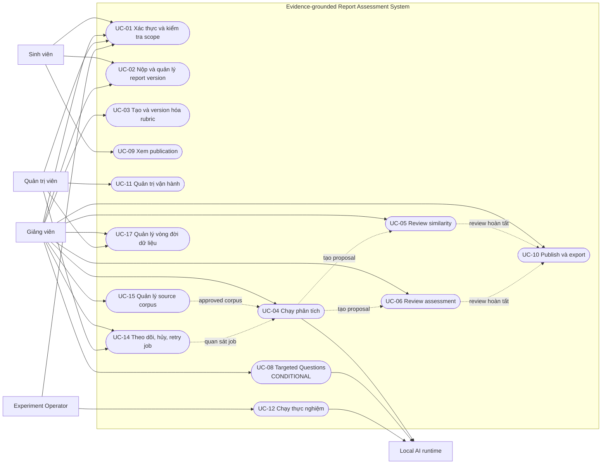
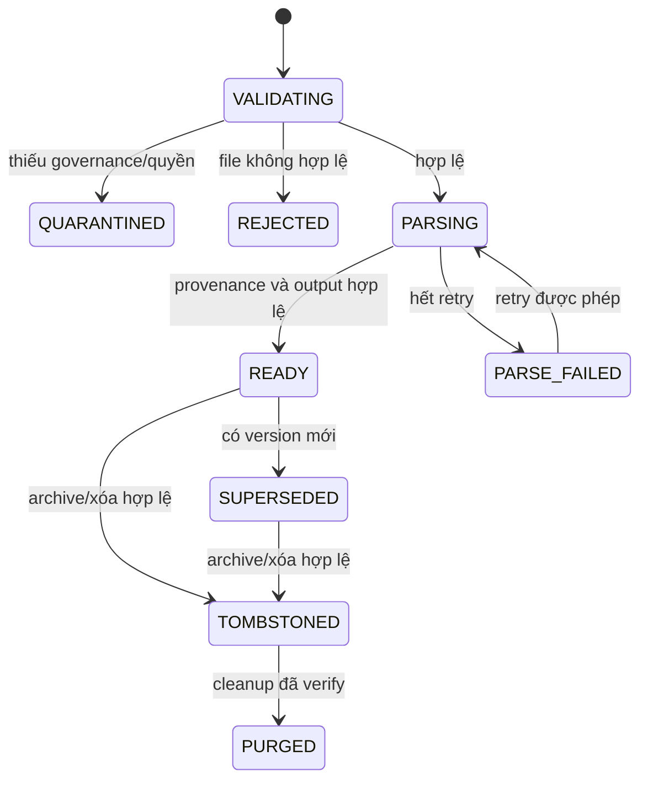
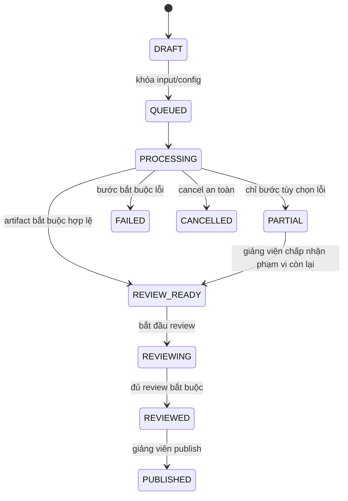

# BỘ USE CASE — BASELINE PHẠM VI V2.0

## Hệ thống hỗ trợ kiểm tra đạo văn và đánh giá báo cáo sinh viên dựa trên bằng chứng

## 1. Thông tin tài liệu

| Thuộc tính | Giá trị |
|---|---|
| Mã tài liệu | `UCM-KLTN-01` |
| Phiên bản | `2.0-review-candidate` |
| Ngày lập | 13/08/2026 |
| Ngày đồng bộ phạm vi | 17/09/2026 |
| Trạng thái | **Đã đồng bộ baseline nội bộ; chờ review chéo và GVHD xác nhận** |
| Owner | Nguyễn Trần Ngọc Quý (Q) |
| Reviewer | Võ Thị Kim Yến (Y) |
| WBS | `W1.1` |
| Tài liệu chuẩn | [Đặc tả yêu cầu v2.0](./W1-03-dac-ta-yeu-cau-v1.md) |

Tài liệu này thay thế phần active của bộ Use Case v1.2. Các ID cũ được giữ tại
mục 11 để truy vết lịch sử, không phải cam kết triển khai.

Phạm vi v2.0 gồm hai hướng chính:

- `RQ1` — Similarity;
- `RQ2` — Evidence-grounded Assessment;
- `RQ3` — Targeted Questions ở trạng thái **CONDITIONAL**, chỉ mở sau khi hai
  hướng chính đáp ứng gate về dữ liệu, chất lượng và tiến độ.

## 2. Ranh giới hệ thống

### 2.1. Trong phạm vi core

1. Xác thực, workspace, vai trò và kiểm tra quyền ở phía server.
2. Upload, version hóa, parse và chunk báo cáo PDF/DOCX có provenance.
3. Quản lý corpus tài liệu đối chứng đã được duyệt quyền sử dụng.
4. Tìm nội dung tương đồng bằng BM25, Dense, Hybrid + RRF và reranker tùy cấu
   hình; kết quả luôn được trình bày như tín hiệu hỗ trợ, không phải kết luận đạo
   văn.
5. Biên dịch rubric thành checklist, tìm evidence, xác minh quan hệ
   claim–evidence và tính điểm theo rule xác định trước.
6. Giảng viên Accept/Edit/Reject proposal trước khi công bố.
7. Quản lý publication, feedback log, audit và vòng đời dữ liệu.
8. Chạy thực nghiệm offline có manifest và kết quả tái lập.

### 2.2. Conditional và Icebox

- `UC-08` Targeted Questions chỉ được bật khi `RQ3` qua gate. Hệ thống chỉ
  sinh–review–export câu hỏi; sinh viên không trả lời trực tuyến trong hệ thống.
- Standalone grammar/style/AI-writing detector (`UC-13` cũ) nằm trong
  **ICEBOX**. Logic consistency cần thiết cho rubric vẫn thuộc `RQ2`.
- GRAPH checklist là cấu hình thử nghiệm; nếu không cho thấy lợi ích thì dùng
  LOCAL làm fallback.

### 2.3. Ngoài phạm vi

- Tự tìm, crawl hoặc fetch nguồn từ Internet.
- Search Provider, Crossref hoặc DOI/metadata checker nâng cao.
- Tự kết luận đạo văn, tự quyết định điểm hoặc tự publish.
- Sinh viên trả lời vấn đáp trực tuyến.

Citation/reference marker-to-span vẫn thuộc provenance parsing; nội dung này
không đồng nghĩa với kiểm tra DOI hay xác thực metadata tài liệu tham khảo.

## 3. Actor và quyền

| Actor | Mục tiêu và quyền chính | Ranh giới bắt buộc |
|---|---|---|
| **Sinh viên** | Upload/xem các version báo cáo của mình; xem publication được cấp quyền | Không xem proposal, review nội bộ, evidence bị hạn chế hoặc báo cáo người khác |
| **Giảng viên** | Quản lý source/rubric; chạy phân tích; review; publish/export | Chỉ thao tác trong workspace/scope được cấp; không bỏ qua evidence/review gate |
| **Quản trị viên** | Quản lý tài khoản, policy, job và vận hành hệ thống | Không mặc định có quyền chấm, sửa review hoặc publish học thuật |
| **Người vận hành thực nghiệm** | Chạy protocol/config đã duyệt; đọc artifact nghiên cứu đúng quyền | Không thay test split, nhãn, quyền dữ liệu hoặc kết quả sau khi mở test |
| **Local AI runtime** | Embedding, reranking và tạo proposal có cấu trúc | Không có quyền truy cập tùy ý DB/network/tool; không được review hay publish |

Quyền được kiểm tra theo `workspace + owner + role + purpose` ở mỗi request.
Việc giao diện không hiển thị nút không được xem là một cơ chế phân quyền.

### 3.1. Ma trận quyền mức cao

| Hành động | Sinh viên | Giảng viên | Quản trị viên | Experiment Operator |
|---|:---:|:---:|:---:|:---:|
| Upload báo cáo | Của mình | Trong scope | — | Dataset được cấp |
| Nạp/duyệt source | — | Trong scope và đúng quyền | Áp policy | Dataset được cấp |
| Tạo/publish rubric | — | Có | — | Dùng snapshot đã duyệt |
| Chạy phân tích nghiệp vụ | — | Có | Theo dõi job | — |
| Accept/Edit/Reject proposal | — | Có | — | Chỉ annotation nghiên cứu |
| Publish kết quả | — | Có | — | — |
| Xem publication | Được cấp quyền | Trong scope | Chỉ khi có quyền hỗ trợ | — |
| Chạy experiment | — | Khi được cấp | Theo dõi tài nguyên | Có |
| Archive/xóa dữ liệu | Theo policy | Theo scope/ủy quyền | Thực thi policy | Không mặc định |

## 4. Sơ đồ Use Case active



Sơ đồ chỉ mô tả phạm vi active. `UC-08` có mặt để giữ traceability nhưng không
được đưa vào sprint core khi gate `RQ3` chưa mở.

## 5. Catalog Use Case

| ID | Tên Use Case | Actor chính | Trạng thái | Kết quả thành công | Truy vết chính |
|---|---|---|---|---|---|
| `UC-01` | Xác thực và truy cập đúng scope | Mọi người dùng | CORE | Session hợp lệ; read/write được lọc đúng quyền | `FR-AUTH-01–03` |
| `UC-02` | Nộp và quản lý report version | Sinh viên, Giảng viên | CORE | File hợp lệ tạo immutable version và provenance | `FR-RPT-01–05` |
| `UC-03` | Tạo và version hóa rubric | Giảng viên | CORE | Rubric/checklist/rule hợp lệ; version đã publish bất biến | `FR-RUB-01–03` |
| `UC-04` | Cấu hình và chạy phân tích | Giảng viên | CORE | Run khóa input/config và tạo proposal có evidence | `FR-RPT-06–07`, `FR-SIM-01–06`, `FR-RUB-04–10` |
| `UC-05` | Review kết quả similarity | Giảng viên | CORE | Match được Accept/Edit/Reject; không tự kết luận đạo văn | `FR-SIM-05–07`, `FR-REV-01–02` |
| `UC-06` | Review evidence-grounded assessment | Giảng viên | CORE | Outcome/rationale/score có evidence và review history | `FR-RUB-05–10`, `FR-REV-01–02` |
| `UC-08` | Review và export Targeted Questions | Giảng viên | **CONDITIONAL** | Câu hỏi grounded được review trước khi export | `FR-QST-01–02` |
| `UC-09` | Xem publication | Sinh viên | CORE | Chỉ snapshot đã publish và được cấp quyền được hiển thị | `FR-REV-03` |
| `UC-10` | Publish và export kết quả | Giảng viên | CORE | Publication bất biến, sanitize được tạo từ review đã hoàn tất | `FR-REV-01–04` |
| `UC-11` | Quản trị tài khoản, policy và vận hành | Quản trị viên | CORE | Cấu hình/audit/job vận hành an toàn; không có provider web | `FR-AUTH-01–03`, `FR-RPT-06–07`, `FR-REV-05` |
| `UC-12` | Chạy, so sánh và xuất thực nghiệm | Experiment Operator | CORE | Manifest, prediction, metric và artifact tái lập | `FR-EXP-01–03` |
| `UC-14` | Theo dõi, hủy và retry job | Giảng viên, Quản trị viên | CORE | Job quan sát được; retry hữu hạn và idempotent | `FR-RPT-07` |
| `UC-15` | Quản lý source corpus | Giảng viên | CORE | Chỉ source `APPROVED` có version/provenance được index | `FR-RPT-02–06`, `FR-SIM-01–04` |
| `UC-17` | Quản lý vòng đời dữ liệu | Giảng viên, Quản trị viên được ủy quyền | CORE | Tombstone chặn dùng mới; archive/purge dẫn xuất có audit | `FR-RPT-06`, `FR-REV-05` |

## 6. Quan hệ và luồng nghiệp vụ chuẩn

### 6.1. Quan hệ giữa các Use Case

| Use Case nguồn | Quan hệ | Đích/hành vi | Guard |
|---|---|---|---|
| `UC-02`, `UC-03`, `UC-04`, `UC-05`, `UC-06`, `UC-08`, `UC-09`, `UC-10`, `UC-11`, `UC-12`, `UC-14`, `UC-15`, `UC-17` | `<<include>>` | Xác minh session, role, workspace, owner và purpose của `UC-01` | Thực hiện ở server trên mỗi request |
| `UC-04` | sử dụng | Report version từ `UC-02`, rubric version từ `UC-03`, approved corpus từ `UC-15` | Mọi version phải được khóa trong run |
| `UC-05`, `UC-06` | sau | Proposal do `UC-04` tạo | Proposal phải thuộc cùng run và có evidence resolve được |
| `UC-08` | mở rộng có điều kiện | Issue/evidence của `UC-04`/`UC-06` | Chỉ khi gate `RQ3=ENABLED` |
| `UC-10` | sau | Review trong `UC-05`/`UC-06`, và `UC-08` nếu enabled | Không còn review bắt buộc ở trạng thái pending |
| `UC-14` | hỗ trợ | Job của `UC-02`, `UC-04`, `UC-12`, `UC-15`, `UC-17` | Retry tạo attempt mới hoặc tiếp tục từ checkpoint an toàn |
| `UC-17` | chi phối | Report/source/run/evidence/publication | Tombstone được kiểm tra trước read/retrieval/job |

### 6.2. Luồng end-to-end

```text
Upload report/source
→ Validate file và governance
→ Parse/normalize/chunk có provenance
→ Index approved corpus
→ Khóa report/rubric/corpus/config vào AnalysisRun
→ Chạy Similarity và/hoặc Evidence-grounded Assessment
→ Tạo proposal + evidence
→ Giảng viên Accept/Edit/Reject
→ Publish/export snapshot đã duyệt
→ Ghi feedback/audit và áp lifecycle
```

Không có transition trực tiếp từ worker hoặc Local AI runtime tới publication.

## 7. Đặc tả luồng chính

### 7.1. `UC-01` — Xác thực và truy cập đúng scope

**Tiền điều kiện:** tài khoản active và có role/workspace hợp lệ.

**Luồng chính:**

1. Người dùng đăng nhập; hệ thống tạo session an toàn.
2. Mỗi request bảo vệ được kiểm tra CSRF/session, role, workspace, owner và
   purpose.
3. Hệ thống chỉ trả metadata/content đã qua scope filter.
4. Đăng xuất hoặc revoke làm session không còn hiệu lực.

**Ngoại lệ:** identifier ngoài scope trả lỗi không làm lộ tài nguyên có tồn tại
hay không; session hết hạn yêu cầu xác thực lại.

### 7.2. `UC-02` — Nộp và quản lý report version

**Tiền điều kiện:** actor có quyền upload vào đúng workspace/report.

**Luồng chính:**

1. Actor chọn PDF/DOCX và khai báo metadata tối thiểu.
2. Hệ thống kiểm tra size, magic/MIME, checksum, filename/path và trùng lặp.
3. Upload hợp lệ tạo file và document version bất biến.
4. Parser tạo ordered element; chunker tạo stable chunk key, source span và
   raw↔normalized mapping.
5. Provenance `file → version → element → chunk` được kiểm tra resolve.
6. Version đạt yêu cầu chuyển `READY`; version trước không bị ghi đè.

**Ngoại lệ:** file không hợp lệ bị reject; parse lỗi chuyển `PARSE_FAILED` và có
thể retry qua `UC-14`; dữ liệu thiếu quyền bị quarantine, không được index/run.

### 7.3. `UC-03` — Tạo và version hóa rubric

**Tiền điều kiện:** giảng viên có quyền trên workspace.

**Luồng chính:**

1. Giảng viên tạo criterion, weight, level và decision rule.
2. Mỗi criterion được tách thành atomic checklist, evidence need và mode
   `LOCAL/GRAPH` kèm lý do.
3. Hệ thống kiểm tra tổng trọng số, schema và rule không mâu thuẫn.
4. Giảng viên publish rubric version; version này trở thành immutable.

**Ngoại lệ:** checklist không nguyên tử hoặc rule không xác định được outcome
thì không cho publish; thay đổi sau publish phải tạo version mới.

### 7.4. `UC-04` — Cấu hình và chạy phân tích

**Tiền điều kiện:** report `READY`, rubric phù hợp nếu chạy assessment và mọi
source/dataset đều `APPROVED`.

**Luồng chính:**

1. Giảng viên chọn report version, mode và rubric version.
2. Hệ thống khóa report, corpus/index generation, rubric, model,
   prompt/config, code version và seed vào run.
3. Pipeline Similarity chạy BM25/Dense, RRF và reranker theo cấu hình.
4. Pipeline Assessment tìm evidence, xác minh quan hệ
   `SUPPORTED/CONTRADICTED/INSUFFICIENT`, áp decision rule để tạo
   `MET/UNMET/CANNOT_ASSESS` và tính điểm xác định trước.
5. Validator chặn citation không resolve được và output sai schema.
6. Run chuyển `REVIEW_READY` khi artifact bắt buộc đã sẵn sàng.

**Ngoại lệ:** evidence thiếu hoặc mâu thuẫn chưa phân giải dẫn tới abstain/
`CANNOT_ASSESS`, không được đoán; GRAPH lỗi phải fallback an toàn; bước bắt buộc
lỗi chuyển `FAILED`, không tạo kết quả chính thức.

### 7.5. `UC-05` — Review kết quả similarity

**Tiền điều kiện:** run ở `REVIEW_READY` hoặc `PARTIAL` có artifact dùng được.

**Luồng chính:**

1. Giảng viên xem đoạn báo cáo, đoạn source, locator, loại similarity và score.
2. Hệ thống cho mở evidence đúng file/version/span.
3. Giảng viên Accept, Edit hoặc Reject từng proposal; Edit/Reject ghi reason.
4. Hệ thống giữ original value, final value, actor, time và revision.

**Bảo đảm:** giao diện và export luôn nêu similarity không đồng nghĩa plagiarism.

### 7.6. `UC-06` — Review evidence-grounded assessment

**Tiền điều kiện:** run có proposal theo rubric và evidence resolve được.

**Luồng chính:**

1. Giảng viên xem criterion/checklist, evidence, quan hệ claim–evidence,
   outcome, rationale và điểm đề xuất.
2. Hệ thống chỉ cho rationale tham chiếu evidence thuộc run/version đã khóa.
3. Giảng viên Accept, Edit hoặc Reject; chỉnh outcome phải ghi lý do.
4. Điểm được tính lại bằng deterministic rubric rule, không do LLM tự đặt.
5. Review action được lưu vào history và feedback log.

**Ngoại lệ:** evidence không đủ thì giữ `CANNOT_ASSESS`; hệ thống không biến
`INSUFFICIENT` thành `UNMET` nếu decision rule không cho phép.

### 7.7. `UC-08` — Review và export Targeted Questions

**Điều kiện mở:** `RQ3=ENABLED`, hai pipeline core không bị ảnh hưởng, issue và
evidence hợp lệ đã có.

**Luồng chính:**

1. Hệ thống sinh câu hỏi liên kết rõ issue, rubric và evidence.
2. Validator kiểm tra grounding và evidence locator.
3. Giảng viên Accept, Edit hoặc Reject từng câu hỏi.
4. Chỉ question set đã duyệt được export cho buổi trao đổi/vấn đáp.

**Bảo đảm:** không có luồng giao bài và thu câu trả lời trực tuyến của sinh viên.

### 7.8. `UC-09` và `UC-10` — Xem, publish và export

1. `UC-10` kiểm tra các review bắt buộc đã hoàn tất và evidence còn hợp lệ.
2. Giảng viên chủ động xác nhận publish; hệ thống tạo publication version bất
   biến và sanitize nội dung trước khi render/export.
3. `UC-09` chỉ cho sinh viên được cấp quyền xem publication, không hiển thị
   proposal hoặc review history nội bộ.
4. Chỉnh sửa sau publish tạo publication version mới, không ghi đè bản cũ.

### 7.9. `UC-11`, `UC-14`, `UC-15`, `UC-17` — Vận hành và dữ liệu

- `UC-11`: quản trị tài khoản/RBAC, policy, health, queue, audit và resource
  cap; không cấu hình Search Provider hoặc outbound web.
- `UC-14`: xem progress/attempt/error; cancel tại checkpoint an toàn; retry hữu
  hạn và idempotent, không nhân đôi authoritative artifact.
- `UC-15`: đăng ký source, version, checksum, license/consent, purpose,
  retention và approver. Chỉ source `APPROVED` mới được index hoặc dùng cho run.
- `UC-17`: archive/tombstone/purge theo authority và retention. Tombstone loại
  dữ liệu khỏi active retrieval trước khi physical cleanup và phải lan tới
  derived artifact theo dependency graph.

### 7.10. `UC-12` — Chạy và xuất thực nghiệm

**Tiền điều kiện:** dataset đã được duyệt quyền, split/checksum/config đã khóa.

**Luồng chính:**

1. Operator chọn protocol và config đã duyệt.
2. Runner kiểm tra dataset manifest, quyền, checksum và split leakage.
3. Hệ thống ghi commit, dataset/version/split, config, model, seed, hardware và
   timing vào run manifest.
4. Runner tạo raw prediction, metric và bảng/biểu từ cùng artifact.
5. Kết quả, kể cả kết quả âm, được lưu nguyên trạng để error analysis.

**Bảo đảm:** test split không được dùng chọn model/threshold; số liệu trong báo
cáo phải sinh từ artifact, không nhập tay.

## 8. Trạng thái và invariant

### 8.1. Vòng đời document version



### 8.2. Vòng đời analysis và publication



### 8.3. Invariant bắt buộc

1. Source/dataset chưa `APPROVED` không được index, retrieval hoặc experiment.
2. Mọi evidence phải resolve về đúng file, version, element/chunk và source
   span; không sửa nội dung gốc sau khi run đã khóa.
3. Proposal và publication là hai artifact khác nhau; AI/worker không có quyền
   tạo publication.
4. Similarity score không được trình bày như xác suất đạo văn hoặc bằng chứng
   gian lận.
5. Claim–evidence relation chỉ dùng
   `SUPPORTED/CONTRADICTED/INSUFFICIENT`; checklist outcome chỉ dùng
   `MET/UNMET/CANNOT_ASSESS` sau decision rule.
6. Thiếu evidence không mặc nhiên có nghĩa claim sai; hệ thống phải abstain khi
   không đủ cơ sở.
7. Điểm proposal được tính bằng rubric rule deterministic.
8. Mọi retry/rebuild phải idempotent và truy được về attempt/config đã dùng.
9. Tombstone được kiểm tra trước read, retrieval, prompt và job mới.
10. Baseline core không gọi dịch vụ web bên ngoài.
11. `UC-08` không chạy khi gate `RQ3` chưa được bật rõ ràng.

## 9. Traceability active: FR → UC → RQ

| Functional Requirements | Use Case | RQ/đầu ra |
|---|---|---|
| `FR-AUTH-01–03` | `UC-01`, được áp dụng cho mọi UC bảo vệ | Nền tảng chung |
| `FR-RPT-01–05` | `UC-02` | `RQ1`, `RQ2`: input và provenance |
| `FR-RPT-06–07` | `UC-02`, `UC-04`, `UC-11`, `UC-14`, `UC-15`, `UC-17` | Governance và job an toàn |
| `FR-SIM-01–07` | `UC-04`, `UC-05`, `UC-12`, `UC-15` | `RQ1`: retrieval, type, review |
| `FR-RUB-01–03` | `UC-03`, `UC-12` | `RQ2`: rubric/checklist |
| `FR-RUB-04–10` | `UC-04`, `UC-06`, `UC-10`, `UC-12` | `RQ2`: evidence, outcome, score |
| `FR-REV-01–04` | `UC-05`, `UC-06`, `UC-09`, `UC-10` | `RQ1`, `RQ2`: human review/publication |
| `FR-REV-05` | `UC-11`, `UC-17` | Lifecycle và audit |
| `FR-EXP-01–03` | `UC-12` | `RQ1`, `RQ2`; `RQ3` nếu enabled |
| `FR-QST-01–02` | `UC-08` | `RQ3-CONDITIONAL` |

| RQ | Use Case chính | Bằng chứng dự kiến |
|---|---|---|
| `RQ1` Similarity | `UC-02`, `UC-04`, `UC-05`, `UC-12`, `UC-15` | Recall@K, MRR, nDCG, span/type F1, latency/RAM |
| `RQ2` Evidence-grounded Assessment | `UC-03`, `UC-04`, `UC-06`, `UC-10`, `UC-12` | Evidence Recall/Precision, three-state macro-F1, grounding, agreement |
| `RQ3` Targeted Questions | `UC-08` | Relevance, grounding, answerability, usefulness; chỉ khi enabled |

## 10. Acceptance scenarios tối thiểu

| ID | Given | When | Then |
|---|---|---|---|
| `AC-UC-01` | Actor dùng ID ngoài workspace | Gọi read/write/retrieval | Không trả content và không làm lộ resource tồn tại |
| `AC-UC-02` | Cùng file/version/config | Parse/chunk lặp lại | Stable element/chunk key và source span giống nhau |
| `AC-UC-03` | Source thiếu approver hoặc quyền | Yêu cầu index/run | Bị quarantine và fail closed |
| `AC-UC-04` | Evidence ID không thuộc run/version đã khóa | Model trả rationale | Validator reject; không tạo proposal hợp lệ |
| `AC-UC-05` | Similarity score cao | Hiển thị/review/export | Có source span và disclaimer; không tự gắn nhãn plagiarism |
| `AC-UC-06` | Evidence thiếu/mâu thuẫn chưa phân giải | Chấm checklist | Abstain hoặc `CANNOT_ASSESS` theo rule, không đoán |
| `AC-UC-07` | Proposal chưa được giảng viên review | Worker/API yêu cầu publish | Bị từ chối |
| `AC-UC-08` | `RQ3` chưa enabled | Yêu cầu sinh câu hỏi | Không enqueue job Targeted Questions |
| `AC-UC-09` | Publication chưa tạo hoặc đã tombstone | Sinh viên mở kết quả | Không hiển thị proposal/nội dung đã thu hồi |
| `AC-UC-10` | Cùng commit/data/config/seed | Chạy experiment lặp lại | Manifest đầy đủ; ranking/metric deterministic trong sai số đã khóa |

## 11. Migration từ bộ Use Case cũ

| ID/nghĩa cũ | Xử lý trong v2.0 |
|---|---|
| `UC-01–UC-06` | Giữ ID; viết lại theo session/scope, provenance, Similarity và Evidence-grounded Assessment hiện hành |
| `UC-07` Reference/DOI checker | **RETIRED / OUT OF SCOPE**; marker-to-span chuyển về `UC-02` provenance |
| `UC-08` Duyệt/giao câu hỏi | Giữ ID nhưng đổi thành `RQ3-CONDITIONAL`; chỉ review và export |
| `UC-09` Xem phản hồi/thực hiện câu hỏi | Giữ ID cho **xem publication đã công bố**; bỏ luồng trả lời trực tuyến |
| `UC-10` Publish/export | Giữ; bắt buộc review/evidence integrity trước publish |
| `UC-11` Admin/provider/quota | Giữ ID cho quản trị tài khoản, policy, job và tài nguyên; bỏ provider web |
| `UC-12` Experiment cho `RQ1–RQ5` | Giữ ID; chỉ phục vụ `RQ1`, `RQ2` và `RQ3` nếu enabled |
| `UC-13` Style/AI-writing review | **ICEBOX**; không nằm trong diagram/catalog active |
| `UC-14`, `UC-15`, `UC-17` | Giữ với nghĩa job, approved source corpus và lifecycle |
| `UC-16` Web candidate/provider | **RETIRED / OUT OF SCOPE**; không còn actor, flow hay gate active |

Không tái sử dụng `UC-07`, `UC-13`, `UC-16` cho chức năng khác để tránh làm
sai lịch sử truy vết.

## 12. Điều kiện chấp nhận và review

### 12.1. Definition of Done cho baseline `W1.1`

- [x] Catalog và Mermaid chỉ chứa Use Case active.
- [x] `RQ1`, `RQ2`, `RQ3-CONDITIONAL` thống nhất với SRS v2.0.
- [x] Search Provider, Crossref, web fetch và DOI checker không còn trong actor
  hoặc flow active.
- [x] Standalone style/AI detector được chuyển về Icebox.
- [x] `UC-09` chỉ cho xem publication; không còn online answering.
- [x] Source corpus có governance gate; dữ liệu chưa duyệt không được index/run.
- [x] Human-in-the-loop và ranh giới proposal/publication được thể hiện rõ.
- [x] FR ↔ UC ↔ RQ active không có dangling ID.
- [x] Có migration table cho các ID cũ.
- [ ] Q/Y review và xác nhận qua PR.
- [ ] GVHD xác nhận scope/RQ hoặc ghi change request.

### 12.2. Điểm cần chốt tiếp

| ID | Nội dung | Owner/Approver |
|---|---|---|
| `OQ-01` | Rubric/checklist/annotation guideline và adjudication | Y / Q / GVHD |
| `OQ-02` | Dataset version, license/consent, split và retention | Y / data owner / GVHD |
| `OQ-03` | Cấu hình parser/embedding/reranker/LLM sau benchmark dev | Q/Y |
| `OQ-04` | GRAPH qua gate multi-hop hay giữ LOCAL fallback | Q/Y/GVHD |
| `OQ-05` | Có bật `RQ3` theo capacity/gate hay không | Q/Y/GVHD |

## 13. Change log và phê duyệt

| Phiên bản | Ngày | Thay đổi |
|---|---|---|
| `1.2-review-candidate` | 13/08/2026 | Bộ cũ gồm RQ1–RQ5, web provider, DOI/reference checker và style feature |
| `2.0-review-candidate` | 17/09/2026 | Đồng bộ về Similarity + Evidence-grounded Assessment; Targeted Questions conditional; retire web/DOI; style về Icebox; cập nhật actor, flow, state và traceability |

| Vai trò | Người | Quyết định | Ngày | Evidence |
|---|---|---|---|---|
| Owner | Nguyễn Trần Ngọc Quý | Đề xuất review v2.0 | 17/09/2026 | Branch `docs/w1-1-scope-sync` |
| Reviewer | Võ Thị Kim Yến | Chờ review | — | — |
| GVHD | Vũ Đình Hồng | Chờ xác nhận scope/RQ | — | — |
