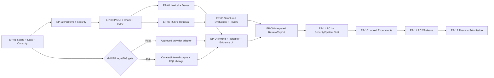

# BACKLOG SẢN PHẨM VÀ WORK BREAKDOWN STRUCTURE (WBS) V1

## Hệ thống hỗ trợ đánh giá báo cáo sinh viên bằng AI cục bộ

## 1. Thông tin tài liệu

| Thuộc tính | Giá trị |
|---|---|
| Mã tài liệu | `PLN-KLTN-01` |
| Phiên bản | `1.2-review-candidate` |
| Trạng thái | **CONTENT-COMPLETE / REVIEW CANDIDATE — chờ GVHD duyệt phạm vi, nhân lực, dữ liệu, rubric và DEC-WEB-01** |
| Ngày lập | 13/08/2026 |
| Kỳ kế hoạch | 24 tuần, 08/08/2026–22/01/2027; mốc nộp bảo thủ 23/01/2027 |
| Nguồn | `Schedule_KLTN.xlsx`; `KLTN_He_thong_danh_gia_bao_cao_AI_cuc_bo.docx`; `SRS-KLTN-01` phiên bản `1.2-review-candidate`; `UCM-KLTN-01` phiên bản `1.2-review-candidate` |
| Phạm vi | Product backlog, WBS, roadmap, phụ thuộc, cổng nghiệm thu và checklist W1-05 |
| Chủ sở hữu backlog | Nhóm nghiên cứu — **TBD sau khi xác nhận nhân lực** |
| Người phê duyệt | GVHD; đại diện giảng viên/người dùng; người có thẩm quyền về dữ liệu/chính sách khi áp dụng |

Tài liệu này chuyển yêu cầu trong [Đặc tả yêu cầu v1](./W1-03-dac-ta-yeu-cau-v1.md) và [Bộ Use Case](./W1-04-bo-use-case.md) thành các gói công việc có thể lập lịch, kiểm thử và truy vết. Cả hai nguồn đang ở `1.2-review-candidate/approval pending`; vì vậy đây là **baseline đề xuất**, không phải cam kết rằng mọi hạng mục ứng viên đều sẽ được triển khai. Chỉ backlog được GVHD duyệt và phù hợp năng lực thực tế mới trở thành commitment.

### 1.1. Quyết định điều phối bắt buộc

1. **Hai đóng góp được bảo vệ trước:** Hybrid Similarity có bằng chứng (`EP-04`) và Rubric-RAG có bằng chứng (`EP-05`).
2. **MongoDB** là source of truth theo `DEC-DB-01`, đồng bộ với Excel; DOCX và các sơ đồ cũ ghi PostgreSQL + pgvector phải được cập nhật bằng change record. Deployment/Search/Vector Search cụ thể phải qua `OQ-04/G-02`.
3. **Không dùng Gemini Grounding làm URL harvester/index seed.** `DEC-WEB-01` là cổng dừng: không code adapter web, fetch, cache hay index nguồn web cho đến khi hồ sơ quyền sử dụng được duyệt.
4. AI-writing detector dạng kết luận, OCR nâng cao, đối chiếu xuyên ngôn ngữ và dashboard thống kê lớp/học kỳ không nằm trên critical path. Chúng chỉ được kéo vào sprint khi các gate chính đạt và buffer còn nguyên.
5. AI chỉ đề xuất; giảng viên duyệt kết quả chính thức. Không có backlog item nào được hiểu là tự động kết luận đạo văn/gian lận.

## 2. Phương pháp lập kế hoạch và quy ước

Kế hoạch dùng product backlog ưu tiên theo giá trị/rủi ro, vòng lặp kiểm tra–thích nghi hai tuần và WBS hướng đầu ra. Cách dùng này được điều chỉnh cho nhóm khóa luận nhỏ, không tuyên bố áp dụng đầy đủ mọi vai trò/sự kiện Scrum. Tham chiếu quản trị gồm [The Scrum Guide 2020](https://scrumguides.org/docs/scrumguide/v2020/2020-Scrum-Guide-US.pdf), [PMI Practice Standard for Work Breakdown Structures](https://www.pmi.org/standards/work-breakdown-structures-third-edition) và [NIST SP 800-218 Secure Software Development Framework](https://csrc.nist.gov/pubs/sp/800/218/final).

### 2.1. Cấu trúc ID ổn định

```text
EP-xx              Epic / gói công việc cấp 1
EP-xx-Fyy          Feature / gói công việc cấp 2
EP-xx-Szz          Story / work package có thể nghiệm thu
EP-xx-Szz-Tnn      Task thực thi
SPK-xx             Spike nghiên cứu/rủi ro có timebox
EXP-xx             Thí nghiệm
MS-xx              Milestone
G-xx               Quality/decision gate
```

ID đã cấp không được tái sử dụng. Khi loại một item, chuyển trạng thái `Removed` và giữ lý do; khi thay đổi phạm vi phải cập nhật SRS, Use Case, traceability và decision log.

Trong bảng chi tiết, `T01`, `T02`... là dạng viết gọn theo story ở cùng dòng. Ví dụ `T03` trong `EP-04-S06` có ID đầy đủ `EP-04-S06-T03`. Issue board và commit phải dùng ID đầy đủ này; vì vậy task vẫn duy nhất và ổn định dù bảng được trình bày gọn.

### 2.2. Priority, trạng thái và ước lượng

| Trường | Quy ước |
|---|---|
| MoSCoW | `M` Must cho baseline đã duyệt; `S` Should nếu đủ năng lực; `C` Could; `W` Won't trong v1 |
| Delivery priority | `P0` critical/điểm nghẽn/nghiệm thu; `P1` quan trọng sau core; `P2` mở rộng; không có P3 trong kế hoạch 24 tuần |
| Trạng thái | `Proposed → Ready → In progress → In review → Done`; thêm `Blocked`, `Deferred`, `Removed` khi cần |
| Story Point | Fibonacci `1, 2, 3, 5, 8, 13`; dùng cho độ phức tạp/tương đối, không quy đổi cứng sang ngày |
| Person-day (PD) | Một ngày làm việc tập trung của một người; dùng để kiểm tra sức chứa, không phải cam kết thời gian tuyệt đối |
| Target | Tuần `W01–W24`; iteration `I01–I12`, mỗi iteration hai tuần |
| Owner | Chỉ ghi vai trò (`BA/R`, `BE`, `FE`, `ML/IR`, `Data`, `QA`, `DevOps`, `Sec/Privacy`, `Docs`) và `TBD`; không gán tên khi nhóm chưa xác nhận |

### 2.3. Giả định năng lực và giới hạn WIP

- `OQ-02` chưa đóng: DOCX thể hiện một sinh viên, Excel thể hiện hai sinh viên. Vì vậy **không phân công cá nhân** trong tài liệu này.
- Kịch bản lập kế hoạch đầy đủ giả định **hai contributor được xác nhận**, tổng khoảng `9 PD/tuần`, tương đương `216 PD/24 tuần`. Dành tối thiểu `15%` (`32 PD`) cho tích hợp, lỗi, phản hồi GVHD và biến động dữ liệu; sức chứa kế hoạch tối đa khoảng `184 PD`.
- Nếu chỉ có một contributor, sức chứa sau buffer khoảng `92 PD`. Khi đó phải rebaseline tại `G-01`: giữ parser/index tối thiểu, Hybrid Similarity, Rubric-RAG, review, thực nghiệm RQ1/RQ3 và hồ sơ nộp; hoãn web adapter nếu chưa hợp lệ, writing/logic nâng cao, OCR, thống kê nâng cao và phần bổ trợ chưa đủ bằng chứng.
- WIP tối đa: `2 story In progress` cho toàn nhóm, trong đó tối đa `1 story` AI/experiment nặng. Không mở extension khi có P0 bị Blocked/In review quá một iteration.
- Mỗi iteration dành khoảng `10%` cho review/tài liệu và `5%` cho sự cố. W21 và W24 là buffer/hardening ở cấp release, không phải chỗ để bắt đầu feature mới.

### 2.4. Tổng hợp sức chứa backlog

| Lớp phạm vi | Story | Task | SP | PD | Ý nghĩa cam kết |
|---|---:|---:|---:|---:|---|
| Must / P0 | 45 | 201 | 267 | 157 | Baseline đề xuất; chỉ cam kết sau G-01 và phải rebaseline nếu chỉ có một contributor |
| Should / P1 | 3 | 13 | 21 | 11 | Stretch; gồm web adapter conditional và writing/logic |
| Could / P2 | 4 | 14 | 26 | 15 | Extension mặc định Deferred |
| **Tổng candidate backlog** | **52** | **228** | **314** | **183** | Gần bão hòa sức chứa net 184 PD của kịch bản hai contributor; P1/P2 không được commit đồng thời và kịch bản một contributor bắt buộc cắt phạm vi |

SP phản ánh độ phức tạp tương đối, còn PD dùng kiểm tra capacity; không cộng hoặc quy đổi hai đại lượng thành nhau. Số task được tính theo ID đầy đủ suy ra từ story như quy ước trên.

### 2.5. Story format

Mỗi story trả lời: **“Là [actor], tôi muốn [khả năng] để [giá trị].”** Acceptance Criteria (AC) dùng điều kiện kiểm chứng được theo dạng Given–When–Then hoặc checklist có số đo. Task mô tả cách thực hiện; AC mô tả kết quả phải đạt.

### 2.6. Status snapshot tại thời điểm lập

- `Proposed`: mọi P0/P1 không được liệt kê ở hai dòng dưới; chưa story nào được đánh dấu `Done` chỉ vì tài liệu đã viết.
- `Blocked`: `EP-04-S06` cho tới khi `G-WEB=Pass`; mọi run dữ liệu thật/lecturer evaluation phụ thuộc OQ-05/06/11/17 và lịch người đánh giá.
- `Deferred`: `EP-03-S05`, `EP-04-S08`, `EP-06-S03`, `EP-09-S05`; chỉ đổi sang `Ready` theo điều kiện ở §6.

Việc GVHD duyệt, cấp quyền dữ liệu, phê duyệt provider hoặc cung cấp đánh giá là **external dependency/gate**, không phải task được tự động xem là Done. Nhóm chỉ có thể hoàn tất hồ sơ, gửi yêu cầu, ghi quyết định và điều chỉnh phạm vi.

## 3. Definition of Ready và Definition of Done

### 3.1. Definition of Ready (DoR) cho Story

Một story chỉ chuyển sang `Ready` khi:

- [ ] Actor/giá trị, phạm vi trong/ngoài, đầu vào/đầu ra và AC đã rõ.
- [ ] Có liên kết ít nhất một `FR/NFR`, `UC`, `RQ`, risk hoặc deliverable; item thuần hạ tầng phải nêu consumer.
- [ ] Phụ thuộc và blocker đã nhận diện; không kéo item web khi `G-WEB` chưa Pass.
- [ ] Mockup/API/schema/test data tối thiểu sẵn có nếu cần; quyền dùng dữ liệu đã xác nhận.
- [ ] Ước lượng SP/PD, priority, target week và owner role/TBD đã có.
- [ ] Story không lớn hơn `8 SP`; nếu lớn hơn phải tách hoặc timebox spike trước.
- [ ] Rủi ro privacy/security, prompt injection, upload độc hại và license đã được xét khi liên quan.
- [ ] Không dựa vào một Open Question mức Blocker chưa có quyết định tạm thời được ghi nhận.

### 3.2. Definition of Done (DoD) cho Story

- [ ] Code/tài liệu đã review; nhánh chính build thành công; format/lint/type check phù hợp đạt.
- [ ] Unit/integration/security tests theo AC đạt; case lỗi, phân quyền và retry được kiểm tra khi liên quan.
- [ ] Không có secret thật; SAST, secret scan và dependency scan không còn phát hiện Critical/High chưa có waiver.
- [ ] Migration/API/schema/versioning và tài liệu vận hành được cập nhật; rollback hoặc recovery path được ghi rõ.
- [ ] Log/audit không lộ PII/secret; evidence có thể truy ngược; AI output qua schema/evidence validator.
- [ ] Artifact demo, test evidence và metric được gắn với story; Product Owner/GVHD delegate chấp nhận AC.
- [ ] FR/UC/RQ/backlog traceability được cập nhật; không đóng item bằng demo thủ công duy nhất nếu AC yêu cầu số đo.

### 3.3. DoD cho Epic/Release

- Tất cả P0 thuộc phạm vi release `Done`; item còn lại có quyết định hoãn rõ ràng.
- End-to-end chạy từ dữ liệu đầu vào đến kết quả đã kiểm duyệt trên môi trường sạch bằng hướng dẫn.
- Gate security/privacy/legal/data tương ứng Pass; không có blocker mở.
- Dataset, code commit, model/prompt/config và metric artifact được khóa phiên bản.
- Demo được chạy lại; hạn chế, chi phí, latency và kết quả âm được báo trung thực.

## 4. Roadmap 24 tuần và mốc đầu ra

> Excel kết thúc công việc W24 ngày 22/01/2027 và ghi nộp ngày 23/01/2027; DOCX ghi đến 07/02/2027. Kế hoạch dùng **23/01/2027 là deadline bảo thủ**. Khoảng đến 07/02 chỉ được dùng nếu Khoa/GVHD xác nhận bằng văn bản, không dùng để biện minh cho scope creep.

| Tuần / Iteration | Ngày | Mục tiêu và đầu ra kiểm chứng | Gate/mốc |
|---|---|---|---|
| W01 / I01 | 08–14/08 | Khảo sát; SRS; Use Case; backlog/WBS; repo/môi trường; Chương 1; mở hồ sơ dữ liệu/rubric/legal | `MS-01`; W1 review |
| W02 / I01 | 15–21/08 | Kiến trúc React–FastAPI–MongoDB; chốt deployment/Search/Vector Search; API/schema/wireframe; rubric mẫu; dataset plan; threat-model draft; tiêu chí `G-WEB` | `G-01` Scope/Capacity; `G-02` Architecture |
| W03 / I02 | 22–28/08 | Auth/RBAC; report/upload lifecycle; migration; audit nền; test đầu tiên | Increment nền tảng |
| W04 / I02 | 29/08–04/09 | Docling/GROBID prototype; cấu trúc/metadata trang; chunking; malicious-file controls | `MS-02` Parse prototype |
| W05 / I03 | 05–11/09 | Local runtime; benchmark embedding/reranker/LLM; MongoDB lexical/vector index; structured-output prototype | `G-03` Model/data feasibility |
| W06 / I03 | 12–18/09 | Kho nội bộ; BM25/n-gram; rules/ground truth seed; chốt hồ sơ quyền provider | `G-WEB` Pass/Fail trước code web |
| W07 / I04 | 19–25/09 | Nếu `G-WEB=Pass`: adapter provider được duyệt, quota/fetch policy. Nếu Fail: curated corpus + change request RQ2. Không dùng Gemini URL harvesting | `MS-03` Candidate-source path |
| W08 / I04 | 26/09–02/10 | Dense + hybrid + reranker; phân loại match; unique coverage; evidence comparison UI; thí nghiệm sơ bộ | `G-04` Similarity v1 |
| W09 / I05 | 03–09/10 | Rubric versioning; retrieval theo tiêu chí; schema đánh giá; evidence grounding | Rubric engine v1 |
| W10 / I05 | 10–16/10 | Lecturer review cho rubric; validation; writing/logic tối thiểu nếu core ổn; thí nghiệm B pilot | `G-05` Rubric-RAG v1 |
| W11 / I06 | 17–23/10 | Reference extraction; Crossref/DOI/metadata; citation consistency; case test | Reference v1 |
| W12 / I06 | 24–30/10 | Ổn định core; style anomaly chỉ là cảnh báo và chỉ làm nếu P0 đạt; adversarial/prompt-injection test vòng 1 | Scope checkpoint |
| W13 / I07 | 31/10–06/11 | Grounded question generation; lecturer review; quality-rating schema | Question v1 |
| W14 / I07 | 07–13/11 | Review workspace Accept/Edit/Reject; audit; export HTML/PDF tối thiểu; usability pilot | `MS-04` Human-in-the-loop |
| W15 / I08 | 14–20/11 | Tích hợp pipeline, queue/retry/progress, quota/usage; xử lý lỗi; **feature freeze** | `G-06` Beta/Feature freeze |
| W16 / I08 | 21–27/11 | Unit/integration/system/security; provider fail-closed; sửa Critical/High; deployment draft | `G-07` RC1 |
| W17 / I09 | 28/11–04/12 | Khóa dataset/guideline/split/metric; gán nhãn; reproducibility dry run | `G-08` Benchmark readiness |
| W18 / I09 | 05–11/12 | A1–A4 similarity; A5 chỉ khi provider/corpus được duyệt; latency/RAM/cost; error analysis | RQ1/RQ2 results draft |
| W19 / I10 | 12–18/12 | B1–B4 Rubric-RAG; lecturer comparison; evidence correctness; error analysis | RQ3 results draft |
| W20 / I10 | 19–25/12 | Reference/question evaluation; writing/style chỉ khi có mẫu; tổng hợp limitation | RQ4/RQ5 results draft |
| W21 / I11 | 26/12–01/01 | Tối ưu có benchmark; threat-model closeout; backup/restore; privacy/security review; sửa lỗi | `G-09` RC2 |
| W22 / I11 | 02–08/01 | Hoàn tất luận văn v1, UML/bảng/biểu/phụ lục; install/user/API docs; gửi GVHD | `MS-05` Thesis v1 |
| W23 / I12 | 09–15/01 | Xử lý góp ý; đối chiếu báo cáo–code–số liệu; Release 1.0; slide/video/kịch bản | `G-10` Release 1.0 |
| W24 / I12 | 16–22/01 | Chỉ sửa lỗi/định dạng; rehearsal; backup; checksum; hồ sơ nộp; không mở feature | `G-11` Submission readiness |
| Mốc nộp | 23/01/2027 | Báo cáo, source, dữ liệu/artifact được phép, hướng dẫn, slide/video và biểu mẫu | `MS-06` Submitted |

## 5. Product backlog chi tiết

### 5.1. `EP-01` — Discovery, phạm vi, dữ liệu và tuân thủ

| Feature | Story (actor–nhu cầu–giá trị) | Acceptance Criteria | Tasks ổn định | Est. | Pri | Phụ thuộc | Target | Owner |
|---|---|---|---|---|---|---|---|---|
| `EP-01-F01` Scope baseline | `EP-01-S01`: Là nhóm nghiên cứu, tôi muốn yêu cầu/UC/backlog được duyệt để không xây sai phạm vi. | RQ1–RQ5, MVP, actor, AC, MongoDB và hai đóng góp chính có quyết định; blocker còn mở có owner/deadline; tài liệu được version/tag. | `T01` đối chiếu DOCX–Excel–SRS; `T02` tổ chức review GVHD; `T03` cập nhật decision/traceability. | 3 SP / 2 PD | M/P0 | W1-01, W1-03, W1-04 | W01–02 / I01 | BA/R, Docs — TBD |
| `EP-01-F02` Data/rubric governance | `EP-01-S02`: Là nhóm nghiên cứu, tôi muốn quyền dữ liệu, rubric và guideline được chốt để benchmark hợp lệ. | Có data inventory, consent/license/ẩn danh, retention, rubric v0, người gán nhãn và split plan; dữ liệu chưa đủ quyền không vào corpus. | `T01` kiểm kê nguồn; `T02` lập data card/consent log; `T03` workshop rubric; `T04` guideline gán nhãn v0. | 5 SP / 3 PD | M/P0 | ASM-01–03, OQ-05/06/11 | W01–03 / I01–02 | Data, BA/R, Privacy — TBD |
| `EP-01-F03` Web compliance | `EP-01-S03`: Là người phụ trách hệ thống, tôi muốn quyết định Search Provider hợp lệ để không vi phạm ToS/quyền dữ liệu. | Hồ sơ ghi đúng product/tier/terms date, quyền query/collect/store URL/fetch/analyze/cache, robots/site license, privacy/DPA, quota; kết quả `Pass` hoặc `Fail + fallback + RQ2 change request`; Gemini không được coi hợp lệ cho URL harvesting. | `T01` lập checklist license/ToS; `T02` đánh giá shortlist/provider và trang đích; `T03` trình `G-WEB`; `T04` ghi ADR + expiry/re-review date. | 5 SP / 3 PD | M/P0 | DEC-WEB-01, OQ-09/15/16 | W01–06 / I01–03 | Sec/Privacy, BA/R — TBD; phê duyệt ngoài nhóm |
| `EP-01-F04` Feasibility | `EP-01-S04`: Là nhóm nghiên cứu, tôi muốn kiểm kê nhân lực/máy/ngân sách/deadline để cam kết có căn cứ. | Đóng hoặc timebox OQ-02/03/09/10; có hai capacity scenario, cấu hình máy, budget cap và scope cut line. | `T01` kiểm kê máy; `T02` xác nhận nhân lực/deadline; `T03` capacity và budget review. | 3 SP / 2 PD | M/P0 | OQ-02/03/09/10 | W01–02 / I01 | BA/R, DevOps — TBD |

### 5.2. `EP-02` — Nền tảng, kiến trúc và security-by-design

| Feature | Story | Acceptance Criteria | Tasks ổn định | Est. | Pri | Phụ thuộc | Target | Owner |
|---|---|---|---|---|---|---|---|---|
| `EP-02-F01` Dev baseline | `EP-02-S01`: Là contributor, tôi muốn repo/CI/môi trường tái lập để tích hợp an toàn. | Cấu trúc FE/BE/worker/docs; `.env.example`; Compose health check; lint/test/secret scan chạy trong CI; không có secret thật. | `T01` scaffold repo; `T02` Compose/healthcheck; `T03` CI quality gates; `T04` developer README. | 3 SP / 2 PD | M/P0 | EP-01-S04 | W01–02 / I01 | DevOps, QA — TBD |
| `EP-02-F02` Data architecture | `EP-02-S02`: Là backend developer, tôi muốn mô hình MongoDB có schema/index/versioning để dữ liệu toàn vẹn và truy vết được. | Source of truth và collection/data dictionary thống nhất; JSON Schema validation, stable reference, unique/compound index và service invariant; luồng nhiều document có atomic boundary hoặc compensation/idempotency; migration/backfill và forward/recovery được test; deployment/search version được khóa. | `T01` data model + dictionary; `T02` ADR deployment/Search/Vector Search + validator/index/atomicity; `T03` migration/versioning/backfill; `T04` backup/recovery, rebuild và migration tests. | 5 SP / 4 PD | M/P0 | DEC-DB-01, OQ-04, EP-01-S01 | W02–03 / I01–02 | BE, Data — TBD |
| `EP-02-F03` Auth/RBAC/audit | `EP-02-S03`: Là người dùng, tôi muốn đăng nhập và chỉ truy cập dữ liệu được cấp quyền. | Ma trận Sinh viên/Giảng viên/Admin đạt 100% test bắt buộc; truy cập chéo trả 403/404; session/logout an toàn; thay đổi quyền có audit. | `T01` auth/session; `T02` RBAC middleware/policy; `T03` user admin tối thiểu; `T04` audit events; `T05` authorization tests. | 8 SP / 5 PD | M/P0 | EP-02-S02, OQ-07 | W03 / I02 | BE, FE, QA — TBD |
| `EP-02-F04` Threat model | `EP-02-S04`: Là nhóm phát triển, tôi muốn threat model và trust boundaries để xử lý rủi ro trước khi code sâu. | Có DFD/trust boundary, asset/actor/abuse case, risk owner và control cho upload/parser, outbound search, local model, queue, DB/log; review ở W2/W16/W21. | `T01` threat-model workshop; `T02` abuse cases; `T03` security requirements/tests; `T04` risk register linkage. | 5 SP / 3 PD | M/P0 | EP-01-S01/03 | W02, cập nhật W16/W21 | Sec/Privacy, BE, ML/IR — TBD |

### 5.3. `EP-03` — Tiếp nhận, bóc tách và lập chỉ mục tài liệu

| Feature | Story | Acceptance Criteria | Tasks ổn định | Est. | Pri | Phụ thuộc | Target | Owner |
|---|---|---|---|---|---|---|---|---|
| `EP-03-F01` Report lifecycle | `EP-03-S01`: Là sinh viên/giảng viên, tôi muốn upload và theo dõi phiên bản báo cáo an toàn. | PDF/DOCX hợp lệ tạo report/version/hash/status; file sai MIME/size/path/duplicate bị xử lý đúng; RBAC và error code được test. | `T01` upload API/storage; `T02` validation/hash/version; `T03` status UI/API; `T04` negative tests. | 5 SP / 3 PD | M/P0 | EP-02-S02/03/04 | W03 / I02 | BE, FE, QA — TBD |
| `EP-03-F02` Structured parsing | `EP-03-S02`: Là giảng viên, tôi muốn báo cáo được bóc tách theo cấu trúc để mọi kết quả có vị trí. | Trên corpus khóa trước, ≥90% PDF text/DOCX không lỗi nghiêm trọng; section/reference/table khi hỗ trợ được lưu; page/position có provenance; failure không sinh dữ liệu giả. | `T01` Docling adapter; `T02` GROBID/reference adapter; `T03` normalized document schema; `T04` parser fixture/golden tests; `T05` failure reporting. | 8 SP / 5 PD | M/P0 | EP-03-S01, EP-01-S02 | W04 / I02 | BE, Data, QA — TBD |
| `EP-03-F03` Chunk/provenance | `EP-03-S03`: Là hệ truy xuất, tôi muốn chunk theo ranh giới cấu trúc và ánh xạ nguồn để bằng chứng mở đúng vị trí. | Chunk có report/section/order/language/page khi có; overlap không tạo vòng/trùng vô hạn; raw và normalized text truy xuất được; evidence viewer mở đúng fixture. | `T01` cleaner/versioning; `T02` structure-aware chunker; `T03` provenance mapping; `T04` chunk/evidence tests. | 5 SP / 4 PD | M/P0 | EP-03-S02 | W04–05 / I02–03 | Data, BE, QA — TBD |
| `EP-03-F04` Hybrid index | `EP-03-S04`: Là module retrieval, tôi muốn full-text và vector index có version để chạy lexical/dense cùng một corpus. | Chunk tìm được độc lập qua MongoDB lexical search và vector search trên deployment đã duyệt; A1 BM25/lexical không bị thay bằng dense; server/search/model/index/config version được lưu; indexing idempotent/resumable; recall/latency/RAM smoke artifact tồn tại. | `T01` lexical/BM25 index benchmark; `T02` embedding + MongoDB vector index benchmark; `T03` fusion adapter; `T04` idempotency/version tests. | 5 SP / 4 PD | M/P0 | EP-02-S02, EP-03-S03, OQ-04, model decision | W05 / I03 | Data, ML/IR, BE — TBD |
| `EP-03-F05` OCR extension | `EP-03-S05`: Là giảng viên, tôi muốn cảnh báo/đọc PDF scan khi có năng lực để tăng coverage. | P2 chỉ mở sau G-06; OCR confidence/page mapping được lưu; không làm giảm parser text; có benchmark riêng và giới hạn rõ. | `T01` OCR spike; `T02` adapter + confidence; `T03` scan fixtures/benchmark. | 8 SP / 5 PD | C/P2 | EP-03-S02–04, G-06 Pass | W20 hoặc Deferred | Data, ML/IR — TBD |

### 5.4. `EP-04` — Hybrid Similarity và candidate-source path

| Feature | Story | Acceptance Criteria | Tasks ổn định | Est. | Pri | Phụ thuộc | Target | Owner |
|---|---|---|---|---|---|---|---|---|
| `EP-04-F01` Evaluation seed | `EP-04-S01`: Là nhà nghiên cứu, tôi muốn tập cặp similarity/guideline v0 để phát triển không tối ưu bằng cảm tính. | Có positive/negative và loại exact/light edit/paraphrase; source/group split chống leakage; guideline, provenance và ít nhất một vòng QA; test set chưa dùng chọn ngưỡng. | `T01` sampling/synthesis plan; `T02` labeling schema; `T03` seed annotations; `T04` leakage/quality check. | 5 SP / 3 PD | M/P0 | EP-01-S02 | W02–06 / I01–03 | Data, BA/R — TBD |
| `EP-04-F02` Lexical baseline | `EP-04-S02`: Là giảng viên, tôi muốn tìm gần nguyên văn trong kho nội bộ để có baseline giải thích được. | BM25 và n-gram/MinHash (nếu benchmark chứng minh) chạy độc lập; lưu đoạn–nguồn/score/vị trí; boilerplate/common phrase rules; Recall@K/latency artifact. | `T01` BM25; `T02` n-gram/MinHash spike; `T03` rules/dedup; `T04` baseline metrics. | 5 SP / 3 PD | M/P0 | EP-03-S04, EP-04-S01 | W06 / I03 | ML/IR, Data — TBD |
| `EP-04-F03` Dense baseline | `EP-04-S03`: Là giảng viên, tôi muốn tìm paraphrase bằng embedding để bổ sung lexical match. | Dense retrieval chạy cùng split/protocol; model/version/normalization được khóa; Recall@K/MRR/nDCG/latency/RAM được báo; không dùng test để chọn model. | `T01` model benchmark; `T02` dense retrieval; `T03` threshold/calibration on validation; `T04` metrics. | 5 SP / 3 PD | M/P0 | EP-03-S04, EP-04-S01 | W06–07 / I03–04 | ML/IR, Data — TBD |
| `EP-04-F04` Fusion/reranking | `EP-04-S04`: Là giảng viên, tôi muốn hybrid + reranker xếp nguồn tốt hơn và có ablation để chứng minh đóng góp. | A1–A4 chạy cùng candidate/test; fusion/reranker config versioned; có Recall@5/10, MRR, nDCG@10, pair F1, latency/RAM và error cases; kết luận không vượt dữ liệu. | `T01` rank fusion; `T02` reranker; `T03` classification/calibration; `T04` ablation; `T05` error analysis. | 8 SP / 5 PD | M/P0 | EP-04-S02/03 | W08, lặp W18 | ML/IR, Data — TBD |
| `EP-04-F05` Provider boundary/fallback | `EP-04-S05`: Là hệ thống, tôi muốn SearchProvider fail-closed và fallback hợp pháp để core local vẫn chạy khi web bị chặn. | Interface tách provider; mặc định disabled; chỉ config có approval metadata còn hiệu lực mới bật; timeout/quota không phá local run; curated/internal corpus path hoạt động; Gemini harvesting bị test từ chối. | `T01` provider contract; `T02` approval/config schema; `T03` fail-closed/fallback; `T04` integration tests. | 5 SP / 3 PD | M/P0 | EP-01-S03, EP-02-S04 | W05–07 / I03–04 | BE, Sec/Privacy, QA — TBD |
| `EP-04-F06` Approved web adapter | `EP-04-S06`: Là giảng viên, tôi muốn tìm URL ứng viên qua provider được phép để đo coverage web. | **Chỉ Ready khi G-WEB Pass**; query selection/redaction/quota/cache đúng license; fetch chỉ khi site policy cho phép; fetcher chặn private/link-local/metadata IP, DNS rebinding và redirect ra đích không được phép; URL/content provenance và access status được lưu; không gửi toàn văn; có kill switch/cost log. | `T01` query selector/PII tests; `T02` approved adapter; `T03` URL normalization + SSRF-safe fetch policy; `T04` cache/quota/kill switch; `T05` compliance/SSRF/redirect test evidence. | 8 SP / 4 PD | S/P1, conditional | `G-WEB=Pass`, EP-04-S05 | W07 / I04 hoặc Deferred | BE, ML/IR, Sec/Privacy — TBD |
| `EP-04-F07` Evidence/review UI | `EP-04-S07`: Là giảng viên, tôi muốn xem hai đoạn đối chứng, score và coverage để tự quyết định. | Mỗi match mở đúng report/source evidence; hiển thị score thành phần/nhãn/confidence/access status; vùng chồng lặp tính một lần; giảng viên sửa nhãn/đánh dấu trích dẫn hợp lệ; ghi rõ similarity ≠ plagiarism. | `T01` match/evidence API; `T02` side-by-side viewer/highlight; `T03` unique coverage; `T04` review/audit tests. | 5 SP / 4 PD | M/P0 | EP-04-S04/05 | W08 / I04 | FE, BE, QA — TBD |
| `EP-04-F08` Cross-language extension | `EP-04-S08`: Là giảng viên, tôi muốn phát hiện dịch Việt–Anh khi dữ liệu cho phép. | Chỉ mở sau G-08; có bilingual labeled subset, baseline và kết quả tách ngôn ngữ; không tuyên bố coverage nếu mẫu nhỏ. | `T01` bilingual data spike; `T02` model/config; `T03` separate evaluation. | 8 SP / 4 PD | C/P2 | EP-04-S04, G-08 Pass | W20 hoặc Deferred | ML/IR, Data — TBD |

### 5.5. `EP-05` — Rubric-RAG có bằng chứng và human control

| Feature | Story | Acceptance Criteria | Tasks ổn định | Est. | Pri | Phụ thuộc | Target | Owner |
|---|---|---|---|---|---|---|---|---|
| `EP-05-F01` Rubric management | `EP-05-S01`: Là giảng viên, tôi muốn tạo/version rubric để chấm nhất quán và tái lập. | Tiêu chí/mô tả/trọng số/thang/rule validate; rubric đã dùng bất biến; clone/version/publish có audit; rubric mẫu được GVHD xem. | `T01` rubric schema/migration; `T02` CRUD/version rules; `T03` editor UI; `T04` tests + sample rubric. | 5 SP / 4 PD | M/P0 | EP-01-S02, EP-02-S02/03 | W02, W09 / I01–05 | BE, FE, BA/R — TBD |
| `EP-05-F02` Criterion retrieval | `EP-05-S02`: Là rubric engine, tôi muốn truy xuất evidence riêng theo tiêu chí để nhận xét bám báo cáo. | Query/filters/top-k versioned; evidence thuộc đúng report/run; retrieval fixture và recall audit; không có evidence thì trả insufficient, không bịa. | `T01` criterion query strategy; `T02` retrieval API; `T03` evidence set/version; `T04` tests/inspection set. | 5 SP / 4 PD | M/P0 | EP-03-S04, EP-05-S01 | W09 / I05 | ML/IR, BE, Data — TBD |
| `EP-05-F03` Structured local evaluation | `EP-05-S03`: Là giảng viên, tôi muốn điểm/nhận xét theo schema để kiểm tra và so sánh được. | Score trong thang; JSON Schema bắt buộc; output có confidence/issues/recommendations/evidence IDs; invalid/timeout retry hữu hạn; model/prompt/config/run versioned. | `T01` B1/B2 prompt baseline; `T02` local runtime adapter; `T03` JSON schema/validator; `T04` retry/timeout; `T05` golden/adversarial tests. | 8 SP / 5 PD | M/P0 | EP-05-S02, model gate G-03 | W09 / I05 | ML/IR, BE, QA — TBD |
| `EP-05-F04` Evidence validation/review | `EP-05-S04`: Là giảng viên, tôi muốn Accept/Edit/Reject từng đề xuất và xem căn cứ để giữ quyền quyết định. | Evidence ID giả/cross-report bị reject; mục công bố có evidence hoặc trạng thái không đủ; Accept/Edit/Reject lưu AI gốc/before-after/actor/time/reason; worker không thể publish. | `T01` evidence validator; `T02` review state machine; `T03` review UI; `T04` audit/publish authorization tests. | 8 SP / 4 PD | M/P0 | EP-05-S03, EP-02-S03 | W10 / I05 | BE, FE, QA — TBD |
| `EP-05-F05` Rubric pilot | `EP-05-S05`: Là nhà nghiên cứu, tôi muốn chạy B1–B4 pilot để phát hiện lỗi protocol sớm. | Cùng report/rubric/split; có MAE/Spearman/QWK khi phù hợp, evidence correctness, acceptance và latency; sai số được phân loại; không dùng test để chỉnh prompt. | `T01` pilot sample; `T02` B1–B4 runner; `T03` lecturer-review form; `T04` pilot analysis. | 5 SP / 3 PD | M/P0 | EP-05-S03/04, lecturer availability | W10, lặp W19 | ML/IR, Data, BA/R — TBD |

### 5.6. `EP-06` — Writing/logic và cảnh báo phong cách (không thuộc critical path)

| Feature | Story | Acceptance Criteria | Tasks ổn định | Est. | Pri | Phụ thuộc | Target | Owner |
|---|---|---|---|---|---|---|---|---|
| `EP-06-F01` Writing quality | `EP-06-S01`: Là giảng viên, tôi muốn lỗi diễn đạt/văn phong có vị trí để rà soát nhanh. | Mỗi finding có type/severity/page/chunk/explanation/suggestion; có Accept/Edit/Reject; precision sample được báo, không coi LLM output là ground truth. | `T01` taxonomy/rules; `T02` grounded analyzer; `T03` review UI reuse; `T04` case tests. | 5 SP / 3 PD | S/P1 | EP-03-S03, EP-05-S04 | W10–12 hoặc Deferred | ML/IR, FE, QA — TBD |
| `EP-06-F02` Document logic | `EP-06-S02`: Là giảng viên, tôi muốn thấy bất nhất mục tiêu–phương pháp–kết quả–kết luận để xác minh. | Finding trỏ ≥1 vị trí; relation/claim có evidence; thiếu căn cứ trả `needs_verification`; test contradiction/missing support; giảng viên duyệt. | `T01` document relation map; `T02` retrieval/prompt; `T03` evidence validation; `T04` evaluation cases. | 8 SP / 4 PD | S/P1 | EP-05-S02–04 | W10–12 hoặc Deferred | ML/IR, Data — TBD |
| `EP-06-F03` Style anomaly extension | `EP-06-S03`: Là giảng viên, tôi muốn cảnh báo thay đổi phong cách mà không bị dẫn tới kết luận AI-writing sai. | Chỉ mức thấp/trung/cao, feature/location/explanation; disclaimer ở UI/export; không có “% AI”; đánh giá giới hạn/bias; chỉ mở sau core gates. | `T01` statistical features; `T02` segment comparison; `T03` disclaimer/UI; `T04` limitation evaluation. | 5 SP / 3 PD | C/P2 | G-04/G-05 Pass | W12/W20 hoặc Deferred | Data, ML/IR, BA/R — TBD |

### 5.7. `EP-07` — Kiểm chứng tài liệu tham khảo

| Feature | Story | Acceptance Criteria | Tasks ổn định | Est. | Pri | Phụ thuộc | Target | Owner |
|---|---|---|---|---|---|---|---|---|
| `EP-07-F01` Citation/reference extraction | `EP-07-S01`: Là giảng viên, tôi muốn citation/reference được bóc tách có vị trí để kiểm tra consistency. | Entry/marker có source location; DOI/URL/title/author/year giữ confidence/raw value; parse failure là unknown; fixture nhiều style chính. | `T01` GROBID/parser mapping; `T02` normalization; `T03` citation–entry candidate links; `T04` fixtures. | 5 SP / 3 PD | M/P0 | EP-03-S02/03 | W11 / I06 | Data, BE, QA — TBD |
| `EP-07-F02` Metadata verification | `EP-07-S02`: Là giảng viên, tôi muốn kiểm tra DOI/metadata/URL để thấy sai khác mà không kết luận giả khi API lỗi. | Crossref polite pool/cache/retry; field-by-field comparison; verified/warning/unknown; not-found/timeout tách khỏi fake; provenance/timestamp lưu. | `T01` Crossref adapter; `T02` DOI/metadata matcher; `T03` URL status/canonical policy; `T04` retry/cache/error tests. | 5 SP / 3 PD | M/P0 | EP-07-S01 | W11 / I06 | BE, Data, QA — TBD |
| `EP-07-F03` Consistency/evaluation | `EP-07-S03`: Là giảng viên/nhà nghiên cứu, tôi muốn phát hiện missing/unused/mismatch và đo chất lượng theo loại lỗi. | Citation thiếu entry, entry unused, DOI/field mismatch có evidence; Precision/Recall/F1 theo nhóm; claim support chỉ `needs verification` nếu chưa có full evidence. | `T01` consistency rules; `T02` findings UI/review; `T03` labeled error set; `T04` metrics/error analysis. | 5 SP / 3 PD | M/P0 | EP-07-S01/02 | W11, W20 | Data, FE, QA — TBD |

### 5.8. `EP-08` — Sinh và duyệt câu hỏi grounded

| Feature | Story | Acceptance Criteria | Tasks ổn định | Est. | Pri | Phụ thuộc | Target | Owner |
|---|---|---|---|---|---|---|---|---|
| `EP-08-F01` Question generation | `EP-08-S01`: Là giảng viên, tôi muốn câu hỏi kiến thức/phương pháp/xác minh có nguồn để dùng vấn đáp. | Mỗi câu có type/question/reference answer/evidence/purpose/difficulty; evidence giả bị reject; câu không đủ căn cứ không phát hành; model/prompt versioned. | `T01` question schema/prompt; `T02` evidence validator reuse; `T03` generation API; `T04` groundedness tests. | 5 SP / 3 PD | M/P0 | EP-05-S02–04; similarity/reference findings | W13 / I07 | ML/IR, BE, QA — TBD |
| `EP-08-F02` Lecturer review/evaluation | `EP-08-S02`: Là giảng viên, tôi muốn chọn/sửa/loại/giao câu hỏi và đánh giá chất lượng. | Chỉ câu approved được giao; audit before/after; form 1–5 cho đúng/liên quan/trả lời được/độ khó/hữu ích; accept/edit/reject rate xuất được. | `T01` review UI/state; `T02` assignment/publish minimum; `T03` rating capture; `T04` evaluation export. | 5 SP / 2 PD | M/P0 | EP-08-S01, EP-02-S03 | W13, W20 | FE, BE, BA/R — TBD |

### 5.9. `EP-09` — Workflow, kiểm duyệt, báo cáo và vận hành

| Feature | Story | Acceptance Criteria | Tasks ổn định | Est. | Pri | Phụ thuộc | Target | Owner |
|---|---|---|---|---|---|---|---|---|
| `EP-09-F01` Workflow/queue | `EP-09-S01`: Là người dùng, tôi muốn tác vụ dài có progress/retry/resume để không mất kết quả. | Request web không bị block; state machine có queued/processing/partial/failed/review-ready/completed; idempotency/retry/timeout; restart worker không mất state đã commit. | `T01` workflow/state model; `T02` queue/worker; `T03` retry/resume/idempotency; `T04` progress/error UI; `T05` recovery tests. | 8 SP / 4 PD | M/P0 | EP-02-S02, EP-03-S01 | W03–05, hoàn thiện W15 | BE, DevOps, QA — TBD |
| `EP-09-F02` Review workspace | `EP-09-S02`: Là giảng viên, tôi muốn một workspace duyệt kết quả có evidence và audit. | Similarity/rubric/reference/question findings lọc được; evidence mở đúng; Accept/Edit/Reject nhất quán; unpublished ẩn với sinh viên; usability pilot ≥80% hoàn tất tác vụ đề xuất; luồng chính dùng bàn phím được, focus/label/error/contrast áp dụng không còn lỗi blocker/critical. | `T01` unified result API; `T02` review UI; `T03` permissions/audit; `T04` usability pilot; `T05` accessibility scan + manual keyboard/screen-reader check. | 8 SP / 4 PD | M/P0 | EP-04-S07, EP-05-S04, EP-07/08 | W14–15 / I07–08 | FE, BE, QA — TBD |
| `EP-09-F03` Publish/export | `EP-09-S03`: Là giảng viên, tôi muốn xuất/công bố báo cáo tách chỉ số, nhận xét và cảnh báo để dùng minh bạch. | HTML/PDF tối thiểu có version/evidence/review status/disclaimer; chỉ lecturer được publish; sinh viên chỉ xem published; không gộp “điểm gian lận”; export fixture ổn định. | `T01` report schema/template; `T02` HTML/PDF renderer; `T03` publish/version flow; `T04` authorization/snapshot tests. | 5 SP / 3 PD | M/P0 | EP-09-S02, OQ-13 | W14–15 / I07–08 | FE, BE, Docs — TBD |
| `EP-09-F04` Observability/cost/privacy | `EP-09-S04`: Là admin/nhà nghiên cứu, tôi muốn theo dõi run/model/query/cost/retention để vận hành và tái lập. | Correlation ID trên mọi job/run; có metric queue depth, success/failure/partial, stage latency, schema/evidence failure, outbound/quota/resource use và alert test; usage/query/token/time/cost/log không lộ secret hoặc PII fixture; hard cap fail-before-call; provider disabled/failure vẫn giữ local result. | `T01` structured telemetry; `T02` quota/cost ledger; `T03` admin view tối thiểu; `T04` retention/delete; `T05` privacy/log-redaction tests; `T06` metrics/threshold/alert test. | 5 SP / 3 PD | M/P0 | EP-09-S01, EP-04-S05 | W07–15 / I04–08 | BE, DevOps, Sec/Privacy — TBD |
| `EP-09-F06` Data lifecycle | `EP-09-S06`: Là quản trị viên/người được ủy quyền, tôi muốn quản lý mục đích, retention, archive/xóa và dẫn xuất để dữ liệu chỉ được dùng trong phạm vi hợp lệ. | Report/corpus có rights/purpose/classification/retention/approver record trước analysis/index/experiment; yêu cầu archive/delete được ủy quyền và audit; file/chunk/vector/result/cache không còn ở active store sau SLA đã duyệt; backup hết hạn theo policy; deletion report/tombstone không chứa nội dung; policy chưa chốt làm story Blocked, không được tự đặt authority/SLA. | `T01` governance record + purpose gate; `T02` archive/delete authorization workflow; `T03` cascade active-store/index/cache deletion; `T04` backup expiry + deletion report/tombstone; `T05` lifecycle/isolation/audit tests. | 5 SP / 3 PD | M/P0 | EP-01-S02, EP-02-S02/03, OQ-17 | W02 design; W14–15 implementation | BE, Data, Sec/Privacy — TBD |
| `EP-09-F05` Cohort dashboard extension | `EP-09-S05`: Là giảng viên, tôi muốn thống kê lớp/học kỳ khi core ổn định. | Chỉ dữ liệu được phân quyền/aggregate; metric definition rõ; không suy diễn gian lận; performance/privacy test; không chặn export v1. | `T01` metric definitions; `T02` aggregate API; `T03` dashboard; `T04` privacy test. | 5 SP / 3 PD | C/P2 | G-06 Pass, EP-09-S02–04 | Sau W15 hoặc Deferred | FE, BE, Privacy — TBD |

### 5.10. `EP-10` — Dataset, thực nghiệm và bằng chứng nghiên cứu

| Feature | Story | Acceptance Criteria | Tasks ổn định | Est. | Pri | Phụ thuộc | Target | Owner |
|---|---|---|---|---|---|---|---|---|
| `EP-10-F01` Benchmark readiness | `EP-10-S01`: Là nhà nghiên cứu, tôi muốn dataset/protocol được khóa trước test để kết quả đáng tin cậy. | Data card/license/consent và manifest nguồn/biến đổi/nhãn/split/checksum qua validator; immutable train/validation/test hoặc split thích hợp; guideline + QA/inter-rater khi có; metric/CI và minimum subgroup-size rule khóa trước; test không dùng tuning. | `T01` finalize samples; `T02` annotation/QA; `T03` split/leakage audit; `T04` dataset card/manifest/version validator; `T05` metric/uncertainty unit tests. | 8 SP / 4 PD | M/P0 | EP-01-S02, module seed sets | W02–17 / G-08 | Data, BA/R, QA — TBD |
| `EP-10-F02` RQ1/RQ2 experiment | `EP-10-S02`: Là nhà nghiên cứu, tôi muốn so A1–A4 và nhánh A5 hợp lệ để đo chất lượng–tốc độ–chi phí. | Cùng split/config policy; ≥3 baseline; Recall@5/10, MRR, nDCG@10, pair P/R/F1, latency/RAM; RQ2 thêm coverage/query/cost/fetch success **chỉ nếu legal path tồn tại**; bootstrap CI/significance khi đủ mẫu; error analysis. | `T01` experiment manifest/runner; `T02` A1–A4; `T03` A5 approved/fallback protocol; `T04` stats/plots; `T05` error analysis/reproduction. | 8 SP / 5 PD | M/P0 | EP-04, EP-10-S01, `G-WEB` | W18 / I09 | ML/IR, Data — TBD |
| `EP-10-F03` RQ3 experiment | `EP-10-S03`: Là nhà nghiên cứu, tôi muốn so B1–B4 với giảng viên để đo giá trị Rubric-RAG/evidence validation. | Cùng rubric/sample; MAE/Spearman/QWK khi hợp lệ; evidence correctness/acceptance/latency; số người chấm và agreement được báo; ablation validator; error analysis. | `T01` B1–B4 locked runs; `T02` lecturer scoring/review; `T03` metrics/statistics; `T04` ablation/error analysis. | 8 SP / 4 PD | M/P0 | EP-05, EP-10-S01, lecturer availability | W19 / I10 | ML/IR, Data, BA/R — TBD |
| `EP-10-F04` RQ4/RQ5 evaluation | `EP-10-S04`: Là nhà nghiên cứu, tôi muốn đo reference checker và câu hỏi để chứng minh phần bổ trợ không chỉ demo. | Reference P/R/F1 theo lỗi và API-failure; question ratings 1–5 và accept/edit/reject; sample/rater/uncertainty/limitations được báo; style chỉ đánh giá nếu module được kéo vào. | `T01` reference test run; `T02` question review study; `T03` optional style limitation study; `T04` analysis tables. | 5 SP / 4 PD | M/P0 | EP-07/08, EP-10-S01 | W20 / I10 | Data, BA/R, QA — TBD |
| `EP-10-F05` Reproducible artifacts | `EP-10-S05`: Là người phản biện, tôi muốn truy từ bảng kết quả về code/data/model/config để kiểm chứng. | Mỗi run có experiment ID, commit, dataset/model/prompt/config/seed/hardware; dependency/container digest và model checksum/license được khóa; script tạo lại bảng/biểu từ artifact khóa; rerun sai khác không vượt tolerance công bố; raw/processed/negative results lưu đúng quyền dữ liệu. | `T01` manifest/schema; `T02` artifact layout/checksum; `T03` table/plot scripts; `T04` clean-room reproduction; `T05` appendix mapping; `T06` environment/model provenance + rerun tolerance check. | 5 SP / 4 PD | M/P0 | EP-10-S01–04 | W17–22 | Data, DevOps, Docs — TBD |

### 5.11. `EP-11` — Chất lượng, bảo mật và release engineering

| Feature | Story | Acceptance Criteria | Tasks ổn định | Est. | Pri | Phụ thuộc | Target | Owner |
|---|---|---|---|---|---|---|---|---|
| `EP-11-F01` Test/security automation | `EP-11-S01`: Là nhóm phát triển, tôi muốn test pyramid và scan tự động để ngăn regression/rò rỉ. | Unit/integration/E2E cho happy/error/RBAC; SAST, secret, dependency/container scan trong CI; dependency/model provenance + license/SBOM; model/prompt/index mới không promotion nếu thiếu comparison artifact hoặc vi phạm threshold/safety/evidence/RBAC gate; Critical/High được sửa hoặc waiver có expiry/owner. | `T01` test strategy/coverage map; `T02` CI tests; `T03` SAST/secret/dependency/container scans; `T04` SBOM/model card/provenance; `T05` triage policy; `T06` quality-regression/promotion gate tests. | 8 SP / 4 PD | M/P0 | EP-02-S01/04 | W02–16, W21 | QA, Sec/Privacy, DevOps — TBD |
| `EP-11-F02` Malicious content/prompt injection | `EP-11-S02`: Là người vận hành, tôi muốn nội dung/nguồn độc hại không phá parser, vượt tenant hoặc điều khiển model/fetcher. | Test MIME spoof/path traversal/archive/decompression/zip bomb/resource limit; parser cách ly/timeout/least privilege; SSRF/DNS/IP/redirect policy fail-closed; retrieval/evidence luôn giới hạn đúng tenant/report/run; report/web text là untrusted data và không ghi đè system/tool policy; allowlisted tools/schema; model/parser/web output bị schema/range/evidence validation và escape/sanitize để XSS, script URL, path hoặc spreadsheet formula không thực thi; adversarial suite có kết quả trước G-07. | `T01` malicious upload corpus; `T02` parser isolation/limits; `T03` indirect prompt-injection adversarial corpus; `T04` instruction/data separation + tool allowlist; `T05` SSRF/DNS/IP/redirect tests; `T06` cross-tenant retrieval/evidence isolation tests; `T07` adversarial run + log redaction; `T08` untrusted-output XSS/path/formula sanitization tests. | 8 SP / 3 PD | M/P0 | EP-02-S04, EP-03, EP-04/05 | W04, W10, W16 | Sec/Privacy, QA, ML/IR, BE — TBD |
| `EP-11-F03` Performance/resilience/data safety | `EP-11-S03`: Là người vận hành, tôi muốn đo latency, retry và phục hồi dữ liệu để demo ổn định. | API sync p95 và pipeline p50/p95 báo theo máy thật; load/timeout/restart/outage tests; backup/restore diễn tập; quota exhaustion/provider outage trả partial/local result; bottleneck có evidence trước tối ưu. | `T01` benchmark plan; `T02` load/resilience tests; `T03` backup/restore drill; `T04` profiling/tuning; `T05` report. | 8 SP / 3 PD | M/P0 | EP-09, integrated pipeline | W15–21 | QA, DevOps, BE — TBD |
| `EP-11-F04` Release hardening | `EP-11-S04`: Là người nhận bàn giao, tôi muốn bản phát hành cài được và không có lỗi blocker. | Clean-machine Compose/healthcheck; migration/seed/rollback notes; no open Critical/High; release notes/known issues/checksums; smoke demo và backup bundle; dữ liệu nhạy cảm không đóng gói. | `T01` RC checklist; `T02` clean install/smoke; `T03` defect triage; `T04` release bundle/checksum; `T05` final restore verification. | 8 SP / 3 PD | M/P0 | EP-02–10 | W16, W21, W23–24 | DevOps, QA, Docs — TBD |

### 5.12. `EP-12` — Luận văn, tài liệu và bàn giao

| Feature | Story | Acceptance Criteria | Tasks ổn định | Est. | Pri | Phụ thuộc | Target | Owner |
|---|---|---|---|---|---|---|---|---|
| `EP-12-F01` Thesis evidence | `EP-12-S01`: Là nhóm nghiên cứu, tôi muốn viết song song với artifact để báo cáo khớp sản phẩm/số liệu. | Mỗi chương có outline/owner role/review; UML/FR/UC/code/table thống nhất; claim định lượng dẫn tới experiment artifact; giới hạn/ethics/ToS và kết quả âm được nêu. | `T01` chapter/evidence matrix; `T02` viết theo increment; `T03` figure/table provenance; `T04` citation/consistency review. | 8 SP / 4 PD | M/P0 | Tất cả epic; không chờ cuối kỳ | W01–22 | Docs, BA/R, toàn nhóm — TBD |
| `EP-12-F02` Technical/user/demo package | `EP-12-S02`: Là GVHD/người dùng, tôi muốn cài, vận hành và xem demo mà không phụ thuộc trí nhớ tác giả. | Install/admin/user/API/data/model docs; demo script/video/slide dùng dataset được phép; limitation/requirements/estimated runtime rõ; dry run trên máy sạch. | `T01` install/ops docs; `T02` user/admin guide; `T03` API/data/model docs; `T04` slide/video/demo; `T05` dry run. | 8 SP / 4 PD | M/P0 | EP-11-S04, product increment | W22–23 | Docs, DevOps, FE — TBD |
| `EP-12-F03` Submission/rehearsal | `EP-12-S03`: Là nhóm nghiên cứu, tôi muốn hồ sơ nộp đầy đủ và demo có phương án dự phòng. | Checklist Khoa đạt; báo cáo–source–artifact–forms có checksum/backup; similarity/Turnitin nếu yêu cầu; rehearsal timing/Q&A; offline demo/fallback; nộp trước/đúng 23/01 nếu mốc không đổi. | `T01` submission inventory; `T02` final formatting/checks; `T03` backups/checksums; `T04` rehearsal/Q&A/fallback; `T05` submission record. | 5 SP / 3 PD | M/P0 | G-10, feedback GVHD | W24 / I12 | Docs, DevOps, toàn nhóm — TBD |

## 6. Extension pool và scope cut line

| Thứ tự kéo vào | Item | Điều kiện | Quyết định mặc định |
|---|---|---|---|
| 1 | `EP-04-S06` Approved web adapter | `G-WEB=Pass`, còn budget và provider cho phép đúng candidate/fetch/local analysis | Conditional; nếu Fail dùng curated/internal path và sửa RQ2 |
| 2 | `EP-06-S01/S02` Writing/logic | G-04 và G-05 Pass; không làm chậm benchmark core | P1, timebox; có thể chỉ làm taxonomy + prototype |
| 3 | `EP-06-S03` Style anomaly | Dataset/ethics/disclaimer đủ; P0 không trễ | P2; mặc định Deferred |
| 4 | `EP-03-S05` OCR | Corpus có tỷ lệ scan đáng kể và parser core đạt | P2; mặc định Deferred |
| 5 | `EP-04-S08` Cross-language | Có labeled bilingual subset và buffer | P2; mặc định Deferred |
| 6 | `EP-09-S05` Cohort dashboard | End-to-end, audit, export và privacy Pass | P2; mặc định Deferred |

Không kéo extension chỉ để tăng số tính năng. Điểm học thuật được ưu tiên bằng baseline, ablation, evidence correctness, error analysis, reproducibility, security/privacy và đánh giá người dùng cho hai đóng góp chính.

## 7. WBS Dictionary

| WBS | Work package / phạm vi gồm | Không gồm | Đầu vào chính | Đầu ra / bằng chứng hoàn tất | Accountable role |
|---|---|---|---|---|---|
| `1.0 / EP-01` | Discovery, scope/data/rubric/provider decisions | Code feature | DOCX, Excel, phỏng vấn, policy | Baseline + decisions + data/legal dossier | BA/R — TBD |
| `2.0 / EP-02` | Repo, architecture, MongoDB, auth, threat model | Feature AI | SRS/UC/decisions | Reproducible platform, validators/indexes/migrations, RBAC/security design | Technical lead role — TBD |
| `3.0 / EP-03` | Upload, parse, chunk, provenance, index | Similarity ranking | Licensed reports, schema | Structured corpus/index + parser benchmark | Data/BE role — TBD |
| `4.0 / EP-04` | Lexical/dense/hybrid/reranker, evidence UI, compliant candidate path | Plagiarism verdict; unapproved crawling | Indexed corpus, labeled pairs, G-WEB | Similarity v1 + A1–A4/A5-conditional artifacts | ML/IR role — TBD |
| `5.0 / EP-05` | Rubric versioning, criterion retrieval, structured evaluation, validation/review | Automatic official grade | Rubric, report chunks, local model | Rubric-RAG v1 + B1–B4 artifacts | ML/IR + lecturer workflow role — TBD |
| `6.0 / EP-06` | Grounded writing/logic; optional style anomaly | AI-authorship verdict | Report/evidence/review framework | Findings, test set, limitation report | ML/IR role — TBD |
| `7.0 / EP-07` | Reference extraction/metadata/citation consistency | Declaring source fake on API failure | Report references, Crossref | Verified/warning/unknown findings + metrics | Data/BE role — TBD |
| `8.0 / EP-08` | Grounded questions and lecturer review/rating | Unreviewed question publication | Evidence/findings | Approved questions + RQ5 ratings | ML/IR/FE role — TBD |
| `9.0 / EP-09` | Queue, unified review, publish/export, telemetry/quota và data lifecycle/retention/deletion | Advanced cohort analytics unless P2 selected | All module outputs; approved lifecycle policy | E2E beta, audit/export/operations và deletion-test evidence | BE/FE/DevOps/Data role — TBD |
| `10.0 / EP-10` | Data freeze, experiments, statistics, artifacts | Cherry-picking/untracked manual tables | Module increments, ground truth | RQ1–RQ5 tables, plots, error analysis, manifests | Research/Data role — TBD |
| `11.0 / EP-11` | Test/security/performance/resilience/release | New product features after freeze | Integrated beta, threat model | RC1/RC2/Release, scans, backup/restore, SBOM | QA/Security role — TBD |
| `12.0 / EP-12` | Thesis, technical/user docs, demo/submission | Unsupported claims | All accepted artifacts | Thesis/release/demo/submission bundle | Docs/Research role — TBD |

Quy tắc `100%`: mỗi work package chỉ chứa công việc thuộc đúng phạm vi của nó; tổng story của epic phải bao phủ toàn bộ đầu ra epic, không đếm trùng PD giữa epic. Công việc quản lý chung được timebox trong EP-01/EP-12 thay vì cộng lặp vào mọi story.

## 8. Phụ thuộc, critical path và nhánh quyết định web



### 8.1. Critical path bảo thủ

`EP-01-S01/S02/S04 → EP-02-S02/S03/S04 → EP-03-S01–S04 → EP-04-S02–S05/S07 → EP-05-S01–S04 → EP-09-S01–S04/S06 → EP-11-S01–S04 → EP-10-S01–S05 → EP-12-S01–S03`.

Nhánh `EP-01-S03 → G-WEB → EP-04-S06` là critical cho **RQ2 nguyên bản**, nhưng không được phép chặn toàn bộ sản phẩm: nếu Gate Fail, phải chuyển sang curated/internal corpus và trình change request RQ2. Không lách gate bằng provider khác chưa review hoặc lấy URL thủ công rồi gọi đó là pipeline tự động.

### 8.2. Các điểm dễ tạo dây chuyền trễ

| Phụ thuộc | Deadline không trễ hơn | Nếu trễ |
|---|---|---|
| Nhân lực/deadline/máy được xác nhận | G-01, cuối W02 | Cắt scope theo kịch bản một contributor |
| Quyền dữ liệu + rubric + giảng viên đánh giá | Pilot W03; khóa W17 | Dùng synthetic/public có quyền, thu hẹp claim; không bịa ground truth |
| G-WEB decision | Cuối W06 | Không code web; dùng fallback; đổi RQ2 chính thức |
| Parser/provenance ổn định | Cuối W05 | Không mở UI/AI extension; sửa parser/evidence trước |
| Similarity/Rubric v1 | W08/W10 | Hoãn EP-06/P2; bảo vệ core |
| Feature freeze | Cuối W15 | Cắt P1/P2, không dời benchmark vào tuần nộp |
| Dataset freeze | Cuối W17 | Báo pilot/giới hạn, không thay test để làm đẹp số |
| GVHD review thesis v1 | W22 | Dùng review checklist nội bộ và dành W23 buffer |

## 9. Release, milestone và quality gates

| Gate/mốc | Thời điểm | Điều kiện Pass | Fail action / stop rule |
|---|---|---|---|
| `G-01` Scope & Capacity | W02 | Nhân lực/deadline/cut line/RQ/MVP được ghi nhận | Re-estimate; áp dụng scope một contributor; không hứa extension |
| `G-02` Architecture/Data | W02 | MongoDB deployment/Search/Vector Search, data model/invariants, API boundary, threat model và data plan được duyệt | Dừng schema/index/API implementation xung đột |
| `G-03` Model/Parser feasibility | W05 | Parser prototype; page provenance; local model/embedding chạy trên máy thật | Giảm model/context; giới hạn PDF text/DOCX; OCR Deferred |
| `G-WEB` Legal/ToS | W06 | Có bằng chứng quyền query, URL collection/storage, fetch/local analysis/cache + privacy/site policy | Adapter disabled; fallback curated/internal; change RQ2. **Không dùng Gemini harvesting** |
| `G-04` Similarity v1 | W08 | A1–A4 chạy cùng protocol; evidence UI; baseline metrics/error cases | Không mở similarity extension; sửa data/retrieval |
| `G-05` Rubric-RAG v1 | W10 | B1–B4 pilot; schema/evidence validator; lecturer review path | Hoãn EP-06; sửa evidence/review trước |
| `G-06` Beta/Feature freeze | W15 | E2E upload→review→export; queue/retry/audit; lifecycle/purpose gate và deletion path theo policy đã duyệt; P0 known issues có plan | Cắt P1/P2; không thêm feature sau gate; nếu OQ-17 chưa đóng thì không xử lý dữ liệu thật ngoài phạm vi đã được phép |
| `G-07` RC1 | W16 | System/RBAC/security/provider failure tests; không còn blocker | Dùng W17 correction budget; benchmark chỉ chạy khi integrity đạt |
| `G-08` Benchmark readiness | W17 | Dataset/split/guideline/metrics/code/config khóa; leakage check | Không công bố test metrics; chỉ pilot và báo hạn chế |
| `G-09` RC2 | W21 | Performance/resilience/privacy/backup pass; số liệu đồng bộ | Dừng tối ưu không có benchmark; sửa release blockers |
| `G-10` Release 1.0 | W23 | Clean install/demo; no Critical/High; thesis/code/artifact consistency | W24 chỉ fix/packaging; kích hoạt offline demo fallback |
| `G-11` Submission readiness | W24 | Hồ sơ/checksum/backup/rehearsal/Khoa checklist đạt | Escalate GVHD ngay; không thêm code ngoài blocker fix |

## 10. Risk spikes và research backlog

Spike tạo quyết định/artifact, không phải “nghiên cứu vô thời hạn”. Mỗi spike timebox 0,5–2 PD; hết timebox phải chọn, thu hẹp hoặc ghi Blocked.

| Spike | Câu hỏi/đầu ra bắt buộc | Timebox | Target | Chuyển thành quyết định/story |
|---|---|---:|---|---|
| `SPK-01` Provider legal/ToS | Quyền collect/store URL, fetch, analyze, cache; privacy/DPA; site policy; expiry date | 2 PD | W01–06 | DEC-WEB-01 update; G-WEB; EP-04-S05/06 |
| `SPK-02` Parser/malicious files | Docling/GROBID quality; MIME spoof, path traversal, archive/decompression bomb, CPU/RAM/time limits, isolation | 2 PD | W03–04 | EP-03-S02; EP-11-S02 |
| `SPK-03` Local model fit | LLM/embedding/reranker quality–latency–RAM trên máy thật; license/model provenance | 2 PD | W05 | Model ADR; EP-03-S04; EP-05-S03; SBOM/model card |
| `SPK-04` Indirect prompt injection | Báo cáo/web source chèn lệnh; instruction/data separation; tool allowlist; exfiltration cases | 2 PD | W04–10 | Threat model; EP-11-S02 controls/tests |
| `SPK-05` Rubric/ground truth | Thang điểm, trọng số, rounding, reviewer count/agreement và annotation burden | 1.5 PD | W01–03 | EP-01-S02; EP-05; EP-10 |
| `SPK-06` Hybrid retrieval | FTS config, embedding, fusion, reranker, index choice; success metric trước benchmark | 2 PD | W05–06 | EP-04-S02–04 |
| `SPK-07` Reference extraction | GROBID/reference styles/Crossref not-found; cache/rate/error semantics | 1 PD | W04/W11 | EP-07-S01/02 |
| `SPK-08` Export | HTML→PDF library, Unicode Vietnamese, evidence links, deterministic snapshot | 1 PD | W13 | EP-09-S03 |
| `SPK-09` Privacy/retention | PII redaction false negatives, log minimization, file/cache retention/delete/backup policy | 1.5 PD | W02/W15 | EP-09-S04; NFR-PRV tests |
| `SPK-10` Supply chain | Dependency/container/model source, hashes, licenses, vulnerability cadence, SBOM format | 1 PD | W02/W16 | EP-11-S01/S04 |

### 10.1. Experiment backlog

| Experiment | Hypothesis/đối chứng | Dataset/split | Metrics chính | Decision rule/đầu ra | Target |
|---|---|---|---|---|---|
| `EXP-01` Parser | Docling/GROBID mapping giữ provenance đủ cho evidence | Locked PDF text/DOCX corpus; report-level split | success rate, page/section mapping accuracy, time | ≥90% no-severe-failure đề xuất; báo theo format/language | W04–05/W17 |
| `EXP-02` Embedding/index | Model nhỏ đáp ứng recall–RAM–latency tốt hơn lựa chọn khác | Similarity validation only | Recall@10, latency, RAM, index size | Chọn Pareto option; không nhìn test | W05 |
| `EXP-03` RQ1 retrieval | Hybrid/reranker cải thiện baseline đơn | Locked test by source/report | Recall@5/10, MRR, nDCG@10, pair F1, CI | A1–A4 + ablation + error analysis | W08 pilot/W18 final |
| `EXP-04` RQ2 candidate path | Provider được phép tăng coverage với chi phí/thời gian chấp nhận được | Same queries/docs; approved path only | coverage, recall, query/report, cost, cache hit if allowed, fetch success | Chỉ chạy khi G-WEB Pass; nếu Fail xuất feasibility/limitation, không có số giả | W07 pilot/W18 final |
| `EXP-05` RQ3 Rubric-RAG | Retrieval + evidence validation giảm sai số/tăng acceptance | Same rubric/report; protected test | MAE, Spearman, QWK if valid, evidence correctness, acceptance, latency | B1–B4; lecturer ratings; ablation validator | W10 pilot/W19 final |
| `EXP-06` RQ4 Reference | DOI+metadata+consistency phát hiện lỗi theo loại | Locked correct/perturbed entries | Precision/Recall/F1 per error, API failure/time | Tách unknown khỏi error/fake | W11 pilot/W20 final |
| `EXP-07` RQ5 Questions | Grounded + anomaly-aware questions hữu ích hơn baseline trọng tâm | Same report/evidence; randomized review if feasible | 1–5 correctness/relevance/answerability/difficulty/usefulness; accept/edit/reject | Báo rater count/agreement/uncertainty | W13 pilot/W20 final |
| `EXP-08` Security/adversarial | Untrusted documents/web text không thể đổi policy/tool behavior | Malicious fixtures separated from product corpus | blocked attacks, schema violations, leaks, resource limit | 100% mandatory attack cases blocked/contained; residual risks | W10/W16/W21 |
| `EXP-09` E2E performance | Standard 30-page report chạy trong giới hạn máy thật | Fixed clean benchmark set | p50/p95, stage latency, RAM/disk, retries, cost | NFR threshold được xác nhận/điều chỉnh bằng số đo | W15/W21 |

## 11. Buffer và chính sách điều chỉnh

1. **Capacity reserve:** giữ 15% tổng PD; không phân bổ reserve cho feature tại planning.
2. **Schedule reserve:** W21 dành tối ưu/risk closeout; W24 dành đóng gói/blocker fix. Không bắt đầu P1/P2 ở hai tuần này.
3. **Data/provider reserve:** mọi benchmark lớn có pilot 2–3 report trước; quota hard cap và kill switch bật trước external call.
4. **Stop-the-line:** rò PII/secret, cross-tenant access, evidence cross-report, unapproved provider, data license fail hoặc test leakage làm dừng run/release liên quan.
5. **Scope cut order:** P2 toàn bộ → EP-06 P1 → web adapter conditional (giữ interface/fallback) → phần UI đẹp/analytics. Không cắt evidence validation, RBAC, dataset integrity, experiment reproducibility hoặc hai core contribution.
6. **Replanning trigger:** capacity lệch >20%, story >8 SP, blocker >3 ngày, parser <90%, model không chạy trên máy, provider gate Fail, dataset/rater thiếu, hoặc feature freeze trễ.

## 12. Ma trận truy vết Deliverable → FR/RQ/UC → Backlog

| Deliverable / gate | FR/NFR chính | RQ | UC | Epic/Story tạo bằng chứng | Target |
|---|---|---|---|---|---|
| SRS/UC/backlog baseline | Toàn bộ; DEC-DB-01; DEC-WEB-01 | RQ1–RQ5 | UC-01–17 | EP-01-S01–04 | W01–02 |
| Architecture/MongoDB/RBAC/threat model | FR-AUTH-01–04; NFR-SEC/PRV/DATA/PORT | — | UC-01/02/11/17 | EP-02-S01–04; EP-09-S06 design | W02–03 |
| Document pipeline/index | FR-RPT-01–04; FR-DOC-01–05; NFR-DOC-01 | RQ1/RQ3–5 enabling | UC-02/04 | EP-03-S01–04; EXP-01/02 | W03–05 |
| Similarity v1 + evidence | FR-SIM-01–09; NFR-COST/PRV/OBS | RQ1; RQ2 conditional | UC-04/05 | EP-04-S01–07; EXP-03/04 | W06–08/W18 |
| Legal candidate-source decision | FR-SIM-04/05; NFR-PRV-04; BR-04/05/07 | RQ2 | UC-04/05/11 | EP-01-S03; EP-04-S05/06; SPK-01; G-WEB | W06 |
| Rubric-RAG + review | FR-RUB-01–06; NFR-AI-01/02 | RQ3 | UC-03/04/06 | EP-05-S01–05; EXP-05 | W09–10/W19 |
| Writing/logic/style | FR-WRI-01–03 | Supporting | UC-04/06 | EP-06-S01–03 | W10–12/conditional |
| Reference verification | FR-REF-01–04; NFR-REL-02 | RQ4 | UC-07 | EP-07-S01–03; EXP-06 | W11/W20 |
| Grounded questions | FR-QST-01–03; NFR-AI-01 | RQ5 | UC-08/09 | EP-08-S01/02; EXP-07 | W13/W20 |
| Review/export/operations | FR-OPS-01–04; NFR-REL/COST/OBS | All enabling | UC-04/06/10/11 | EP-09-S01–04 | W14–15 |
| Data lifecycle | FR-RPT-05/06; NFR-PRV-03/05; NFR-DATA-01; NFR-SEC-01 | Research validity/privacy enabling | UC-02/11/15/17 | EP-01-S02; EP-09-S06 | W02 design; W14–15 implementation |
| Dataset/benchmarks/artifacts | FR-EXP-01/02; NFR-REP-01 | RQ1–RQ5 | UC-12 | EP-10-S01–05; EXP-01–09 | W17–22 |
| Safety/isolation/accessibility | NFR-SEC-04–07; NFR-AI-03/04; NFR-RET-01; NFR-USE-01; NFR-ACC-01 | Validity/enabling | UC-02/04–06/10/12/16 | EP-02-S04; EP-09-S02; EP-11-S01/02; EXP-08 | W02–W21 |
| RC/security/release | NFR-SEC/PRV/PERF/REL/DATA/OBS/REP/PORT/ETH | Validity/enabling | UC-01–17 | EP-10-S05; EP-11-S01–04 | W16/W21/W23 |
| Thesis/demo/submission | DoD MVP; all accepted requirements | RQ1–RQ5 | UC-12 | EP-12-S01–03 | W22–24 |

### 12.1. RQ → experiment → quyết định

| RQ | Backlog/experiment | Quyết định mà kết quả hỗ trợ |
|---|---|---|
| RQ1 | EP-04-S01–04/07; EXP-03 | Có nên dùng hybrid + reranker thay baseline đơn; cấu hình Pareto nào |
| RQ2 | EP-01-S03; EP-04-S05/06; EXP-04 | Có tồn tại luồng web hợp pháp/khả thi; coverage–cost–latency; hoặc cần sửa RQ2 |
| RQ3 | EP-05-S01–05; EXP-05 | Retrieval/evidence validation có cải thiện điểm, evidence và acceptance không |
| RQ4 | EP-07-S01–03; EXP-06 | Rule/metadata nào đủ chính xác; loại nào phải giữ unknown/human review |
| RQ5 | EP-08-S01/02; EXP-07 | Câu grounded có đúng/liên quan/hữu ích; cần sửa prompt/review flow gì |

## 13. Cadence quản trị backlog

- **Đầu iteration:** chọn item `Ready` theo priority/capacity; xác nhận goal và buffer; không kéo item phụ thuộc blocker.
- **Hằng ngày làm việc:** cập nhật trạng thái/blocker/actual PD ngắn gọn; không cần hình thức daily meeting nếu nhóm nhỏ.
- **Cuối tuần:** demo artifact, kiểm AC, cập nhật risk/decision/traceability và báo cáo Excel “công việc đã làm/% hoàn thành” bằng evidence.
- **Cuối iteration:** review với GVHD khi có thể; retrospective 15–30 phút; re-estimate chỉ phần chưa làm, không sửa số cũ để che lệch.
- **Mỗi gate:** lưu biên bản Pass/Conditional Pass/Fail, người duyệt, ngày, artifact link và action.
- **Change control:** thay RQ, DB, provider, deadline, rubric hoặc quyền dữ liệu phải có decision/change record trước code hoặc experiment tương ứng.

## 14. Checklist hoàn thành W1-05

### 14.1. Nội dung tài liệu

- [x] Có quy ước ID, priority, status, SP/PD, owner role và target week/iteration.
- [x] Có DoR, DoD Story/Epic/Release và stop-the-line rules.
- [x] Có roadmap đủ 24 tuần và deadline bảo thủ 23/01/2027.
- [x] Có decomposition `Epic → Feature → Story → Task`, AC, estimates, dependencies, status snapshot và owner role/TBD.
- [x] Có WBS Dictionary, dependency graph, critical path, milestone/release gates và buffer.
- [x] Có risk spikes, experiment backlog và security work cho upload/parser, prompt injection, supply chain, SAST/secret/dependency scan và threat model.
- [x] Có DEC-WEB-01/G-WEB; không giả định Gemini hoặc provider bất kỳ hợp lệ.
- [x] Có traceability deliverable–FR/NFR–RQ–UC–backlog và ưu tiên hai đóng góp chính.
- [x] AI-writing/OCR/cross-language/cohort dashboard được đặt ngoài critical path.

### 14.2. Việc cần con người xác nhận trước khi đổi trạng thái sang Baseline

- [ ] GVHD duyệt RQ/MVP/scope cut line, ưu tiên và các gate.
- [ ] Xác nhận một hay hai sinh viên, capacity thực tế và phân công tên người sau đó.
- [ ] Xác nhận deadline 23/01 hay 07/02; GVHD ghi nhận MongoDB và duyệt deployment/Search/Vector Search theo OQ-04; cập nhật DOCX đang ghi PostgreSQL + pgvector.
- [ ] Xác nhận rubric, dữ liệu, quyền sử dụng/ẩn danh, người gán nhãn và lịch lecturer review.
- [ ] Đóng `G-WEB` bằng hồ sơ quyền sử dụng hoặc phê duyệt fallback/change RQ2.
- [ ] Đưa các story đã duyệt lên issue board, giữ nguyên ID, liên kết commit/test/artifact.
- [ ] Chốt velocity/capacity sau I01; điều chỉnh target nhưng không xóa lịch sử estimate.

## 15. Trạng thái và Change Log

| Phiên bản | Ngày | Trạng thái | Thay đổi |
|---|---|---|---|
| `1.0-draft` | 13/08/2026 | Draft | Tạo roadmap 24 tuần, 12 epic, 52 story/228 task, backlog/WBS, gate, critical path, traceability, research/security spikes; dùng PostgreSQL + pgvector; thêm G-WEB theo DEC-WEB-01, UC-17/data lifecycle và scope cut line theo capacity |
| `1.1-review-candidate` | 13/08/2026 | Content-complete; approval pending | Đồng bộ SRS/UCM 1.1; hoàn tất 12 epic, 52 story, 228 task, roadmap 24 tuần, capacity hai kịch bản, status snapshot, DoR/DoD, WBS Dictionary, critical path, quality gates và ma trận truy vết; mọi quyết định ngoài thẩm quyền nhóm vẫn để chờ duyệt |
| `1.2-review-candidate` | 13/08/2026 | Content-complete; GVHD acknowledgement pending | Đồng bộ quyết định dùng MongoDB; thêm blocker OQ-04/G-02 cho deployment, lexical/BM25, Vector Search, atomicity, migration/backfill và backup/recovery; giữ nguyên 12 epic, 52 story và 228 task |

### Phê duyệt

| Vai trò | Họ tên | Quyết định | Ngày | Ghi chú |
|---|---|---|---|---|
| Đại diện nhóm sinh viên |  | Chờ ký |  |  |
| GVHD |  | Chờ duyệt |  |  |
| Giảng viên/người dùng khảo sát |  | Chờ xác nhận rubric/workflow |  |  |
| Người duyệt dữ liệu/chính sách/provider (nếu áp dụng) |  | Chờ duyệt |  |  |
